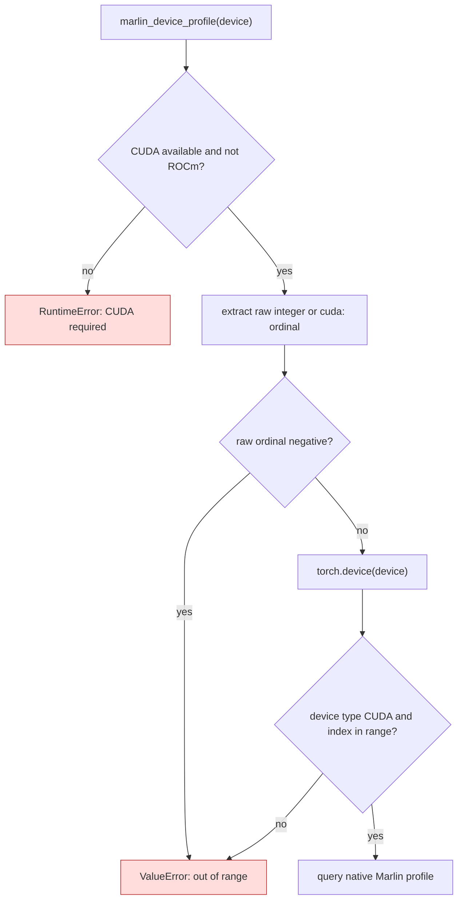

<!-- SPDX-FileCopyrightText: 2026 ModelCloud.ai
SPDX-License-Identifier: Apache-2.0 -->

# Marlin device-profile validation

`marlin_device_profile` accepts an integer, CUDA device string, or
`torch.device`. It keeps the caller's ordinal before constructing a Torch
device because Torch may narrow large ordinals. A negative ordinal must be
rejected here as an out-of-range request, before `torch.device(-1)` raises its
own unrelated `RuntimeError`.

| Mechanism | Before | After |
| --- | --- | --- |
| Negative integer (`gptqmodel/utils/marlin.py:390-392`) | `torch.device(-1)` raised `RuntimeError` before the range check | The raw ordinal is checked first and raises `ValueError: out of range` |
| Negative CUDA string (`gptqmodel/utils/marlin.py:390-392`) | The string was not parsed and Torch raised its own device-string error | `cuda:-1` reaches the same explicit range check |
| Large positive ordinal | The raw value was retained to avoid Torch's index narrowing | The existing range check still uses that raw value |

The focused regression covers both negative forms. The existing profile tests
cover large positive ordinals and invalid device types.
