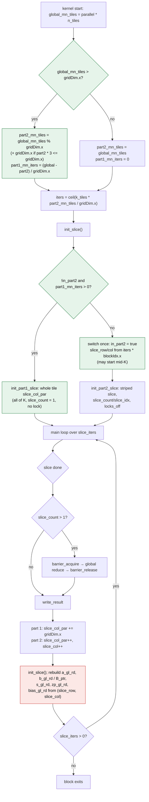

<!-- SPDX-FileCopyrightText: 2026 ModelCloud.ai
SPDX-License-Identifier: Apache-2.0 -->

# Marlin hybrid work schedule

The Marlin GEMM (`gptqmodel_ext/marlin/marlin_template.h`) runs one persistent
threadblock per SM. Each threadblock walks a list of *slices*. A slice is a
run of `thread_k`-row K tiles of one output tile (`slice_col`, in M block
`par_id`). Blocks that share an output tile combine their partial sums through
the lock workspace (`barrier_acquire` / `global_reduce_fp32` or
`global_reduce_fp16` / `barrier_release`).

## Old flow: stripes only

Before this change every block took one contiguous stripe of
`iters = ceil(k_tiles * n_tiles * parallel / gridDim.x)` K tiles over all
output tiles in column order (`slice_row = iters * blockIdx.x % k_tiles`).
With many more output tiles than SMs, many tiles were still split
across two blocks, each of which paid a lock wait and a global reduction.

## New flow: whole tiles first, then stripes

The red node is the risky transition: the first part-2 slice of a block
usually starts in the middle of K. The old re-init assumed `slice_row == 0`
and only advanced the B pointers by one column. Every global read index is
now rebuilt from `(slice_row, slice_col)`.
`tests/kernels/test_marlin_hybrid_schedule.py` drives that transition with
g128 scales, AWQ zero points, bias, and FP32 and FP16 reductions, checking
each launch against an FP64 oracle.

| Situation | Before | After |
| --- | --- | --- |
| `parallel * n_tiles <= gridDim.x` | stripes | stripes (identical split) |
| more output tiles than blocks | stripes, many tiles split over 2 blocks | `part1_mn_iters` rounds of whole tiles, then stripes over `part2_mn_tiles` |
| lock offset rule | `parallel * n_tiles >= gridDim.x` | `part2_mn_tiles >= gridDim.x` |
| slice re-init | B pointers advanced by one column, `slice_row` assumed 0 | all read indices rebuilt from `(slice_row, slice_col)` |

Source: vllm-project/vllm#24722 (scheduling only; its contiguous-K warp layout
and single-copy scale fetch are not ported).

## Prefill only: the 512-row gate

The hybrid schedule is a separate compiled kernel (`hybrid=true` template
argument), generated only for 64-row tiles. The host launches it only when the
whole call has at least `MARLIN_HYBRID_MIN_ROWS` (512) rows
(`gptq_marlin.cu`). Every smaller call, including all decode, runs the
`hybrid=false` kernel, which compiles to the original schedule: no part-1
state, and the original slice re-init that just advances the B pointers.

Why: a clean A/B on a 124-SM A100 (int4 g128, fp16 and bf16, 7 shapes, M from
1 to 8192, two runs per build) measured the ungated hybrid kernel at:

| M | hybrid vs original |
| --- | --- |
| 1 | ~1 us slower per call on every shape (0.94-0.97x) |
| 64 | up to 14% slower (0.86x fp16 5120x8192) |
| 128-256 | neutral in fp16, ~1.05x in bf16 |
| 512 | 1.04-1.11x in bf16 (6 of 7 shapes), ~1% slower in fp16 |
| 1024-8192 | 1.06x median, up to 1.20x |

The small-M cost appeared even where no part-1 round runs, so it comes from
the extra code in the kernel, not from the schedule; a runtime check inside one
kernel would not remove it, which is why the gate is a compile-time choice.

| Call rows | Kernel | Output bits |
| --- | --- | --- |
| < 512 | original (`hybrid=false`) | same as before this PR |
| >= 512, 64-row tiles | hybrid | may differ from the original (K is split differently); deterministic |
