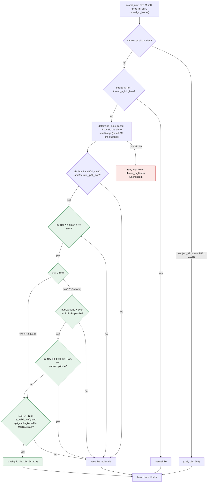

<!-- SPDX-FileCopyrightText: 2026 ModelCloud.ai
SPDX-License-Identifier: Apache-2.0 -->

# Marlin thread-tile selection

`marlin_mm` (`gptqmodel_ext/marlin/gptq_marlin.cu`) picks one thread tile
(`thread_k`, `thread_n`, `num_threads`) per M split before launching the
Marlin GEMM on `sms` threadblocks. The kernel stripes the output tiles' K work
over all threadblocks, so a tile that is split across several blocks is reduced
through the lock workspace (`barrier_acquire` / `global_reduce_fp32`).

When the chosen tile leaves only a few output tiles per SM, most blocks work on
K slices of the same tile and then queue on its lock. The planner therefore
replaces a wide tile with the narrow `{128, 64, 128}` tile on small grids, as
vLLM has since vllm-project/vllm#24722.

## Selection flow

`m_tiles = ceil(prob_m_split / (16 * thread_m_blocks))` and
`n_tiles = prob_n / thread_n` are counted for the tile the table chose. The
full-SM sm_80 tables (`marlin_prefers_full_sm80`) and Ada's narrow FP32 AWQ
schedule (`narrow_splitk_arch`, `narrow_fp32_awq`) were tuned separately and
keep their own tile.

`gptq_marlin_gemm(..., thread_k=..., thread_n=..., num_threads=...)` forwards
an explicit tile through the existing manual branch; the defaults keep the
shape planner. Tests use it to launch both tiles on identical operands.

The tile-count test alone ignored K and the 256-thread tile it replaced
(#5281). On 128-SM Ada parts `N=4096` sits exactly on the `<=` boundary, so
every large-K down projection took the narrow tile although the wide tile
already had enough split-K work per SM. Those parts therefore keep the
override only while the narrow tile still splits K over at least two
threadblocks per output tile, and a 16-row wide tile is kept for long K
unless the narrow tile still splits K at least four ways.
Parts with more than 128 SMs keep the original choice: on the 170-SM RTX 5090
the narrow tile measured faster for every 16-row shape in the table below.

## Before and after

| Situation | Before | After |
| --- | --- | --- |
| Auto tile with `m_tiles * n_tiles * 4 <= sms` | table tile, for example `{64, 256, 256}` for M > 16 | `{128, 64, 128}` |
| 128-SM part, large K, narrow tile would not split K | `{128, 64, 128}` | table tile |
| 128-SM part, 16-row table tile, `K > 4096`, narrow split < 4 | `{128, 64, 128}` | table tile |
| Narrow tile not valid for the shape, or not instantiated | table tile | table tile |
| Full-SM sm_80 board, or sm_89 narrow FP32 AWQ shape | table / forced tile | unchanged |
| Manual `thread_k` / `thread_n` | manual tile | unchanged |

Before this change the auto branch launched the table's tile directly
(`gptq_marlin.cu`, `exec_cfg = determine_exec_config<scalar_t>(...)` followed by
`thread_tfg = exec_cfg.tb_cfg`).

## Measured effect

RTX 5090 (sm_120, 170 SMs), 4-bit g128, CUDA-graph timing, median of 60
replays of 20 calls, per-call microseconds. Each cell is the GPTQ FP16 time
before → after, then the range of the change over GPTQ/AWQ × FP16/BF16:

| shape (K x N) | M=1 | M=7 | M=16 | M=64 | M=128 | M=512 | M=2048 |
|---|---|---|---|---|---|---|---|
| llama_qkv (4096x6144) | 7.3→7.3 (-0..+0%) | 7.3→7.4 (+0..+1%) | 9.8→9.9 (-0..+1%) | 33.1→23.8 (-29..-26%) | 40.4→40.5 (-0..+0%) | 120.4→120.5 (-0..+0%) | 458.8→461.0 (+0..+0%) |
| llama_o (4096x4096) | 7.4→5.9 (-20..-19%) | 7.5→6.0 (-19..-18%) | 9.7→7.8 (-21..-19%) | 31.4→19.1 (-40..-39%) | 34.7→29.2 (-17..-14%) | 82.3→82.2 (-1..-0%) | 302.2→302.3 (-0..+0%) |
| llama_kv (4096x1024) | 13.9→7.7 (-46..-44%) | 13.9→7.8 (-45..-44%) | 17.2→8.9 (-49..-46%) | 72.6→16.9 (-77..-76%) | 42.0→16.4 (-61..-61%) | 34.5→29.0 (-17..-14%) | 82.5→82.6 (-1..+0%) |
| llama_gateup (4096x28672) | 15.7→15.6 (-0..+0%) | 16.3→16.3 (-1..+0%) | 24.3→24.3 (-0..+0%) | 73.1→73.5 (-1..+1%) | 138.3→138.4 (+0..+0%) | 525.2→525.2 (-0..+0%) | 2102.7→2105.4 (+0..+0%) |
| llama_down (14336x4096) | 11.8→11.0 (-8..-7%) | 12.1→11.2 (-8..-7%) | 16.9→15.7 (-8..-7%) | 58.6→44.6 (-24..-23%) | 79.8→81.4 (+0..+3%) | 260.9→261.0 (-0..+0%) | 1033.1→1035.1 (+0..+0%) |
| qwen_q (3584x3584) | 7.6→5.3 (-31..-29%) | 7.7→5.5 (-30..-28%) | 9.8→6.9 (-31..-28%) | 32.6→16.4 (-50..-49%) | 31.0→24.0 (-24..-21%) | 64.7→64.3 (-1..+0%) | 233.8→233.8 (+0..+0%) |
| qwen_kv (3584x512) | 21.9→11.1 (-49..-48%) | 22.0→11.2 (-49..-48%) | 27.1→12.6 (-54..-48%) | 63.4→22.4 (-65..-63%) | 63.6→18.7 (-71..-70%) | 32.5→17.3 (-47..-46%) | 42.5→42.6 (+0..+0%) |
| qwen_down (18944x3584) | 12.9→12.3 (-7..-5%) | 13.3→12.5 (-7..-6%) | 18.6→17.4 (-7..-6%) | 67.0→49.9 (-25..-24%) | 90.1→91.3 (+1..+4%) | 299.5→299.5 (-0..+0%) | 1233.2→1237.5 (+0..+1%) |

Shapes that keep the table tile (large M, or N large enough to fill the grid)
are unchanged. The two down projections at M=128 (14336x4096 and 18944x3584)
measured +0..+4% in this run. They could not be re-run on an idle GPU, so
they are not verified either way. Performance on other architectures has not
been measured.

#5281 retuned the 128-SM boundary. RTX 4090 (sm_89, 128 SMs), GPTQ 4-bit g128
FP16, CUDA-graph timing, minimum of seven interleaved rounds of 100 calls on a
shared host. `wide` is the pre-#5216 tile, `narrow` the #5216 tile:

| shape (K x N) | M | wide us | narrow us | narrow/wide | chosen |
|---|---|---|---|---|---|
| 14336x4096 | 4 | 11.00 | 12.85 | 1.17x | wide |
| 14336x4096 | 16 | 14.54 | 19.11 | 1.31x | wide |
| 14336x4096 | 128 | 61.39 | 76.85 | 1.25x | wide |
| 11008x4096 | 16 | 12.09 | 14.21 | 1.18x | wide |
| 11008x4096 | 128 | 49.94 | 58.34 | 1.17x | wide |
| 8192x4096 | 16 | 10.09 | 10.79 | 1.07x | wide |
| 8192x4096 | 128 | 38.84 | 43.57 | 1.12x | wide |
| 28672x8192 | 64 | 146.24 | 169.83 | 1.16x | wide |
| 4096x4096 | 64 | 29.43 | 14.41 | 0.49x | narrow |
| 4096x1024 | 64 | 86.50 | 13.45 | 0.15x | narrow |
| 3584x512 | 64 | 61.40 | 17.80 | 0.29x | narrow |

BF16 on the same part showed the same pattern (14336x4096 at M=16: 15.22 us
wide vs 19.78 us narrow; 4096x1024 at M=64: 92.00 us vs 14.04 us).
