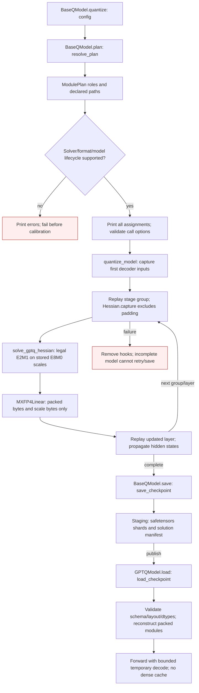

<!-- SPDX-FileCopyrightText: 2026 ModelCloud.ai -->
<!-- SPDX-License-Identifier: Apache-2.0 -->

# Matched solver/format planning and CPU execution

GPT-QModel separates **how weights are optimized** (`solver`) from **what is
stored** (`format`). This first model lifecycle qualifies native dense Qwen2
with GPTQ → MXFP4 on CPU. It is a correctness implementation, not a native
MXFP4 hardware kernel or an unrestricted solver/format compatibility promise.
The existing method-based API and `GPTQModel.export` remain unchanged.

## Public API

```python
import torch
from gptqmodel import GPTQModel, MatchedQuantizeConfig, Matcher, QuantizeConfig
from gptqmodel import formats, solvers

model = GPTQModel.load(
    "Qwen/Qwen2.5-0.5B-Instruct",
    device="cpu", dtype=torch.float32, attn_implementation="eager",
)
config = [
    MatchedQuantizeConfig(
        matcher=Matcher.attention(projections=("q", "k", "v")),
        solver=solvers.GPTQ(damp_percent=0.01),
        format=formats.MXFP4(),
    ),
    MatchedQuantizeConfig(
        matcher=Matcher.glob("model.layers.*.mlp.*"),
        solver=solvers.GPTQ(damp_percent=0.02, desc_act=True),
        format=formats.MXFP4(),
    ),
]

# Optional preview: prints every module/configuration and all rejection reasons.
plan = model.plan(config=config)
assert plan.success  # bool(plan) has the same meaning

# quantize() ALWAYS builds/prints a fresh plan before consuming calibration.
model.quantize(calibration, config=config)
model.save("qwen-mxfp4")
restored = GPTQModel.load("qwen-mxfp4", device="cpu")
```

`calibration` may contain strings (with a tokenizer), integer token sequences,
or mappings containing `input_ids` and optional `attention_mask`. This initial
runner accepts one sequence per row (`batch_size=1`), preserves caller order,
and excludes padding from Hessian statistics. It does not use the legacy
sort/minimum-length/concatenation machinery. Supply at least two tokens per row.

A scalar, unmatched config targets **all declared eligible linears**:

```python
model.quantize(calibration, config=QuantizeConfig(
    solver=solvers.GPTQ(), format=formats.MXFP4(),
))
```

Choose one quantization call on a dense source model; do not run the alternatives
sequentially. Pass solver/format config to `quantize`, not to `load`.
Legacy `QuantizeConfig(bits=4, group_size=128, ...)` still uses the old factory.
Choose source precision with `load(dtype=...)`, not a whole-model `.to(dtype)`
cast: native nonpersistent rotary buffers must remain FP32 for reconstruction
on reload. Planning and saving reject altered buffer precision.

## Planning contract

`MatchedQuantizeConfig` inherits `QuantizeConfig` and adds only `matcher`.
Lists require matched configs. `Matcher.glob`, `Matcher.regex`,
`Matcher.attention`, and `Matcher.moe_experts` select **declared eligible
modules**, not arbitrary descendants. Semantic matching uses `module_plan()`
roles and expert metadata. Attention excludes the output projection unless
`"o"` is requested. An unqualified expert lifecycle is rejected even if its
selector resolves successfully.

| Condition | Outcome |
| --- | --- |
| Disjoint matches | Independent complete solver/format policy per module |
| Unmatched module | Original dense weight remains unchanged |
| Empty match, overlap, bad 32-column geometry | Failed plan; no calibration or weight mutation |
| Unsupported solver, format, model, or device | Failed plan with specific reasons |
| Remote code, fusion, lazy source, already/partly quantized | Rejected before replay |
| Unsupported legacy `quantize` options | Rejected after printing the plan, before calibration |
| Invalid calibration | Error before weight replacement; capture hooks removed |
| Numerical error after replacement begins | Model marked incomplete; retry/save rejected; reload dense source |

Plans contain independent snapshots of resolved configs, not shared mutable
execution state. A plan validates structural/lifecycle compatibility; it cannot
guarantee good calibration, finite future activations, or quantization quality.
Qualification is declared on each concrete definition, not inherited by aliases.
`solvers.AWQ()` and `formats.MXFP8()` can describe a request but **do not have a
qualified model lifecycle yet**. Their CPU mathematical proofs are separate.

## Execution and tensor ownership



| Boundary | Existing path | New explicit `config=` path |
| --- | --- | --- |
| Configuration | `QuantizeConfigMeta.__call__` routes method/format to legacy classes | Typed solver/format with optional inherited matcher |
| Admission | `BaseQModel.quantize` selects a method processor | `BaseQModel.plan` resolves assignments and fails closed |
| Execution | `ModuleLooper` with existing processor contracts | `quantize_model` CPU-only qualified replay adapter |
| Save | Existing `BaseQModel.save`/writer dispatch | `save_checkpoint` publishes representation plus per-module provenance |
| Load | Existing `GPTQModel.load`/loader dispatch | Versioned `solver_format` manifest reconstructs packed CPU modules |

The new runner is intentionally bounded rather than pretending the legacy
method-homogeneous looper can already execute arbitrary mixed solutions.
It reuses the definition's stage groups. Q/K/V and gate/up share captured
inputs; downstream projections are replayed after upstream replacement.
It retains one Hessian per active group, not one for the whole model. GPTQ uses
FP64 Cholesky/error feedback with blocked trailing updates; activation ordering
does not regroup physical MXFP4 blocks. Scales are fixed to the stored E8M0
grid before solving. This is not globally optimal scale/code optimization.

Persistent MXFP4 storage is row-major low-nibble-first E2M1 bytes and one E8M0
scale byte per 32 weights: **4.25 bits per weight**, excluding bias. Forward
decodes at most 128 output rows at a time into operation-local scratch; no
dense/unpacked tensor remains attached to the module after forward. CPU
FP16/BF16/FP32 inputs accumulate in FP32; FP64 inputs accumulate in FP64.
This canonical layout is not a vendor-swizzled GPU layout.

Checkpoints use safetensors only. Every shard carries the version and resolved
module manifest; JSON config carries the same manifest. The loader validates
their agreement, geometry, dtype, and scale codes, installs packed modules
before assigning weights, restores tied embeddings, and rejects missing or
unexpected state. Saving requires a new/empty directory and stages the complete
artifact before publication. An I/O failure does not overwrite an old checkpoint.
The matcher is recipe metadata, not part of the encoded weight format.

## Validation

```bash
python -m pytest tests/test_matched_quantize_config.py tests/test_mxfp4_solver_kernel.py -q
python -m scripts.validate_matched_mxfp4 --output /path/to/new-validation-directory
```

The model script uses Qwen2.5-0.5B-Instruct in FP32 on CPU, all 168 decoder
projections, 16×128 WikiText-2 training tokens for calibration and 8×128 test
tokens for held-out next-token loss. It checks finite logits, generation,
packed state hashes, and exact logits/generation after public save/load.
The tiny real-Qwen2 tests additionally cover repeated save/load, mixed GPTQ
settings, unmatched state preservation, padded SDPA replay, failure cleanup,
and configuration snapshot isolation. Independent scalar decoding and fresh
normal-equation solves establish the codec/kernel/blocked solver oracles.

Observed with Torch 2.15.0, Transformers 5.22.2, Python 3.12, four CPU threads:

| Measurement | Result |
| --- | ---: |
| Decoder projections solved | 168 |
| Quantization time | 227.8 seconds |
| Held-out next-token perplexity, dense FP32 | 30.108 |
| Held-out next-token perplexity, GPTQ → MXFP4 | 37.806 |
| Dense/quantized argmax agreement | 76.07% |
| Packed target weights and scales | 190,095,360 bytes |
| Full safetensors checkpoint (including dense embeddings) | 735,084,816 bytes |
| Peak process RSS | 4,206,080 KiB |
| Reload packed/dense state and logits | Exact |
| Reload greedy generated token IDs | Exact |

Loss covers 1,016 next-token predictions with context reset per 128-token row;
the perplexity increase is real, not claimed accuracy parity. These figures are
not comparable to full-corpus WikiText benchmarks with different context lengths.
The generated smoke sample began “The capital of France is Paris”; its subsequent
population claim was inaccurate, so fluent output is not treated as quality proof.

This bounded evaluation is a lifecycle/quality smoke test, not full WikiText
perplexity, lm-eval qualification, native GPU performance, arbitrary model/MoE
support, activation quantization, or free-threaded PyTorch qualification.
