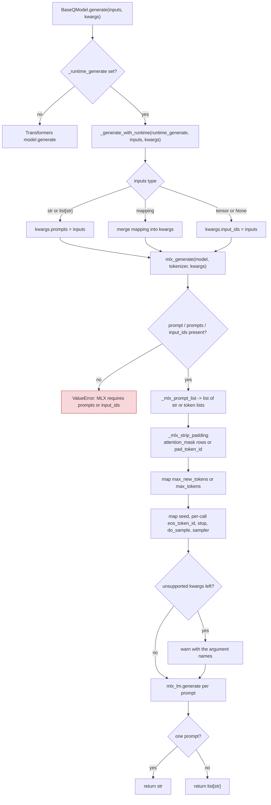
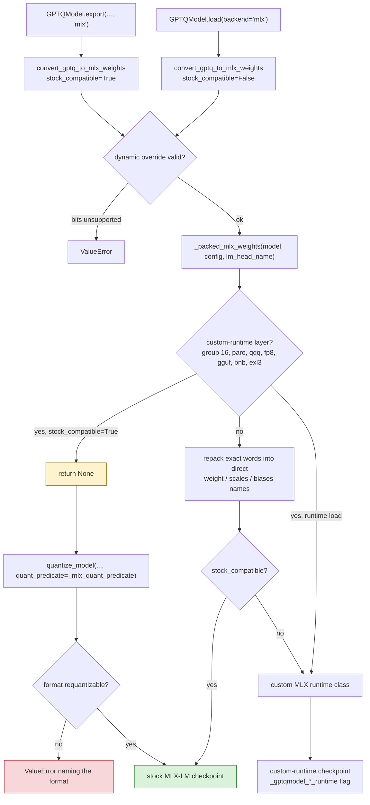

# MLX runtime generation and export flow

This page describes how GPT-QModel drives an MLX model through the standard
`BaseQModel.generate()` API and how `GPTQModel.export(..., format="mlx")`
turns a GPTQ/AWQ checkpoint into an MLX-LM checkpoint. It records the flow
introduced for issue #4076 so the input normalization, the exact packed
transfer, and the `dynamic` fallback stay reviewable without reading the diff.

The MLX runtime is the only part that needs Apple Silicon and Metal. Converting
a checkpoint is pure numpy: `repack_gptq` / `repack_awq` decode the stored
checkpoint words and repack them into MLX's affine layout. Export therefore
runs on any OS; only loading the converted model for inference requires Metal.

## Generation path

`BaseQModel.generate()` keeps one normalization point for every external
runtime (`models/base.py`, `_generate_with_runtime`). It maps a string or a
list of strings to `prompts=`, a tensor to `input_ids=`, and leaves a mapping
untouched. The MLX adapter (`utils/mlx.py`, `mlx_generate`) consumes those
keys, converts token tensors to the token lists `mlx_lm.generate` accepts, and
maps the HF-style options onto `mlx_lm` sampling parameters.



Option mapping:

| Standard `generate()` argument | MLX mapping |
| --- | --- |
| `prompts=` (str or list of str) | each string is passed to `mlx_lm.generate` |
| `input_ids=` (tensor or token list) | tensor is moved to CPU and converted to a token list; a 2-D tensor is treated as a batch |
| `attention_mask=` (tensor or nested list) | pad positions are removed from each token row before generation; a row/length mismatch raises `ValueError` |
| `pad_token_id` | fallback when no mask is given: leading and trailing pad ids are trimmed |
| `prompt=` (legacy adapter argument) | still accepted, unchanged |
| `max_new_tokens` | wins over `max_tokens`; becomes `mlx_lm` `max_tokens` |
| `max_tokens` | legacy fallback, default `256` |
| `eos_token_id` (int or list) | added to a per-call copy of the tokenizer's EOS id set; the shared tokenizer is not mutated |
| `stop` (str or list of str) | generation result is trimmed at the earliest stop string |
| `seed` | `mx.random.seed(seed)` before generation |
| `do_sample=False` / `True` | greedy (`temperature=0.0`) / `temperature=1.0` when no temperature is supplied |
| `temperature`, `top_p`, `min_p`, `min_tokens_to_keep`, `sampler` | passed to `make_sampler` |
| `repetition_penalty` | `make_logits_processors(repetition_penalty=...)` |
| any other keyword | logged as unsupported instead of being dropped silently |

## Export and conversion path

`convert_gptq_to_mlx_weights` first tries `_packed_mlx_weights`, the exact
transfer: every supported packed source layer is decoded with the numpy repack
and rebuilt as an MLX quantized module. Only when that transfer is unavailable
does conversion fall back to `quantize_model`, and that fallback now receives
`_mlx_quant_predicate`, which applies the same `dynamic` rules.



`_mlx_quant_predicate` uses `dynamic_get(dynamic, path)`, so the same
first-match and `-:` exclusion semantics as quantization apply to the
requantization fallback. A `+:` override without a `bits` key keeps the base
bit width.

### Stock-compatible export (#4091 item 10)

Before this fix, the export path called `convert_gptq_to_mlx_weights` with the
same packed transfer as the runtime loader. On Linux, #4083 made that transfer
available, so every GPTQ/AWQ `TorchLinear` was wrapped in `MlxGPTQLinear` /
`MlxAWQLinear` and written with `*.linear.*` key names plus a
`_gptqmodel_custom_mlx_runtime` flag. Stock `mlx_lm.load` builds
`nn.QuantizedLinear` and rejected those names:

```
ValueError: Received 576 parameters not in model:
model.layers.0.mlp.down_proj.linear.biases ...
```

`GPTQModel.export(..., format="mlx")` now passes `stock_compatible=True`. The
exact packed transfer still runs for layers that map onto a stock
`nn.QuantizedLinear` (direct `weight` / `scales` / `biases` names), and layers
that need the custom runtime (group 16, ParoQuant, QQQ, FP8, GGUF,
bitsandbytes, EXL3) go through the stock `quantize_model` fallback. Formats
with no requantization path fail with the existing `ValueError` naming the
format instead of writing an unreadable layout. The in-process
`GPTQModel.load(backend="mlx")` path keeps `stock_compatible=False`, so its
custom kernels are unchanged.

| Situation | Before #4091 | After #4091 |
| --- | --- | --- |
| Linux export of a GPTQ/AWQ checkpoint | `*.linear.*` keys + custom-runtime flag; stock `mlx_lm.load` rejects | direct keys; stock `nn.QuantizedLinear`; `mlx_lm.load` succeeds |
| Export of a group-16 / ParoQuant / QQQ / FP8 / GGUF / bitsandbytes / EXL3 checkpoint | custom-runtime layout | requantization when supported, otherwise `ValueError` naming the format |
| Runtime `GPTQModel.load(backend="mlx")` | exact packed transfer + custom runtime | unchanged |

### Before/after mechanism

| Mechanism | Before #4076 | After #4076 |
| --- | --- | --- |
| Runtime prompt key | `utils/mlx.py` `mlx_generate` popped only `prompt`; `BaseQModel._generate_with_runtime` sends `prompts`/`input_ids` | adapter accepts `prompt`, `prompts`, `input_ids`; tensor inputs become token lists |
| Token budget | `max_tokens = kwargs.pop("max_tokens", 256)` ignored `max_new_tokens` | `max_new_tokens` maps to `max_tokens`; legacy `max_tokens` still works |
| Sampling options | `eos_token_id`, `stop`, `seed`, `do_sample` were dropped | mapped to EOS ids, stop trimming, `mx.random.seed`, greedy/temperature sampler |
| Exact transfer platform gate | `_MlxLinearContract.source_compatible` called `validate`, which ran `validate_once` (Darwin + arm64 + Metal) | `_validate_source` skips the runtime platform gate; `pack_source` is pure numpy |
| `dynamic` in requantization | `quantize_model(...)` had no `quant_predicate`, so exclusions were quantized and overrides lost | `_mlx_quant_predicate` returns `False` for `-:` and `{bits, group_size}` for `+:` |
| Override without `bits` | `utils/mlx.py` read `config["bits"]` and raised `KeyError` | `config.get("bits", gptq_config["bits"])`; the stray debug print is gone |

### Failure and ambiguity contract

| Situation | Behavior |
| --- | --- |
| No prompt, `prompts`, or `input_ids` | `ValueError("MLX requires prompts or input_ids to be provided")` |
| Empty prompt list | `ValueError("MLX requires a non-empty prompt")` |
| Unsupported `dynamic` bit width | `ValueError` before any model work |
| Packed source layer layout mismatch | `_packed_mlx_weights` returns `None`; conversion falls back to requantization with the predicate |
| Packed layer names do not match the MLX model | warning, then float conversion fallback (`_packed_mlx_weights` returns `None`) |
| Unsupported format with no transferable packed state | `ValueError` naming the format |
| MLX runtime on non-Apple hardware | kernel selection still rejects it through `validate_once`; only export/convert is platform-free |
| `attention_mask` row or length mismatch | `ValueError` before generation |
| `attention_mask` with string prompts | warning; the mask is ignored because there are no token positions |
| `eos_token_id` on one call | applied to a per-call tokenizer copy; the shared tokenizer keeps its EOS set |
| Export layer needs the custom runtime | stock requantization when the format supports it, otherwise `ValueError` naming the format |

## Measured export result

Qwen2.5-0.5B-Instruct RTN 4-bit group 128 with
`dynamic={"-:.*mlp\\.down_proj": {}, "+:.*self_attn\\.o_proj": {"bits": 8, "group_size": 32}}`,
exported on Linux with `mlx-cpu 0.32.4` + `mlx-lm 0.32.2`:

| Layer | Before | After |
| --- | --- | --- |
| exported `quantization` | `{group_size: 128, bits: 4, mode: affine}` (no per-layer entries) | adds `model.layers.0.self_attn.o_proj: {bits: 8, group_size: 32, mode: affine}` |
| `layers.0.self_attn.o_proj` rel err vs fp16 | 0.1104 | 0.0051 |
| `layers.0.mlp.down_proj` | quantized 4-bit g128, rel err 0.1089 | fp16, rel err 0.0000 |

The after column is an exact packed transfer: the exported affine words are the
source layer's own codes, with the source scales cast to float16 as MLX
requires.

## Not in scope

The custom MLX runtime classes (`MlxGPTQLinear`, `MlxGroup16Linear`,
`MlxParoLinear`, `MlxQQQLinear`, `MlxFP8Linear`, `MlxGGUFLinear`) are still
used by the in-process `GPTQModel.load(backend="mlx")` path. Export no longer
writes a checkpoint that depends on them: `GPTQModel.export(...,
format="mlx")` emits the stock `mlx_lm` layout described above. Checkpoints
written by earlier versions with `*.linear.*` keys and the
`_gptqmodel_custom_mlx_runtime` flag still require the GPT-QModel MLX loader.
