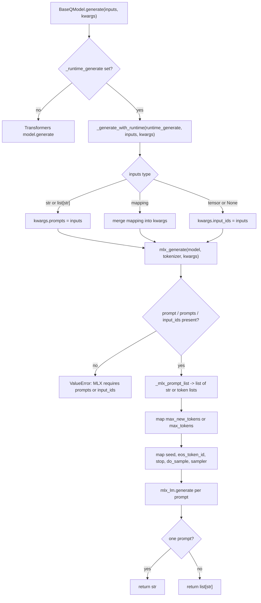
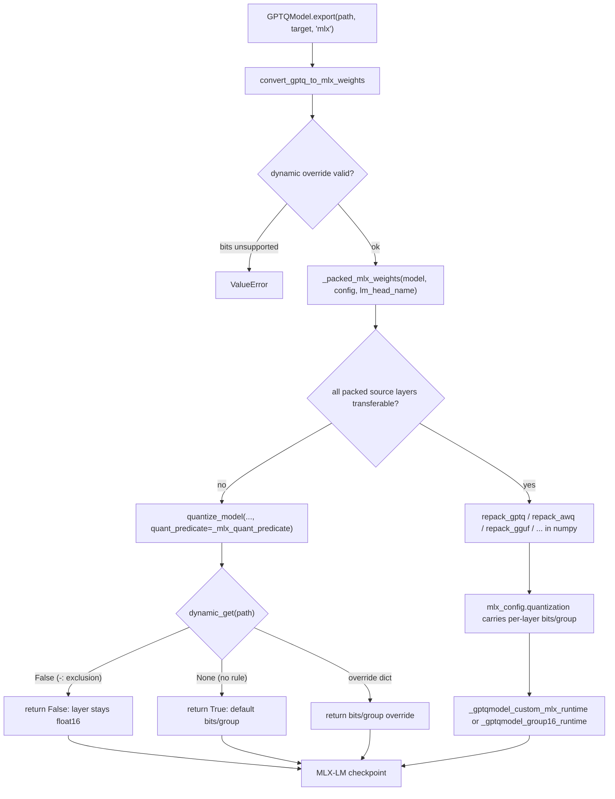

# MLX runtime generation and export flow

This page describes how GPT-QModel drives an MLX model through the standard
`BaseQModel.generate()` API and how `GPTQModel.export(..., format="mlx")`
turns a GPTQ/AWQ checkpoint into an MLX-LM checkpoint. It records the flow
introduced for issue #4076 so the input normalization, the exact packed
transfer, and the `dynamic` fallback stay reviewable without reading the diff.

The MLX runtime is the only part that needs Apple Silicon and Metal. Converting
a checkpoint is pure numpy: `repack_gptq` / `repack_awq` decode the stored
checkpoint words and repack them into MLX's affine layout. Export therefore
runs on any OS; only loading the converted model for inference requires Metal.

## Generation path

`BaseQModel.generate()` keeps one normalization point for every external
runtime (`models/base.py`, `_generate_with_runtime`). It maps a string or a
list of strings to `prompts=`, a tensor to `input_ids=`, and leaves a mapping
untouched. The MLX adapter (`utils/mlx.py`, `mlx_generate`) consumes those
keys, converts token tensors to the token lists `mlx_lm.generate` accepts, and
maps the HF-style options onto `mlx_lm` sampling parameters.

Option mapping:

| Standard `generate()` argument | MLX mapping |
| --- | --- |
| `prompts=` (str or list of str) | each string is passed to `mlx_lm.generate` |
| `input_ids=` (tensor or token list) | tensor is moved to CPU and converted to a token list; a 2-D tensor is treated as a batch |
| `prompt=` (legacy adapter argument) | still accepted, unchanged |
| `max_new_tokens` | wins over `max_tokens`; becomes `mlx_lm` `max_tokens` |
| `max_tokens` | legacy fallback, default `256` |
| `eos_token_id` (int or list) | added to the tokenizer's EOS id set (`TokenizerWrapper`) |
| `stop` (str or list of str) | generation result is trimmed at the earliest stop string |
| `seed` | `mx.random.seed(seed)` before generation |
| `do_sample=False` / `True` | greedy (`temperature=0.0`) / `temperature=1.0` when no temperature is supplied |
| `temperature`, `top_p`, `min_p`, `min_tokens_to_keep`, `sampler` | passed to `make_sampler` |
| `repetition_penalty` | `make_logits_processors(repetition_penalty=...)` |

## Export and conversion path

`convert_gptq_to_mlx_weights` first tries `_packed_mlx_weights`, the exact
transfer: every supported packed source layer is decoded with the numpy repack
and rebuilt as an MLX quantized module. Only when that transfer is unavailable
does conversion fall back to `quantize_model`, and that fallback now receives
`_mlx_quant_predicate`, which applies the same `dynamic` rules.

`_mlx_quant_predicate` uses `dynamic_get(dynamic, path)`, so the same
first-match and `-:` exclusion semantics as quantization apply to the
requantization fallback. A `+:` override without a `bits` key keeps the base
bit width.

### Before/after mechanism

| Mechanism | Before #4076 | After #4076 |
| --- | --- | --- |
| Runtime prompt key | `utils/mlx.py` `mlx_generate` popped only `prompt`; `BaseQModel._generate_with_runtime` sends `prompts`/`input_ids` | adapter accepts `prompt`, `prompts`, `input_ids`; tensor inputs become token lists |
| Token budget | `max_tokens = kwargs.pop("max_tokens", 256)` ignored `max_new_tokens` | `max_new_tokens` maps to `max_tokens`; legacy `max_tokens` still works |
| Sampling options | `eos_token_id`, `stop`, `seed`, `do_sample` were dropped | mapped to EOS ids, stop trimming, `mx.random.seed`, greedy/temperature sampler |
| Exact transfer platform gate | `_MlxLinearContract.source_compatible` called `validate`, which ran `validate_once` (Darwin + arm64 + Metal) | `_validate_source` skips the runtime platform gate; `pack_source` is pure numpy |
| `dynamic` in requantization | `quantize_model(...)` had no `quant_predicate`, so exclusions were quantized and overrides lost | `_mlx_quant_predicate` returns `False` for `-:` and `{bits, group_size}` for `+:` |
| Override without `bits` | `utils/mlx.py` read `config["bits"]` and raised `KeyError` | `config.get("bits", gptq_config["bits"])`; the stray debug print is gone |

### Failure and ambiguity contract

| Situation | Behavior |
| --- | --- |
| No prompt, `prompts`, or `input_ids` | `ValueError("MLX requires prompts or input_ids to be provided")` |
| Empty prompt list | `ValueError("MLX requires a non-empty prompt")` |
| Unsupported `dynamic` bit width | `ValueError` before any model work |
| Packed source layer layout mismatch | `_packed_mlx_weights` returns `None`; conversion falls back to requantization with the predicate |
| Packed layer names do not match the MLX model | warning, then float conversion fallback (`_packed_mlx_weights` returns `None`) |
| Unsupported format with no transferable packed state | `ValueError` naming the format |
| MLX runtime on non-Apple hardware | kernel selection still rejects it through `validate_once`; only export/convert is platform-free |

## Measured export result

Qwen2.5-0.5B-Instruct RTN 4-bit group 128 with
`dynamic={"-:.*mlp\\.down_proj": {}, "+:.*self_attn\\.o_proj": {"bits": 8, "group_size": 32}}`,
exported on Linux with `mlx-cpu 0.32.4` + `mlx-lm 0.32.2`:

| Layer | Before | After |
| --- | --- | --- |
| exported `quantization` | `{group_size: 128, bits: 4, mode: affine}` (no per-layer entries) | adds `model.layers.0.self_attn.o_proj: {bits: 8, group_size: 32, mode: affine}` |
| `layers.0.self_attn.o_proj` rel err vs fp16 | 0.1104 | 0.0051 |
| `layers.0.mlp.down_proj` | quantized 4-bit g128, rel err 0.1089 | fp16, rel err 0.0000 |

The after column is an exact packed transfer: the exported affine words are the
source layer's own codes, with the source scales cast to float16 as MLX
requires.

## MACaQ and NF12 Metal kernels

Two additional formats transfer their packed checkpoint state unchanged and run
on dedicated Metal kernels.

MACaQ's MXFP4 storage is already OCP MXFP4: one E2M1 nibble per value with the
low nibble holding the even column, plus one E8M0 scale byte per 32 values. That
is byte-identical to MLX's `mxfp4` quantization mode, so the transfer is a
`uint8 -> uint32` reinterpretation with no repack and no requantization. The
module keeps MACaQ's 32-wide block Hadamard matrix and diagonal pre-scale and
applies them to the activations, then calls MLX's MXFP4 matmul. `w4a16` uses
`quantized_matmul`; `w4a4` uses the fused `qqmm` through 16 rows and an explicit
quantize/dequantize pair above it, because MLX's fused activation quantization
stops winning on wide token blocks (measured on this host: equal at 16 rows,
5x slower at 512). MLX chooses its own E8M0 exponent and tie handling for that
activation rounding, so W4A4 output tracks the Torch MACaQ kernel within the
4-bit activation grid rather than bit-for-bit; W4A16 is unaffected.

NF12 stays in its 12-byte tiled group stream. `MlxNF12Linear` decodes it on
Metal: a single-row forward fuses the decode into the dot product, and a wider
forward decodes once into BF16 and multiplies. Both paths are exact for the
checkpoint's BF16 weights, so a decoded layer is bit-identical to the Torch
codec's `decode()`; only the accumulation order differs from the Torch
`linear()` oracle.

### Measured Metal result

One 4096x4096 BF16 layer on an M5 Ultra (36-core CPU, 256 GiB unified memory),
median of 20 timed repetitions after three warmups, against the portable Torch
MPS path for the same packed checkpoint:

| Format | Rows | Torch MPS | MLX Metal | Speedup |
| --- | ---: | ---: | ---: | ---: |
| MACaQ W4A16 | 1 | 4.46 ms | 0.26 ms | 17x |
| MACaQ W4A16 | 512 | 3.67 ms | 0.46 ms | 8x |
| MACaQ W4A4 | 1 | 4.46 ms | 0.24 ms | 19x |
| MACaQ W4A4 | 512 | 5.45 ms | 0.47 ms | 12x |
| NF12 | 1 | 5.10 ms | 0.26 ms | 20x |
| NF12 | 512 | 5.17 ms | 0.50 ms | 10x |

The NF12 prefill number is dominated by the decode pass: at this layer size a
32 MB elementwise pass already takes 0.27 ms on this GPU, so the fused
single-row kernel and the decode both sit at the small-workload floor rather
than at the 650 GB/s the device reaches on 512 MB working sets.

## Not in scope

The custom-runtime checkpoint emitted when the packed transfer succeeds keeps
`*.linear.*`-prefixed tensors and the `_gptqmodel_custom_mlx_runtime` flag.
Loading that checkpoint with stock `mlx_lm.load` (as opposed to the GPT-QModel
MLX loader) is not changed by this page.
