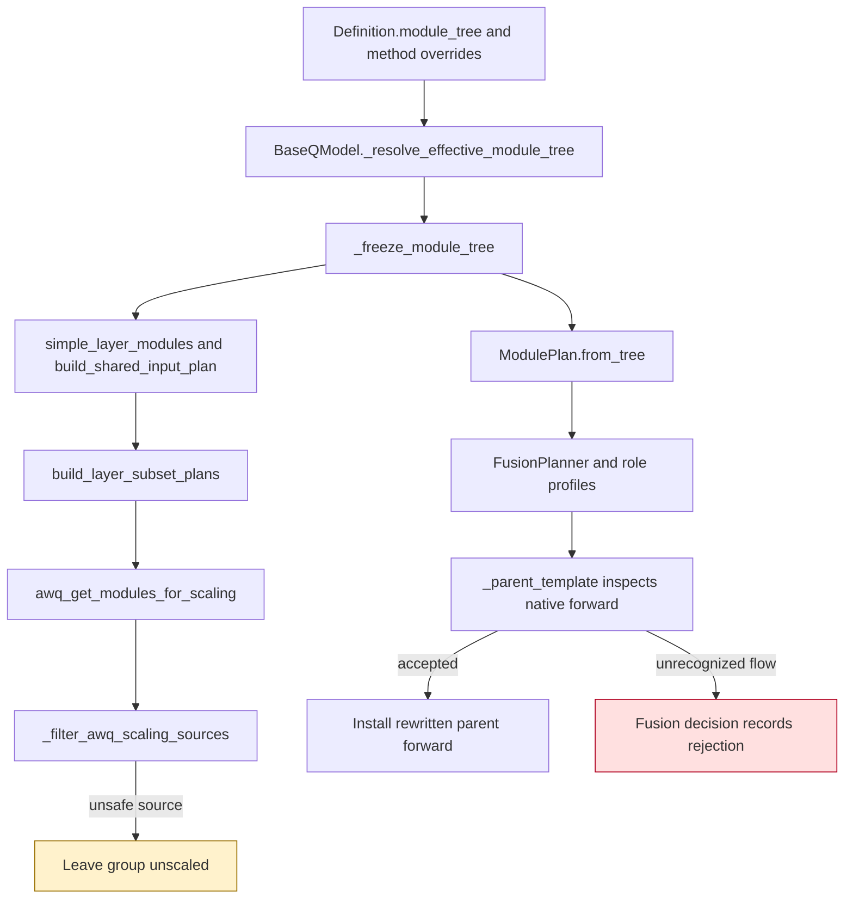
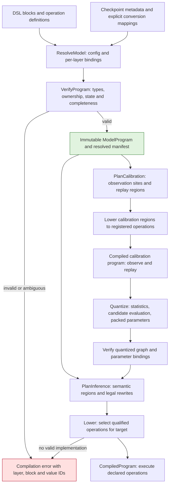
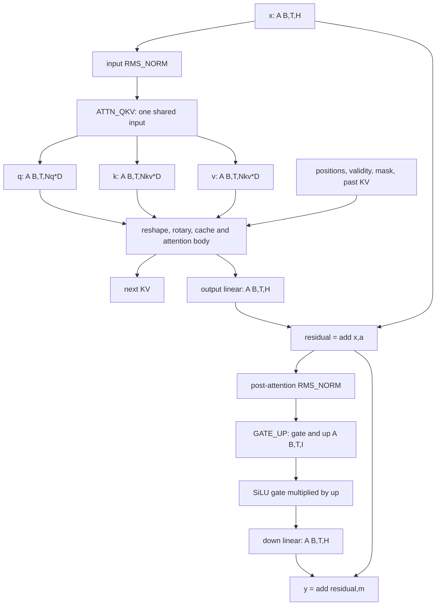
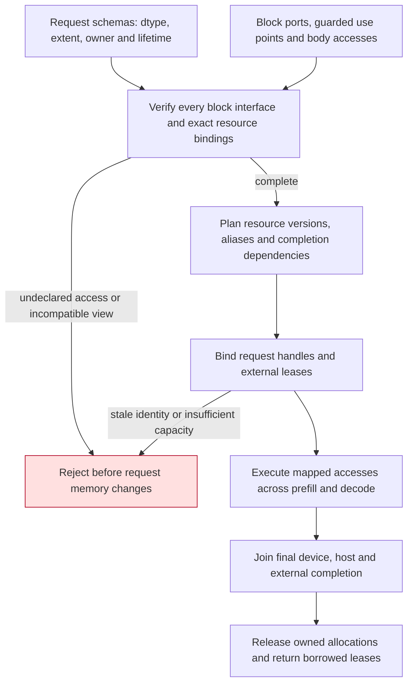
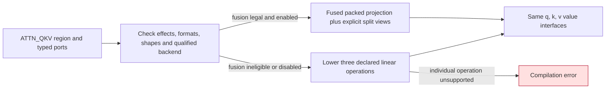

<!-- SPDX-FileCopyrightText: 2026 ModelCloud.ai -->
<!-- SPDX-License-Identifier: Apache-2.0 -->

# Model computation DSL

**Status: design proposal with an initial executable subset.** This document
specifies a replacement for the tree/tag model definition, with one executable
computation graph consumed by both quantization and inference. The standalone
[Python compiler](model-dsl-compiler.md) now emits eager and optimized PyTorch
2.15 code for Llama 3.2 1B. The textual snippets and broader APIs below remain
design notation; full quantizer integration and the other architectures are
not implemented.

The central decision is to declare **the model's computation**, including its
structure, parameters, tensor edges, state, and numerical semantics. Compile
that declaration into calibration and inference programs. A module inventory,
an optimization hint, or an HF-forward wrapper cannot be the execution authority.
The first executor can interpret compiled operations through Torch; a later JIT
can lower the same operations to native kernels without changing model semantics.

## Design requirements

| Requirement | Contract |
| --- | --- |
| Model code and model structure are explicit | Block bodies contain operations and connected values; parameter ownership is a separate explicit mapping. |
| Every layer can differ | A resolved manifest contains a concrete block instance, bindings, and constants for every layer and subsection. |
| Quantization subsets describe actual computation | Subsets refer to operation/value IDs and executable replay regions with complete interfaces. |
| Correlated computations are named | `ATTN_QKV` and `GATE_UP` are semantic regions with defined bodies, shared inputs, and named result ports. |
| Inputs and outputs are typed | Every block port and intermediate value has a dtype, shape, axis meaning, and layout; state and effects are also explicit. |
| Every block declares external resources | A typed resource interface names request-global memory/state, access rights and when it is needed. Blocks with no dependencies declare an empty interface. |
| Request memory outlives subsets | Dtype, shape, ownership, lifetime and exact block/port mappings describe who needs what and when. Computation bodies define how. |
| Both consumers agree | Quantization and inference derive plans from the same immutable semantic graph and parameter identities. |
| Execution can become independent of HF modeling | The compiled program invokes registered operations, never HF `forward`, Python source rewriting, or undeclared callbacks. |

## Current behavior and the information gap

The following is the **current implementation**, not the proposed compiler.
References identify the source locations when this proposal was written.



| Existing mechanism and evidence | Proposed replacement |
| --- | --- |
| Leaf paths, integer groups, `:in=x`, norm and role tags: `gptqmodel/models/definitions/llama.py:35-45` | Typed operations, shared SSA value identities, explicit norm bodies and correlated regions. |
| One union of alternative token mixers and MLP layouts with non-strict missing-path handling: `gptqmodel/models/definitions/qwen3_next.py:24-69` | Exact per-layer block selection; missing bindings or unresolved alternatives are compilation errors. |
| Per-instance frozen tree and inventory: `gptqmodel/models/base.py:763-784`, `gptqmodel/models/module_plan.py:196-207` | Immutable, resolved `ModelProgram` and a manifest of concrete layer instances. |
| Tree-based activation sharing: `gptqmodel/models/shared_input.py:343`, forward probes at `:484` | Producer/value identity and numerical/layout compatibility, qualified against native reference executions during onboarding. |
| Prefix-specific subset selection, with merged declarations on ambiguity: `gptqmodel/looper/module_looper.py:2133-2202`, `gptqmodel/looper/stage_subset.py:681-715` | A layer instance ID selects its own typed graph and dependency schedule. |
| AWQ candidate source tracked through tree order and filtered for unsafe producers: `gptqmodel/models/base.py:5051-5081`, `:5639-5700` | Producer/consumer graph, explicit replay boundary, operation-specific fold legality, complete consumer coverage. |
| Fusion roles resolved through a plan, then native-forward AST qualification: `gptqmodel/models/fusion.py:58-187`, `:685-760` | Rewrite a declared semantic region into a qualified physical operation with the same public ports. |

The tree remains useful as an inventory, but it does not represent residual
edges, head reshapes, nonlinearity, mask semantics, or state updates. Adding more
tags cannot make it a complete executable model. A weight inventory can be
derived from the graph and bindings; a complete graph cannot be recovered from
the inventory.

## One semantic program, several compiled plans

The following is the **proposed complete flow**. The implemented first subset
has its own [code-derived flow and limits](model-dsl-compiler.md); this diagram
does not imply that all passes below have shipped.



Quantization is a compiler client and a controlled graph transformation. It
does not create a second model definition. Calibration and inference plans may
differ in scheduling, observation, packing, and fusion, while preserving the
same architectural semantics and stable source IDs. Quantization explicitly
changes parameter values and permitted numerical error; it is not claimed to
be an exact rewrite of the floating-point model. Fusion must preserve the
already selected floating-point or quantized program's numerical contract.

| Object | Required contents |
| --- | --- |
| `ModelProgram` | Versioned operation set, symbolic dimensions and constraints, entry points, block definitions, parameter/resource schemas, concrete layer manifest and resource binding map. |
| `LayerInstance` | Stable ID, exact block revision, subsection instances, resolved constants, parameter bindings and state bindings. No implicit layer-zero template. |
| `Block` | Typed input/output ports, explicit parameter/resource arguments, operation body, nested blocks, effects and numerical contract. No hidden tensor capture. |
| `Operation` | Opcode and semantic version, typed operands/results, attributes, shape/precision rules, effects, portable reference implementation and permitted lowerings. |
| `Value` | Stable producer/result ID, complete type, and all uses. SSA: each value is defined once; a value is distinct from its storage allocation. |
| `Parameter` | Semantic ID, logical shape, storage format, checkpoint keys/conversions, alias group, ownership, and quantization policy eligibility. |
| `Resource` | Stable logical ID, scope, typed contents, capacity/valid extent, ownership, initialization, placement, aliases and lifetime; includes external buffers and request state. |
| `ResourceUse` | Exact block instance/port, resource/view/version binding, access rights, entry-point/branch guard, use points and completion dependency. |
| `ReplayRegion` | Exact executable operation slice, complete live-in/live-out ports, parameter versions, state snapshot policy and scoring outputs. |
| `ExecutionPlan` | Scheduled operations, physical tensor/storage descriptors, kernel bindings, buffer lifetimes, state dependencies, guards and source map. |

The authoring surface should have convenient constructors such as `ATTN_QKV`,
but the canonical representation is a serializable, versioned typed IR. A
Python builder may construct it from configuration using ordinary host control
flow. It must emit every body and binding explicitly: no symbolic execution of
arbitrary Python, tensor tracing, imported `nn.Module.forward`, or executable
Python callback in the artifact. Text syntax can evolve independently of the IR.

## Tensor, parameter and state contracts

A tensor type includes the following independent properties:

| Property | Example / rule |
| --- | --- |
| Logical element dtype | `bf16`, `fp16`, `fp32`, `i64`, `bool`; finite dtype variables resolve before lowering. |
| Shape and axes | `Tensor<bf16, [batch:B, token:T, hidden:H]>`; dimensions are constants or constrained symbols, not unspecified `...`. |
| Layout | Logical axis order, required contiguity/strides or permitted layout set. A view, transpose or materialization is an explicit operation. |
| Numerical behavior | Compute/accumulation dtype, rounding/cast boundaries, reduction behavior and allowed error contract. Never assume the output dtype specifies accumulation. |
| Placement | Logical device variable and constraints; physical device/ordinal resolved in the execution plan. Transfers are explicit in that plan. |
| Storage / aliasing | Owned value, immutable borrow, or versioned resource; views record the source allocation, offsets and valid lifetime. |

For a linear weight, logical `Wq: [Nq*D,H]` and physical INT4 packed storage
are different descriptors of the **same parameter**. Its physical descriptor
includes packing axis/order, signedness, group axis/size, scales, zero points,
padding, format version and any permutation. Activations can remain BF16 while
the weight is packed INT4 and accumulation uses another declared dtype. Graph
typing must not pretend that a packed array's physical shape is `[Nq*D,H]`.

Shapes carry constraints such as `Nq % Nkv == 0`, `D % 2 == 0`, and
`Qwidth = Nq*D`; neither `Qwidth == H` nor `Kwidth == Qwidth` is implicit.
`B`, `T` and past sequence length can remain dynamic with checked bounds and
entry guards. Ragged token streams require explicit lengths/row-splits and
mask contracts, rather than treating a padded dense type as ragged.

Parameters and persistent buffers bind through a declared checkpoint mapping.
Tied embedding/head weights reference the same parameter ID. Slices, transposes,
packed QKV conversion and aliases must be explicit and validated. Audit actual
checkpoint keys and conversion mappings; tensors created after load do not
automatically become checkpoint obligations. Every checkpoint-owned tensor has
one declared owner or an explicit alias/conversion disposition; unexpected or
missing keys fail binding. Compiler-created scratch and cache are separate.

The semantic baseline passes state in and returns its successor explicitly.
KV caches, recurrent state, RNG and communication cannot hide in module fields.
A physical implementation may update unique storage in place only after
ownership/liveness checks. Stateful operations carry ordered version/effect
tokens; stochastic operations also take an explicit RNG state. Replaying a
calibration candidate uses a forked snapshot and discards its successor, never
the live inference cache. Read-only old versions remain valid until their last
declared use; an unsafe overwrite is a verification error.

## Blocks express structure and actual computation

The notation below uses named SSA values. `Tensor<A,[B,T,H]>` abbreviates the
full tensor contract above; axes and permitted layouts are defined by each
signature. A semicolon separates ordinary values from explicit parameter
arguments. Parameters are not undeclared block captures. `linear(x,W)` means
`x @ transpose(W)` with the operation's declared precision contract; bias is
present only when supplied explicitly. Examples use bias-free projections.
Each block specialization binds every referenced dimension and attribute;
nested calls explicitly bind these in canonical IR. The display notation omits
repeated attribute bindings for readability. No unresolved name or implicit
precision default is permitted in a compiled program.

### QKV is one correlated region with three logical outputs

```text
block ATTN_QKV(
    x: Tensor<A,[B,T,H]>;
    Wq: Weight<[Nq*D,H]>, Wk: Weight<[Nkv*D,H]>, Wv: Weight<[Nkv*D,H]>
) -> (
    q: Tensor<A,[B,T,Nq*D]>,
    k: Tensor<A,[B,T,Nkv*D]>,
    v: Tensor<A,[B,T,Nkv*D]>
) resources {} pure {
    q = linear(x, Wq, precision=projection_precision)
    k = linear(x, Wk, precision=projection_precision)
    v = linear(x, Wv, precision=projection_precision)
    return (q, k, v)
}
```

`projection_precision` is a required compile-time block attribute, part of its
specialization identity. All three operations read the **same SSA value** `x`.
The region declares correlation and fusion intent; it does not require temporal
simultaneity or one hardware kernel. Its body remains executable unfused.

| Interface | Input | Output |
| --- | --- | --- |
| Logical `ATTN_QKV` | `A[B,T,H]` | Record `{q: A[B,T,Nq*D], k: A[B,T,Nkv*D], v: A[B,T,Nkv*D]}`. |
| Optional physical fused projection | Same logical input | Packed result `A[B,T,(Nq+2*Nkv)*D]`, split at explicit offsets `0`, `Nq*D`, `(Nq+Nkv)*D`, `(Nq+2*Nkv)*D`. |
| Full attention subsection | Hidden state, positions, mask, previous KV state, parameters | One hidden contribution `A[B,T,H]` **and** successor KV state. |

For `H=4096`, `Nq=32`, `Nkv=8`, `D=128`, Q/K/V widths are
`4096/1024/1024` and the optional packed width is `6144`. These are illustrative
dimensions, not measured results. The physical split can be zero-copy views if
the next operations accept the resulting strides; otherwise materialization is
explicit. Concatenation is a storage representation, not the attention result.

### The attention subsection includes everything between its ports

Here `S=P+T`. The reference state is a dense, uniformly sized history
`KV<A,B,Nkv,P,D>` containing K, V, absolute positions `[B,P]`, and validity
`[B,P]`. Padding validity is carried explicitly; paged/ragged storage is a
separate physical representation or separately typed semantic interface.
`allow[B,T,S]` includes causal, history-validity and current-token padding rules.

```text
block ATTENTION(
    x: A[B,T,H], pos: i64[B,T], valid: bool[B,T],
    allow: bool[B,T,S], past: KV<A,B,Nkv,P,D>;
    w: AttentionWeights, inv_freq: fp32[D/2]
) -> (out: A[B,T,H], next: KV<A,B,Nkv,S,D>) resources {} pure {
    q0, k0, v0 = ATTN_QKV(x; w.q, w.k, w.v)
    q1 = transpose(reshape(q0, [B,T,Nq,D]), [0,2,1,3])
    k1 = transpose(reshape(k0, [B,T,Nkv,D]), [0,2,1,3])
    v1 = transpose(reshape(v0, [B,T,Nkv,D]), [0,2,1,3])
    q2 = rotary(q1, pos, inv_freq, layout=split_half, precision=rope_precision)
    k2 = rotary(k1, pos, inv_freq, layout=split_half, precision=rope_precision)
    next = kv_concat(past, k2, v1, pos, valid)
    kc, vc = next.keys, next.values
    kr = repeat_kv(kc, query_to_kv_head=gqa_contiguous(Nq,Nkv))
    vr = repeat_kv(vc, query_to_kv_head=gqa_contiguous(Nq,Nkv))
    scores = matmul(cast(q2, fp32), transpose_last2(cast(kr, fp32))) * (1/sqrt(D))
    prob32 = masked_softmax(scores, allow, axis=key, fully_masked_row=zeros)
    prob = cast(prob32, A)
    heads = matmul(prob, vr, precision=context_precision)
    merged = reshape(materialize(transpose(heads, [0,2,1,3])), [B,T,Nq*D])
    out = linear(merged, w.o, precision=projection_precision)
    return (out, next)
}
```

This is an illustrative standard GQA variant with explicit rounding decisions,
not a claim to reproduce every architecture named Llama or every HF attention
backend. `AttentionWeights` expands to the three typed QKV weights above and
`o: Weight<[H,Nq*D]>`. The precision attributes are required specialization
constants, including intermediate casts/reduction rules. Alternative cast
boundaries, attention biases, dropout, Q/K norms, sliding windows, partial RoPE,
logit caps and gain conventions require different declared bodies/attributes
with their own reference qualification.

The operation registry must define behavior, not delegate those names to HF:

| Operation | Required reference semantics for this example |
| --- | --- |
| `rotary` | Compute FP32 angle `pos * inv_freq`, duplicate cos/sin across halves, rotate `[-x_second, x_first]`, apply the declared casts/multiply/add order. |
| `kv_concat` | Concatenate K/V on the token axis and positions/validity on their token axis; return a new logical state. Physical append must preserve this behavior. |
| `gqa_contiguous` / `repeat_kv` | Query head `h` uses KV head `floor(h / (Nq/Nkv))`; no head-order guessing. |
| `masked_softmax` | Stable FP32 key-axis softmax over allowed keys only; fully masked rows return zeros in this variant. Reject a kernel with different behavior. |
| `allow` construction | Explicit Boolean operations on query/key absolute positions and validity, plus any declared window. `True` means attend; never infer mask polarity or fabricate an all-valid mask. |

For the illustrated causal variant the context body includes:

```text
key_pos = concat(past.positions, pos, axis=token)         # i64[B,S]
key_valid = concat(past.valid, valid, axis=token)         # bool[B,S]
causal = key_pos[:,None,:] <= pos[:,:,None]               # bool[B,T,S]
allow = valid[:,:,None] & key_valid[:,None,:] & causal    # bool[B,T,S]
```

Broadcast/slice notation expands to typed operations. Position ordering and
cache validity are checked entry contracts. A local/windowed/cross-attention
mask requires a different body; context is not reconstructed from sequence
length alone during replay.

Named operations may be primitives implemented in native code. They still need
versioned mathematical semantics, full interfaces, a portable reference, and
declared lowering contracts. An opaque `call_hf_attention(...)` is not a model
definition. A custom operation without a registered implementation makes that
program unsupported; it does not permit fallback to an unrelated HF forward.

### Norm, MLP and residual dependencies remain visible

`RMS_NORM(x; gain, eps, ...)` declares its reduction axis, FP32 mean-square
and reciprocal-square-root computation, gain convention (`weight` or
`one_plus_weight`), and exact output cast placement. LayerNorm additionally
declares mean subtraction and optional bias. These are semantic operations,
not a generic `norm` tag whose behavior is read from a module class.

For example, the `weight`-gain RMSNorm variant used below expands to
`x32 = cast(x, fp32)`, `variance = mean(x32*x32, hidden, accum=fp32)`,
`r = rsqrt(variance + eps_fp32)`, `n = cast(x32*r, A)`, and
`y = multiply(n, gain, precision=elementwise_A)`, with `gain: A[H]`.
This explicitly rounds the normalized value before multiplying the gain.
A variant that multiplies in FP32 and casts only afterward is a different
specialization/body with independent qualification. `one_plus_weight` likewise
declares where and in which dtype the addition of one occurs.

```text
block GATE_UP(x: A[B,T,H]; Wg: Weight<[I,H]>, Wu: Weight<[I,H]>)
    -> (gate: A[B,T,I], up: A[B,T,I]) resources {} pure {
    gate = linear(x, Wg, precision=projection_precision)
    up = linear(x, Wu, precision=projection_precision)
    return (gate, up)
}

block MLP(x: A[B,T,H]; w: MLPWeights) -> (out: A[B,T,H]) resources {} pure {
    gate, up = GATE_UP(x; w.gate, w.up)
    activated = silu(gate, precision=activation_precision)
    product = multiply(activated, up, precision=activation_precision)
    out = linear(product, w.down, precision=projection_precision)
    return out
}

block SEQUENTIAL_DECODER(
    x: A[B,T,H], ctx: AttentionContext, past: KV<A,B,Nkv,P,D>;
    w: SequentialWeights
) -> (y: A[B,T,H], next: KV<A,B,Nkv,S,D>) resources {} pure {
    a_in = RMS_NORM(x; w.input_norm, norm_attributes)
    a, next = ATTENTION(a_in, ctx.pos, ctx.valid, ctx.allow, past; w.attn, ctx.inv_freq)
    residual = add(x, a, precision=residual_precision)
    m_in = RMS_NORM(residual; w.post_attn_norm, norm_attributes)
    m = MLP(m_in; w.mlp)
    y = add(residual, m, precision=residual_precision)
    return (y, next)
}

block PARALLEL_DECODER(
    x: A[B,T,H], ctx: AttentionContext, past: KV<A,B,Nkv,P,D>;
    w: ParallelWeights
) -> (y: A[B,T,H], next: KV<A,B,Nkv,S,D>) resources {} pure {
    shared = RMS_NORM(x; w.shared_norm, norm_attributes)
    a, next = ATTENTION(shared, ctx.pos, ctx.valid, ctx.allow, past; w.attn, ctx.inv_freq)
    m = MLP(shared; w.mlp)
    branches = add(a, m, precision=residual_precision)
    y = add(x, branches, precision=residual_precision)
    return (y, next)
}
```

`MLPWeights` contains `gate/up: [I,H]` and `down: [H,I]`.
`SequentialWeights` contains two `[H]` norm gains plus the attention/MLP
records; `ParallelWeights` contains one `[H]` gain and both records.
`AttentionContext` expands to the typed position, validity, mask and frequency
ports above. Attribute records resolve all epsilons and precision choices;
records are typed products, not dictionaries of implicit runtime kwargs.

Every nested subsection has a complete interface, and compiler inlining exposes
its internal value edges without losing the hierarchy/source map. The parallel
variant makes the shared norm's attention **and** MLP consumers visible. The
sequential variant makes the residual add between the two norms visible. Neither
relationship can be inferred safely from neighboring weight paths alone.

This is the corresponding **proposed example model graph**, with state and
context ports shown at the attention boundary:



## Exact per-layer model construction

Reusable blocks do not imply identical layers. A config resolver produces an
explicit manifest; for example, this illustrative three-layer model emits:

| Instance | Block and subsection choices | Explicit specializations |
| --- | --- | --- |
| `decoder.0` | `SEQUENTIAL_DECODER`, GQA attention, gated MLP | `H=4096, Nq=32, Nkv=8, D=128, I=11008`, two norm bindings. |
| `decoder.1` | `PARALLEL_DECODER`, GQA attention, gated MLP | `H=4096, Nq=32, Nkv=4, D=128, I=14336`, one shared norm binding. |
| `decoder.2` | `SEQUENTIAL_DECODER`, GQA attention, gated MLP | `H=4096, Nq=16, Nkv=4, D=128, I=8192`, two norm bindings; Q width is smaller than H. |

All three instances independently bind activation dtype and the precision
records, with norm epsilon `1e-6`, `1e-5` and `1e-6` respectively in this example.
Their norm gains use the `weight` body above. A concrete binding for layer zero
illustrates how structural names connect to checkpoint ownership:

```text
layer decoder.0 uses SEQUENTIAL_DECODER {
    symbols = {H:4096, Nq:32, Nkv:8, D:128, I:11008}
    weights = {
        input_norm:     checkpoint("model.layers.0.input_layernorm.weight"),
        attn.q:         checkpoint("model.layers.0.self_attn.q_proj.weight"),
        attn.k:         checkpoint("model.layers.0.self_attn.k_proj.weight"),
        attn.v:         checkpoint("model.layers.0.self_attn.v_proj.weight"),
        attn.o:         checkpoint("model.layers.0.self_attn.o_proj.weight"),
        post_attn_norm: checkpoint("model.layers.0.post_attention_layernorm.weight"),
        mlp.gate:       checkpoint("model.layers.0.mlp.gate_proj.weight"),
        mlp.up:         checkpoint("model.layers.0.mlp.up_proj.weight"),
        mlp.down:       checkpoint("model.layers.0.mlp.down_proj.weight")
    }
    resources = {}
    state_values = {past:model.past.0, next:model.next.0}
    attributes = resolved_attributes("decoder.0")
}
```

`resolved_attributes` denotes a required manifest record with fully enumerated
constants, not a runtime callback. Layer one binds `shared_norm` and has no
post-attention norm parameter. Layer two binds its own complete sequential
record. Config-driven generation can avoid repeating source text, but the
resolved artifact must contain all three concrete records. Paths bind weights;
they never determine computation or select an execution branch.

The model body explicitly applies token embedding, these calls in order, final
normalization and the output head. For the example, the public signature is:

```text
tokens: i64[B,T], positions: i64[B,T], valid: bool[B,T],
past: (KV0<P>, KV1<P>, KV2<P>)
    -> (logits: A[B,T,Vocab], next: (KV0<S>, KV1<S>, KV2<S>))
```

Within that model body, `x0 = embedding(tokens; token_weight[Vocab,H])`,
`x1,next0 = decoder.0(x0,ctx0,past.0;weights.0)`, followed by `decoder.1`
and `decoder.2`, then `z = RMS_NORM(x3;final_gain,final_norm_attributes)`
and `logits = linear(z;head_weight[Vocab,H],head_precision)`. Each `ctx`
is built from positions, validity and that layer's old cache metadata using
the declared mask/RoPE operations. Prefill and decode use this same semantic
body; lowering can specialize on `T` and cache layout. Logit dtype and optional
last-token selection must be explicit in the entry point, not runtime guesses.

These pure reference cores receive and return state **values** and therefore
declare an empty external-resource interface. The operational request entry
point explicitly binds cache resources, reads the required versions and
publishes the returned versions; it owns neither an implicit per-layer cache
nor a second state authority. The resource-backed form below makes these
external interfaces and mappings explicit. Reading a resource version does not
require copying its full storage; a checked immutable view is sufficient.

A hybrid attention/recurrent model selects distinct blocks from an explicit
per-layer config list and binds distinct state types to them. It must supply
the actual recurrent convolution/scan/gating body and its state transition;
calling both layouts “attention” or skipping missing subpaths is insufficient.
Dense versus MoE, Q/K-normalized subsections, cross-attention, multimodal stacks,
and layer-specific projections follow the same rule. A width-changing layer
needs explicit residual projections and typed links to its neighbors.

Compile-time choices must resolve exactly once for each instance: zero or
multiple matching alternatives is an error. Runtime tensor-dependent choices
use typed `if`, `scan`, or routing operations with compatible result types and
explicit state joins; host-language control flow cannot depend on tensor data.
Recurrence crosses an explicit state boundary, not an undeclared graph cycle.

For MoE, the body declares router logits, scoring dtype, softmax/top-k order,
selection/normalization/tie policy, dispatch, each expert computation, weighted
combine, and shared experts/gates. Router weights can remain unquantized and
still be consumers of a scaled value. Ragged expert batches and coverage counters
are explicit. An expert with no calibration traffic remains an observed
coverage gap; static graph completeness does not prove runtime coverage.

## Architecture stress samples

The [six architecture samples](model-dsl-examples/README.md) apply this design
to [Llama 3.2 1B Instruct](model-dsl-examples/llama32.md),
[Qwen 3.8 MoE](model-dsl-examples/qwen38.md),
[DeepSeek V4.1 Flash](model-dsl-examples/deepseek41.md),
[MiniMax M3.1 Flash](model-dsl-examples/minimax31.md),
[Muse Spark Open](model-dsl-examples/muse-spark.md) and
[Kimi K3.1 Pro](model-dsl-examples/kimi31.md). They identify concrete model
revisions, per-layer variations, computation excerpts and who/what/when
resource maps. They also expose source/config conflicts and missing evidence;
they are not complete emitted programs or model-execution tests.

These cases require more than `ATTN_QKV`: recurrent matrices and convolution
history, latent attention, cross-layer compressed-cache/index reuse, residual
depth banks, streaming audio and distinct draft/verify resources all belong
in the same typed program. Every operation still needs a declared portable
body and numerical contract before execution can be admitted.

## Request-global memory and every block's resource interface

Tensor inputs/outputs describe value flow. Every computation block must **also
declare the resources or state it needs that live outside the block and belong
to the request**. This includes nested subsections, replay regions and fused
replacements. No block receives an ambient request object, discovers state in
a module field, or inherits all resources accessible to its parent. Blocks
without external dependencies declare `resources {}` explicitly; `pure`
additionally states that the body has no effects.

The **request manifest** describes what exists. Each **block resource
interface** describes what that block needs and when. An **instance binding
map** connects its local ports to exact request resource IDs/views. Instructions
in the computation body describe how contents are used; the map does not
repeat the cache, attention or routing algorithm. The compiler checks declared
accesses against the body and emits a resolved who/what/when table.

### Typed resources and ownership

| Field | Required declaration |
| --- | --- |
| Contents | Dtype and logical shape of every tensor/scalar field, axes, layout, storage format and alignment. A bare `buffer` or opaque untyped `cache` is insufficient. |
| Scope | `request`, `model`, `service`, `invocation` or `dispatch`. KV/recurrent state persists across one request's prefill/decode calls; ending a subset does not end that lifetime. |
| Extent | Capacity bounds, valid ranges/lengths and indexing units; invalid/uninitialized slots cannot be read. Ragged lengths are typed metadata. |
| Ownership | Owner/allocator, owned or borrowed handle, initialization/reset, growth policy, release condition and external completion lease. |
| Placement | Memory class, device/host placement, sharding, transfers and coherence. Request-shared storage differs from a kernel's dispatch-local shared-memory scratch. |
| Aliasing | Base resource ID, typed view, offset/strides/range, overlap and allowed mutation. Two names cannot conceal one allocation from hazard analysis. |
| Identity | Request/sequence/branch identity, generation and version. An artifact contains descriptors, never a live pointer or an old request's handle. |

This illustrative manifest has heterogeneous cache types. Fix `A=bf16` here;
positions/lengths have their own integer dtype independently of K/V dtype.

```text
resource_schema KV0 = {
    k: A[B,8,C,64], v: A[B,8,C,64],
    positions: i64[B,C], valid: bool[B,C], lengths: i64[B]
}
resource_schema KV2 = {
    k: A[B,4,C,128], v: A[B,4,C,128],
    positions: i64[B,C], valid: bool[B,C], lengths: i64[B]
}
request_resources ExampleRequest(B, C <= context_limit) {
    kv0: Resource<KV0> {
        owner=request, lifetime=request, init=empty_valid_extent,
        memory=device_global, placement=decoder_device,
        growth=checked_paged, aliases=none
    }
    kv2: Resource<KV2> {
        owner=request, lifetime=request, init=empty_valid_extent,
        memory=device_global, placement=decoder_device,
        growth=checked_paged, aliases=none
    }
    encoder_tokens: Resource<A[B,Nimage,2048]> {
        owner=request, lifetime=until_last_cross_attention,
        init=produced_by(vision.encode), memory=device_global,
        placement=decoder_device, growth=forbidden, aliases=none
    }
    logits_out: ExternalResource<fp32[B,Tout,Vocab]> {
        owner=caller, lifetime=caller_lease_until(request.completed),
        init=uninitialized, memory=device_global, placement=output_device,
        growth=forbidden, aliases=declared_at_bind
    }
}
```

Cross-attention is independent illustrative syntax here, not a Llama feature.
Every retained request buffer needs such a descriptor: token/position history,
compressed KV, sparse indexes, convolution/recurrent state, AttnRes banks,
vision/audio features and speculative branches. Immutable weights and shared
Engram tables have model scope. A service page pool may back many requests,
but each request holds a bounded lease. Cross-request prefix sharing requires
explicit immutable borrowing, reference counts and copy-on-write before mutation.

### Block requirements and exact instance mappings

```text
block SELF_ATTENTION_0(
    x: A[B,T,2048], positions: i64[B,T], valid: bool[B,T]; parameters: Attn0
) -> (y: A[B,T,2048])
resources {
    cache: read_append<KV0> {
        when=entry(prefill|decode|verify),
        read_at=[cache.read_prefix], write_at=[cache.append],
        read_extent=cache.valid_prefix,
        write_extent=token_interval(positions,valid), completion=attention.done
    }
} {
    q,k,v = ATTN_QKV(x; parameters.q,parameters.k,parameters.v)
    q,k = ROPE_LLAMA3(q,k,positions; rope_attributes)
    past = resource_read(cache) at cache.read_prefix
    next = KV_APPEND(past,k,v,positions,valid)
    resource_write(cache,next) at cache.append
    y = ATTEND_AND_PROJECT(q,next,valid; parameters.o)
    return y at attention.done
}

block DENSE_MLP(x: A[B,T,H]; parameters: MLPWeights) -> (y: A[B,T,H])
resources {} pure {
    gate,up = GATE_UP(x; parameters.gate,parameters.up)
    y = linear(silu(gate)*up; parameters.down)
    return y
}

bind decoder.0.attn.resources.cache = request.kv0
bind decoder.2.attn.resources.cache = request.kv2
bind decoder.5.cross_attn.resources.encoder = read_view(request.encoder_tokens)
bind model.output.resources.destination = write_view(request.logits_out)
```

This interface-focused notation uses mandatory precision/attribute specialization
as in the earlier bodies. `read_append` permits reading valid old slots and
appending new ones. Overwriting a ring cache needs different declared rights
and an explicit window/overwrite computation. Logical positions are not assumed
physical page offsets. Every child call binds its required ports from the
parent's permitted ports. `ATTN_QKV`, `ROPE_LLAMA3` and `KV_APPEND` operate on
passed values and each declares `resources {}`; only `SELF_ATTENTION_0` accesses
the external cache in this example.

The emitted access map for these example bindings contains:

| Who: exact block and port | What: resource and typed view | Rights | When: semantic interval/guard |
| --- | --- | --- | --- |
| `decoder.0.attn.cache` | `request.kv0`, K/V `bf16[B,8,C,64]` plus typed metadata | Read prefix; append | Prefill/decode/verify, `cache.read_prefix` through `attention.done`; publish the new version after append completes. |
| `decoder.2.attn.cache` | `request.kv2`, K/V `bf16[B,4,C,128]` plus typed metadata | Read prefix; append | Layer 2 attention; persist afterward for later token steps. |
| `decoder.0.mlp` | None | None | Explicit empty resource set in every phase. |
| `decoder.5.cross_attn.encoder` | `request.encoder_tokens`, `bf16[B,Nimage,2048]` | Read | After `vision.encode` completion, whenever cross-attention runs; retain until its final future consumer. |
| `model.output.destination` | `request.logits_out`, `fp32[B,Tout,Vocab]` | Write | Selected output entry point; caller consumes after output completion. |

"When" names semantic entry points, branch guards, token/chunk intervals,
versions and operation/completion events, not guessed wall-clock times or
ordinal subsets. A prefill-only resource is absent from a decode branch that
never accesses it. A cache produced at layer 2 and consumed at layers 8 and 14
has all three exact mappings; it cannot be reclaimed after layer 2.

### Scheduling, replay and failure contracts

The compiler derives lifetimes and read/write ordering from mapped accesses,
aliases and versioned effect tokens. Concurrent reads of an immutable version
are legal; overlapping writes need proven disjoint ranges or explicit ordering.
Device streams, peer transfers, host I/O and external users contribute completion
events. A completed host call, subset or dispatch submission does not prove
that underlying memory is safe to reuse.

Proposed resource planning/binding flow (not implemented):



Replay captures resource versions/valid extents as well as tensor live-ins.
Calibration candidates and speculative decoding use forked bindings with
copy-on-write or a qualified transactional implementation. Failure/rejection
cannot advance live KV lengths, recurrent state, indexes or residual history.
Irreversible external side effects cannot enter replay without a replay-safe
adapter. Branch commit atomically publishes all coupled resource versions.

Binding validates every port, dtype/layout, capacity, identity, placement and
caller lease before dispatch. Missing bindings, undeclared accesses, reads
before initialization, stale aliases, unsynchronized conflicts and premature
release are errors. Fusion composes the constituent resource interfaces and
use/effect maps; it cannot hide dependencies or grant unrelated blocks extra
resources. A backend may add typed bounded physical workspace to its lowering,
but cannot introduce undeclared persistent semantic state.

## Quantization consumes executable graph regions

Architectural blocks, quantization subsets, and fused kernels are related but
distinct. A block defines semantics. A quantizer chooses observation sites,
parameter transformations, ordering and replay scopes. A backend chooses an
equivalent physical implementation. They share operation/value/parameter IDs.

`PlanCalibration` selects quantizable operation/parameter pairs under the
explicit quantization config. It derives dependencies from the graph and the
method's ordering requirements, then emits typed `ReplayRegion`s. A subset
lists its target operation IDs, exact input value IDs, output ports, replay
boundary, precision, state policy and parameter versions. It is not an ordinal
list of module names. A quantizer may request the whole decoder as a scoring
boundary even when its target is a smaller projection region.

For the sequential example, Q/K/V can share an activation observation or
Hessian because they consume the same `a_in` value under compatible contracts.
The output projection observes the post-attention `merged` value; MLP gate/up
observe `m_in`; down observes `product`. Equal shapes do not merge these sites.
Different casts, slices, transposes, state versions or quantized representations
are different values unless a verified equivalence rule proves otherwise.

### AWQ scaling is a checked graph rewrite

1. Identify the exact producer result and **all** its consumers in the resolved
   graph, including unquantized routers/gates, residuals, shared experts and
   aliases. No filtering for missing observations may hide conflicting users.
2. Ask the registered operation rules whether a channel scale can cross each
   edge. A nonlinear operation, residual use, head rearrangement, input-dependent
   norm or unsupported gain convention is a barrier unless a specific verified
   rule handles it. Matching widths or a region label is not proof.
3. Construct one transformation for the shared source and every affected
   consumer. For direct affine consumers of `z`, changing a foldable norm gain
   to produce `z/s` requires every such consumer's input columns to become
   `W*s`. `one_plus_weight` uses effective gain `1+w`, then converts back to
   stored `w`; plain `w/s` would be wrong. Fold the source once.
4. Build the candidate objective on an executable region containing all
   affected outputs, native context and routing behavior. In the existing AWQ
   candidate coordinates, evaluate `Q(W*s)/s` on original-coordinate inputs;
   keep nonquantized routers/shared gates unchanged during candidate replay.
   Compensate them in the final fold. Do not apply both coordinate conventions.
5. Reject overlapping/conflicting transformations before observation/fallback
   filtering. Validate candidate and final-fold semantics independently. A
   declaration of edges is not evidence that the declaration matches the model.
6. Commit a successful rewrite transactionally with new parameter/graph
   versions; restore candidate weights, observers and state on every failure.
   If scaling cannot be qualified, retain plain quantization when that method's
   explicit policy allows it, or reject with a precise reason.

The parallel example requires one source group spanning attention and MLP.
The sequential example cannot fold through its residual add merely because the
next norm has the same width. Algebraic equality is a real-arithmetic argument;
FP16/BF16 preservation and rounding tolerances require measured qualification.
Graph validation cannot replace full-output neutral-fold, candidate-search,
native-mask, chunk/routing and rollback tests.

### Parameter and activation lifecycle

The compiler fixes region interfaces and dependencies before scheduling work.
The runtime materializes only the required checkpoint parameters, captures
declared live-ins (including mask/position/state metadata), observes sites,
evaluates candidates on snapshot state, commits packed parameters, and replays
with the correct committed versions before later dependent observations.
Pristine-reference and progressively quantized replay are separate named
versions selected by method policy, never incidental module mutation order.

Observers/Hessians are keyed by graph/value/parameter versions and calibration
context. The last-use schedule releases captures and dense temporaries; offload,
cross-device transfer and asynchronous completion dependencies appear in the
execution plan. Shared read-only programs contain no mutable per-run counters
or cache. Each request owns its declared resources across entry-point calls.
Each invocation owns its scratch, observers and state transaction;
shared packed parameters are immutable or replaced under explicit synchronization.

## Inference and fusion consume the same graph

Inference lowers the committed quantized program. `ATTN_QKV` and `GATE_UP` give
the compiler a precise candidate region with named ports and an executable
unfused body. Fusion is legal only when input identity, dtype/layout, parameter
formats, effective quantization configuration, effects, aliases and the native
backend's complete shape contract permit it. Region labels alone never qualify
a backend or authorize moving work across mutations/communication.

A fused implementation must preserve every public output, including tuple
ordering and unequal widths, rounding contract, state effects and parameter
identity. Incompatible or disabled fusion lowers the declared body using
qualified operations. Missing semantics or no implementation for an individual
operation is a compile error, not permission to invent a different model.

The physical plan may concatenate **packed** weights and carry explicit split
descriptors while retaining original checkpoint parameter identities. It must
preserve AUTO's native kernel selection unless an explicit backend option
requests otherwise. No inference implementation may retain dequantized or
expanded weight caches between uses. Temporary unpacking is bounded to the
current operation and released after use.



The portable compiled executor is the first semantic execution path. Native
kernels, ahead-of-time specialization, graph capture and JIT are later lowerings
of its IR. HF may remain a config/checkpoint/tokenizer adapter and an independent
onboarding oracle. It is not invoked for compiled-model computation; generation
calls the compiled prefill/decode entry points with explicit state. Sampling and
tokenizer policy can remain separate from the model graph.

## Verification, diagnostics and artifact identity

Before execution, verify definitions and uses, every block signature, symbolic
constraints, control-flow joins, parameter ownership, aliases, complete state
transitions and implementation availability. Emit exact instance/block/op/value
IDs on failure, together with the incompatible contracts and source locations.
Do not repair unknown semantics by inspecting suffixes or trying alternate
native forwards. Dump both the resolved logical diagram and physical schedule.

Compiler passes retain provenance from source declaration through rewrites,
parameter conversions and chosen kernels. A diagnostic should explain, for
example, that `decoder.1.shared_norm.out` also feeds `decoder.1.mlp.gate`, or that
QKV fusion was refused because K has a different quantization group format.

Versioned artifacts contain declarative program/manifest data, checkpoint
mapping, quantization policy and compiler/operation compatibility information.
Tensor payloads remain safetensors by default; no pickled modules/callbacks.
Native/JIT code is a local derived cache, not trusted executable checkpoint
content. Validate artifact structure and operation versions before loading.

Separate semantic program identity from the physical-plan cache key. Cache keys
include resolved graph/attributes, shape guards, parameter format/version,
quantization policy, target hardware family/architecture, compiler and relevant
backend versions. Statistics/replay records also bind calibration data/context
and reference versions. Parameter updates invalidate derived operands and
captures; a matching model name is never sufficient for cache reuse.

| Situation | Required behavior |
| --- | --- |
| Unknown layer variant, multiple selected bodies, missing parameter | Fail compilation/binding before model state changes. |
| Dtype/shape/layout or branch-output mismatch | Point to both producer and consumer; require an explicit conversion or corrected declaration. |
| Unsupported custom op or unmodeled state | Reject compiled mode with the unsupported semantic operation named. |
| Missing resource port, wrong dtype/extent, illegal phase/access or unresolved alias | Reject binding/planning before writes; name the block, resource and use point. |
| Resource lifetime ends before a future block or asynchronous user completes | Reject the schedule; retain request state independently of subset boundaries. |
| Unsafe/incomplete AWQ fold or replay context | Tested plain-quantization policy or explicit error; never guess a source or silently shrink the objective. |
| Unobserved expert or missing activation samples | Apply the configured coverage policy and report it; do not count it as qualified. |
| Unsupported fusion shape/format | Execute the unfused declared body if its operations are supported. |
| Stale cache, graph revision or parameter version | Invalidate/recompile or fail a guard before dispatch. |
| Candidate or kernel failure | Restore the transaction's parameters/state/resources; never publish a partially installed program. |

## Migration and acceptance gates

This draft makes **no runtime behavior changes**. The following stages are
proposed implementation work, not completed milestones or performance claims.

| Stage | Deliverable | Gate |
| --- | --- | --- |
| 1. Typed semantic core | IR schema/verifier, operation registry, config/checkpoint resolver, graph/manifest inspection. | Negative tests reject ambiguous layers, hidden state, bad types, unowned/tied weights and incompatible operation versions. |
| 2. Executable reference | One completely specified real decoder/model and a portable compiled executor. | Native model versus compiled full outputs, prefill/decode/cache parity, causal/padding tests, FP16/BF16 precision evidence. No HF forward on the compiled path. |
| 3. Quantization client | Graph-based observation, subset scheduling, state-isolated replay and transactional packing. | Independent expected groups and replay values, complete AWQ safety qualification, dynamic policy/coverage and fault-injection tests. |
| 4. Inference client | Quantized reference execution, then qualified QKV/gate-up fusion. | Independent packed-weight/Torch oracles, native backend retention, unequal widths, storage/lifetime/mutation/restoration tests on actual supported devices. |
| 5. Heterogeneous qualification | A real mixed-layer architecture, MoE/stateful or multimodal blocks and all selected layouts. | Each layer's manifest and actual computation are verified; no union-of-paths or layer-zero fallback. |
| 6. Retire tree authority | Migrate definitions and consumers incrementally, then remove tree/tag resolution and native-forward rewriting. | Every migrated model passes checkpoint coverage and computation/quantization/inference gates; unconverted models remain explicitly legacy until qualified. |

During coexistence, a model instance chooses one execution authority through an
explicit API/config option: legacy tree plus native forward, or compiled DSL.
There is no mixed authority that takes quantization semantics from one and
inference from the other. A temporary `ModulePlan`-shaped **derived view** can
serve inventory/inspection clients for a compiled program, but cannot reconstruct
its execution or silently fall back to tree guesses. Old tree definitions do
not acquire compiled-mode support automatically. The final migrated path removes
HF modeling dependence; coexistence is a migration boundary, not the end design.

| Required regression | What it must establish |
| --- | --- |
| Distinct layer bodies and constants | Compiled per-layer behavior differs as declared, including norm semantics, attention type, widths and subsection topology. |
| QKV and gate/up interfaces | Same input value, correct multi-result types and packed split offsets, GQA/MQA and noncontiguous-result handling. |
| Native semantic parity | Whole-model and intermediate outputs, residual order, masks, positions, state updates and rounding agree with an independently qualified implementation. |
| AWQ rewrite qualification | All consumers compensated once, neutral folds and candidate coordinates preserve outputs/routing, complete native replay and chunk parity, rollback on failure. |
| Quantization lifecycle | Correct pristine/committed versions, shared observation identity, coverage policy, release/offload timing and deterministic dependency scheduling. |
| Fused/unfused equivalence | Same logical ports and state, independent weight oracle, native kernel support inventory and measured dtype/device accuracy. |
| Concurrency and persistent storage | Per-invocation state isolation, version invalidation, actual free-threaded/device qualification where applicable; no retained expanded weights. |
| Resource interfaces and access maps | Missing/undeclared block ports, wrong dtype/extent, phase guards, aliases and cross-layer read/write maps; blocks with no needs have explicit empty resource sets. |
| Request-resource lifetime | Prefill/decode continuity, cross-layer shared cache/index readers, external leases, completion before reuse, prefix copy-on-write and rollback of all coupled state. |

Textual syntax and backend technology are secondary choices. The invariants to
settle first are: an executable operation body for every block, complete typed
ports and dependencies, exact per-layer instantiation, explicit state, and one
semantic authority shared by quantization and inference. This is the foundation
on which JIT compilation can operate without reverse-engineering modeling code.
