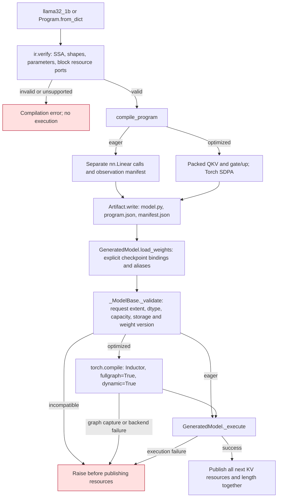

<!-- SPDX-FileCopyrightText: 2026 ModelCloud.ai -->
<!-- SPDX-License-Identifier: Apache-2.0 -->

# GPT-QModel computation DSL compiler

`gptqmodel_compiler` compiles a typed Python model declaration into standalone
PyTorch **2.15.x** source. The first architecture is Llama 3.2 1B Instruct.
The compiler, generated modules, checkpoint loader and numerical tests do not
import Transformers or use its model/config/forward implementations.

This implements a bounded first subset of the [DSL design](model-computation-dsl.md).
The design's textual examples remain pseudocode. Executable authoring uses
`Program`, `Block`, `Operation`, `Tensor`, `Parameter`, `Resource` and
`ResourceUse` records, which also round-trip through JSON. There is no parser
for the illustrative textual grammar. Each layer is expanded into concrete
blocks and edges before verification; the compiler has no Llama forward switch.
The other five [architecture sketches](model-dsl-examples/README.md) remain design work.

## Implemented flow



Request validation/publication and checkpoint IO are outside the compiled
tensor core. Fullgraph applies to the complete generated model computation,
including all decoder layers and functional KV appends. Compilation errors
propagate; there is no silent eager fallback. Empty-cache prefill, single-token
decode and other chunk shapes can produce separate guarded specializations.

| Existing production mechanism | New standalone compiler path |
| --- | --- |
| `module_tree` inventory and roles, `gptqmodel/models/definitions/llama.py:35-45` | Explicit typed operations, tensor dependencies and checkpoint parameter identities. |
| `ModulePlan.from_tree`, `gptqmodel/models/module_plan.py:196-207` | `ir.verify` validates concrete block bodies before source emission. |
| Native-forward AST qualification, `gptqmodel/models/fusion.py:685-760` | `compile_program` lowers declared QKV/gate-up regions directly; no forward inspection. |
| Legacy subset resolution, `gptqmodel/looper/module_looper.py:2133-2202` | Eager source and observation metadata expose exact shared value IDs and linear sites. Looper integration is future work. |

These paths coexist. This prototype does not change `MODEL_MAP`, AUTO kernel
selection, existing quantization loops or the normal GPT-QModel loader.

## Generate and execute

Use a checkout on `PYTHONPATH` and a separate environment with stable Torch
2.15.x. Only Torch is needed to import/run emitted modules. Safetensors is
needed by the checkpoint IO adapter; the optional real-model test additionally
uses `tokenizers` for text/token IO. Installing the main GPT-QModel package and
its Transformers dependency is unnecessary for this compiler path.

```bash
python -m gptqmodel_compiler --llama32-1b --dtype float32 --capacity 256 --target eager --output compiled/eager
python -m gptqmodel_compiler --llama32-1b --dtype float32 --capacity 256 --target optimized --output compiled/optimized
# The serialized program can be recompiled without the architecture factory:
python -m gptqmodel_compiler --program compiled/eager/program.json --target optimized --output compiled/recompiled
```

Generated `model.py` files contain their runtime prelude and manifest, so they
can be imported outside this repository with only Torch installed. The compiler
also offers an in-memory source loader:

```python
import torch
from gptqmodel_compiler import compile_program, llama32_1b
from gptqmodel_compiler.checkpoint import load_safetensors

program = llama32_1b(dtype="float32", capacity=256)
eager_artifact = compile_program(program, target="eager")
optimized_artifact = compile_program(program, target="optimized")
eager = load_safetensors(eager_artifact.instantiate(), "/path/to/checkpoint")
optimized = load_safetensors(optimized_artifact.instantiate(), "/path/to/checkpoint")

tokens = torch.tensor([[128000, 3923, 374, 220, 17]], dtype=torch.int64)
state = eager.new_request(batch_size=1, phase="calibrate")
logits, state = eager(tokens, state)
branch = state.fork()  # Independent resources for candidate/replay execution.
branch.phase = "decode"
next_logits, branch = eager(logits[:, -1].argmax(-1, keepdim=True), branch)
generated_ids = optimized.generate(tokens, max_new_tokens=4)
```

`generate` performs fixed-count greedy decoding, including any end-of-turn
tokens. The caller owns conversation termination/prompt rendering. Neither
generated path contains tokenizer code or model downloads.

## Quantization and precision boundaries

The eager target retains separate `nn.Linear` modules for Q, K, V, gate, up,
down and attention output. `manifest["observations"]` maps operation/value IDs
and checkpoint names to those modules. Ordinary Torch forward/pre-hooks can
collect activations; Q/K/V consume the same tensor object. MLP and norm blocks
have explicit empty resource interfaces; only the attention append operation
maps its declared request cache. This is a calibration execution surface,
not an integration with existing GPTQ/AWQ search, folding or packing.

The optimized target stores QKV and gate/up in native floating row-packed
weights and preserves separate typed logical outputs. Checkpoint tensors are
loaded directly into storage views. It does not retain a second concatenated
weight copy. The embedding and output head share one parameter allocation.
The source emits last-use deletions so eager execution releases intermediate
activations instead of retaining every layer's locals.

The optimized target currently accepts **FP32 only**, and the Llama factory/CLI
default to FP32. Eager FP16/BF16 inference is covered by independent fixture
tests. A full-checkpoint BF16 experiment passed the eager prefill oracle but
failed the optimized raw-logit tolerance: maximum absolute difference `0.375`,
or `0.25` with Inductor cast emulation. Consequently the compiler rejects that
optimized specialization before emission; it does not weaken the `2e-3`
absolute/relative gate. Low-precision optimized inference needs further
qualification and is not a supported output of this version.

RMSNorm reduces in FP32, rounds the normalized value to activation dtype,
then multiplies by the gain. Llama-3 frequencies/trigonometry use FP32;
cosine/sine round to activation dtype before applying split-half rotation.
Attention computes QK, masking, softmax and PV in FP32 and rounds its result
to activation dtype. Eager uses explicit matmuls/softmax; optimized uses Torch
SDPA with GQA and an explicit offset-aware causal mask. Both use zero dropout.
SiLU and residual/multiplication boundaries use the selected native dtype.
This profile is explicit and does not claim bit identity with every external
attention implementation.

## Request resource contract

Each declared cache owns K and V tensors in activation dtype and `B,H,S,D`
layout. Capacity is a bound, not a preallocation: appends return new tensors
through `torch.cat`. All batch rows are valid and advance together; contiguous
positions are derived from a checked request length. There are no padding or
arbitrary position/validity inputs in this first entry-point ABI. Full request
metadata arrays, paged storage and external output buffers remain design work.

Before tensor execution the wrapper checks token type/range, batch/device,
resource count, shape, dtype, contiguity, capacity, storage aliasing, parameter
storage/aliases and parameter version. Mutating/replacing/moving weights makes
an existing prefix stale. Pure functional cache results are published only
after successful execution; a failed candidate leaves its previous cache and
length intact. `fork` copies caches and metadata for branch isolation.
Calls on one model must be serialized; concurrent execution is explicitly
rejected. No free-threaded multi-worker or asynchronous multi-stream support
is claimed.

## Reproduce numerical validation

```bash
python -m pytest -q tests/compiler/test_compiler.py -o log_cli=false
PYTHONPATH=. python tests/compiler/validate_llama32_checkpoint.py /path/to/checkpoint \
  --dtype float32 --output results.json --artifacts compiled
```

The checkpoint gate validates dimensions and Llama-3 constants from plain JSON,
uses an independent Torch implementation written from the equations, and
compares logits, greedy token IDs and per-layer caches. The independent path
does not call compiler/runtime operations. Tiny FP32 fixtures also evaluate
linear algebra in FP64. A subprocess denies Transformers imports while running
an emitted module. Ordinary CI does not download multi-GB weights.

The [retained CPU report](model-dsl-llama32-validation.json) identifies the
pinned public mirror, weight hash, exact prompt/token IDs, framework commit,
precision, tolerances and observed graph count. It is a correctness smoke
test, not a quality benchmark or throughput comparison. GPU execution and
CUDA graph capture remain unqualified because the test VM exposes no GPU.

| Check | Observed result on Torch 2.15.0+cpu, FP32 |
| --- | --- |
| Targeted regression suite | 12 passed, including FP16/BF16 eager fixtures and low-precision optimized rejection. |
| Real checkpoint | 1,235,814,400 parameters; 24-token prompt and five cached decode calls. |
| Maximum absolute logit error vs independent equations | Eager `3.29e-5`; Inductor `5.77e-5`, below the `2e-3` absolute/relative gate. |
| Greedy output | Six token IDs match all three paths; answer starts with `4` followed by end-of-turn/header tokens because the test uses a fixed count. |
| Whole-model prefill graph | One graph, zero graph breaks. |
| Linear modules | Eager 113; optimized 65. |
| Native FP32 parameter bytes | 4,943,257,600 per target, including one tied embedding/head allocation. |

These results qualify this deterministic smoke workload, not general language
quality, performance or every context/batch shape.

Packed quantized lowerings, AWQ transforms, alternate model families,
heterogeneous recurrent state, padding/ragged batches, eviction/rollback of
accepted tokens and concurrent execution are not implemented. Unknown
operations, attributes, storage formats or resource mappings raise rather than
calling an external model forward.

Introduced with [the model DSL draft](https://github.com/ModelCloud/GPTQModel/pull/4275).
