# Model tree resolution

How GPT-QModel decides what each module *is*: its role (`q`/`k`/`v`/`o`,
`gate`/`up`/`down`), whether it belongs to a MoE block, which expert family it
belongs to, and whether it should be quantized at all.

The short version: **the architecture's declared `module_tree` is authoritative;
runtime module names are not consulted.** Introduced in PR #3565.

## Why it is shaped this way

Before this change the answer to "what is this module?" was derived from the
*string* of the live module name:

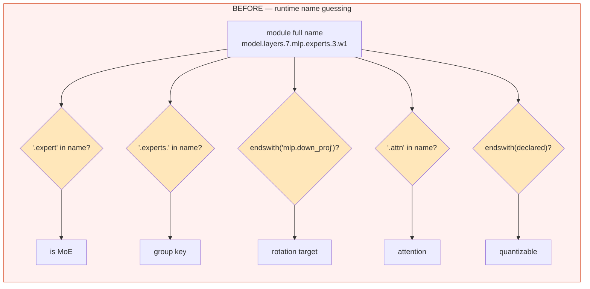

Each of those rules fails *silently*: no exception, just the wrong grouping or
the wrong quantization. A model that renames `gate_proj` to `w1`, exposes
`shared_mlp` instead of `shared_experts`, or adds an extra attention projection
was mis-classified by construction.

The repository already declared the structure of every supported architecture in
`module_tree` — decoder boundaries (`#`), leaf order, aliases, `:moe` markers,
and `!`/`?` exclusion flags. That declaration only drove layer extraction; role
logic re-guessed the rest. This design makes the declaration the single source of
truth and compiles it once per model instance.

## Resolution flow

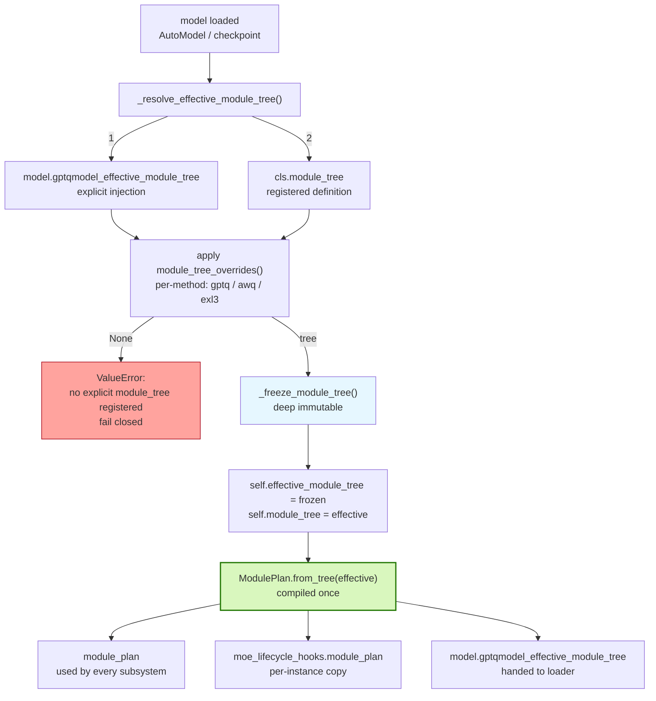

Three properties matter here:

- **One tree per instance.** The tree is deep-frozen and stored on the instance,
  so a class definition can be reused by later instances without dispatch state
  leaking between them.
- **Compiled once.** `ModulePlan` is built at construction, not re-derived per
  module lookup.
- **Fails closed.** If no definition and no injection exist, loading raises
  instead of guessing a structure.

## `ModulePlan`

`gptqmodel/models/module_plan.py` turns the declaration into an immutable
inventory of `ModuleSpec(template, flags)` plus role and MoE queries.

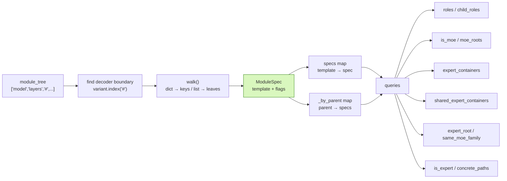

### Inspection API

The compiled plan is attached to every model instance and is retrieved through
one public method:

```python
plan = model.module_plan()

plan.print()                     # TUI tree, ANSI auto-detected
plan.print(color=False)          # plain log-safe output
plan.print(max_depth=2)          # cap very large trees
text = plan.render(color=False)
payload = plan.to_dict()         # JSON-friendly extraction/debug data
json_text = plan.to_json()
summary = plan.summary()
```

`ModulePlan` and `ModuleSpec` are exported from both `gptqmodel` and
`gptqmodel.models`. `model.module_plan()` raises if called before the model has a
compiled plan; it never guesses or recompiles a tree. All internal consumers
resolve the plan through this accessor rather than reading the backing field.

The tree renderer marks:

- `[quantize]` — declared as a quantization leaf.
- `[excluded]` / `[capture-only]` — non-quantized declarations.
- `[moe]`, `[expert-container]`, `[shared-expert]`, `[expert]` — MoE structure.
- `[roles=q]`, `[in=x]`, `[group=0]` — projection roles, shared input, and group.
- `[container]` — structural parent, not itself a quantization target.

### Declaration syntax

```
"mlp:moe"                 ^    ^
  │   │                   │    └── flags: moe root
  │   └── leaf/container name
  └── the declared path segment
```

| Token form | Meaning | Produced role |
| --- | --- | --- |
| `q_proj:0:q` | slot `0`, role `q` | `q` |
| `w1:0:gate` | explicit tag wins over the name | `gate` |
| `mlp:moe` | MoE root marker | `moe` |
| `x:!` / `x:?` | not quantized / capture-only | `quantize = False` |
| `experts.#` | routed-expert expansion | `{expert_index}` → `\d+` |
| `gate_up_proj` | fused projection | `("gate","up")` |

### Matching is exact

Templates compile to an anchored regular expression (`^…$`) with `#` replaced by
`\d+`. There is no `startswith`, `endswith`, or `in` fallback:

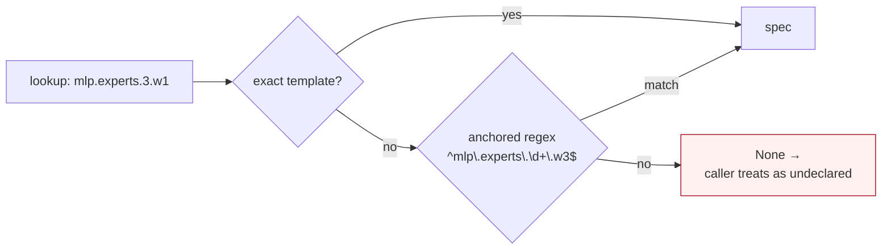

Because the pattern is anchored and placeholder-aware, `mlp_extra.gate_proj`
can never match the declared `mlp` branch, while `mlp.experts.3.gate_proj`
matches the declared `mlp.experts.#.gate_proj` template.

### Shared experts without an allow-list

`shared_expert_containers()` finds shared/parallel expert branches
**structurally**: a direct projection family under a MoE root that is not the
routed `#` container and carries no router-only role. Definitions therefore do
not need to spell `shared_experts`, `shared_expert`, or `shared_mlp`; declaring
the branch is enough.

## What each subsystem asks

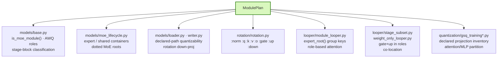

### MoE membership and grouping

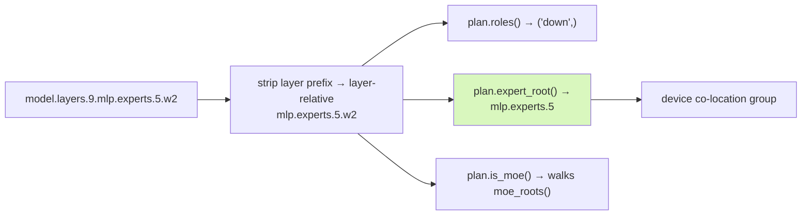

The expert family key used for device co-location is the declared family path, so
`gate`/`up`/`down` of one expert stay together on one device regardless of what
the projections are named.

### Quantizability (loader and writer)

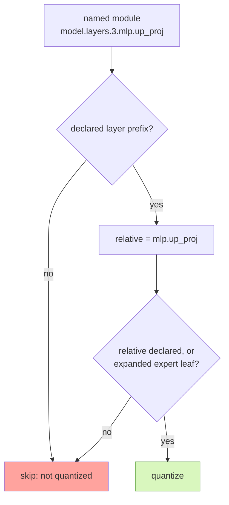

### Checkpoint weight coverage

The tree is also the oracle for every checkpoint-owned weight inside a decoder
layer, not only for modules that the current quantization pipeline replaces.
This prevents a non-quantized projection, router, hyper-connection, compressor,
or norm from disappearing between the model definition and the live model.

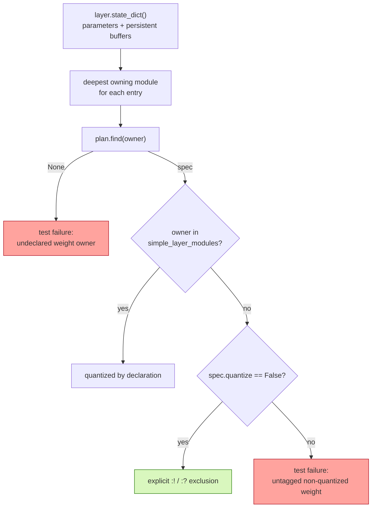

`state_dict()` is the source of truth for this check. Non-persistent buffers
created at runtime are excluded by Torch and are not model-definition
obligations. The owning-module rule also covers direct parameters and buffers on
containers, such as Qwen `linear_attn.A_log`, DeepSeek `self_attn.sinks`, and
Ripple `self_attn.value_res_lambda`.

Measured Flash-family coverage at this revision:

| Model family | Decoder layers | Quantizable specs | Unique weight owners |
| --- | ---: | ---: | ---: |
| Qwen3.5 / Qwen3.8 | 32 | 10 | 19 |
| GLM-5.3-Flash | 45 | 873 | 37 |
| MiniMax-M3.1-Flash | 60 | 394 | 20 |
| DeepSeek-V4-Flash | 43 | 775 | 29 |
| Ripple | 5 (fixture) | 8 | 15 |

DeepSeek-V4.1-Flash is not included: its checkpoint declares
`model_type=deepseek_v41`, but Transformers 5.22.2 and its main branch expose no
native `deepseek_v41` config or model class. The test activates automatically
when upstream support lands instead of relabeling V4-Flash as V4.1.

### Rotation

Rotation needs the two layer norms, one attention parent, and one MLP parent.
It reads them from declared `:norm` and projection roles rather than assuming a
Llama layout:

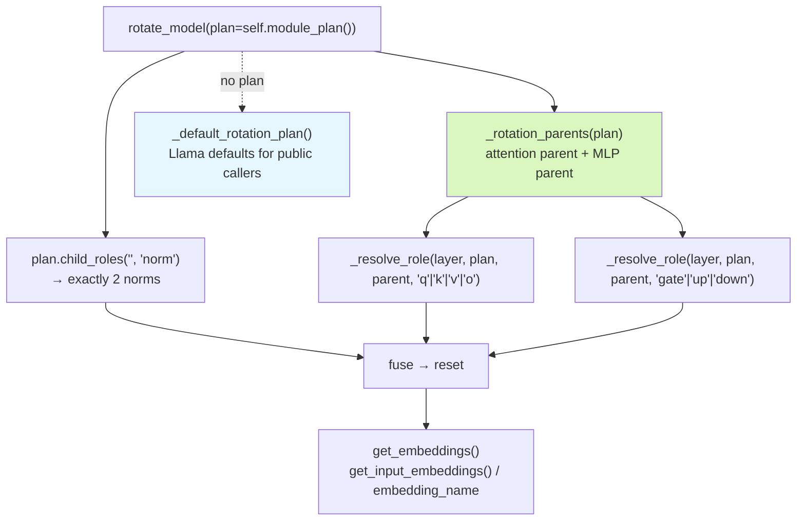

`_resolve_role` requires exactly one match and raises with the offending path, so
a definition with two `:q` projections fails loudly instead of silently picking
one.

## Ambiguity in name lookup

Two helpers in `utils/model.py` used to return the first match in module
registration order. They now prefer an exact path and raise on multiple matches:

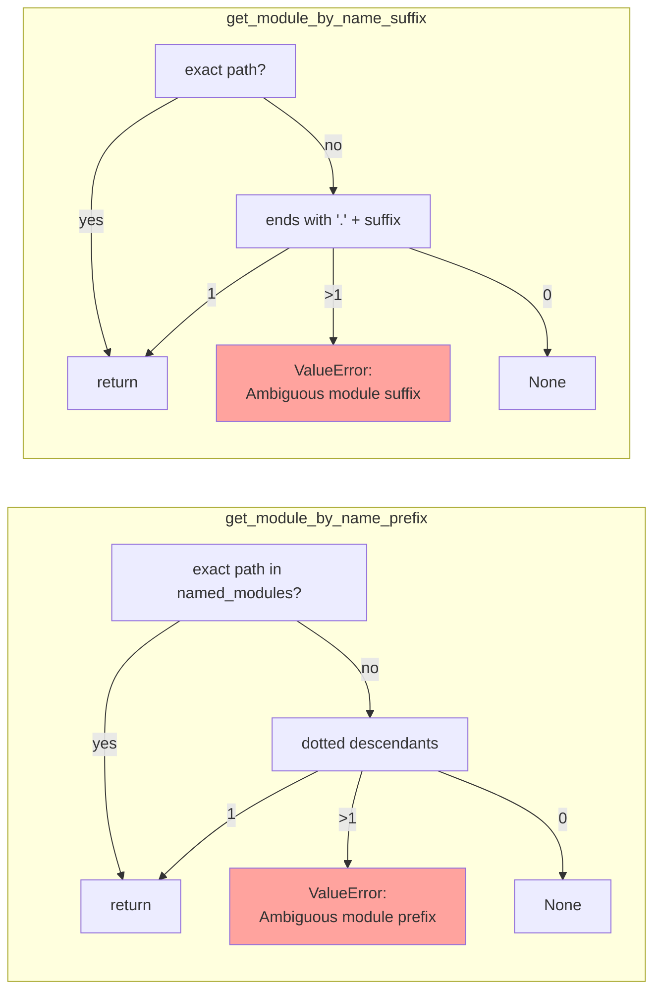

## Contracts

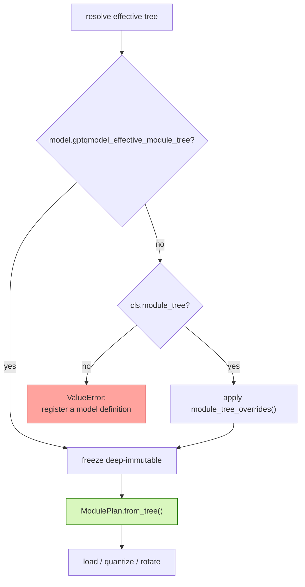

| Situation | Behavior |
| --- | --- |
| Unknown `model_type`, no definition | `ValueError`; never auto-guesses a tree |
| Ambiguous `:q` / `:k` / … role | `ValueError` naming the candidate paths |
| Ambiguous prefix or suffix lookup | `ValueError` naming the candidates |
| Path not declared in the tree | treated as undeclared: not quantized, no role |
| Custom architecture | inject `model.gptqmodel_effective_module_tree` |
| Per-method difference | `module_tree_overrides[method]` on the definition |

## Extension points

- **New architecture:** add a model definition with an explicit `module_tree`.
  Never add a new name heuristic to make an architecture work.
- **Per-method divergence:** use `module_tree_overrides` keyed by quantization
  method instead of branching on names inside shared code.
- **Custom/injected models:** attach `gptqmodel_effective_module_tree` to the
  model object before loading.
- **Diagnostics only:** `_auto_detect_module_tree()` still exists to inspect an
  unknown model, but it is deliberately not on the loading path.

## Known limitation

`ModuleSpec.roles` falls back to a small name-to-role map (`q_proj`,
`k_proj`, `v_proj`, `o_proj`, `gate_proj`, `up_proj`, `down_proj`, `w1`, `w2`,
`w3`, `gate_up_proj`) when a declared leaf carries no explicit role tag. The
fallback applies at *declaration time*, not against live module names, so it
cannot select the wrong sibling — but it is still a naming convention. Fully
tagging every definition would allow the map to be deleted.

## Related tests

| Test file | What it pins |
| --- | --- |
| `tests/module_tree/test_explicit_module_plan.py` | roles, shared containers, renamed leaves, sibling rejection, fail-closed |
| `tests/module_tree/test_module_tree_variants.py` | tree variants produce identical declared paths |
| `tests/module_tree/test_auto_detect.py` | auto-detection stays diagnostic-only |
| `tests/test_afmoe_support.py`, `tests/test_k2_horizon_support.py` | real MoE definitions resolve without name overrides |
| `tests/module_tree/test_flash_model_tree_consumption.py` | real Flash-family meta models: quantizable specs, every checkpoint weight owner, roles, MoE hooks, looper helpers, Ripple custom code |
