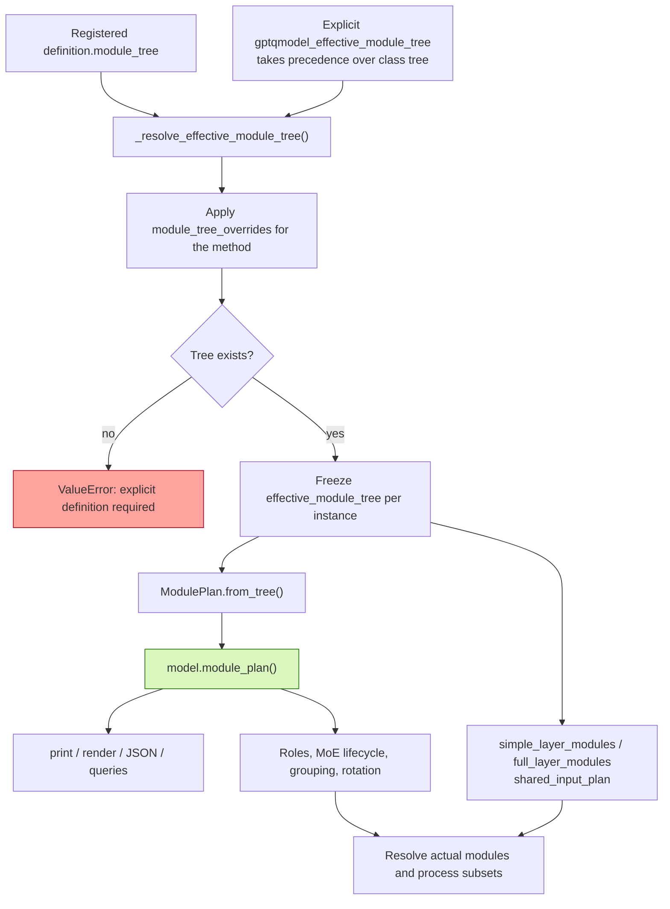
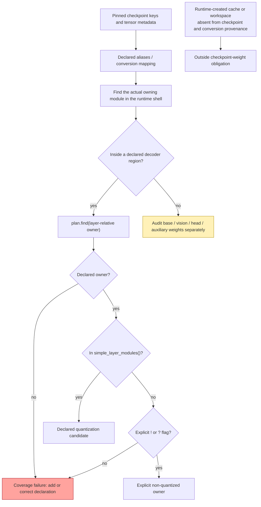
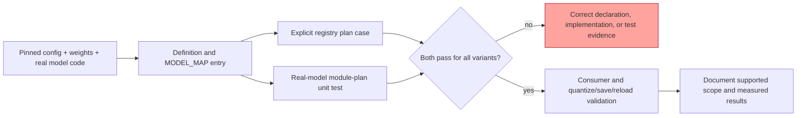

# Module plans and model-definition tags

GPT-QModel uses a model definition to declare weight-owning module paths and
their meaning. The declaration includes weights that stay in their source
representation, even when no quantization processor consumes them. A compiled
`ModulePlan` gives loading, quantization, and debugging code the same answers
about those paths.

This guide describes the implementation merged in
[PR #3565](https://github.com/ModelCloud/GPTQModel/pull/3565), source revision
`7d03a349`. Use a checkout containing that commit for the APIs below; an older
installed release may not include them. The Python package is `gptqmodel`; the
public loader class remains `GPTQModel`.

- [Inspect a loaded model](#inspect-a-loaded-model)
- [What the plan represents](#what-the-plan-represents)
- [Tag and path reference](#tag-and-path-reference)
- [Write a definition](#write-a-definition)
- [Add and validate a new model](#add-and-validate-a-new-model)
- [Debug a mismatch](#debug-a-mismatch)
- [DeepSeek V4.1 Flash](deepseek-v41-module-inventory.md)

For the implementation diagrams and subsystem contracts, see
[model tree resolution](model-tree-resolution.md).

## Inspect a loaded model

Obtain the plan from the **GPT-QModel wrapper**, not its underlying Transformers
model. The same API applies before and after quantization:

```python
from pathlib import Path

# model is the wrapper returned by GPTQModel.load(...).
plan = model.module_plan()
assert model.module_plan() is plan

plan.print()                          # Terminal tree; automatic ANSI color
plan.print(color=False, max_depth=3)   # Compact, plain-text diagnostic
tree_text = plan.render(color=False)  # Embed in a TUI, log, or bug report
with Path("module-plan.txt").open("w") as stream:
    plan.print(file=stream, color=False)

payload = plan.to_dict()              # JSON-compatible summary and specs
Path("module-plan.json").write_text(plan.to_json(indent=2))
```

Use `color=False` when redirecting output; automatic color detection checks
standard output. `max_depth` abbreviates the display, not the underlying plan.
`str(plan)` renders the tree and `repr(plan)` returns a short summary. There is
no separate `model.plan()` API. Internal consumers also use
`model.module_plan()`; the backing field is an implementation detail.

Queries use **decoder-layer-relative module paths**, without a tensor suffix:

```python
# Examples for the Llama definition, not paths shared by every architecture.
assert plan.roles("self_attn.q_proj") == ("q",)
assert not plan.find("input_layernorm").quantize
assert plan.find("self_attn.q_proj.weight") is None
assert plan.find("other.self_attn.q_proj") is None
assert plan.find("self_attn.q_proj.undeclared") is None
```

For `model.layers.7.self_attn.q_proj.weight`, the layer-relative owner is
`self_attn.q_proj`. The checkpoint key, decoder layer prefix, tensor name, and
owning module are distinct pieces of information.

| API | Result and intended use |
| --- | --- |
| `plan.specs` | Tuple of frozen `ModuleSpec` records; inspect `template`, `flags`, `roles`, `quantize`, and `capture_only`. |
| `plan.find(path)` | Declared spec or `None`; exact path or an explicitly declared expert placeholder. |
| `plan.roles(path)` | Projection-role tuple; empty for an undeclared path or a declaration with no projection role. |
| `plan.child_roles(parent, role)` | Direct child names for a projection role under a declared parent. |
| `plan.role_paths_in_parent(parent, role)` | Full layer-relative paths for those direct children. |
| `plan.moe_roots()` / `plan.is_moe(path)` | Explicit MoE root specs / membership of a declared path. |
| `plan.expert_containers()` | Routed-expert container paths. |
| `plan.shared_expert_containers()` | Non-routed projection-family paths beneath MoE roots. |
| `plan.is_expert(path)` / `plan.expert_root(path)` | Routed-expert membership / concrete expert family, such as `mlp.experts.3`. |
| `plan.same_moe_family(a, b)` | Whether two declared paths belong to the same concrete routed expert. |
| `plan.summary()` | Declaration counts and MoE containers; not a live tensor census. |
| `plan.to_dict()` / `plan.to_json()` | Debug export including flags, roles, container markers, and templates. |

The plan keeps expert templates, rather than allocating one spec per expert.
A placeholder accepts a numeric index structurally; it does not check the
model's configured expert count or prove that a module exists on a particular
layer. Those checks belong to model-specific tests and consumers resolving the
live layer. Parent-role enumeration uses the stored parent template; use
`find()` for concrete expert leaves.

## What the plan represents

| Term | Meaning |
| --- | --- |
| Model definition | A registered `BaseQModel` subclass: tree, loader settings, hooks, and architecture-specific policies. |
| `module_tree` | The authored declaration: decoder prefixes, nested paths, flags, and ordering. |
| `effective_module_tree` | The selected instance tree after explicit injection and method overrides, then frozen. |
| `ModulePlan` | Compiled decoder-relative inventory and role queries from that effective tree. |
| Subset/shared-input plans | Other views derived from the same effective tree for ordered processing and activation sharing. |



### Checkpoint ownership is the boundary

The coverage obligation is **checkpoint-owned weights**, including parameters,
persistent checkpoint buffers, non-quantized norms/routers, and stored scales
or other inference metadata. A tensor created only after loading is not a new
definition obligation merely because it is a parameter or buffer at runtime.



`state_dict()` is useful for an architecture fixture because it includes
parameters and persistent buffers. It does **not** establish checkpoint
provenance by itself: post-load persistent tensors may appear there, and
conversion may rename, fuse, split, or consume checkpoint entries. Keep an
explicit source-to-runtime mapping for an actual checkpoint audit. A simple
intersection of checkpoint and runtime names can silently lose converted weights.

The current `ModulePlan` compiles the mapping **after the decoder `#` boundary**.
It is not yet a complete whole-model or per-tensor checkpoint manifest.
Embeddings, vision towers, final norms/heads, and auxiliary prediction modules
outside those regions need separate inventory and tests. Source-format scales
can share an owner with a weight, but the plan does not expose tensor shape,
dtype, checkpoint origin, or conversion lineage. Do not claim whole-checkpoint
coverage from a passing decoder-only test.

Likewise, `summary()["quantized_count"]` counts specs whose flags allow
quantization, including structural parents; it is **not** the number of
quantized tensors or live linear layers. In JSON, inspect `container` as well
as `quantize`. Use `simple_layer_modules()` plus actual layer resolution to
identify processing candidates, then apply method/backend/dynamic policies.

## Tag and path reference

A string token has this form:

```text
runtime_path|checkpoint_alias:group:role:other_flag
gate_proj|w1:0:gate:in=x
```

The first name is the runtime shell path. Flags follow colons; their spelling
is case-sensitive. Tags declare semantics, not substrings to search for in live
module names. Unknown flags do not acquire behavior automatically; a consumer
and tests must implement any new semantics.

| Syntax | Meaning | How to use it |
| --- | --- | --- |
| Top-level `"#"` | Decoder-layer boundary. | `["model", "layers", "#", {...}]` identifies `model.layers`; the mapping describes one layer. |
| Nested dictionary | Adds a path component. | `{"mlp": {"experts": ...}}`. Preserve architecture order. |
| Leaf tuple/list | Ordered module declarations. | `"self_attn": ("q_proj:0:q", "o_proj:1:o")`. |
| Dotted leaf | Exact relative subpath. | `"compressor.kv_norm:!"` under `self_attn` declares `self_attn.compressor.kv_norm`. |
| Nested dictionary `"#"` | Routed-expert index placeholder. | `"experts": {"#": ("w1:0:gate", ...)}` produces `experts.{expert_index}.w1`. `dynamic_expert_index` identifies the config field used by subset expansion. |
| `:<integer>` | Subset order/group. | `:0` and `:1` establish processing blocks; the first numeric flag is used. Grouping is scoped by the tree, not a global layer index. |
| `:q`, `:k`, `:v`, `:o` | Attention projection roles. | Use explicit tags for renamed or factorized projections; a combined KV projection may carry `:k:v`. |
| `:gate`, `:up`, `:down` | MLP projection roles. | `:gate` means the gated MLP branch, **not** the MoE routing gate. A fused projection may carry `:gate:up`. |
| `:moe` | MoE root. | Put on the owning branch, such as `"mlp:moe"`; declare router, routed experts, and shared experts beneath it. |
| `:!` | Explicit non-quantized declaration. | Norms, routers, direct parameter owners, or projections deliberately kept in their source representation. Does not delete or unload weights. |
| `:?` | Capture-only declaration. | Keeps a module available for capture/inspection without quantizing it; capture views must opt in with `include_capture_only=True`. |
| `:norm` | Norm consumer flag. | `"input_layernorm:!:norm"`; used by norm-related consumers and rotation. It is not a projection role, so inspect `spec.flags`, not `plan.roles()`. |
| `:in=<tag>` | Identical input activation declaration. | Siblings with the same tag may share Hessian capture after real-forward verification. A group number or matching shape does not prove shared input. |
| `runtime\|checkpoint` | Ordered path aliases. | `"gate_proj\|w1:0:gate"` names runtime `gate_proj` and a checkpoint alias. `plan.find()` queries the first name; it is not an alias search API. |
| Empty dictionary key `""` | Keep the current parent path. | Used for direct dense MLP alternatives alongside MoE branches. |
| Repeated parent leaf | Annotate the parent module itself. | `"input_layernorm": ("input_layernorm:!:norm",)` does not repeat the path. |

`"experts.#"` is explanatory notation, not a substitute for the nested `"#"`
dictionary syntax. A normal `*` in a path is not a supported wildcard.

**Parent flags apply to that owner.** For example, `"self_attn:!"` can describe
a direct `self_attn.sinks` parameter while declared child projections remain
quantization candidates. Exclude each child owner that also needs exclusion.
The current owner-level representation does not independently classify every
tensor on the same owner.

Explicit projection tags take precedence. Existing untagged declarations can
still receive roles from the compiler's small declared-name map (`q_proj`,
`k_proj`, `v_proj`, `o_proj`, `gate_proj`, `up_proj`, `down_proj`, `w1`, `w3`,
`w2`, `gate_up_proj`). New definitions should tag roles explicitly. This
compatibility map never authorizes matching an undeclared live path.

### Shared input needs a separate proof

`q_proj:0:q:in=x` and `k_proj:0:k:in=x` assert the same activation under the same
parent. The tag is scoped to that parent; another parent's `in=x` is a separate
group. Runtime reuse also requires members in the same processing subset.

Before enabling reuse, add a tiny real-forward test using
`gptqmodel.models.shared_input.probe_shared_inputs(layer, shared_plan, forward)`.
Here `shared_plan` comes from `shared_input_plan()`, **not** `module_plan()`.
Only then list the model type in the concrete definition's own
`shared_input_verified_model_types`. This opt-in is not inherited; unverified
types use singleton capture groups. Cover un-routed experts explicitly rather
than counting an unexecuted route as verified.

### Variants and overrides

Use complete tree variants for multiple decoder prefixes. For hybrid layers,
declare the supported alternatives and use `layer_modules_strict = False` only
when absence is expected on particular layers. Tests must exercise every
alternative somewhere; permissive lookup cannot hide a misspelled path.

`module_tree_overrides` is a dictionary keyed by `METHOD`. Overrides are applied
to a copy before compilation and must use the declaration's exact keys,
including tags. Replacing a leaf tuple replaces that tuple; retain its required
non-quantized entries and roles. See
[Qwen3NextGPTQ](../gptqmodel/models/definitions/qwen3_next.py) for an existing
method-specific router policy. Test the effective plan for every override.

## Write a definition

This standalone authoring example describes a hypothetical, bias-free,
Llama-shaped decoder. It is not a registration for a new checkpoint and does
not load weights:

```python
from gptqmodel import ModulePlan
from gptqmodel.models.base import BaseQModel


class ExampleQModel(BaseQModel):
    pre_lm_head_norm_module = "model.norm"
    module_tree = [
        "model", "layers", "#",
        {
            "input_layernorm": ("input_layernorm:!:norm",),
            "self_attn": (
                "q_proj:0:q", "k_proj:0:k", "v_proj:0:v", "o_proj:1:o",
            ),
            "post_attention_layernorm": ("post_attention_layernorm:!:norm",),
            "mlp": ("gate_proj:0:gate", "up_proj:0:up", "down_proj:1:down"),
        },
    ]


plan = ModulePlan.from_tree(ExampleQModel.module_tree)
assert plan.roles("self_attn.q_proj") == ("q",)
assert "norm" in plan.find("input_layernorm").flags
assert plan.find("self_attn.fake_q_proj") is None
plan.print(color=False, show_summary=False)
```

Output:

```text
├─ input_layernorm [excluded] [norm]
├─ self_attn [container]
│  ├─ q_proj [quantize] [group=0] [roles=q]
│  ├─ k_proj [quantize] [group=0] [roles=k]
│  ├─ v_proj [quantize] [group=0] [roles=v]
│  └─ o_proj [quantize] [group=1] [roles=o]
├─ post_attention_layernorm [excluded] [norm]
└─ mlp [container]
   ├─ gate_proj [quantize] [group=0] [roles=gate]
   ├─ up_proj [quantize] [group=0] [roles=up]
   └─ down_proj [quantize] [group=1] [roles=down]
```

`ModulePlan.from_tree()` is useful for authoring and compiler tests. For a loaded
model, always use `model.module_plan()` so method overrides and injected trees
are respected.

For a model whose *actual* runtime MLP contains routed and shared experts, a
replacement MLP branch could be:

```python
moe_branch = {
    "mlp:moe": {
        "router": ("router:!",),
        "experts": {
            "#": ("w1:0:gate", "w3:0:up", "w2:1:down"),
        },
        "shared": ("w1:0:gate", "w3:0:up", "w2:1:down"),
    },
}
```

Use the actual config's expert-count field for `dynamic_expert_index`. Select
lifecycle hooks compatible with its forward signature and dispatch. The plan
recognizes the shared branch from its declared projection family; the word
`shared` is not what grants it that meaning.

## Add and validate a new model

1. **Pin the architecture evidence.** Record the checkpoint revision,
   `config.model_type`, loader implementation, weight index, and source/runtime
   conversion mappings. Marketing names are not registry keys. Inspect all
   branch types: full/linear attention, dense/MoE layers, modalities, optional
   ranks, and auxiliary inference modules.
2. **Build the real model shell.** Use the real implementation with a tiny CPU
   or meta config. Run normal Defuser conversion where required. Confirm
   decoder prefixes, direct parameter owners, aliases, and expert counts. A
   fake model generated from the tree cannot independently validate that tree.
3. **Add the definition.** Put a `BaseQModel` subclass in
   `gptqmodel/models/definitions/`. Declare every checkpoint-owned decoder
   owner, including explicit `:!`/`:?` for non-quantized owners. Set the final
   norm/head metadata, loader, lifecycle hooks, and strictness only as required
   by the implementation. Inventory weights outside decoder regions separately.
4. **Register the actual model type.** Import the class and add its mapping in
   `gptqmodel/models/auto.py`. A checkpoint alias requires verification too;
   similar architecture names alone are not sufficient.
5. **Add the mandatory registry contract.** Update both `models` and the
   definition/method entries in
   `tests/module_tree/fixtures/registered_module_plans.json`. Review expected
   decoder prefixes and ordered blocks independently; do not copy a compiler's
   output and call that a correctness oracle.
6. **Add a model-specific module-plan test.** Under `tests/module_tree/`, test
   real module resolution, all checkpoint-owned decoder owners, roles,
   routed/shared families, relevant consumers, and rejection of undeclared
   lookalikes/descendants. Cover every layout variant and method override. Use
   `model.module_plan()` for tests involving a loaded wrapper. Add real-forward
   sharing tests before enabling `:in=` reuse.
7. **Exercise quantization and inference.** Run the affected consumer tests and
   the model's applicable quantize/save/reload/generation or evaluation tests.
   A plan proves declarations, not numerical correctness or backend support.
8. **Document the result.** Update docs and the PR with commands, measured
   results, precise skips, ownership limits, and a flow diagram when logic
   changes. Follow the repository's model-plan skill and PR template.



Example commands from an environment with the repository dependencies installed:

```bash
python -m pytest tests/module_tree/test_registered_module_plans.py -q
python -m pytest tests/module_tree/test_your_model_module_plan.py -q
python -m pytest tests/module_tree -q
```

Replace `test_your_model_module_plan.py` with the test you added. The always-run
registry contract covers every registered type, including aliases; it is
separate from real-model/checkpoint validation. The current Flash-family
reference is
[test_flash_model_tree_consumption.py](../tests/module_tree/test_flash_model_tree_consumption.py).
See the exact contribution requirements in
[the model-plan test skill](../.agents/skills/gptqmodel-model-plan-tests/SKILL.md).

## Debug a mismatch

| Symptom | What to check |
| --- | --- |
| `plan.find()` returns `None` | Use the canonical runtime module owner, strip the declared layer prefix and tensor suffix, and confirm the effective tree. No suffix fallback is intended. |
| A checkpoint entry appears absent | Trace aliases and conversion provenance; do not treat a checkpoint tensor name as an `nn.Module` path. |
| A root/container parameter is missed | Declare its owning module explicitly, including an exclusion when appropriate; traversing linear children misses direct parameters. |
| An expert index matches but does not exist | Placeholder matching is structural; validate the live model and configured expert count. |
| `is_moe()` is true on a dense layer branch | The plan describes the union of declared layouts; lifecycle hooks must resolve the containers present on that layer. |
| `norm` is absent from `roles()` | `norm` is in `spec.flags`; projection roles are only `q/k/v/o/gate/up/down`. |
| Shared inputs are not deduplicated | Verify the concrete model-type opt-in, parent scope, equal activation tensors, and same-subset execution. |
| Rotation rejects multiple projections | A correct inventory does not guarantee compatibility with a consumer requiring exactly one projection per role. Do not hide factorized roles to bypass that check. |
| Printed counts differ from quantized layers | Counts describe templates and flags; structural parents, variants, dynamic policy, and expert expansion change the actual processing count. |
| A runtime buffer has no declaration | Establish checkpoint ownership first. Caches, workspaces, and generated lookup tables are not weight obligations solely because they are tensors. |

Attach `plan.to_json()`, the model/config and checkpoint revisions, the method,
the failing checkpoint key and mapped runtime owner, and the smallest relevant
real-model test when reporting a mismatch.
