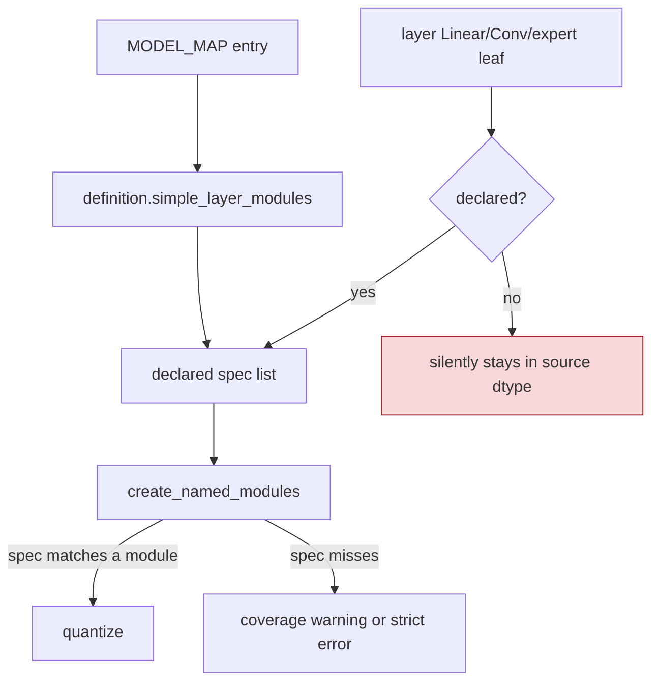
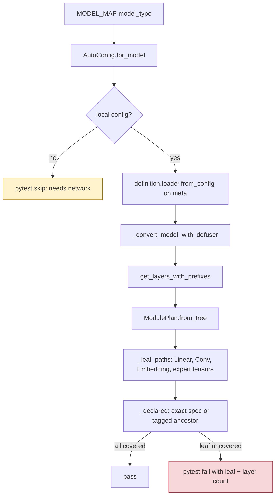
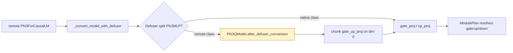

# Module-tree leaf coverage

`module_tree` is the only declaration of which decoder weights GPT-QModel will
quantize. Before issue #4174 the tests compared a definition with itself: they
proved every declared spec resolved, but a `Linear`/`Conv`/expert leaf that the
tree never mentioned was invisible. Quantization completed successfully and
left those weights in the checkpoint dtype.

This page describes the fail-closed leaf-coverage contract added in
`tests/module_tree/test_registry_leaf_coverage.py` and the per-model
`after_defuser_conversion` hook used for remote-code Phi-3 checkpoints.

## Old flow: declared specs only

The undeclared leaf (`I`) never enters the declared-spec list, so neither the
strict check nor the old coverage report could see it. The runtime warning in
`LayerModuleCoverageTracker.record_undeclared` also only inspected
`nn.Linear`, `nn.Conv1d` and `nn.Conv2d`, so a 3-D expert parameter was doubly
invisible.

## New flow: registry leaf inventory

`_leaf_paths` adds a module when it is one of `SUPPORTS_MODULE_TYPES` or when
it directly owns a routed/shared expert parameter (2-D or 3-D). `_declared`
accepts an exact `ModulePlan.find()` hit or a `:!`/`:?` tag on an ancestor, so a
definition can explicitly exclude a whole checkpoint-owned subtree.

## Phi-3 remote-code conversion

Phi-3 128k longrope checkpoints load remote `modeling_phi3.py`. Its `Phi3MLP`
class path is not the installed Transformers class path that Defuser registers,
so Defuser leaves `mlp.gate_up_proj` fused while the definition declares
`gate_proj`/`up_proj` and `layer_modules_strict` stays true.

## Failure and ambiguity contract

| Situation | Before | After |
| --- | --- | --- |
| Decoder layer path drifted (Voxtral) | zero layers, nothing quantized | `pytest.fail`: no decoder layers resolved |
| Linear/Conv leaf absent from tree | silent source-dtype weight | `pytest.fail` with path and layer count |
| 3-D expert parameter absent from tree | silent source-dtype weight | `pytest.fail`; 3-D owners are in the inventory |
| Leaf under an explicit `:!`/`:?` subtree | undeclared | covered by the ancestor tag |
| Config only available via remote code | not built | `pytest.skip` with the exception reason |
| Reviewed out-of-scope defect | unknown | explicit `KNOWN_UNDECLARED` xfail with reason |

## Coverage

`tests/module_tree/test_issue_4174_model_trees.py` pins the real layouts for
Voxtral, Nemotron-H MoE, Ling `bailing_moe`, Llama-4 Maverick, Gemma-4 MoE,
Phi-3 longrope, Zamba/Zamba2, PhiMoE, Falcon-H1, HRM-Text, Jamba, GRIN-MoE and
native Kimi-Linear. The registry test runs every `MODEL_MAP` entry whose config
is locally constructible.

Issue #4174 introduced this contract.
