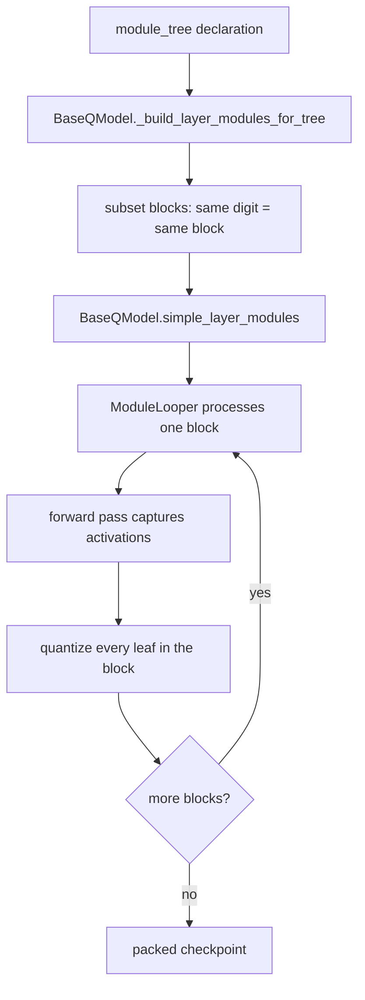
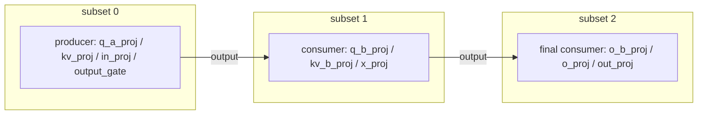
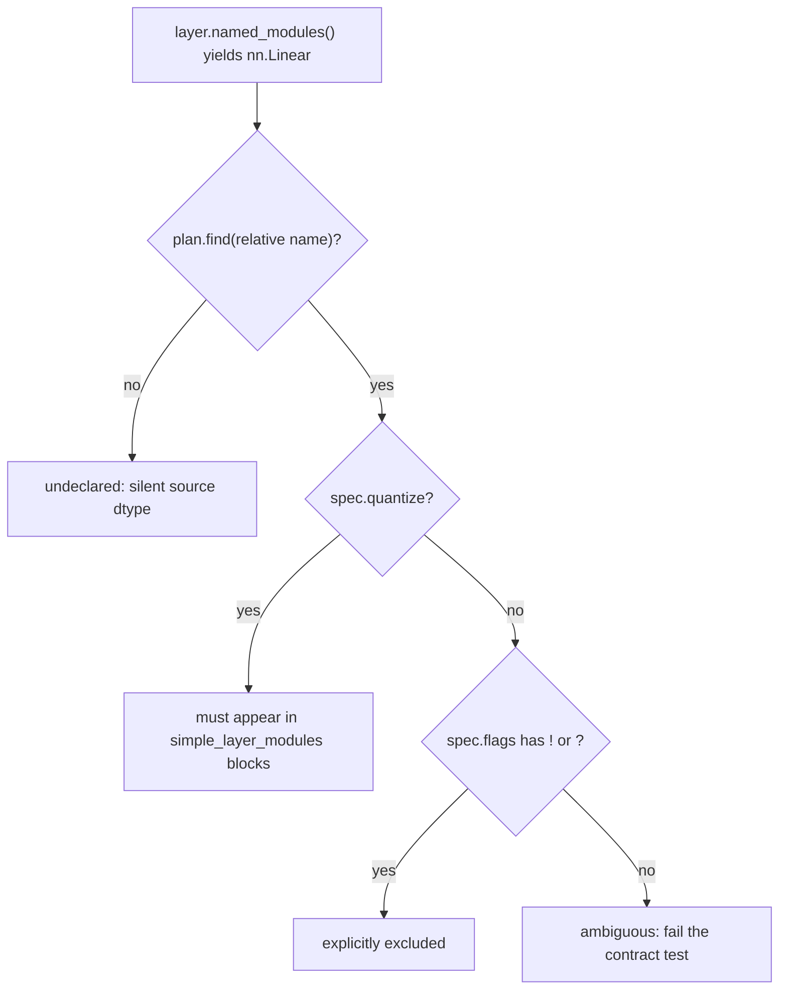

# Module tree subset ordering

Every quantizable leaf in a model definition's `module_tree` carries an optional
subset digit (`q_proj:0`, `o_proj:1`). `BaseQModel._build_layer_modules_for_tree`
groups leaves with the same digit into one block, and the block is the unit the
looper processes: it runs one forward pass, captures activations for the whole
block, and only then installs the quantized weights for every member.

Consequently a leaf that *consumes* another leaf's output must live in a later
subset. If a producer and its consumer share a subset, the consumer is
calibrated and quantized against the producer's unquantized output, so the
sequential error compensation that GPTQ/AWQ rely on is silently lost. The same
rule protects AWQ scale folding, which reads the producer's live output.

This page documents the ordering contract introduced for issue #4041 and the
coverage rule for called `nn.Linear` modules that are intentionally excluded.

## How a definition becomes executable subsets

The digit is a dependency order, not a tensor-identity hint. Sibling leaves
that read the same activation use `:in=<tag>` instead; that metadata is
documented in [Shared-input metadata](module-plan-guide.md#shared-input-needs-a-separate-proof)
and never changes the emitted blocks.

## Producer before consumer

`BaseQModel._build_layer_modules_for_tree` emits blocks in ascending subset
order, so the diagram above is also the execution order. The regression test
`tests/module_tree/test_definition_subset_ordering.py` pins the exact subset
index for each audited projection.

### What changed

| Definition | Old declaration | New declaration | Why |
| --- | --- | --- | --- |
| `gptqmodel/models/definitions/deepseek_v4.py` | `q_a_proj:0`, `q_b_proj:0`, `o_b_proj:1`, `kv_proj:2` | `q_a_proj:0`, `kv_proj:0`, `q_b_proj:1`, `o_b_proj:2` | `q_b_proj` consumes `q_a_proj`; `o_b_proj` consumes `kv_proj` |
| `gptqmodel/models/definitions/deepseek_v2.py` | `q_a/q_b/kv_a/kv_b:0`, `o_proj:1` | `q_a/kv_a:0`, `q_b/kv_b:1`, `o_proj:2` | Match the DeepSeek-V3 MLA split |
| `gptqmodel/models/definitions/lfm2.py` | `conv: (in_proj, out_proj)` | `conv: (in_proj:0, out_proj:1)` | `out_proj` consumes the convolution of `in_proj` |
| `gptqmodel/models/definitions/falcon_mamba.py` | `in_proj:0`, `x_proj:0`, `out_proj:1` | `in_proj:0`, `x_proj:1`, `out_proj:2` | `x_proj` consumes convolved `in_proj`; `out_proj` consumes the SSM output |
| `gptqmodel/models/definitions/minimax_m2.py` (`MiniMaxQModel`) | `qkv_proj:0`, `out_proj:1`, `output_gate:1` | `qkv_proj:0`, `output_gate:1`, `out_proj:2` | `out_proj` consumes `output_gate(hidden) * attention` |
| `gptqmodel/models/definitions/jamba.py` | `mamba: (in_proj:0, out_proj:1)` | `mamba: (in_proj:0, x_proj:1, out_proj:2)` | `x_proj` was a called `nn.Linear` that the tree never declared |
| `gptqmodel/models/definitions/axk2.py` | gated-norm MLPs and DSA indexer absent | explicit `:!` leaves | Every called `nn.Linear` is now owned by the plan |

The checked-in inventory
`tests/module_tree/fixtures/registered_module_plans.json` pins the resulting
ordered blocks for each definition.

## Coverage: declared, quantized, or explicitly excluded

A definition may set `layer_modules_strict = False` because layers own
different variants (Jamba interleaves Mamba and attention; AXK2 interleaves
dense and sparse MLPs). That flag is not permission to forget a called
`nn.Linear`: an undeclared leaf is silently left in the source dtype.

Jamba now declares `mamba.x_proj:1`, so it is quantized like Falcon Mamba's
`x_proj`. AXK2 keeps its gated-norm MLPs and DSA indexer linears in their
checkpoint dtype (the indexer is listed in `_keep_in_fp32_modules`) but declares
them with `:!` so the exclusion is reviewable rather than implicit.

`tests/module_tree/test_definition_subset_ordering.py` walks a tiny real AXK2
decoder and fails if any called `nn.Linear` resolves to no plan leaf.

## Failure and ambiguity paths

| Situation | Before | After |
| --- | --- | --- |
| Producer and consumer share a subset | Consumer quantized against dense producer output; no error | Subset digits separate them; regression test pins the order |
| Called `nn.Linear` absent from the tree | Silent source-dtype tensor (`layer_modules_strict=False`) | Declared and quantized (Jamba `x_proj`) or declared `:!` (AXK2) |
| Unknown model layout | `plan.find()` returns `None` | Coverage test fails instead of assuming exclusion |

## Additive shared-input tags

Issue #4041 also listed sibling projections that read one activation but had
no `:in=` tag, which kept Hessian dedup off. This change covers a verified
subset of those families: `opt`, `starcoder2`, `gptj`, `phi`, `jamba` and
`lfm2`. Each family gained

- `:in=x` on the q/k/v siblings (and gate/up or w1/w3 where the MLP has that
  shape),
- a real-forward case in `tests/module_tree/test_shared_input_cpu_forward.py`,
- its `model_type` in the definition's own `shared_input_verified_model_types`.

The safety argument has two halves, both tested:

1. `build_layer_modules` emits byte-identical blocks with and without the
   `:in=` metadata (`test_in_tags_do_not_change_quantization_blocks`), so the
   quantization order and membership cannot change.
2. `probe_shared_inputs` records every planned module's input during a real
   forward and fails unless group members are bitwise identical
   (`test_plan_matches_real_forward_inputs`).

Together those mean the follower's skipped Hessian is the leader's Hessian, so
the packed tensors are unchanged. Families that need remote code or a
non-native layout were left out rather than tagged without a forward case.

## Not in scope

This change does not re-audit `:in=` tag correctness (issue #4041 found none
wrong) and does not tag every family the issue lists. Families whose layout
requires remote code (for example `deepseek_v2`, `deepseek_v4`, `kimi_k25`) or
whose sibling leaves sit under different parents (attention and MLP parallel
blocks such as `falcon`) need their own real-forward case first.

## Reference

Introduced by the pull request that fixes issue #4041. See
[model tree resolution](model-tree-resolution.md) for the declaration syntax
and the fail-closed resolution contract.
