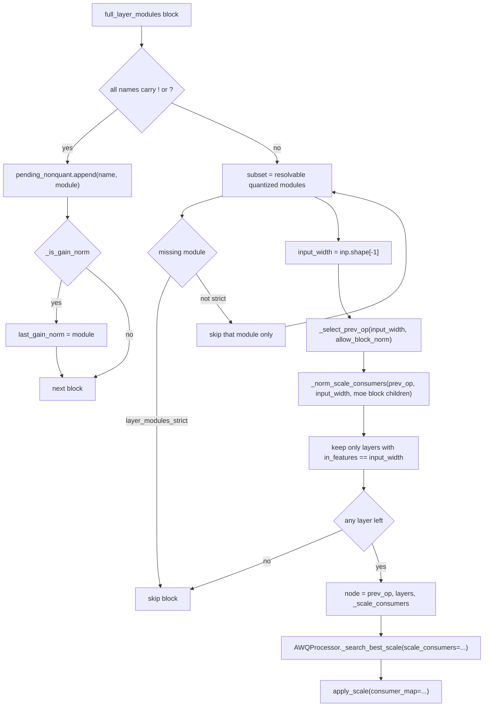
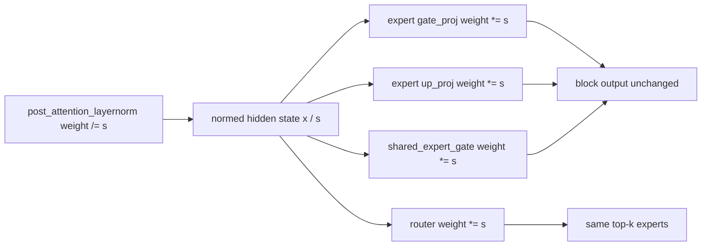
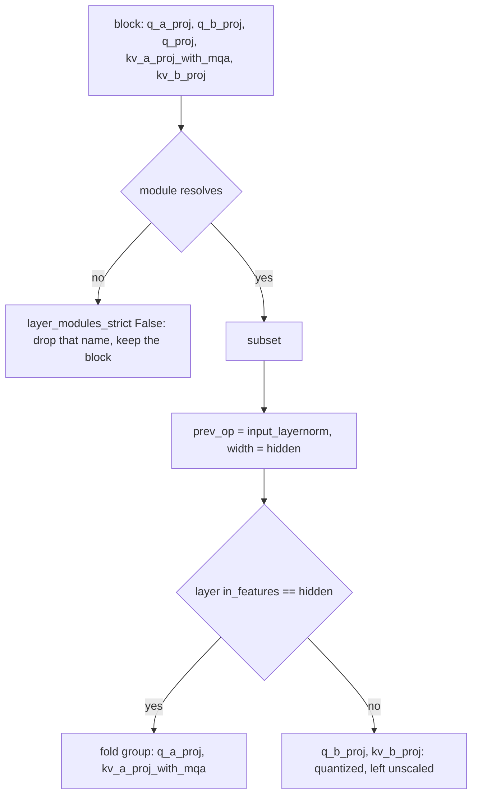
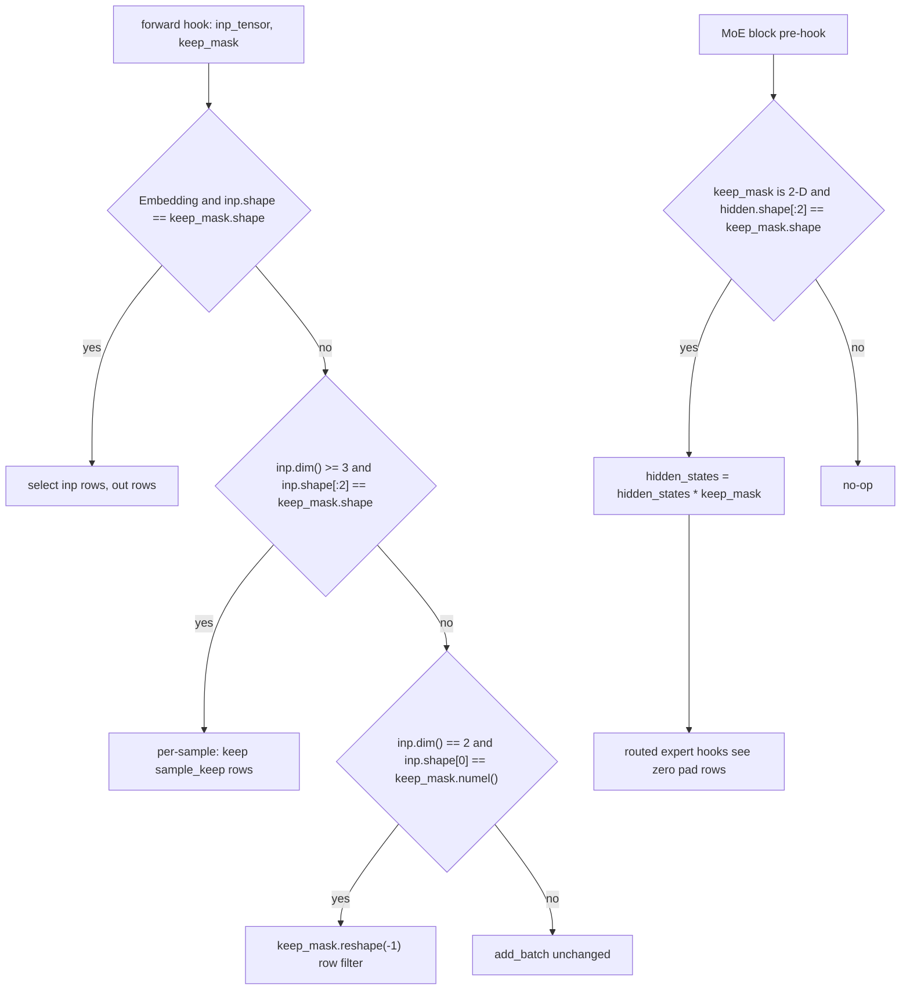
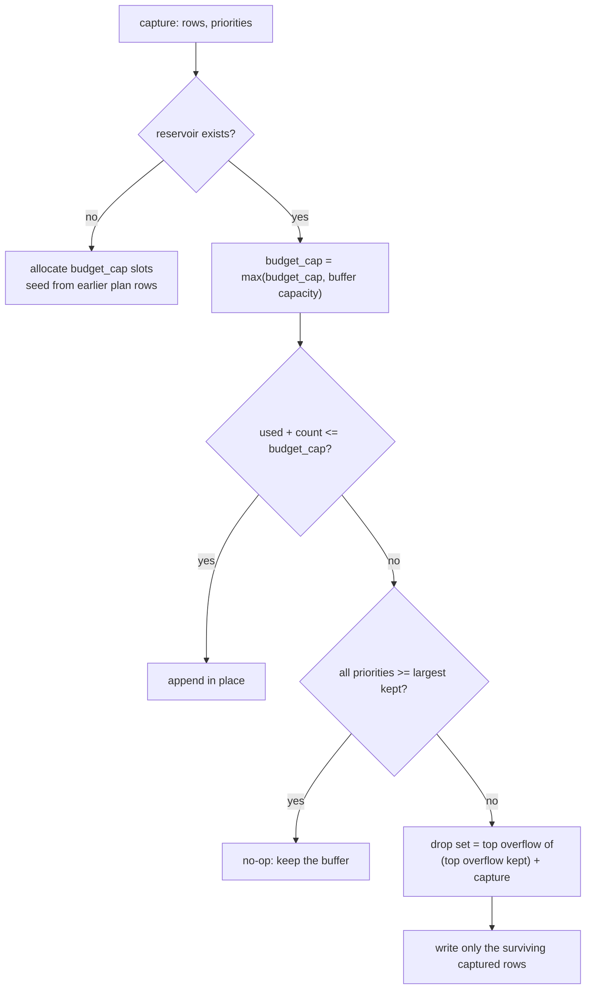

# MoE AWQ scale folding and calibration row ownership

This page describes two coupled mechanisms that decide whether a quantized MoE
layer still computes what the unquantized layer computed:

1. **AWQ scale folding** - which normalization absorbs a group's input scale,
   and which *non-quantized* consumers of that normalization must receive the
   same scale so routing and shared-expert gating do not change.
2. **Calibration row ownership** - which calibration rows are allowed into a
   module's Hessian (`X^T X`) when the calibration batch contains padding.

Both are decided from declared data flow (`module_tree`, `ModulePlan`) and from
the calibration keep mask, never from module names.

Introduced by PR #4027 (issue #4017).

## 1. Fold-source selection and consumer scaling

`BaseQModel.awq_get_modules_for_scaling` walks `full_layer_modules` and keeps a
run of non-quantized blocks (`pending_nonquant`) between two quantized blocks.
`_select_prev_op` resolves the one gain norm that actually feeds the consumer
group; `_norm_scale_consumers` collects the non-quantized modules that read the
same normed tensor. `AWQProcessor` then hands both to `apply_scale`.

After selection, `_filter_awq_scaling_sources` drops groups whose `prev_op` is
declared `nosrc` by the definition (see
[AWQ scaling groups](awq-scaling-groups.md)). A dropped group scales no
consumers, because its norm is never divided.



`_select_prev_op` refuses two folds that used to corrupt layers:

| Situation | Before | After |
| --- | --- | --- |
| Last module is a norm of a different width than the consumer input | folded the wrong-width scale into that norm | returns `None`; the group stays unscaled (`gptqmodel/models/base.py`, `_select_prev_op`) |
| MoE gate/up group whose non-quantized run was already consumed by an earlier routed-expert block | fell back to an unrelated `nn.Linear` (an expert `down_proj`), which later hit `assert len(layers) == 1` in `apply_scale` | falls back to the last gain norm of the layer when `allow_block_norm` is set for a MoE gate/up group |

### Consumer scaling

`scale_ln_fcs` divides the norm by `s` and multiplies every quantized consumer's
input columns by `s`. Any other module reading the same normed tensor keeps
reading `x / s` unless it is scaled too. The router (`mlp.gate`, `router`) and
Qwen2's `shared_expert_gate` are the two consumers that matter for MoE.

Routers are not `nn.Linear`: `Qwen2MoeTopKRouter`, `Qwen3MoeTopKRouter` and
`DeepseekV2TopkRouter` own a `[experts, hidden]` weight and apply it with
`F.linear`. `scale_input_columns` therefore scales the 2-D `weight` parameter
rather than a module class, and `apply_scale` folds the *product* of every scale
divided into the same norm, because each group divides it again.



`_search_best_scale` also multiplies the consumers by each candidate scale while
it scores a group (`_compute_best_scale(..., scale_consumers=...)`), so the
search measures the layer the fold will produce instead of a block whose routing
is still unscaled.

### Where consumers come from

* Declared non-quantized blocks in the same run (`pending_nonquant`), including
  nested ones.
* Direct children of the MoE block with a 2-D `weight` of the block-input width
  that are not declared quantizable. This covers definitions that do not declare
  the router at all (DeepSeek V2/V3 trees list only the projections).

## 2. MLA group partitioning

DeepSeek-V2/V3 `self_attn` declares alternative projections in one block:

```
"self_attn": ("q_a_proj:0", "q_b_proj:0:in=q_a", "q_proj:0",
              "kv_a_proj_with_mqa:0", "kv_b_proj:0:in=kv_a", "o_proj:1")
```

`q_lora_rank` decides whether `q_a_proj`/`q_b_proj` or `q_proj` exist, and
`q_b_proj` / `kv_b_proj` read the compressed latents, not `input_layernorm`.



The second group (`o_proj`) has no norm source: its captured input is the
attention output, so `_select_prev_op` returns the last module (an `nn.Linear`)
and `AWQProcessor` drops the group on the `prev_op.weight.shape[0] !=
first_layer.weight.shape[1]` check.

## 3. Calibration row ownership

`GPTQProcessor.pre_process_fwd_hook` decides which rows reach `add_batch`, and
`GPTQProcessor.register_moe_root_capture_hook` zeroes padding on the MoE block
input for natively routed experts.



| Path | Row shape at the hook | Handled by |
| --- | --- | --- |
| Dense projections | `[B, S, H]` | 3-D branch, per-sample keep mask |
| MoE routing bypass, 2-D shared expert | `[B*S, H]` | 2-D branch, `keep_mask.reshape(-1)` |
| Natively routed experts | `[routed_rows, H]` (row count unrelated to `B*S`) | MoE block pre-hook zeroes pad rows; GPTQ drops them at its expert hook, AWQ in `_drop_padding_only_rows` |

The MoE block pre-hook returns a new tensor, so the caller's residual input is
not mutated in place.

### AWQ captures the same rows

`AWQProcessor.register_moe_root_capture_hook` registers the same zeroing
pre-hook, and `_drop_padding_only_rows` removes the zeroed rows from a routed
expert's capture before it reaches the reservoir or `raw_tokens` (#5337). #4035
had fixed this for GPTQ only, so AWQ kept every padding row the router sent to
an expert: at `batch_size > 1` a few experts could be dominated by pad-token
activations, and DeepSeek-V4 hash layers sent every pad row to the same six
experts per layer (58-75% of those experts' AWQ sample in a 32-document run).

A capture is treated as a routed subset only when its row count matches neither
`keep_mask.numel()` (the raw `[B*S, H]` grid, filtered by the mask itself) nor
`keep_mask.sum()` (the all-expert path, which already stores exactly the kept
rows). A real activation can be all-zero, so the row count is the
discriminator and the zero check only finds which rows to drop.

## 4. Routed-expert capture reservoirs

A routed expert sees a different number of tokens in every batch, so its
captures can never be concatenated into the token-row plan the dense modules
use. Each expert therefore keeps a bounded **priority reservoir**: every
captured row gets a deterministic uniform priority seeded from its capture
slot, and the buffer holds the `budget_cap` lowest priorities seen so far. That
is the deterministic equivalent of Algorithm R, so a batch keeps a share
proportional to its length regardless of where it falls in the stream, and the
memory stays `O(budget_cap)`.

### Capacity

| Situation | `budget_cap` |
| --- | --- |
| Definition declares `max_tokens` | that value, clamped to the position limit |
| Routed expert, no declaration | `max(largest capture, capture count)` — the pre-#5175 per-expert budget |
| No capture history yet | the layer-wide token-row plan budget, clamped to the position limit |

The expert budget only grows, and a growing buffer carries every row it
already held; the reservoir therefore never resets mid-layer. Keeping the
layer-wide budget for every routed expert made the clip search and the replay
forward run on about five times the rows on OLMoE (#5284).

The cap is a high-water mark. Two captures of one module compute their caps
under the processor lock and merge under the module lock, so they can merge in
the opposite order. The merge raises the cap to the buffer's current capacity
before deciding whether to resize; an older, smaller cap therefore cannot
evict rows a larger capture already merged (#5333).

### Merge

The kept set is the `budget_cap` lowest priorities of `kept + captured`. Only
the `overflow` largest kept rows can be displaced — any other kept row already
has `overflow` kept rows at or above it — so the merge selects the drop set
from those plus the capture and writes only the rows that survive. A capture
whose priorities all lose to the largest kept one leaves the buffer untouched.



## Failure and ambiguity contract

| Situation | Behaviour |
| --- | --- |
| Fold source is a norm whose width differs from the consumer input | group is not folded (left unscaled); `scale_ln_fcs` is never called with a mismatched scale |
| Block mixes consumers of different input widths | matching consumers fold; the others stay quantized but unscaled, and the reason is logged at debug level |
| MoE gate/up group with no non-quantized run left | falls back to the last gain norm of the layer only for MoE gate/up groups |
| `layer_modules_strict=True` and a declared module is missing | block is skipped (unchanged) |
| `layer_modules_strict=False` and a declared module is missing | only that name is skipped (DeepSeek alternative layouts) |
| No keep mask bound to the calibration thread | every hook is a no-op; rows pass through |
| `defuser` older than 0.0.32 | the loader logs an error naming the installed version before conversion, because fused 3-D experts stay unsplit and are left unquantized |
| `prev_op` declared `nosrc` | `_filter_awq_scaling_sources` drops the group before `apply_scale`; consumers are not scaled because the norm is not divided |

## Measured results

Tiny random MoE models (1-2 layers, 4 experts, top-2), CPU float32, one scale
group per norm:

| Measurement | Before | After |
| --- | --- | --- |
| qwen2_moe block output relative error after fold | 2.14e-2 | 1.95e-7 |
| qwen2_moe router logits relative error | 2.1e-2 | 9.4e-8 |
| qwen2_moe `shared_expert_gate` relative error | - | 5.3e-8 |
| qwen2_moe top-k expert set | changed | identical |
| DeepSeek-V2 AWQ quantization | `RuntimeError: mm: mat1 and mat2 shapes cannot be multiplied` | completes |
| qwen3_moe expert weights, `batch_size=1` vs `2` (FP32 calibration) | 15.4% - 18.7% relative | bit-identical |
| qwen3_moe dense attention weights, same comparison | bit-identical | bit-identical |

The block-output numbers come from an independent float64 forward of a deep copy
of the pre-fold layer, not from the fold code. The batch-size numbers compare
dequantized checkpoints from the two runs; FP32 calibration is used so the
forward is independent of the batch shape (in BF16 the GEMM blocking alone moves
expert codes by ~10%).

## Not in scope

Groups whose members share an input *width* but read different tensors are still
only separated by width; a same-width different-input group would need declared
`in=` tags on every leaf to be partitioned exactly.
