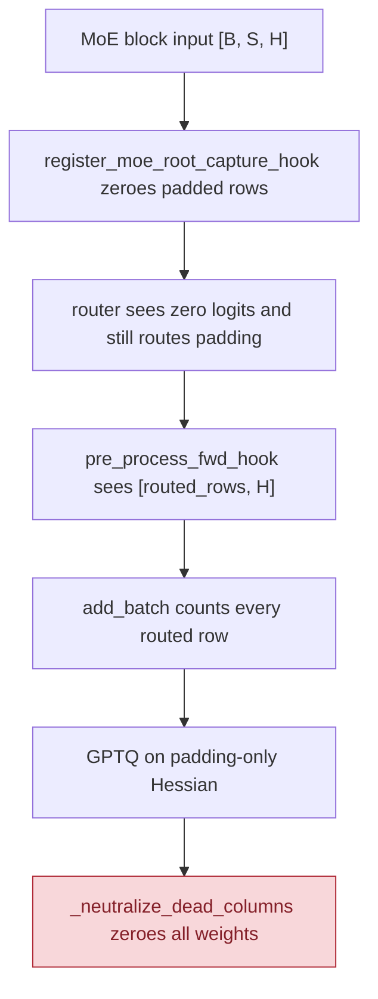
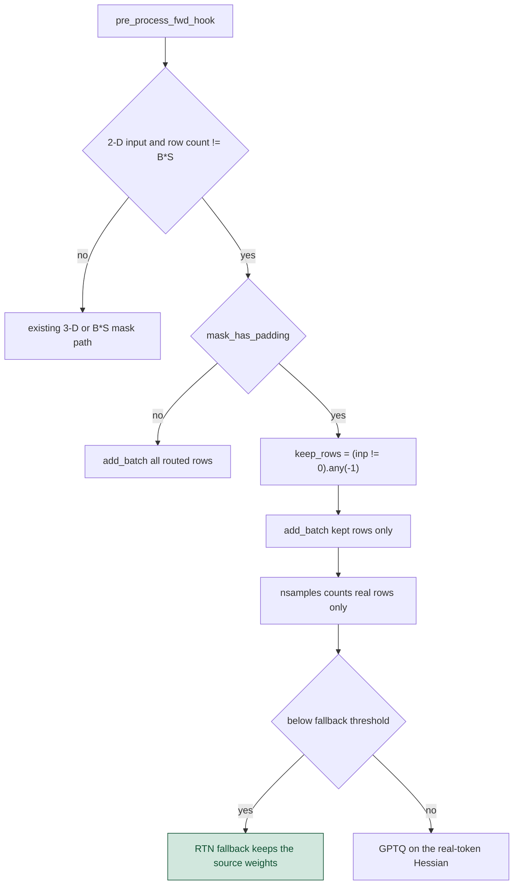
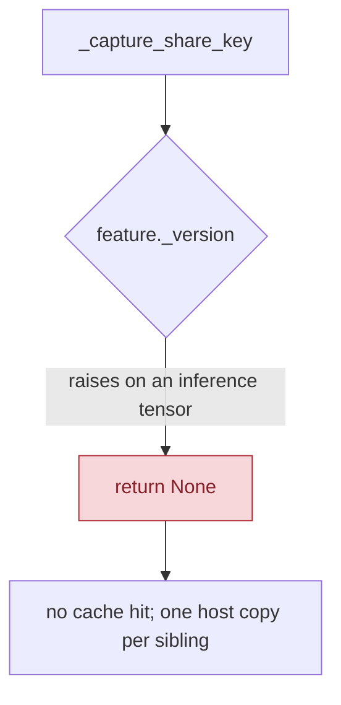
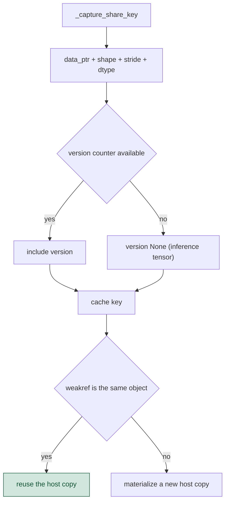
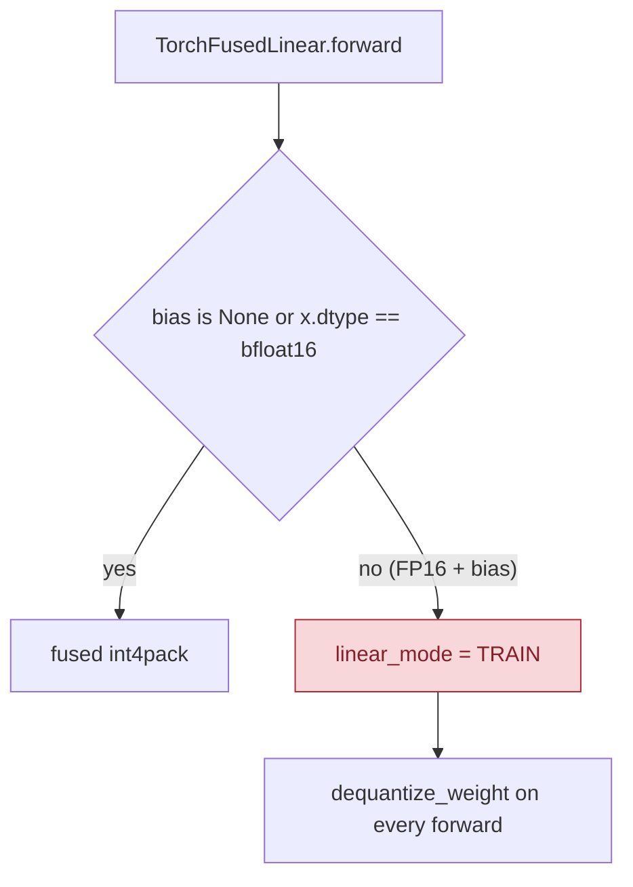
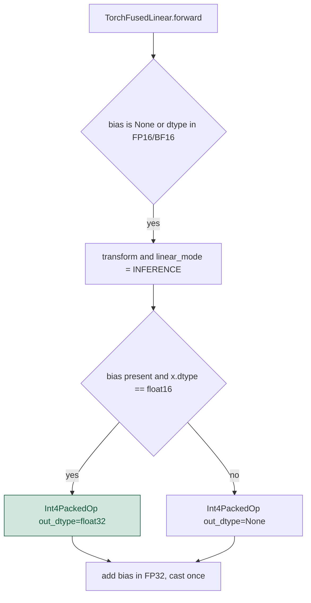
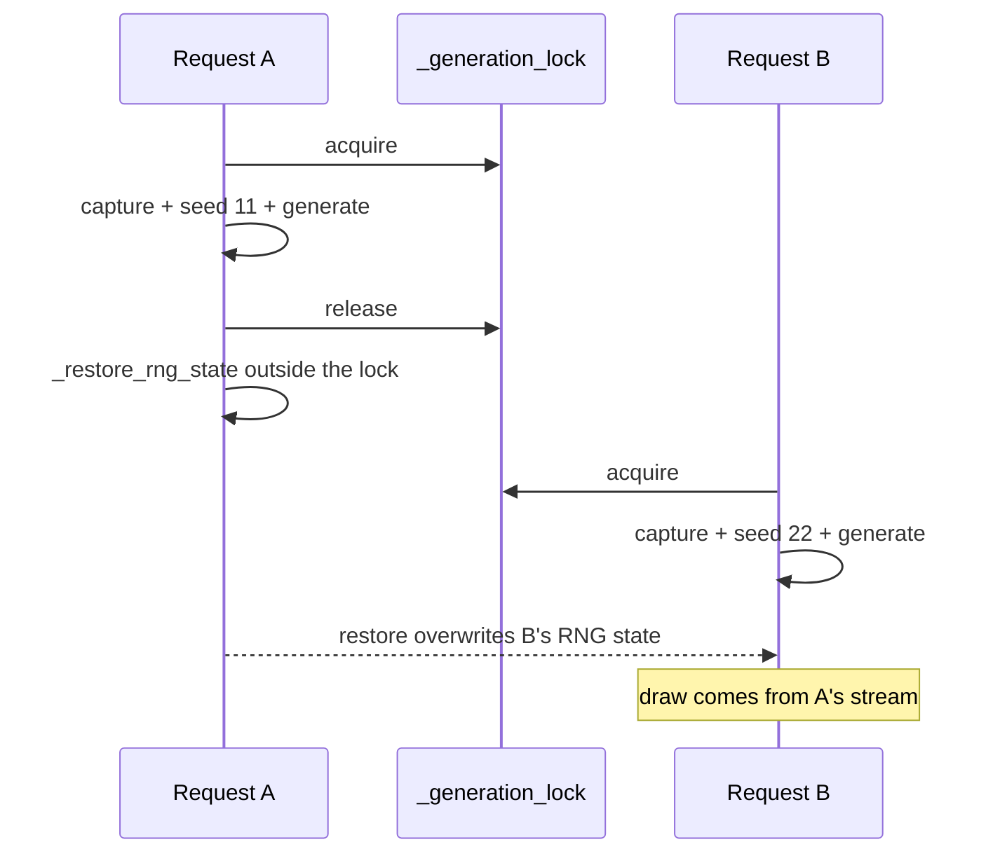
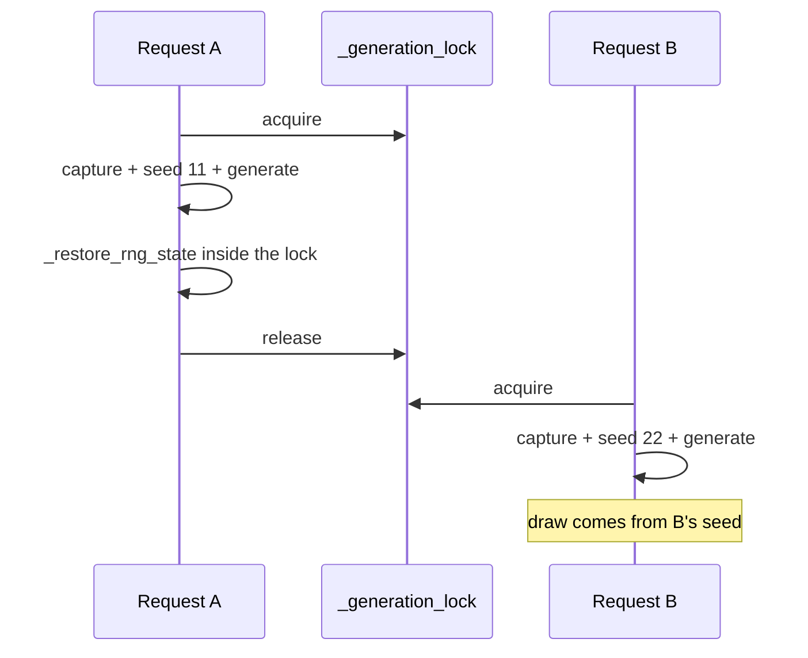

# MoE padding ownership and calibration capture lifetimes

This page describes the calibration and inference flows that decide which rows
reach a routed-expert Hessian, when sibling AWQ captures may share one host
copy, which Torch CPU fused kernel an FP16 layer with a bias takes, and where
the OpenAI server restores the global RNG state. They are coupled by one rule:
a tensor that exists only to describe padding must not change a decision, a
count, or a lock boundary.

Introduced by PR #4051 (follow-up to #4035, #4043, #4032 and #4033).

## 1. MoE padding row ownership

`GPTQProcessor.register_moe_root_capture_hook` zeroes the padded positions of
the `[B, S, H]` MoE block input before the router runs. The router still sees
those rows and still routes them, so the expert hook used to count them in
`nsamples`. An expert that won only padding rows then cleared the 0.5% fallback
threshold, ran GPTQ on an all-zero Hessian, and `_neutralize_dead_columns`
zeroed every weight column.



The fixed hook detects the natively routed `[routed_rows, H]` layout (the row
count is unrelated to the keep mask), drops every all-zero row, and hands only
real rows to `add_batch`. `_set_processor_mask` records `mask_has_padding` once
per batch so a batch without padding does not pay for a scan per expert.



Measured with the Qwen3-MoE fixture where experts 0/1 win only padding rows
(`batch_size=4`): before, `experts.1.gate_proj` had `|Wq| = 0.000` and
`zero_frac = 1.000`; after, `|Wq| = 0.895` and `zero_frac = 0.126`, identical
to the `batch_size=1` RTN result.

## 2. AWQ sibling capture dedup

Calibration runs under `inference_mode`, so every captured activation is an
inference tensor. `AWQProcessor._capture_share_key` keyed on
`int(feature._version)`, which raises for inference tensors. The key was
therefore always `None`, and q/k/v and gate/up each paid their own host copy.



The key is now the storage pointer plus shape, stride, dtype and, when one
exists, the version counter. The cached weakref still proves that a hit is the
same object, so a recycled pointer cannot alias a different capture. A version
counter remains part of the key for normal tensors, so an in-place mutation
still invalidates the host copy.



`apply_scale` already restores the pristine capture before a second scale group
divides the same tensor; `test_apply_scale_restores_shared_feature_for_a_second_group`
pins that contract. Measured on the AWQ Llama fixture, the old key rejected
336/336 captures as `noversion(inference=True)` with 0 cache hits; the new key
materializes one host copy for three sibling captures.

## 3. TorchFused FP16 + bias dispatch

`TorchFusedLinear.forward` treated an FP16 bias as unsafe for the fused op
because the CPU kernel wrote an FP16 output before the bias add. That forced
`linear_mode = TRAIN`, so every forward dequantized the full weight.



`_cpu_int4pack_mm` now accepts an `out_dtype`. A biased FP16 layer asks for an
FP32 product, adds the bias in FP32, and casts once. BF16 keeps its existing
path because BF16 already has FP32's range. `TorchAtenLinear` uses the same
contract.



Measured on CPU with 4 threads, `K = N = 4096`, `M = 1`, median of 10 runs:

| path | before | after |
| --- | --- | --- |
| TorchFused FP16 + bias | 262.95 ms | 17.47 ms |
| TorchFused BF16 + bias | 34.94 ms | 29.92 ms |
| TorchAten FP16 + bias | dense path | 13.04 ms |

The existing FP16 overflow test (`x * K * W + bias` cancels an out-of-range
pre-bias sum) still returns the exact rounded FP16 value. A random-weight
comparison against the dense `matmul_fp32_reduce` path differs by at most one
FP16 ULP (maximum absolute difference `4.88e-4`, relative `3.1e-4`).

## 4. RNG restore inside the generation lock

`create_completion` seeded the global RNG inside `_generation_lock` but restored
it in a `finally` after the `with` block exited. A second request could acquire
the lock, seed and start generating, and then the first request's restore
overwrote its RNG state.



The restore now runs in a nested `finally` inside the lock, so the next request
cannot seed until the previous request's RNG state is back.



With a 0.1 s delay injected inside `_restore_rng_state`, the pre-fix seed 22
request drew from request A's stream; the fixed request draws the value produced
by `torch.manual_seed(22)`.

## Change inventory

| Area | File | Purpose |
| --- | --- | --- |
| MoE padding | `gptqmodel/looper/gptq_processor.py` | drop zeroed routed rows before `add_batch` |
| MoE padding | `gptqmodel/looper/module_looper.py` | publish `mask_has_padding` once per batch |
| AWQ dedup | `gptqmodel/looper/awq_processor.py` | key captures on storage identity, not only `_version` |
| CPU fused kernels | `gptqmodel/nn_modules/qlinear/torch_fused.py` | FP32-output int4pack for FP16 + bias |
| CPU fused kernels | `gptqmodel/nn_modules/qlinear/torch_aten_kernel.py` | same FP32-output contract |
| OpenAI server | `gptqmodel/utils/openai_server.py` | restore the RNG state inside `_generation_lock` |

## Validation

```bash
PYTHONPATH=$PWD /opt/venvs/cu130t/bin/python -m pytest \
  tests/test_moe_padding_rows.py tests/test_moe_batch_equivalence.py -q
PYTHONPATH=$PWD /opt/venvs/cu130t/bin/python -m pytest \
  tests/test_awq_scale_search_memory.py -q
PYTHONPATH=$PWD /opt/venvs/cu130t/bin/python -m pytest \
  tests/test_inference_fp16_overflow.py -q
ruff check gptqmodel docs/eora tests setup.py
```

The OpenAI-server concurrency test skips cleanly when `httpx`/`fastapi` are not
installed, as in this environment.
