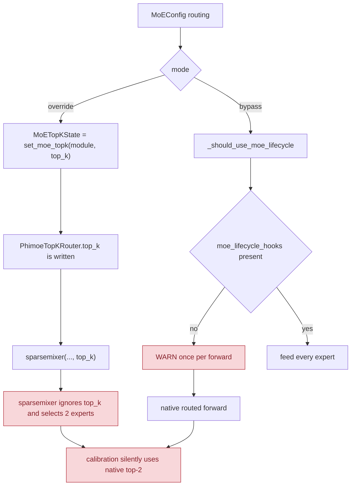
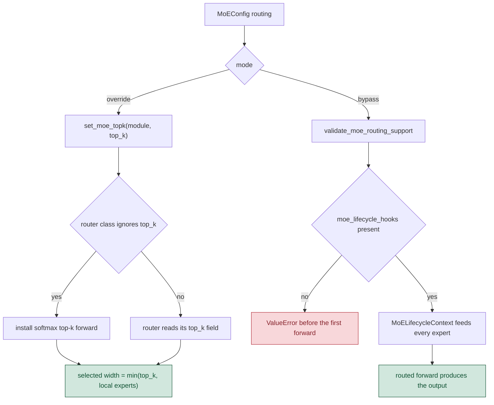
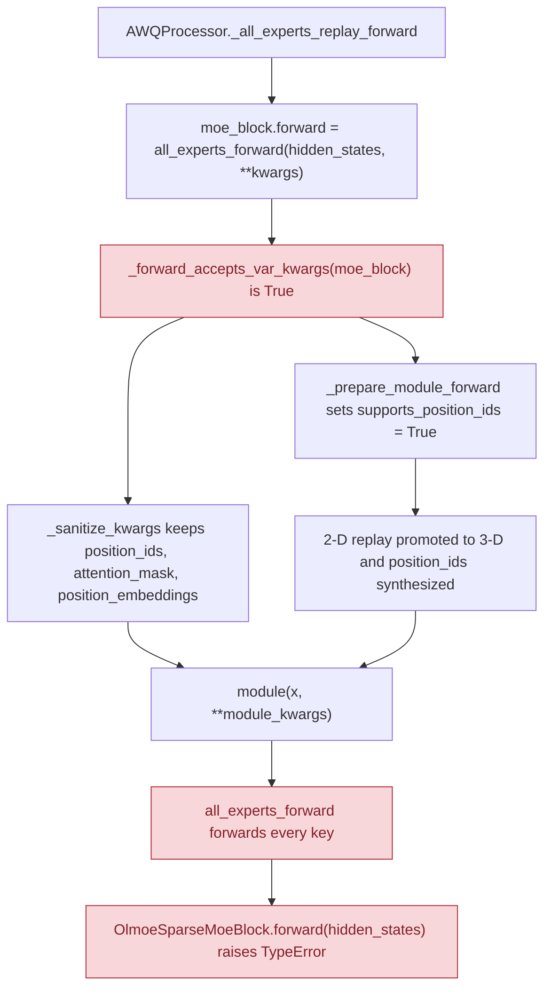
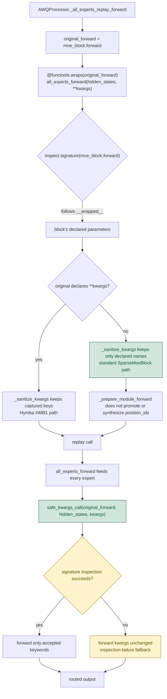

# MoE routing override and bypass contract

This page describes how `MoEConfig` routing modes reach a model's router and
expert lifecycle, and why an unsupported request must fail closed instead of
falling back to native routing.

Introduced by PR for issue #4636.

## 1. The two routing modes

`MoEConfig` selects one of three behaviors:

| Mode | `MoEConfig.routing` | Calibration behavior |
| --- | --- | --- |
| native | `None` | The model's own router selects experts per token. |
| override | `ExpertsRoutingOverride(...)` | Temporarily set the router's top-k so each token reaches that many experts. |
| bypass | `ExpertsRoutingBypass(...)` | Feed the MoE block input to every expert, then run the model's routed forward for the output. |

`ModuleLooper` resolves the mode once in `__init__`
(`gptqmodel/looper/module_looper.py:431`) and `ForwardExecutor` applies it per
forward. `AWQProcessor` re-enters the same mode for its scale-search replay.

## 2. Old flow: two silent fallbacks

The saved config still recorded the requested mode, so the checkpoint looked
like it had been calibrated with override or bypass when it had not.

## 3. New flow: honoured or rejected

The override installer is `_install_phimoe_topk_override`
(`gptqmodel/utils/model.py:4064`). It keeps the native `sparsemixer` path while
`router.top_k` equals the model's configured value, and only replaces the
forward when the override changes it. `restore_moe_topk` restores the original
value, so the next forward uses the native path again.

The bypass gate is `validate_moe_routing_support`
(`gptqmodel/looper/module_looper.py:169`), called from `ModuleLooper.__init__`.
`_should_use_moe_lifecycle` keeps the same guard for a config mutated after
construction.

## 4. Before and after

| Situation | Before | After |
| --- | --- | --- |
| `ExpertsRoutingOverride` on PhiMoE | `set_moe_topk` wrote `top_k`; `sparsemixer` kept selecting 2 experts; no warning | PhiMoE router forward selects `min(top_k, num_experts)` experts; restore returns to native top-2 |
| `ExpertsRoutingBypass` on PhiMoE | No `moe_lifecycle_hooks`; one WARN per forward; native top-2 calibration | `GateUpDownMoELifecycleHooks` declared; every defused expert receives the block input |
| `ExpertsRoutingBypass` on a definition without hooks | One WARN per forward; native calibration; config still recorded bypass | `ValueError` in `ModuleLooper.__init__` before calibration |
| Router that ignores `top_k` | Silent no-op | Model-specific installer or explicit rejection |

## 5. Definitions that now reject bypass

These definitions declare `dynamic_expert_index` but no
`moe_lifecycle_hooks`. Their override path is unchanged because their routers
honour `top_k`; their bypass path now raises the `ModuleLooper` error instead of
falling back:

`gpt_oss`, `granitemoe`, `granitemoehybrid`, `ernie4_5_moe`,
`ernie4_5_vl_moe`, `gemma4`, `nemotron_h`, `nemotron_h_puzzle`,
`dbrx_converted`, `diffusion_gemma`, `kimi_k3`, `deepseek_v4`, `deepseek_v41`.

PhiMoE is implemented rather than rejected: its defused experts expose
`gate_proj`/`up_proj`/`down_proj` with SiLU, so `GateUpDownMoELifecycleHooks`
can feed every expert.

## 6. Failure and ambiguity contract

| Request | Result |
| --- | --- |
| override on a router that honours `top_k` | router selects the requested width |
| override on PhiMoE | router selects the requested width through the installed forward |
| override on an unsupported router | model-specific installer, otherwise the router's own behavior is used |
| bypass with `moe_lifecycle_hooks` | every expert sees the block input |
| bypass without `moe_lifecycle_hooks` | `ValueError` before the first forward |
| dense model with an explicit bypass | `ValueError`; the option cannot be honoured |

## 7. Not in scope

Implementing lifecycle hooks for the thirteen definitions listed above is not
part of this change. They fail closed until a definition supplies tested
`moe_lifecycle_hooks`.

## 8. AWQ replay kwargs for bypass routing

AWQ's scale search replays the MoE block outside `MoELifecycleContext`, so
`AWQProcessor._all_experts_replay_forward`
(`gptqmodel/looper/awq_processor.py:3346`) temporarily installs an
instance-level `all_experts_forward` on the block. The wrapper feeds every
expert in the scale group and then calls the block's original forward for the
routed output.

That wrapper is not a model forward. Before #5095 it was a bare closure with
its own `**kwargs`, so every signature-based decision in the replay path saw
the wrapper instead of the block:

The removed mechanism was `return original_forward(hidden_states, **kwargs)`
at `gptqmodel/looper/awq_processor.py:3410` (e2f9676c6). The `**kwargs`
allowance itself is still required: Hymba's `HymbaBlock` declares
`(hidden_states, past_key_value=None, **kwargs)` and reads `attention_mask`,
`position_ids` and `kv_last_layer` out of the catch-all (#4891). Deleting the
allowance would regress that model.

The fix distinguishes the two by *declaration* rather than by who installed
the forward. The wrapper now carries `functools.wraps(original_forward)`
(`gptqmodel/looper/awq_processor.py:3392`), so `inspect.signature` follows
`__wrapped__` and reports the block's real signature. A genuine `**kwargs`
block still reports `VAR_KEYWORD`; the wrapper no longer does. The wrapper also
forwards only the keywords the original forward declares, through
`safe_kwargs_call` (`gptqmodel/looper/awq_processor.py:3429`), so a caller that
does supply extra keys cannot widen the block's contract.

| Situation | Before #5095 | After #5095 |
| --- | --- | --- |
| Standard MoE block (`forward(hidden_states)`) replayed by AWQ bypass | Wrapper's `**kwargs` made `_forward_accepts_var_kwargs` true; `position_ids`/`attention_mask` reached the block; `TypeError` in layer 0 | `functools.wraps` exposes `forward(hidden_states)`; sanitize keeps no layer kwargs; wrapper forwards only `hidden_states` |
| Hymba `HymbaBlock` (`forward(hidden_states, past_key_value=None, **kwargs)`) | Real `VAR_KEYWORD`; captured `attention_mask`, `position_ids`, `kv_last_layer` forwarded (#4891) | Unchanged: the declared signature still has `VAR_KEYWORD` |
| Caller passes an unsupported key to the wrapper | Forwarded to the original forward and raised | `safe_kwargs_call` drops it before the original forward |
| Signature cannot be inspected | Predicate returns false; wrapper forwards everything | `safe_kwargs_call` forwards kwargs unchanged (explicit fallback) |

Failure and ambiguity contract:

| Condition | Result |
| --- | --- |
| Standard MoE block, bypass replay | Only `hidden_states` reaches the original forward |
| Real `**kwargs` block, bypass replay | Every captured, non-private key reaches the block |
| Instance wrapper without `functools.wraps` | Treated as a `**kwargs` block; the regression test fails |
| `inspect.signature` raises | `_forward_accepts_var_kwargs` is false; `safe_kwargs_call` forwards kwargs unchanged |

Introduced by the PR for issue #5095.
