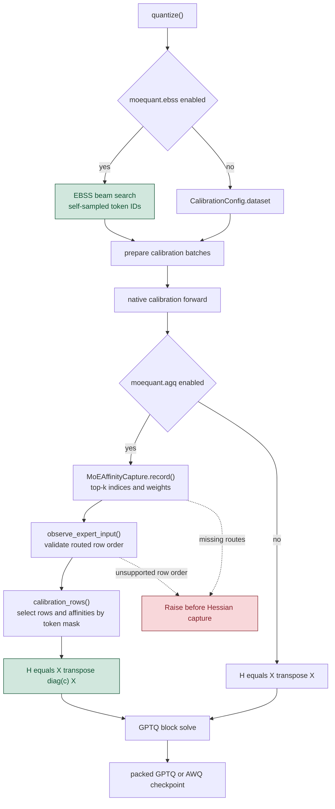

# MoEQuant: expert-balanced sampling and affinity-guided quantization

[Documentation index](README.md) · [Project overview](../README.md)

MoEQuant (Chen et al., ICML 2025) adds two calibration techniques for
Mixture-of-Experts models:

- **Expert-Balanced Self-Sampling (EBSS)** builds a calibration set from the
  model itself. It searches token sequences with a beam, scoring each branch by
  cumulative likelihood and by how evenly the branch uses the routed experts.
  The search is data-free and does not read WikiText or C4.
- **Affinity-Guided Quantization (AGQ)** weights each routed token's
  quantization error by the router affinity `c_i` that the MoE block applies to
  that expert's output. For GPTQ this is exactly a row-weighted Hessian,
  `H = X^T diag(c) X`; the block solve itself does not change.

GPT-QModel implements both as a calibration variant of GPTQ and AWQ. The
checkpoint format and `quant_method` remain `gptq` or `awq`; `meta.moequant`
records the calibration provenance. This is a clean-room implementation from
the paper's Algorithm 1 and Eqs. 18-19, not a port of either public release.

## Flow



| Situation | Before | After |
| --- | --- | --- |
| MoE calibration data | Caller-provided text, often WikiText or C4 | EBSS self-samples token sequences from the model |
| Starved experts | Rarely selected experts get few or no rows | EBSS rewards branches with balanced expert usage |
| Routed expert Hessian | `H = X^T X`, every token equally weighted | `H = X^T diag(c) X`, weighted by router affinity |
| Dense and shared experts | `H = X^T X` | unchanged; the paper defines affinity for routed experts |
| GPTQ block solve | unchanged | unchanged; only the captured Hessian differs |
| Checkpoint format | `gptq` / `awq` | unchanged; `meta.moequant` records the calibration policy |
| Routed rows selected for calibration | Padding inferred from activations in natively routed GPTQ | AGQ maps the calibration keep mask through the validated token order |
| Missing routing weights or unknown row order | n/a | AGQ raises before accumulating the Hessian |
| AWQ AGQ | n/a | not implemented; AWQ supports EBSS only in this release |

## EBSS search

Algorithm 1 in the paper keeps `w` branches. At each step every retained prefix
is forwarded once; the next-token logits expand the whole vocabulary
analytically. The score of appending token `v` to prefix `S` is

```text
score(S, v) = -(R_S + log P(v | S)) / (l + 1) + sigma(M, S) / tau
```

where `R_S` is the prefix log-likelihood and `sigma(M, S)` is the
layer-averaged standard deviation of routed-expert usage over that prefix:

```text
sigma_l = sqrt(sum_e (usage_e - 1 / E)^2 / (E - 1))
```

The beam keeps the lowest costs and returns the completed sentence with the
lowest cost, following the joint minimization in Eqs. 9–10. The balance term
uses the sample standard deviation in Eq. 4. Each router has its own usage
histogram. When a model or enclosing MoE block also exposes the gate's top-k
settings, EBSS observes the nested router. A forward that never calls a
discovered router raises before its output can enter the beam.

The defaults are the paper's ablation values: `width=4`, `temperature=1.2`.
`num_sentences` and `seq_len` default to 128 and 512 and remain configurable.
The search keeps one KV cache per branch, so a step costs `w` single-token
forwards rather than a full-vocabulary forward per branch.

The first token of every sentence is drawn uniformly from the vocabulary. Its
constant `-log V` prior cancels from all candidate rankings, so `R_S` starts at
zero. The balance term in the intermediate score uses the retained prefix's
routing statistics: the next token's routing is known only after the branch is
forwarded, so evaluating the paper's `sigma(M, new candidate)` for every
vocabulary item would require a forward per expansion. The final sentence
score uses the complete sequence's routing.

## AGQ capture

GPT-QModel reads each affinity `c_i` from the `top_k_weights` input of the
experts container, paired with its corresponding `top_k_index`. A pre-hook on
the expert's input projections validates its dispatch order against the
container input. This also runs during a subset that captures only
`down_proj`, which receives the same routed rows after the expert's activation
function. Both slot-major and token-major dispatch are supported, including
batched route tensors. The validated token indices select calibration rows
and affinities together, excluding padding and masked attention sinks.

The captured row weights are `c_i`; GPTQ applies `sqrt(c_i)` to the input rows
before `X^T X`. The existing sink-row cap and Hessian chunking compose with
that scale.

## Configuration

GPTQ with both techniques:

```python
from gptqmodel import EBSSConfig, GPTQModel, MoEQuantConfig, QuantizeConfig

qcfg = QuantizeConfig(
    bits=4,
    group_size=128,
    desc_act=False,
    # EBSS needs a materialized model; the lazy checkpoint shell is rejected.
    offload_to_disk=False,
    moequant=MoEQuantConfig(
        agq=True,
        ebss=EBSSConfig(num_sentences=128, seq_len=512, width=4, temperature=1.2),
    ),
)
model = GPTQModel.load("Qwen/Qwen3-30B-A3B", quantize_config=qcfg)
model.quantize()  # EBSS generates the calibration data
```

AWQ with EBSS:

```python
from gptqmodel import GPTQModel, QuantizeConfig
from gptqmodel.quantization import FORMAT, METHOD

qcfg = QuantizeConfig(
    bits=4,
    group_size=128,
    method=METHOD.AWQ,
    format=FORMAT.GEMM,
    offload_to_disk=False,
    moequant=MoEQuantConfig(
        agq=False,
        ebss=EBSSConfig(num_sentences=128, seq_len=512, width=4, temperature=1.2),
    ),
)
```

The variant is also accepted as a plain dictionary, like the other calibration
options:

```python
moequant={"agq": True, "ebss": {"num_sentences": 64, "seq_len": 256}}
```

## Failure contracts

- EBSS replaces `CalibrationConfig.dataset`. Passing both raises; the search
  never silently appends to or ignores caller data.
- EBSS requires materialized weights. A lazy checkpoint shell raises before the
  search; load with `QuantizeConfig(offload_to_disk=False)` or materialize the
  model first.
- The search runs on the quantization device (`device=` or
  `QuantizeConfig.device`). The full model is staged there when it fits and
  its previous placement is restored afterwards; otherwise decoder layers are
  staged one at a time. See
  [multi-GPU quantization](multi_gpu_quantization.md#ebss-search-placement).
- `agq=True` requires native MoE routing. `ExpertsRoutingBypass` is rejected
  because the bypass feeds every expert all tokens, so the routed-token
  affinity is not defined.
- AGQ fails closed when the experts container does not expose
  `top_k_index`/`top_k_weights` or the expert input disagrees with the
  captured row order or count.
- AWQ currently supports EBSS only. `AWQConfig(moequant=MoEQuantConfig())`
  raises and asks for `agq=False`.
- `moequant` is mutually exclusive with `gptaq`, `foem`, `g2ptq`, GSQ, mock
  quantization and the W4A `activation` stream. It is a run-level option and
  cannot be set in `dynamic`.
- `requantize()` cannot rerun EBSS; run it during `quantize()`.

## Scope and limitations

- The paper's `MoEQuant++` combines QuaRot, GPTQ, EBSS and AGQ. This
  implementation adds EBSS and AGQ to GPT-QModel's GPTQ path; it does not add a
  new rotation. Existing rotation/smoothing options can be configured
  separately and must be validated on the target model.
- Shared experts and dense projections are not affinity-weighted. The paper
  defines Eq. 18 for routed experts; it does not define a shared-expert
  affinity.
- AWQ AGQ is not implemented. AWQ's routed gate/up scale group spans several
  experts and its replay scores the mixed MoE-block output, so applying one
  per-expert affinity vector would either double-count the block's routing
  weights or require a per-member replay. AWQ therefore keeps EBSS and plain
  AWQ scaling in this release.

## Citation and credit

The method and its algorithms are from:

> Zhixuan Chen, Xing Hu, Dawei Yang, Zukang Xu, Xu Chen, Zhihang Yuan, Sifan
> Zhou, and Jiangyong Yu. "MoEQuant: Enhancing Quantization for
> Mixture-of-Experts Large Language Models via Expert-Balanced Sampling and
> Affinity Guidance." ICML 2025, PMLR 267:8245-8260.

```bibtex
@InProceedings{pmlr-v267-chen25aa,
  title     = {{M}o{EQ}uant: Enhancing Quantization for Mixture-of-Experts Large Language Models via Expert-Balanced Sampling and Affinity Guidance},
  author    = {Chen, Zhixuan and Hu, Xing and Yang, Dawei and Xu, Zukang and Chen, Xu and Yuan, Zhihang and Zhou, Sifan and Yu, Jiangyong},
  booktitle = {Proceedings of the 42nd International Conference on Machine Learning},
  pages     = {8245--8260},
  year      = {2025},
  volume    = {267},
  series    = {Proceedings of Machine Learning Research},
  publisher = {PMLR},
  url       = {https://proceedings.mlr.press/v267/chen25aa.html}
}
```

Paper: <https://arxiv.org/abs/2505.03804> ·
PMLR: <https://proceedings.mlr.press/v267/chen25aa.html> ·
Official implementation: <https://github.com/chenzx921020/MoEQuant> ·
Later public release: <https://github.com/Strandding/MoEQuant>

The paper's software link is the April 2025 release
(`chenzx921020/MoEQuant`), which ships the GPTQ/AWQ evaluation code and
pre-built EBSS calibration JSONL. `Strandding/MoEQuant` is a later release that
adds the EBSS beam-search driver and the AGQ hooks, and it is the release
consulted for behaviour here. The implementation in `gptqmodel/utils/ebss.py` and
`gptqmodel/utils/moe_affinity.py` is clean-room from the paper; no source code
was copied from either release.
