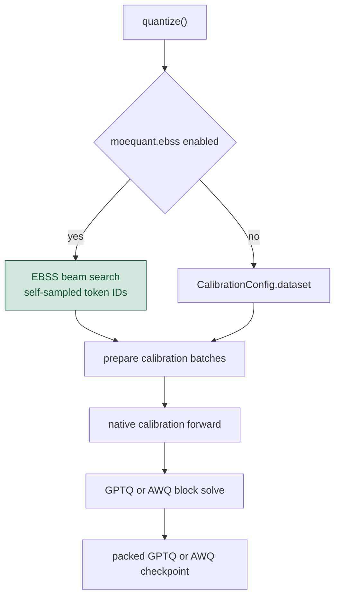

# MoEQuant: expert-balanced self-sampling calibration

[Documentation index](README.md) · [Project overview](../README.md)

MoEQuant (Chen et al., ICML 2025) introduces two calibration techniques for
Mixture-of-Experts models: Expert-Balanced Self-Sampling (EBSS) and
Affinity-Guided Quantization (AGQ). This change implements **EBSS** as a
calibration variant of GPTQ and AWQ. AGQ is not implemented here.

EBSS builds a calibration set from the model itself. It searches token
sequences with a beam, scoring each branch by cumulative likelihood and by how
evenly the branch uses the routed experts. The search is data-free and does not
read WikiText or C4.

The checkpoint format and `quant_method` remain `gptq` or `awq`;
`meta.moequant` records the calibration provenance. This is a clean-room
implementation from the paper's Algorithm 1, not a port of the public
repository.

## Flow



| Situation | Before | After |
| --- | --- | --- |
| MoE calibration data | Caller-provided text, often WikiText or C4 | EBSS self-samples token sequences from the model |
| Starved experts | Rarely selected experts get few or no rows | EBSS rewards branches with balanced expert usage |
| GPTQ/AWQ block solve | unchanged | unchanged; only the calibration data differs |
| Checkpoint format | `gptq` / `awq` | unchanged; `meta.moequant` records the calibration policy |
| Caller dataset plus EBSS | n/a | rejected instead of silently ignored |

## EBSS search

Algorithm 1 in the paper keeps `w` branches. At each step every retained prefix
is forwarded once; the next-token logits expand the whole vocabulary
analytically. The score of appending token `v` to prefix `S` is

```text
score(S, v) = -(R_S + log P(v | S)) / (l + 1) + sigma(M, S) / tau
```

where `R_S` is the prefix log-likelihood and `sigma(M, S)` is the
layer-averaged standard deviation of routed-expert usage over that prefix:

```text
sigma_l = sqrt(E / (E - 1) * sum_e (usage_e - 1 / E)^2)
```

The defaults are the paper's ablation values: `width=4`, `temperature=1.2`.
`num_sentences` and `seq_len` default to 128 and 512 and remain configurable.
The search keeps one KV cache per branch, so a step costs `w` single-token
forwards rather than a full-vocabulary forward per branch.

The first token of every sentence is drawn uniformly from the vocabulary. Its
constant `-log V` prior cancels from all candidate rankings, so `R_S` starts at
zero. The balance term in the intermediate score uses the retained prefix's
routing statistics: the next token's routing is known only after the branch is
forwarded, so evaluating the paper's `sigma(M, new candidate)` for every
vocabulary item would require a forward per expansion. The final sentence
score uses the complete sequence's routing.

## Configuration

GPTQ with EBSS:

```python
from gptqmodel import EBSSConfig, GPTQModel, MoEQuantConfig, QuantizeConfig

qcfg = QuantizeConfig(
    bits=4,
    group_size=128,
    desc_act=False,
    # EBSS needs a materialized model; the lazy checkpoint shell is rejected.
    offload_to_disk=False,
    moequant=MoEQuantConfig(
        ebss=EBSSConfig(num_sentences=128, seq_len=512, width=4, temperature=1.2),
    ),
)
model = GPTQModel.load("Qwen/Qwen3-30B-A3B", quantize_config=qcfg)
model.quantize()  # EBSS generates the calibration data
```

AWQ with EBSS:

```python
from gptqmodel import GPTQModel, QuantizeConfig
from gptqmodel.quantization import FORMAT, METHOD

qcfg = QuantizeConfig(
    bits=4,
    group_size=128,
    method=METHOD.AWQ,
    format=FORMAT.GEMM,
    offload_to_disk=False,
    moequant=MoEQuantConfig(
        ebss=EBSSConfig(num_sentences=128, seq_len=512, width=4, temperature=1.2),
    ),
)
```

The variant is also accepted as a plain dictionary, like the other calibration
options:

```python
moequant={"ebss": {"num_sentences": 64, "seq_len": 256}}
```

## Failure contracts

- EBSS replaces `CalibrationConfig.dataset`. Passing both raises; the search
  never silently appends to or ignores caller data.
- EBSS requires materialized weights. A lazy checkpoint shell raises before the
  search; load with `QuantizeConfig(offload_to_disk=False)` or materialize the
  model first.
- `moequant` is mutually exclusive with `gptaq`, `foem`, GSQ and mock
  quantization. It is a run-level option and cannot be set in `dynamic`.
- `requantize()` cannot rerun EBSS; run it during `quantize()`.
- AGQ is not implemented in this change. `MoEQuantConfig(agq=True)` raises
  instead of silently skipping affinity weighting.

## Scope and limitations

- The paper's `MoEQuant++` combines QuaRot, GPTQ, EBSS and AGQ. This change
  adds EBSS to GPT-QModel's GPTQ and AWQ calibration paths; it does not add a
  new rotation or AGQ.
- Shared experts and dense projections are unaffected by EBSS. It changes the
  calibration data, not the per-module weighting.

## Citation and credit

The method and its algorithms are from:

> Zhixuan Chen, Xing Hu, Dawei Yang, Zukang Xu, Xu Chen, Zhihang Yuan, Sifan
> Zhou, and Jiangyong Yu. "MoEQuant: Enhancing Quantization for
> Mixture-of-Experts Large Language Models via Expert-Balanced Sampling and
> Affinity Guidance." ICML 2025, PMLR 267:8245-8260.

```bibtex
@InProceedings{pmlr-v267-chen25aa,
  title     = {{M}o{EQ}uant: Enhancing Quantization for Mixture-of-Experts Large Language Models via Expert-Balanced Sampling and Affinity Guidance},
  author    = {Chen, Zhixuan and Hu, Xing and Yang, Dawei and Xu, Zukang and Chen, Xu and Yuan, Zhihang and Zhou, Sifan and Yu, Jiangyong},
  booktitle = {Proceedings of the 42nd International Conference on Machine Learning},
  pages     = {8245--8260},
  year      = {2025},
  volume    = {267},
  series    = {Proceedings of Machine Learning Research},
  publisher = {PMLR},
  url       = {https://proceedings.mlr.press/v267/chen25aa.html}
}
```

Paper: <https://arxiv.org/abs/2505.03804> ·
PMLR: <https://proceedings.mlr.press/v267/chen25aa.html> ·
Official implementation: <https://github.com/chenzx921020/MoEQuant> ·
Later public release: <https://github.com/Strandding/MoEQuant>

The paper's software link is the April 2025 release
(`chenzx921020/MoEQuant`), which ships the GPTQ/AWQ evaluation code and
pre-built EBSS calibration JSONL. `Strandding/MoEQuant` is a later release that
adds the EBSS beam-search driver and the AGQ hooks, and it is the release
consulted for behaviour here. The implementation in `gptqmodel/utils/ebss.py`
is clean-room from the paper; no source code was copied from either release.
