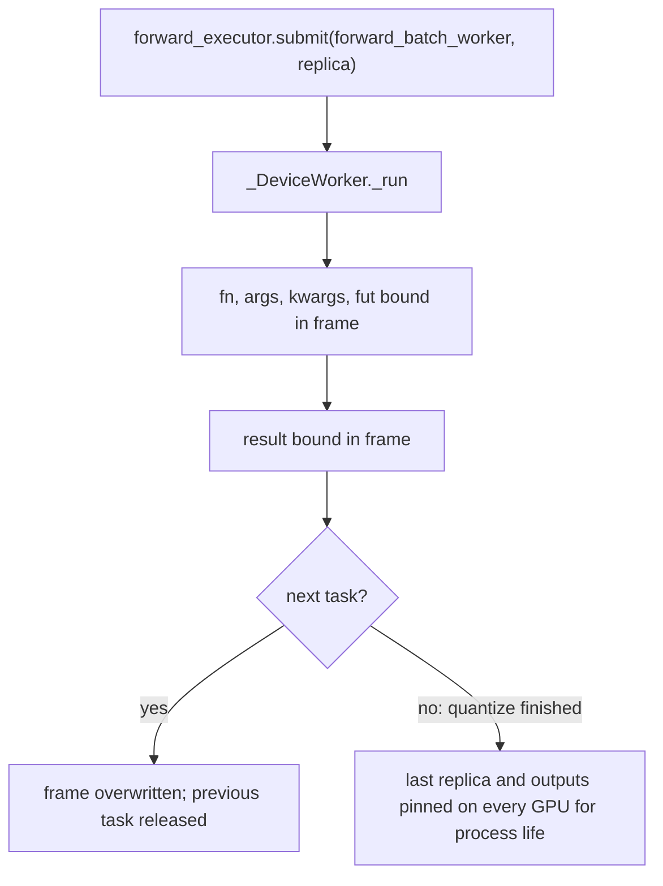
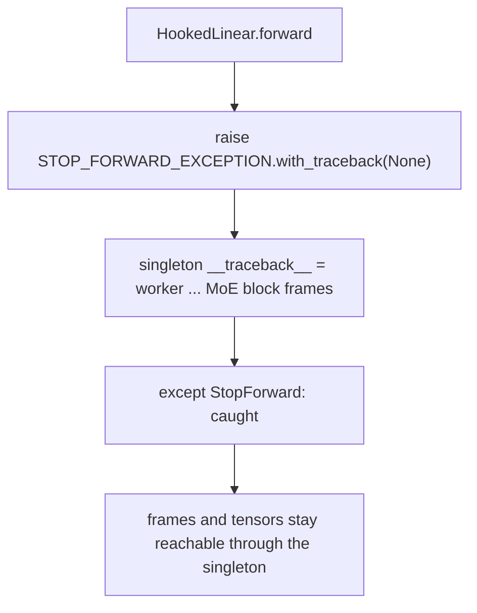
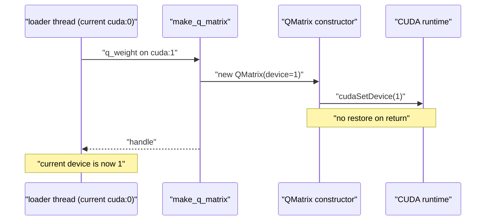
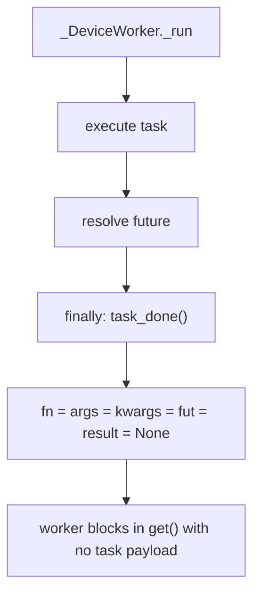
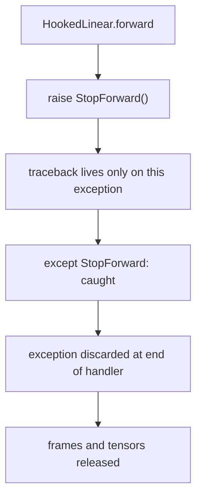
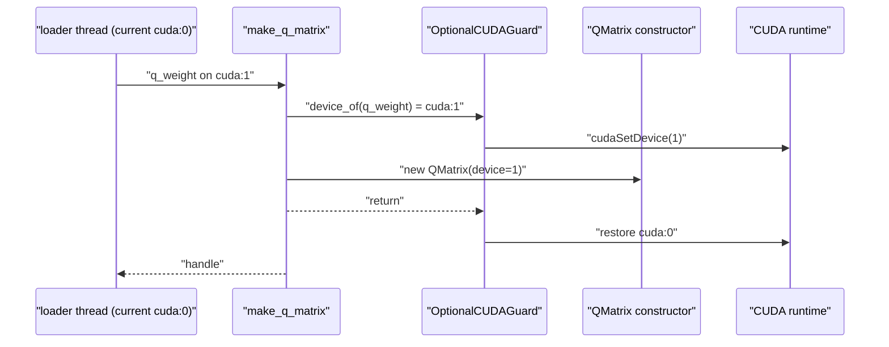

# Multi-GPU memory retention

Multi-GPU quantization splits each decoder layer across the visible GPUs and
fans the per-device forward out to a device thread pool. Three resources used to
outlive the stage that created them, so a completed `quantize()` still held GPU
memory or leaked device state for the life of the process:

1. the device worker frame kept the last task's callable, arguments, result and
   future;
2. the shared `STOP_FORWARD_EXCEPTION` kept the traceback (and every tensor in
   its frames) from its last raise;
3. ExLlamaV2's `QMatrix` constructor changed the process's current CUDA device
   and never restored it.

The ownership rule is the same for all three: the object that creates a
resource releases it when the operation completes, not when the next unrelated
operation happens to arrive.

| Resource | Created by | Released by |
| --- | --- | --- |
| task callable / args / result / future | `forward_executor` submit | worker `finally`, after `task_done()` |
| `StopForward` traceback | `HookedLinear` / auto-cast hooks | exception discarded after its handler; each raise is a fresh instance |
| CUDA current device | `QMatrix` constructor | `at::cuda::OptionalCUDAGuard` at `make_q_matrix` scope exit |

## Old flow

A worker only overwrote its frame when the next task arrived. After
`quantize()` none does, so the last data-parallel replica stayed pinned.

The singleton exception accumulated the traceback on every raise, so a caught
`StopForward` still reached the MoE block's frames through the module global.

ExLlamaV2's constructor switched the current device for the calling thread and
left it switched.

## New flow

The worker drops its task references immediately after accounting for the task.
This is a reference-count change only; it adds no synchronization point.

Every early stop raises a fresh `StopForward`. The module-level
`STOP_FORWARD_EXCEPTION` remains importable for compatibility but is no longer
raised, so nothing process-lifetime owns a traceback. No code compares the
exception by identity (`is`); handlers only use `except StopForward`.

`make_q_matrix` now guards the whole op, so the constructor's `cudaSetDevice`
is undone when the op returns.

## Before and after

| Item | Old mechanism | New mechanism | Code |
| --- | --- | --- | --- |
| Worker frame | task locals live until the next `get()` | cleared in `finally` after `task_done()` | `gptqmodel/utils/threadx.py:570-577` |
| Early stop | one shared exception keeps the last traceback | fresh `StopForward` per raise | `gptqmodel/nn_modules/hooked_linear.py:230`, `:292`, `:354`, `:384`, `:456`; `gptqmodel/utils/auto_dtype_cast.py:308`; `gptqmodel/looper/stage_inputs_capture.py:321` |
| ExLlamaV2 load | constructor leaves `cudaSetDevice` set | `OptionalCUDAGuard` over the whole op | `gptqmodel_ext/exllamav2/ext_gptq.cpp:27`; `gptqmodel_ext/exllamav2/ext_awq.cpp:27` |

Measured on 2x RTX 4090 (CUDA 13.0, Torch 2.16.0.dev), `torch.cuda.memory_allocated`:

| Repro | Before | After |
| --- | --- | --- |
| Worker task holding 256 MiB, caller refs dropped + gc | 256.000 MiB pinned | 0.000 MiB, weakref dead |
| Same, after one further no-op task | 0.0000 MiB | 0.0000 MiB |
| `StopForward` raised from a frame holding 512 MiB, caught + gc | 512.000 MiB pinned, singleton traceback not None | 0.0010 MiB, singleton traceback None |
| Qwen2.5-0.5B GPTQ 4-bit, 2 GPUs, after `quantize()` + `save()` + gc on `cuda:1` | 26.377 MiB | 0.000 MiB |
| `make_q_matrix` with operands on `cuda:1` while `cuda:0` is current | `current_device` 0 -> 1 (GPTQ and AWQ) | 0 -> 0 (GPTQ and AWQ) |

On 2x R9700 (ROCm 10.1) the worker-frame repro and its test report 0.000 MiB
and a dead weakref after the fix. ExLlamaV2 is CUDA-only, so the device-guard
repro runs on CUDA.

Quantize wall time on Qwen2.5-0.5B is unchanged within noise (11.9 s after vs
12.6 s before on the same host); the `finally` cleanup performs no
synchronization.

## Tests

| Test | Invariant |
| --- | --- |
| `tests/test_threadx.py::test_worker_frame_releases_last_task_references` | the last task's tensor dies once the task completes, with no further submission |
| `tests/test_stop_forward_leak.py::test_stop_forward_does_not_pin_the_raising_traceback` | the singleton keeps no traceback and the raising frame's tensor is released |
| `tests/kernels/test_exllamav2_device_guard.py::test_make_q_matrix_restores_current_device` | GPTQ and AWQ `make_q_matrix` leave `torch.cuda.current_device()` unchanged |

All three fail against the pre-fix code and pass after it.
