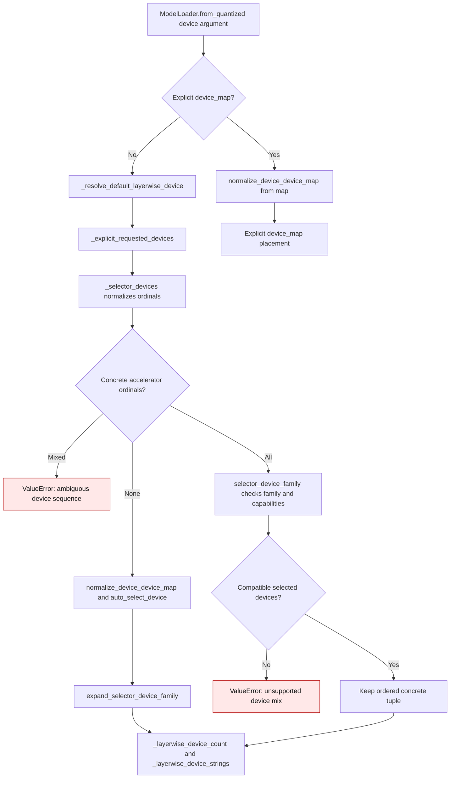
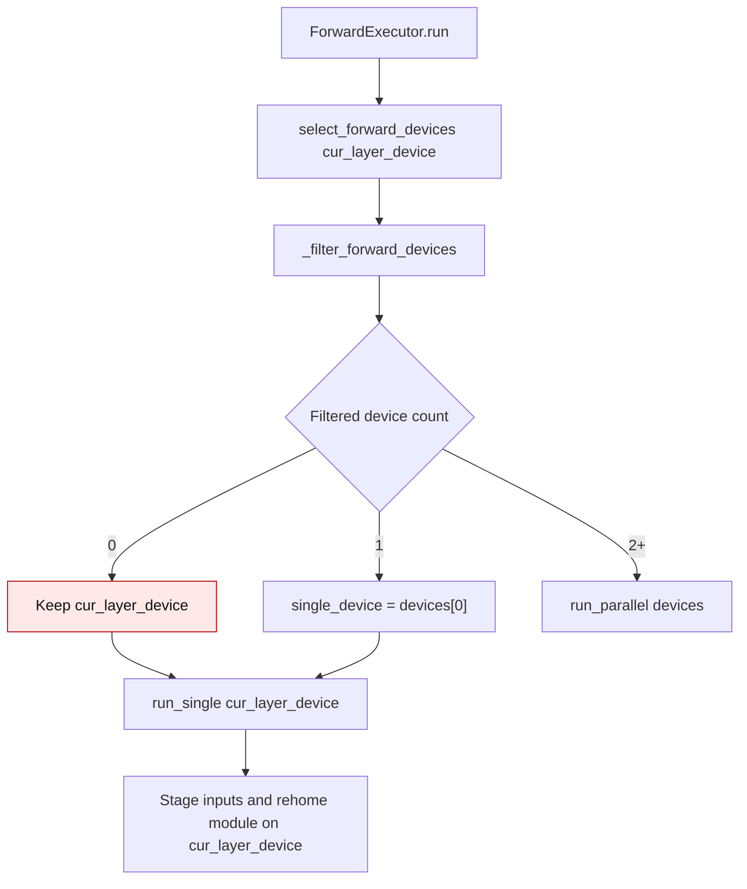
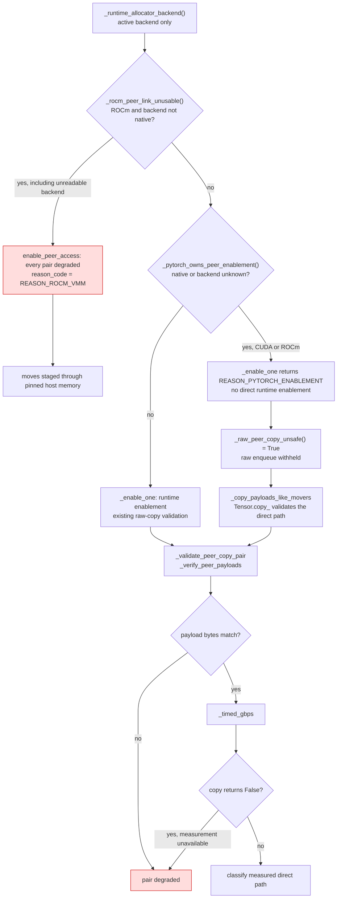
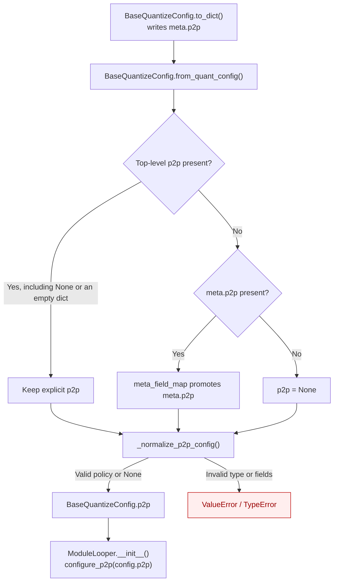
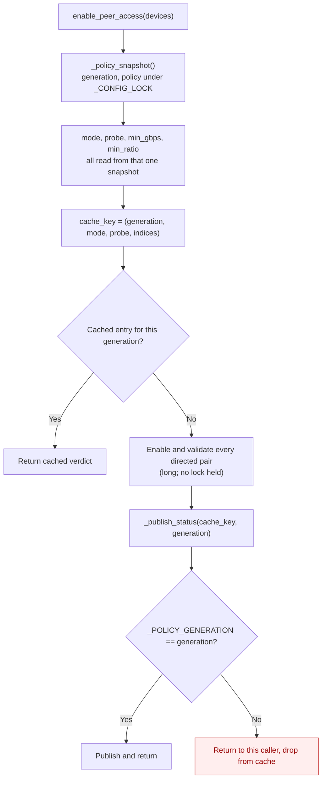
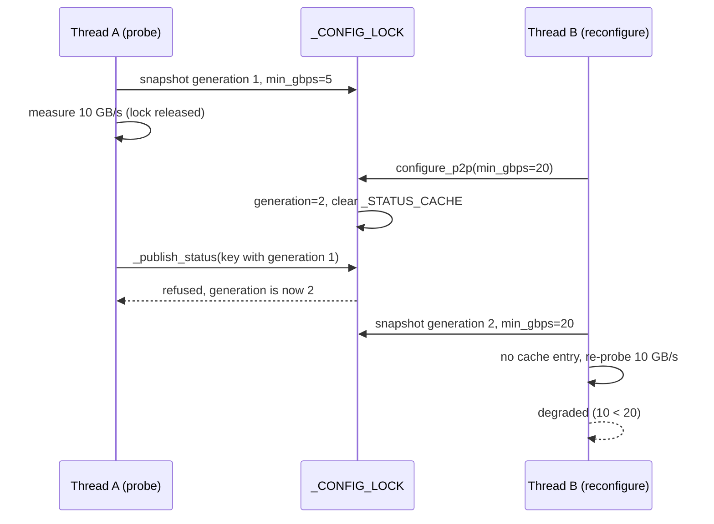

<!-- SPDX-FileCopyrightText: 2026 ModelCloud.ai
SPDX-License-Identifier: Apache-2.0 -->

# Multi-GPU quantization

`CUDA_VISIBLE_DEVICES` controls which GPUs a process can see. It does not by
itself enable parallel quantization. For a MoE model such as DeepSeek, select a
balanced MoE device pool in `QuantizeConfig`. On a free-threaded Python build,
set `PYTHON_GIL=0` before starting Python to enable parallel expert
quantization.

For example, to use physical GPUs 0 and 1:

```bash
CUDA_VISIBLE_DEVICES=0,1 PYTHON_GIL=0 python quantize_deepseek.py
```

Inside `quantize_deepseek.py`, configure the pool using the logical CUDA
indices visible to that process (`cuda:0` and `cuda:1` in this example):

```python
from gptqmodel import GPTQModel, QuantizeConfig
from gptqmodel.quantization.config import VramStrategy

model_id = "MODEL_REPO_OR_LOCAL_PATH"
quant_config = QuantizeConfig(
    bits=4,
    group_size=128,
    device="cuda:0",
    moe_vram_strategy=VramStrategy.BALANCED,
    moe_vram_strategy_devices=["cuda:0", "cuda:1"],
)

model = GPTQModel.load(model_id, quant_config, dtype="bfloat16")
model.quantize(calibration_dataset)
model.save("DeepSeek-GPTQ-4bit")
```

Provide `calibration_dataset` using the normal `model.quantize()` input format.
The dense model modules remain on the default exclusive strategy; balanced
MoE placement distributes expert work across the selected devices. The Python
runtime must be a free-threaded build and the GIL must actually be disabled;
`PYTHON_GIL=0` cannot make a regular Python build free-threaded. GPT-QModel logs
the visible dense/MoE device pools and whether parallel MoE quantization is
eligible when quantization starts.

For a dense model, `moe_vram_strategy` does not apply. To distribute dense
module work, configure `dense_vram_strategy` and
`dense_vram_strategy_devices` instead. Loading an already-quantized model
across GPUs is a separate operation and can use `device_map="auto"`; that
controls inference placement, not quantization parallelism.

## Explicit device sequences

Pass a tuple or list of concrete accelerator ordinals to constrain the default
layer-wise loader map and quantization to those devices.
Integer ordinals use the active Torch accelerator namespace, so on a CUDA or
ROCm runtime `device=(0, 1)` resolves to logical `cuda:0` and `cuda:1`.
Duplicate ordinals select one device. Use `device=("cuda:1",)` to constrain a
single GPU in both paths. `from_quantized(device="cuda:1")` also uses an explicit
single-device map, while `from_pretrained` needs a sequence to constrain its
quantization device pool. A bare family such as `device="cuda"` spans all
visible GPUs.



The prior helper at `gptqmodel/models/loader.py:388-403` converted list items
with `torch.device(str(item))` and returned `None` for a single entry or any
bare selector. The `None` fallback at `gptqmodel/models/loader.py:412-424`
counted every visible GPU. Normalization in `ModelLoader.from_quantized` also
collapsed one-device and duplicate lists to a scalar before this helper saw
them (`gptqmodel/models/loader.py:1515-1526` in the prior version). The current
helper normalizes and validates the original sequence at
`gptqmodel/models/loader.py:393-406`. The default loader path preserves that
sequence before normalization can collapse it at
`gptqmodel/models/loader.py:453-460` and
`gptqmodel/models/loader.py:1529-1536`. `ModelLoader.from_pretrained` uses the
same helper to build its quantization `compute_device_filter`.
See [PR #3577](https://github.com/ModelCloud/GPTQModel/pull/3577) for the
regression report and rationale.

| Request on a four-GPU host | Before | After |
| --- | --- | --- |
| `device=(0, 1)` | Quantization used all four; default loader map used two | Both use `cuda:0`, `cuda:1` |
| `device=("cuda:1",)` | Both used all four | Both use only `cuda:1` |
| `device=("cuda:1", "cuda")` | Both used all four | `ValueError` for the ambiguous mix |
| `device=("cuda:1", "cuda:1")` | Quantization used `cuda:1`; loader map used all four | Both use only `cuda:1` |

## Forward device selection

`ForwardExecutor.run` expands the base device to its family through
`select_forward_devices`, then applies `compute_device_filter` before choosing
between the data-parallel and serial paths. The serial path is also the
single-survivor fallback when the filter leaves exactly one device, so it must
stage inputs and rehome the module on that survivor rather than on the
pre-filter base device.



| Mechanism | Before | After |
| --- | --- | --- |
| Sole-survivor dispatch (`gptqmodel/looper/forward_executor.py:232-248`) | Filtered list selected `run_single`, but the original `cur_layer_device` was forwarded | `run_single` receives the surviving filtered device |
| Input staging and module rehome (`ForwardExecutor.run_single`) | Used the pre-filter base device | Uses the surviving filtered device |
| Empty filtered list (`ForwardExecutor._filter_forward_devices`) | Returned the unfiltered pool | Unchanged: returns the unfiltered pool |

The regression is covered by
`tests/test_compute_device_filter.py::test_serial_fallback_stages_on_sole_surviving_filtered_device`.
The failure path is an empty filtered list, which `_filter_forward_devices`
already resolves by keeping the unfiltered pool; `run` then falls back to
`cur_layer_device`.

## GPU peer access (P2P)

PyTorch already enables peer access lazily inside its own copy path
(`c10/cuda/PeerToPeerAccess.cpp` -> `CUDACachingAllocator::enablePeerAccess`), so
cross-device `copy_`/`.to()` stays on the peer link without any help from
GPT-QModel. GPT-QModel additionally pre-enables the links before the first
cross-device transfer, so the first copy does not pay the setup cost, at most
once per device set: before `clone_module_for_devices()`, from the weight-only
looper, and for multi-device `device_map` loads. Enablement goes through
`hipDeviceEnablePeerAccess` on ROCm and `cuCtxEnablePeerAccess` on CUDA; PyTorch
has no enable wrapper of its own.

Peer links are **directed**. GPT-QModel checks `src -> dst` for every
cross-device move it issues itself; when that direction is unsupported (or
measured `degraded`), the move is staged through pinned host memory instead of
calling the peer copy.
On some ROCm topologies the matrix is asymmetric (for example `0 -> 1`
unsupported while `1 -> 0` works), and a direct `tensor.to("cuda:1")` segfaults
inside `hipMemcpyPeerAsync` rather than raising. That case is logged, and
NCCL/torch replicate is skipped in favor of deepcopy plus host staging. A
healthy symmetric link still uses the direct device-to-device path.

An enablement call that reports success for a direction the runtime capability
query denies is reported as `unverified` and is never used for a direct copy or
measured by the probe (the probe itself performs a direct copy). Enablement is
still kept for PyTorch's own paths; GPT-QModel moves in that direction are
staged through host memory.

### Allocator-managed peer enablement

Introduced in [PR #3815](https://github.com/ModelCloud/GPTQModel/pull/3815).

Direct runtime peer enablement does not update the native allocator's peer
metadata for future VMM reservations. This affects native expandable segments
on both CUDA and ROCm. A separate ROCm restriction applies to non-native
allocators. The two cases need different handling:

* the native caching allocator, independently of its current
  `expandable_segments` setting, and
* a non-native ROCm backend, including `backend:cudaMallocAsync`.

#### Native allocators: delegate to PyTorch

The defect is the ctypes `hipDeviceEnablePeerAccess` call, not the allocator.
That call grants access to the expandable segments that exist at that moment;
segments the allocator reserves afterwards stay unreachable, and a copy into one
of them returns success while moving nothing. Measured with a 4 MiB payload
on ROCm, peer access pre-enabled with ctypes:

| copy path | result |
|---|---|
| `Tensor.copy_` | 40 of 80 rounds copied nothing (3 of 3 processes) |
| raw `hipMemcpyPeerAsync` | same |
| `Tensor.copy_`, PyTorch owning enablement | **80 of 80 byte-exact** (3 of 3 processes) |

PyTorch grants peer access per segment from its own copy path
(`ExpandableSegment::addPeer` → `hipMemSetAccess`), so on this allocator
GPT-QModel stops pre-enabling and lets PyTorch own it. The same policy is
required for native expandable segments on CUDA: bidirectional threaded mover
tests after manual enablement intermittently raised `CUDA_ERROR_INVALID_VALUE`
for an inaccessible VMM operand. Delegating enablement and withholding raw copies
passed the repeated CUDA and ROCm mover checks. **P2P stays direct**:

| configuration | pairs | direct | host staging |
|---|---|---|---|
| `expandable_segments:True` (default) | `enabled` | 28.7 GB/s | 22.7 GB/s |

The default configuration keeps the direct link while withholding raw ctypes
copies. The same ownership rule applies when expandable segments are disabled,
since existing VMM allocations can remain alive. Validated copy correctness and the
timing loop both run through `_copy_payloads_like_movers`, which selects
`Tensor.copy_` whenever the raw call is withheld, so the probe measures the
path the movers actually use.

#### The non-native backend case: fail closed

`cudaMallocAsync` cannot be saved the same way — even `Tensor.copy_` returned
mismatched bytes, and so did a plain *same-device* copy, so the fault is the
allocator rather than the peer path. Every directed pair is reported `degraded`
and moves stage through pinned host memory.



| Mechanism | Before (`276605140`, merge base) | After |
|---|---|---|
| Native VMM pre-enablement | `_enable_one` (`gptqmodel/utils/p2p.py:654`) always called the runtime enablement function without updating allocator metadata. | `_pytorch_owns_peer_enablement` delegates native allocators on both CUDA and ROCm. |
| Allocator detection | No allocator check preceded enablement or validation. | `_allocator_is_native` uses the active backend; `_rocm_peer_link_unusable` handles the separate ROCm restriction. |
| Probe copy path | `_validate_peer_copy_pair` (`gptqmodel/utils/p2p.py:854`) validated raw enqueues even when movers would use `Tensor.copy_`. | `_copy_payloads_like_movers` validates and times the selected path. |
| Raw copy data path | `_can_peer_copy` (`gptqmodel/utils/p2p.py:1394`) and `_peer_copy_batch_enqueue` (`:1439`) issued runtime copies. | `_raw_peer_copy_unsafe` withholds raw calls while `can_transfer_directly` preserves native P2P. |
| Degraded warning | `_warn_degraded_once` (`gptqmodel/utils/p2p.py:929`) attributed every failure to topology. | `REASON_ROCM_VMM` identifies a non-native ROCm allocator failure. |

Allocator classification reads the active backend through
`_runtime_allocator_backend()`. Native allocators always delegate peer enablement
and copies to PyTorch, including when expandable segments are currently disabled.
A partial settings update can omit `expandable_segments` while leaving it enabled;
disabling it does not remove existing VMM tensors. The last parsed string therefore
cannot authorize raw copies. Delegation also preserves allocator ownership if
expandable segments are enabled later. An unknown backend withholds raw copies:
CUDA delegates to PyTorch and ROCm stages through host memory.
A copy returning `False` aborts bandwidth timing, so a failed enqueue cannot
be measured as a successful fast transfer.

| Review correction | Before (`dcec732c0`) | After |
|---|---|---|
| Backend authority | `_allocator_is_native`, `gptqmodel/utils/p2p.py:176`, allowed parsed/environment backend names to override the live backend. | Only the live backend authorizes the native path; unreadable ROCm backends stage. |
| CUDA native VMM | `_enable_one`, `gptqmodel/utils/p2p.py:872`, delegated only on ROCm. | `_pytorch_owns_peer_enablement` delegates native allocators on both CUDA and ROCm. |
| Missing allocator settings | `_runtime_alloc_conf_value`, `gptqmodel/utils/p2p.py:132`, collapsed missing and empty settings, then consulted the environment. | Settings strings no longer authorize raw copies; every native allocator delegates enablement. |
| Failed timing step | `_timed_gbps`, `gptqmodel/utils/p2p.py:922`, ignored a false copy result. | Warm-up and measured failures return no bandwidth. |
| Nested ROCm policy | `_ROCM_NESTED_PEER_DISABLED`, `gptqmodel/utils/p2p.py:1904`, read a runtime environment switch. | `P2PConfig.use_rocm_nested_peer_copy` owns the choice and preserves allocator checks. |

A `True` result from `_raw_peer_copy_unsafe()` withholds raw runtime copies.
A `False` result still goes through the existing per-direction `enabled` / `degraded` /
`unverified` decision. Peer access is configured through
`BaseQuantizeConfig.p2p` (`P2PConfig`), not environment variables.

Measured on two ROCm devices, 4 MiB payload, peer access pre-enabled, source
buffer allocated first:

| allocator setting | raw `hipMemcpyPeerAsync` | `Tensor.copy_` | following `torch.cuda` op |
|---|---|---|---|
| `expandable_segments:True` + ctypes enable | rc 0, destination unchanged | destination unchanged | `hipErrorIllegalAddress` |
| `expandable_segments:True`, PyTorch enablement | not used | byte-exact | ok |
| `expandable_segments:False` | byte-exact | byte-exact | ok |
| `backend:cudaMallocAsync` | rc 0, destination unchanged | mismatched bytes | ok or fault |

The guard and delegation are covered by `tests/test_p2p.py`. Hardware tests keep
the real allocator guards: raw-copy tests skip when the allocator withholds that
path, while `test_mover_fallbacks_are_ordered_and_thread_safe` checks actual
module, nested-input and tensor-copy fallbacks with separate source and
destination streams in both directions.

The settings-transition regression keeps real VMM source tensors alive while
applying a partial update, an empty update, an explicit disable, or a rejected
update. All four cases failed the ownership assertion before the correction at
`f9707a0eb`; after the correction they must retain direct, byte-exact copies in
both directions without raw runtime copies.

| Review correction | Before (`f9707a0eb`) | After |
|---|---|---|
| Settings as allocation evidence | `_allocator_forces_vmm`, `gptqmodel/utils/p2p.py:179`, parsed only the last settings string. Missing or false `expandable_segments` authorized raw copies even with live VMM tensors. | `_pytorch_owns_peer_enablement` delegates all native allocators, independent of settings updates and existing allocation types. |
| Unknown CUDA backend | `_pytorch_owns_peer_enablement`, `gptqmodel/utils/p2p.py:196`, returned false for unreadable backend metadata. | Unknown backends also withhold raw calls; the ROCm host-staging guard still takes precedence. |

Validation on 2026-11-13 used `PYTHON_GIL=0` throughout:

| Check | CUDA | ROCm |
|---|---|---|
| `pytest tests/test_p2p.py tests/test_p2p_copy_utils.py` (plus `tests/test_alloc_conf.py` on CUDA) | 96 passed, 14 skipped | 87 passed, 15 skipped |
| P2P suite after disabling expandable segments through the Torch API | 88 passed, 14 skipped | 88 passed, 14 skipped |
| `gil0_api_probe.py --only gptqmodel.p2p.allocator_guard` | 3/3 independent runs passed | 3/3 independent runs passed |
| `test_mover_fallbacks_are_ordered_and_thread_safe` | 3/3 independent runs passed | 3/3 independent runs passed |

Native-allocator hardware tests intentionally skip raw-copy paths, even with
expandable segments disabled. `test_mover_fallbacks_are_ordered_and_thread_safe`
checks actual movers with 8 workers and 32 tasks per process; the settings-update
regression separately checks retained VMM allocations. The explicit nested-copy
option cannot override allocator safety guards.

Inference is **not** covered by this routing. Loading the quantized model with
`device_map="auto"` installs accelerate's `AlignDevicesHook`, whose
`send_to_device` moves activations with a plain `Tensor.to`; on an asymmetric
ROCm topology that still segfaults (exit 139) inside `hipMemcpyPeerAsync`.
Measured on 2x R9700 (`gfx1201`, ROCm 7.16.26385): quantization completes, then
`generate()` on the same two devices crashes from
`accelerate.hooks.AlignDevicesHook.pre_forward -> send_to_device`. Until that
move is routed through `safe_move_to`, run inference on a single device on such
a topology.

Configuration lives on `BaseQuantizeConfig.p2p` (`P2PConfig`); there are no
environment variables:

```python
from gptqmodel import GPTQModel
from gptqmodel.quantization.config import QuantizeConfig
from gptqmodel.utils.p2p import P2PConfig

config = QuantizeConfig(
    bits=4,
    p2p=P2PConfig(
        mode="auto",       # "auto" | "on" (force) | "off" (skip pre-enablement)
        probe=False,       # run the bandwidth diagnostic
        probe_mib=64,      # preferred probe payload (steps down under pressure)
        min_gbps=5.0,      # diagnostic floor
        min_ratio=1.0,     # direct must reach this fraction of host staging
        use_torch_replicate=False,
    ),
)

# Inference on an already-quantized checkpoint:
model = GPTQModel.load("/path/to/quantized", p2p=P2PConfig(probe=True))
```

`p2p=` is also accepted by `GPTQModel.from_pretrained(...)` and
`GPTQModel.from_quantized(...)`; a plain dict with the same keys works anywhere
a `P2PConfig` is accepted. `None` uses the defaults.

| Field | Default | Meaning |
|---|---|---|
| `mode` | `auto` | `off` skips GPT-QModel's pre-enablement (PyTorch still peers lazily); `on` also attempts pairs the capability bit denies, but a denied direction stays host-staged (`unverified`) even if enablement reports success |
| `probe` | `False` | measures every directed pair; `degraded` directions are host-staged |
| `min_gbps` | `5.0` | absolute floor; below it a direction is `degraded` (host-staged) |
| `min_ratio` | `1.0` | direct copy must reach this fraction of ordered pinned-host staging, else `degraded` |
| `probe_mib` | `64` | preferred probe copy size (steps down to 32/16/4 under memory pressure) |
| `use_rocm_nested_peer_copy` | `False` | opt into small ROCm nested runtime copies; allocator checks still apply |
| `use_torch_replicate` | `False` | allow `torch.nn.parallel.replicate` on GIL builds (always skipped when the GIL is disabled) |

`P2PConfig` is a no-op for CPU-only runs and for any CPU<->CPU transfer: peer
access is an accelerator concept, so `enable_peer_access` reports
"fewer than two CUDA/HIP devices", emits no warning, and the CPU move helpers
use their regular copy path.

### P2P policy persistence

GPT-QModel stores `BaseQuantizeConfig.p2p` under `meta.p2p`. Both
`to_dict()` / `from_quant_config()` and `save_pretrained()` /
`from_pretrained()` preserve the complete policy. Loading a config only
normalizes the policy; `ModuleLooper.__init__` installs it for quantization
through `configure_p2p`.



The before column refers to `e310049849b109c9da64d2c542a7ea99594f55a0`.

| Input / mechanism | Before | After |
| --- | --- | --- |
| Saved `meta.p2p` | `gptqmodel/quantization/config.py:4623` omitted `p2p` from `meta_field_map`, leaving `p2p=None`. | The map restores the saved policy before `_normalize_p2p_config` validates it. |
| Explicit top-level `p2p` | The presence check at `gptqmodel/quantization/config.py:4682` gave top-level values precedence. | The same check also protects explicit `None` and empty dictionaries from stale metadata. |
| Invalid saved policy | Ignored with the other unpromoted metadata. | Normalization raises `ValueError` or `TypeError`; it cannot silently install defaults. |
| Missing or null policy | `None` selected defaults when consumed by `configure_p2p`. | Unchanged: older configs still use defaults. |

`tests/qcfg/test_p2p_meta_roundtrip.py` covers complete dictionary and
`P2PConfig` round trips, disk persistence, explicit overrides, legacy defaults,
and invalid metadata. Its fixture restores the incoming process-wide policy.
The persistence fix was introduced in [#3850](https://github.com/ModelCloud/GPTQModel/pull/3850).

### Policy generations and cached verdicts

`enable_peer_access` caches its classification so repeated calls are free. That
cache has to be bound to the policy that produced it: `configure_p2p` can run
from another thread, and a verdict measured under a loose `min_gbps` must not
answer a query under a stricter one.

Every replacement of the active policy bumps a monotonic generation. The
generation is the first element of the cache key, and a probe publishes its
result only while the generation it started under is still current.





| Mechanism at `origin/main` | Location | Consequence |
| --- | --- | --- |
| Cache cleared after the lock is released | `gptqmodel/utils/p2p.py:318-340` | A probe already in flight reinserts its verdict after the clear |
| Cache key without policy identity | `gptqmodel/utils/p2p.py:1193-1201` | A verdict measured under the old gates answers queries under the new ones |
| Gates read after the cache lookup | `gptqmodel/utils/p2p.py:1230-1231` | The key and the classification can describe two different policies |

| Situation | Before | After |
| --- | --- | --- |
| `configure_p2p` with no concurrent probe | Cache cleared, next call re-probes | Unchanged |
| `configure_p2p` while another thread is validating | Stale verdict cached; stricter gate bypassed | Verdict dropped; next call re-probes under the new policy |
| Repeat call under an unchanged policy | Cache hit | Cache hit (same generation) |
| `_cached_status_for` after a policy change | Could reuse a superset verdict from the old policy | Ignores entries whose generation is not current |

`tests/test_p2p.py` covers the deterministic interleaving
(`test_policy_change_during_a_probe_does_not_cache_a_stale_verdict`), the
non-concurrent invalidation, and that the cache key starts with the generation.
The interleaving test passes 5/5 under `PYTHON_GIL=0` with
`sys._is_gil_enabled() is False`. The generation contract was introduced in
[#3947](https://github.com/ModelCloud/GPTQModel/issues/3947).

### Bandwidth diagnostics (`p2p=P2PConfig(probe=True)`)

Probing moves real payload across every directed pair and synchronizes each
sample, so it is **opt-in** and never runs during normal quantization. Its
verdict selects the transfer path: a `degraded` direction is staged through
pinned host memory, exactly like an unsupported one.

The reference is an explicit, correctly ordered `src -> pinned CPU -> dst`
pipeline. It pays for two transfers (D2H then H2D), so it is strictly slower
than a direct copy at the same link rate; the legs must be ordered, because
issuing them on two device streams without a dependency measures the staged path
at roughly twice its real speed. Measured with ordered legs (64 MiB,
double-synchronized timer, median of 7 samples):

| pair | direct GB/s | ordered staged GB/s | ratio |
|---|---|---|---|
| 2x R9700 (`gfx1201`) | 52.99 | 27.35 | 1.94 |
| 2x RTX 4090 (`sm_89`) | 26.23 | 13.27 | 1.98 |

A `1.0` gate therefore keeps every healthy PCIe peer link direct while still
flagging a link that is genuinely slower than the fallback. Lower
`P2PConfig.min_ratio` if a topology really does measure at parity.

A `strict=False` failure never raises; one informational summary line is
logged. When a multi-GPU run cannot enable every ordered pair, GPT-QModel also
logs exactly one actionable warning: the GPUs do not have P2P either because of
motherboard compatibility (PCIe slot wiring, ACS/IOMMU), BIOS compatibility
(Above 4G decoding, Resizable BAR, PCIe generation), or hardware compatibility,
and multi-GPU quantization/inference speed may be sub-optimal. The run keeps
working and falls back to driver/host staging.

Measure with `scripts/benchmark_multi_gpu_p2p.py` (its `host` column is
the non-peer reference; `pre_enable` is already peer-enabled by PyTorch after
the warm-up, so it is not an "off" baseline).

### GIL-safe peer copies

Every hot cross-device copy goes through
`gptqmodel.utils.p2p.peer_copy_batch`, which calls
`cudaMemcpyPeerAsync`/`hipMemcpyPeerAsync` through `ctypes` with the GIL
released. It records an event on the source stream, waits for it on the
destination stream, and enqueues the copies on the destination's current
stream. `move_module_to_device` and `move_nested_to_device` in
`gptqmodel/utils/looper_helpers.py` use it for module moves and calibration
input/mask/`position_ids` staging; the Hessian partial reduction and
shared-Hessian adoption use the same direct GPU-to-GPU path.

The copy is enqueued with the **destination device current**. HIP binds a
stream to the calling thread's current device context, so issuing the copy
while the source device is current puts the work on the source queue, where the
destination stream never waits for it. See manual finding 5 in
`pytorch_gil_0_compat.md`.

The peer path is gated by leaf size: it is used only when the average leaf is
at most 256 KiB (`_PEER_COPY_MAX_AVG_LEAF_BYTES`). Measured within one process
against the regular `Tensor.to` path (2x RTX 4090, median of 3 runs x 10
roundtrips, 12 module shapes), 128-256 KiB leaves are 3-15% faster through the
peer path, while 2 MiB and larger leaves are 0-6% slower. Large leaves now fall
back to `Tensor.to`, which keeps the module path within 1.6% of the pre-change
tree.

Coalescing (pack into one buffer, one peer copy, scatter) was prototyped and is
7-17% slower on every shape: it replaces N peer transactions with 2N local ones
plus one peer transaction, and the pack/scatter enqueues cost more than the
single transfer saves. Do not re-add it without a measurement showing otherwise.

Contiguity is not the reason coalescing needs a pack step, so making tensors
contiguous does not remove it. Every parameter and buffer is already contiguous
(checked by `gptqmodel.utils.tensor_layout.assert_model_tensors_contiguous`
across load, quantize, save and reload, and by
`tests/test_tiny_moe_quant_smoke.py`); they simply live in separate
allocations, which no single memcpy can span. The peer-copy path still requires
contiguity, and refuses non-contiguous leaves rather than copying storage order,
because a raw byte copy of a strided view would silently produce wrong values.

End-to-end quantization of a 438M-parameter model stayed within run-to-run
noise (about ±20%).

Do **not** call `torch.cuda.comm.*` from worker threads. On a free-threaded
(`PYTHON_GIL=0`) build `broadcast_coalesced` has hung and returned torn copies
on both ROCm and CUDA (small payloads can pass; multi-MiB payloads tear), and
`reduce_add` has hung inside NCCL and segfaulted. `torch.nn.parallel.replicate`
internally uses `broadcast_coalesced`; `clone_module_for_devices` skips it when
the GIL is disabled and uses the deepcopy + `move_module_to_device` path
instead. It is still serialized by `_THREAD_SAFE_PARALLEL` on GIL builds.
`use_torch_replicate` is off by default; enable it only after qualifying the
replicate path for the target Python/PyTorch build.
`pytorch_gil_0_compat.md` records the measured status of every PyTorch API we
use, plus the workaround for each unsafe one.

### RTX 4090 (consumer Ada) note

Consumer cards frequently report `can_device_access_peer == True` while direct
throughput is limited by PCIe. They are not special-cased by `sm_89`: with the
probe enabled every pair is measured, and the measurement is the verdict.
`can_device_access_peer` alone is never treated as proof that P2P is effective.

P2P and NCCL are different mechanisms. The `gloo`/`nccl` distributed path used by
GSQ (`gptqmodel/quantization/gsq_distributed.py`) is independent; verify it with
`tests/test_gsq_distributed.py` (gated on `is_nccl_available()`) in addition to
the P2P tests in `tests/test_p2p.py`.

## Allocator backend for very wide layers

GPTQ builds a dense `columns x columns` fp32 Hessian per projection, and inverts
it with a Cholesky factor plus a cuSOLVER workspace. A 40960-wide projection
(`mlp.down_proj` on a 65B model) therefore needs roughly **three 6.25 GiB
buffers at once**. Data-parallel accumulation makes it worse: each participating
device holds a full partial Hessian, and `materialize_global_hessian` allocates a
separate accumulator on the target device.

The native CUDA caching allocator can fail that single multi-GiB request even
when the driver reports >13 GiB free, because it cannot assemble one contiguous
block next to the resident partials. The failure surfaces either as a plain OOM
or, with `expandable_segments`, as `CUDA driver error: out of memory ...
from cuMemSetAccess`. GPTQModel logs a hint when it falls back to CPU for this
reason.

Use the async allocator for these runs:

```bash
PYTORCH_ALLOC_CONF=backend:cudaMallocAsync python quantize.py
```

Measured on 4x RTX 4090 with a 65B model, `offload_to_disk=True` and
`auto_forward_data_parallel=True`:

| allocator | result |
| --- | --- |
| `native` (default) | OOM on the first wide `mlp.down_proj` |
| `native` + `expandable_segments` | still fails, now in `cuMemSetAccess` |
| `backend:cudaMallocAsync` | 80/80 layers, no OOM, `reserved` flat across layers |

`cudaMallocAsync` does not change numerics: quantizing the same checkpoint on
four devices produced **237/237 bit-identical tensors** compared with the native
backend.

Caveats:

* The backend is chosen when the process first touches CUDA. Set the variable in
  the environment, before Python starts; it cannot be switched at runtime.
* `torch.cuda.memory_snapshot()` and `torch.cuda.memory._record_memory_history()`
  are unsupported on this backend and raise. `memory_allocated`,
  `memory_reserved`, `memory_stats`, `memory_summary`, `mem_get_info` and
  `empty_cache()` all keep working.
* `expandable_segments` is a native-allocator feature and is ignored here.
