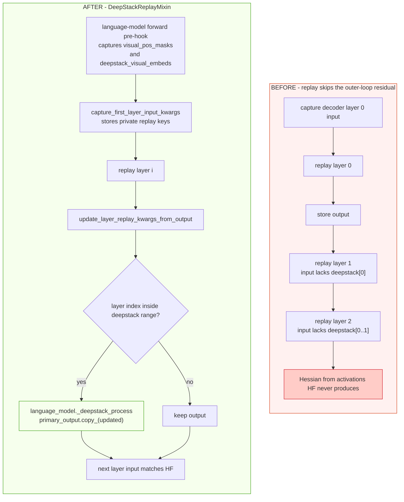
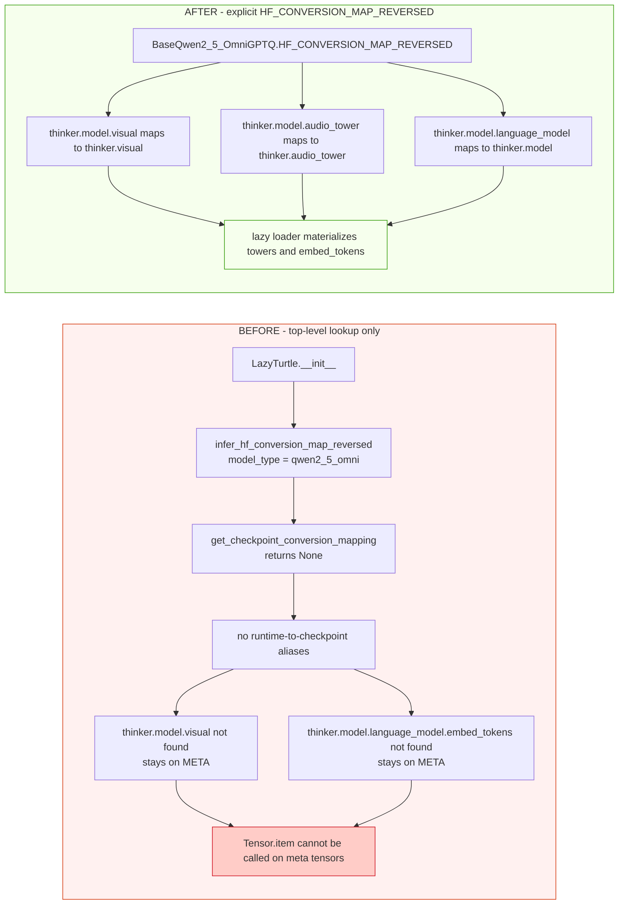
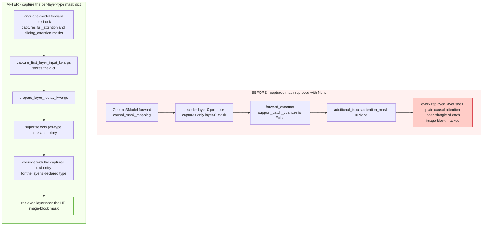
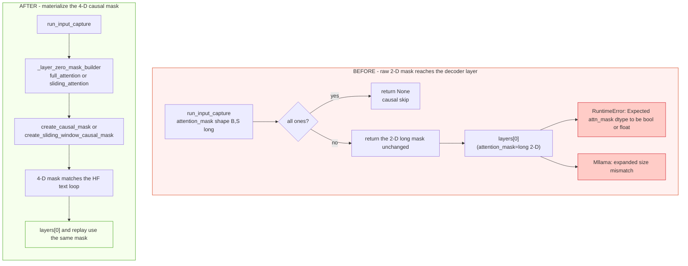

# Multimodal calibration replay

Multimodal calibration runs one forward pass, stops at the first decoder layer,
and replays the cached layer input through every decoder layer in isolation.
Some multimodal families apply work in the **outer model loop**, outside any
decoder layer. Layer-by-layer replay cannot see that work unless the definition
captures it, so the calibration Hessian is built from activations the real model
never produces.

This page documents the four outer-loop contracts fixed for issue #4015. It
extends [calibration layer replay](calibration-replay.md), which covers the
per-layer-type mask and rotary selection.

## 1. DeepStack residual replay

`Qwen3VLTextModel.forward` and `Qwen3OmniMoeThinkerTextModel.forward` add
`deepstack_visual_embeds[i]` to the output of decoder layer `i` for the first
`len(deepstack_visual_embeds)` layers. The residual lives in the model loop, not
inside the decoder layer.



`DeepStackReplayMixin` is defined in
`gptqmodel/models/definitions/base_qwen3_vl.py:32`. `BaseQwen3VLGPTQ` and
`Qwen3OmniMoeGPTQ` inherit it; `Qwen3_VL_MoeQModel` inherits it through
`BaseQwen3VLGPTQ`. The mixin's private keys are popped by
`prepare_layer_replay_kwargs` before the decoder layer forward.

| Mechanism | Before | After |
| --- | --- | --- |
| DeepStack capture | none; `BaseQwen3VLGPTQ` had no replay hooks (`gptqmodel/models/definitions/base_qwen3_vl.py:37` on `origin/main`) | language-model pre-hook + `capture_first_layer_input_kwargs` (`:72`) |
| DeepStack application | none | `update_layer_replay_kwargs_from_output` calls the model's own `_deepstack_process` and copies into the stored output (`:111`) |
| Replay kwargs | private keys would leak into the layer forward | `prepare_layer_replay_kwargs` pops them (`:99`) |

## 2. Qwen2.5-Omni lazy checkpoint aliases

Transformers 5.22 registers the Qwen2.5-Omni checkpoint renames under the nested
`qwen2_5_omni_thinker` model type, not the top-level `qwen2_5_omni`.
`LazyTurtle.infer_hf_conversion_map_reversed` looked up only the top-level type
(`gptqmodel/utils/structure.py:1670`), so the runtime-to-checkpoint aliases were
empty and the lazy loader could not find the towers or `embed_tokens`.



The explicit map is at `gptqmodel/models/definitions/base_qwen2_5_omni.py:93`.
`tests/test_qwen2_5_omni_lm_head.py` no longer forces `offload_to_disk=False`;
it quantizes through the lazy path and reloads the saved checkpoint.

## 3. Gemma-3 image-block mask

`Gemma3Model.forward` builds a mask per layer type and, when `token_type_ids` is
present, lets image tokens attend bidirectionally inside each image block.
`Gemma3ForConditionalGenerationGPTQ.support_batch_quantize = False`
(`gptqmodel/models/definitions/gemma3.py:57` on `origin/main`) made
`forward_executor.py:375` replace the captured mask with `None`, so replay used
a plain causal mask.



The capture hook is `_start_replay_mask_capture`
(`gptqmodel/models/definitions/gemma3.py:161`); replay selection is
`prepare_layer_replay_kwargs` (`:210`). The captured dict is authoritative for
the mask, while the base definition still supplies the per-type
`position_embeddings`.

## 4. Batch-size greater than one

`BaseQwen2VLGPTQ.run_input_capture` and `MLlamaQModel.run_input_capture` call
`layers[0]` directly. Their helpers returned a non-all-ones 2-D `[B, S]` long
padding mask unchanged, and replay then fed it to every layer.



`_layer_zero_mask_builder` and `_prepare_first_layer_attention_mask` are at
`gptqmodel/models/definitions/base_qwen2_vl.py:169` and `:183`; the Mllama copy
is at `gptqmodel/models/definitions/mllama.py:168`.

The processor-side half of item 4 is padding: LLaVA, LFM2-VL and SmolVLM called
`apply_chat_template` without `padding=True`, so a batch of unequal-length
conversations raised `ValueError: expected sequence of length ...`. The three
calls now pass `padding=True`
(`gptqmodel/models/definitions/llava.py:121`,
`lfm2_vl.py:125`, `smolvlm.py:95`).

## Contracts

| Situation | Behaviour |
| --- | --- |
| model passes no `deepstack_visual_embeds` | the mixin captures `None` and replay is unchanged |
| layer index outside `len(deepstack_visual_embeds)` | no residual is applied |
| language model has no `_deepstack_process` | no residual is applied |
| Gemma-3 layer type missing from the captured dict | the base per-type mask is kept |
| Gemma-3 text-only batch with no `token_type_ids` | the dict still exists and is replayed |
| Qwen-VL / Mllama 2-D mask is all ones | `None` is kept, as before |
| Qwen-VL / Mllama 2-D mask has padding | a 4-D mask is built with the HF builder |
| Qwen2.5-Omni checkpoint uses the pre-5.22 layout | the explicit map still resolves the towers |
| RTN packed buffers have no version counter | `tensor_buffer` materializes a normal copy before writing (`gptqmodel/utils/tensor.py:12`) |

## Measured effect

Tiny random models built from the real configs; every decoder layer's `forward`
was patched to record its input and compared with a plain HF forward.

Qwen3-VL, 4 decoder layers, `deepstack_visual_indexes=(1, 2, 3)`, 4 image
tokens:

```text
BEFORE  layer 1: image 0.03454  text 0.00000
        layer 2: image 0.04565  text 0.00635
        layer 3: image 0.06234  text 0.01287
AFTER   layer 1..3: image 0.00000  text 0.00000
```

Gemma-3 VL, 4 decoder layers alternating sliding/full, one 4-token image block.
The full-attention mask differs from a plain causal mask in exactly 6 positions
(`4 * 3 / 2`); the issue measured `32640 = 256 * 255 / 2` for a 256-token block:

```text
BEFORE  layer 1: image 2.60712  text 2.20544
        layer 2: image 2.75136  text 2.60753
        layer 3: image 3.64687  text 3.21054
AFTER   layer 1..3: image 0.00000  text 0.00000
```

Qwen2-VL / Qwen2.5-VL / Mllama, batch 2 with a padded 2-D mask:

```text
BEFORE  Qwen2-VL: RuntimeError: Expected attn_mask dtype to be bool or float
        Mllama:   expanded size mismatch
AFTER   layer-0 hidden, attention mask and position embeddings equal HF exactly
```

## Tests

| Test | Invariant |
| --- | --- |
| `tests/test_multimodal_calibration_replay.py::test_qwen3_vl_replay_applies_deepstack_residual` | every replayed layer input equals the native forward at batch 1 and 2 |
| `...::test_gemma3_vl_replay_keeps_bidirectional_image_mask` | replayed masks equal the native per-type masks; an image token can attend to a later image token |
| `...::test_qwen_vl_batch_capture_builds_the_4d_mask` | Qwen2-VL and Qwen2.5-VL layer-0 capture matches HF with a padded batch |
| `...::test_mllama_batch_capture_builds_the_4d_mask` | Mllama layer-0 capture matches HF with a padded batch |
| `...::test_llava_prepare_dataset_pads_batched_conversations` and `test_vl_definitions_pad_batched_conversations` | LLaVA, LFM2-VL and SmolVLM pass `padding=True` |
| `tests/test_qwen2_5_omni_lm_head.py::test_omni_conversion_map_resolves_thinker_runtime_paths` | visual, audio and language-model runtime paths map to checkpoint keys |
| `tests/test_qwen2_5_omni_lm_head.py::test_omni_lm_head_quantize_save_reload` | quantize, save and reload with the default `offload_to_disk=True` |

## Not in scope

- Rebuilding per-layer masks for models whose image-block mask is built outside
  the Transformers mask-builder table.
- Quality sweeps of the affected families after quantization.
- Qwen3-Omni audio replay; the shared DeepStack hooks are wired but the audio
  path was not exercised in this change.
