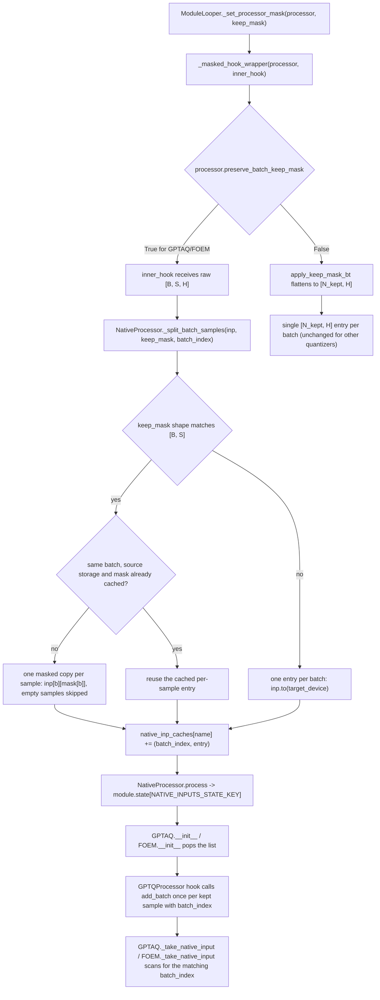
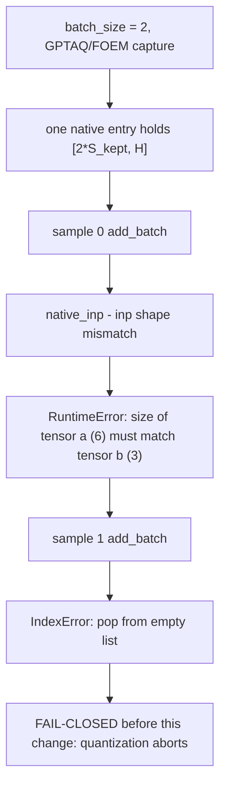

# Native calibration batch split

GPTAQ and FOEM (with `alpha > 0`) compare each calibration sample's native
activation against the GPTQ-rescaled activation. They therefore consume the
captured native inputs one entry per **sample**, while the capture stage used to
store one entry per **forward batch**. The two lists were only aligned at
`batch_size=1`, so a larger calibration batch made sample 0 consume the whole
batch tensor and the remaining samples pop from an empty list.

This page describes the split that keeps the capture and consumer aligned. It
was introduced with PR #3995 (issue #3978).

## New flow

The split mirrors `GPTQProcessor`'s own per-sample contract: samples whose keep
mask is empty are skipped in both places, so the entry order stays aligned even
with padded calibration rows. Each entry is stored as `(batch_index, tensor)`
because the data-parallel forward does not replay batches in capture order; see
[Multi-GPU quantization](multi_gpu_quantization.md#gptaqfoem-per-device-hessian-reduction).

## Sibling input sharing

The sibling projections fed by one source activation — `q_proj`/`k_proj`/`v_proj`
and `gate_proj`/`up_proj` — are called with the same `[B, S, H]` tensor in the
same forward pass. Their masked slices are therefore bitwise-identical, but the
split used to build a fresh copy for every module and kept all copies alive
until the module was consumed. `NativeProcessor._split_batch_samples` now keeps
one entry per `(batch_index, source storage, mask)` in a thread-local cache and
returns the same tensor object to every sibling.

The key is `(untyped_storage().data_ptr(), storage_offset, shape, stride, dtype,
device)`; the cache token also carries the calibration batch index and the
keep-mask identity. The cache is thread-local because capture hooks run on
data-parallel workers, and it is dropped as soon as the batch index or mask
changes or `process()` ends the layer's forward pass, so it never pins a
finished batch or reuses a recycled source address. Entry tagging and the
consume-by-`batch_index` contract are unchanged: each module still stores its
own `(batch_index, tensor)` list and `_take_native_input` still pops one entry
per `add_batch`.

Two different views of one storage are treated as the same source, which is
safe because their values are identical. An in-place write to the source
between sibling hooks is not detected; normal decoder forwards do not mutate
the hidden state before its sibling projections, and the `batch_size=1` alias
path already makes that same assumption.

Consumers treat entries as read-only. `GPTAQ.process_batch` and
`FOEM.process_batch` only call `.to`, `.reshape`, `.unsqueeze` and `.t` on the
native tensor and build the delta with out-of-place arithmetic, so sharing the
storage does not change the Hessian or `dXXT`. The source activation is likewise
assumed to be unchanged between sibling hooks; that is the same assumption the
`batch_size=1` alias path already makes (there, `.to` returns the source tensor
itself).

| Mechanism | Before | After |
| --- | --- | --- |
| Sibling masked copy | every hook call built `inp[b][mask[b]].to(target_device)` | the first call builds it, `q`/`k`/`v` and `gate`/`up` reuse the same storage |
| Entry layout | `(batch_index, tensor)` per module | unchanged |
| `add_batch` calls | one per kept sample per module | unchanged |
| Cache lifetime | none | thread-local, reset on forward pass, batch-index, or keep-mask change |

Measured on cached `HuggingFaceTB/SmolLM2-135M` with GPTAQ at `batch_size=4`
(8 calibration rows): the same 1680 native entries total 44,029,440 bytes in
both runs, but they occupy 1680 distinct storages (44,029,440 bytes) before the
change and 960 distinct storages (28,788,480 bytes) after. The 15,240,960 bytes
(34.6%) of duplicated sibling copies disappear, and the saved checkpoint
(`model.safetensors`) is byte-identical between the two runs.

## Before / after

| Mechanism | Before | After |
| --- | --- | --- |
| Capture unit | One entry per forward batch, `native_processor.py:101` (main) | One entry per kept sample when GPTAQ/FOEM is configured, `native_processor.py` `_split_batch_samples` |
| Mask ownership | The hook wrapper masked the batch to `[N_kept, H]`; the native entry had no per-sample boundary | `NativeProcessor.preserve_batch_keep_mask` is enabled for GPTAQ/FOEM, so the hook sees `[B, S, H]` and applies the same `[B, S]` mask per sample |
| Consumer | `gptaq.py:79` / `foem.py:160` did `native_inps.pop(0)` per `add_batch`, but the list held one batch entry | One keyed lookup per `add_batch` matches one captured sample; the entry also carries the calibration batch index used for multi-GPU pairing |
| Other quantizers | One entry per batch | Unchanged: `_native_per_sample` is false, so the single-entry layout is kept |

## Failure contract

After the split the same input produces two entries of `[S_kept, H]`, the
Hessian and `dXXT` are finite, and the batched result matches a `batch_size=1`
replay of the same samples (see `tests/test_gptaq_foem_batch.py`).
