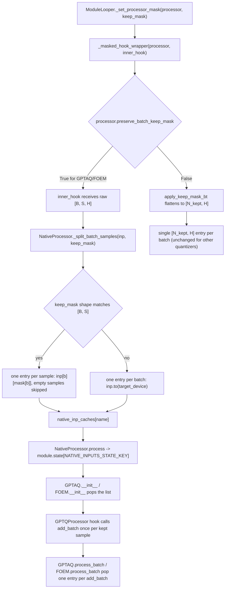
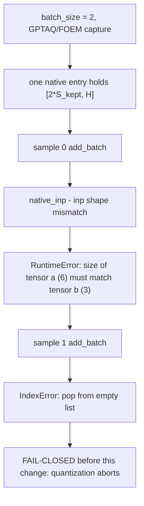

# Native calibration batch split

GPTAQ and FOEM (with `alpha > 0`) compare each calibration sample's native
activation against the GPTQ-rescaled activation. They therefore consume the
captured native inputs one entry per **sample**, while the capture stage used to
store one entry per **forward batch**. The two lists were only aligned at
`batch_size=1`, so a larger calibration batch made sample 0 consume the whole
batch tensor and the remaining samples pop from an empty list.

This page describes the split that keeps the capture and consumer aligned. It
was introduced with PR #3995 (issue #3978).

## New flow

The split mirrors `GPTQProcessor`'s own per-sample contract: samples whose keep
mask is empty are skipped in both places, so the entry order stays aligned even
with padded calibration rows.

## Before / after

| Mechanism | Before | After |
| --- | --- | --- |
| Capture unit | One entry per forward batch, `native_processor.py:101` (main) | One entry per kept sample when GPTAQ/FOEM is configured, `native_processor.py` `_split_batch_samples` |
| Mask ownership | The hook wrapper masked the batch to `[N_kept, H]`; the native entry had no per-sample boundary | `NativeProcessor.preserve_batch_keep_mask` is enabled for GPTAQ/FOEM, so the hook sees `[B, S, H]` and applies the same `[B, S]` mask per sample |
| Consumer | `gptaq.py:79` / `foem.py:160` did `native_inps.pop(0)` per `add_batch`, but the list held one batch entry | One pop per `add_batch` matches one captured sample |
| Other quantizers | One entry per batch | Unchanged: `_native_per_sample` is false, so the single-entry layout is kept |

## Failure contract

After the split the same input produces two entries of `[S_kept, H]`, the
Hessian and `dXXT` are finite, and the batched result matches a `batch_size=1`
replay of the same samples (see `tests/test_gptaq_foem_batch.py`).
