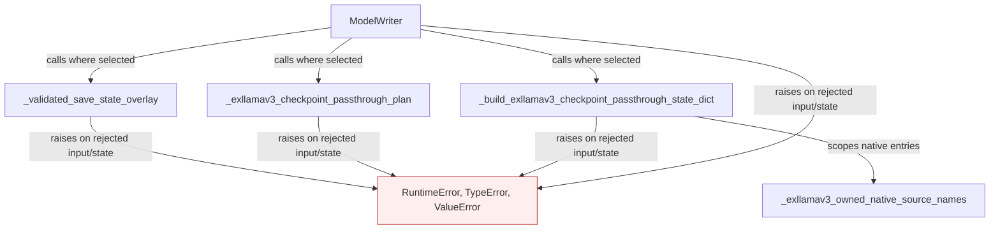

# Compose native checkpoint passthrough and save overlays

Preserve source-native checkpoint names and untouched tensors, compose validated auxiliary overlays, stream exact passthrough exports, reject incomplete publication trees, and publish EXL3 ledgers without embedding the tensor manifest in model config. Retain early auxiliary-source validation and the earlier atomic shard writer.

This page describes the shipped API and conditional calls carried from the working fork. It is a structural call map, with no invented execution ordering between public entry points. Solid edges name calls present in the source; dashed edges expose class entry points. Rejected states and propagated failures are marked separately.

| Before this extraction layer | Carried implementation |
|---|---|
| API absent in the previous stack layer (path/symbol checked) | `gptqmodel/models/writer.py::_validated_save_state_overlay`: `_validated_save_state_overlay` |
| API absent in the previous stack layer (path/symbol checked) | `gptqmodel/models/writer.py::_exllamav3_checkpoint_passthrough_plan`: `_exllamav3_checkpoint_passthrough_plan` |
| API absent in the previous stack layer (path/symbol checked) | `gptqmodel/models/writer.py::_build_exllamav3_checkpoint_passthrough_state_dict`: `_build_exllamav3_checkpoint_passthrough_state_dict` |
| Previous stack layer: `gptqmodel/models/writer.py:799` | `gptqmodel/models/writer.py::ModelWriter`: `ModelWriter` |

## Passthrough ownership scope

The source index describes the whole on-disk checkpoint, not the loaded model. A
reduced `num_hidden_layers` copy of an 8B checkpoint still indexes every layer
above the cut, and MTP / next-token heads are commonly present even though the
model never instantiates them.

`_build_exllamav3_checkpoint_passthrough_state_dict` therefore asks
`_exllamav3_owned_native_source_names` which native entries the loaded model
owns before it publishes anything:

| Source entry | Published? |
| --- | --- |
| Its owning module exists in the model (the model's own state covers it) | yes, byte-for-byte from the source shard |
| A runtime parameter/buffer resolves to it through the checkpoint source's runtime -> checkpoint alias chain | yes, byte-for-byte from the source shard |
| No owning module and no alias resolves to it (a layer above the cut, an MTP head) | no, and the skipped names are logged |
| Ownership cannot be enumerated | every entry is kept (fail closed) |

The scope only removes entries the model cannot use; every retained entry still
comes from its original shard with its original dtype and bytes, and the packed
EXL3 tensors are published exactly as before.

The previous stack layer supplies dependencies. Standalone store/policy APIs are connected by the later processor, looper and model layers rather than being enabled implicitly here.

Validation for this extraction is limited to Python parsing, dependency inspection and whitespace checks. Existing regression/oracle tests are carried with the feature; no new model quantization, accelerator work, hardware benchmark or broad runtime revalidation was performed. The author reports successful prior use in the fork. This draft seeks initial feedback on value and scope before further refactoring or validation.
