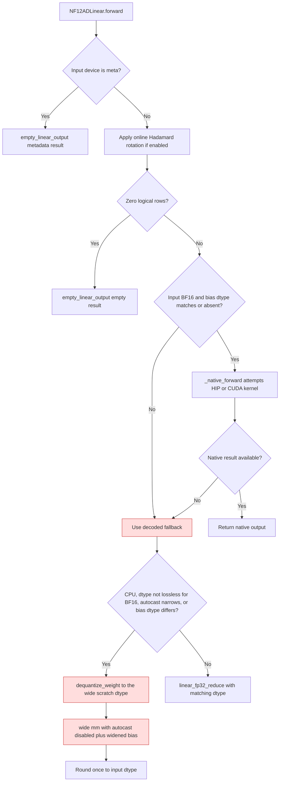

<!-- SPDX-FileCopyrightText: 2026 ModelCloud.ai
SPDX-License-Identifier: Apache-2.0 -->

# NF12 fallback epilogue

`NF12ADLinear.forward` keeps the stored bias dtype and the full BF16 weight
range until after the temporary decoded weight and activation have been
multiplied. A native BF16 kernel receives bias only when its dtype matches the
BF16 activation; other cases use the wide fallback. Introduced in PR #3730,
corrected for mixed-dtype bias in PR #3735, and corrected for FP16 activation
range loss in the follow-up that added `test_linear_fallback_preserves_bf16_weight_range`.

NF12-AD checkpoints are lossless BF16. The format range is therefore the BF16
range, not the activation range: `65536` is a representable weight, and
`65536 * 2**-16` is exactly `1` even though `65536` is outside the FP16 range.
A decoded weight narrowed to FP16 becomes `inf` before the product, so a finite
final result is lost.

The meta branch answers before the online Hadamard transform. That transform
preserves shape, dtype, and device, but its native operator has no meta kernel,
so a rotation-enabled lazy-load shell would still raise if the rotation ran
first. Both empty paths call `empty_linear_output()` directly; that helper
already applies the adapter exactly once.

| Mechanism | Before | After |
| --- | --- | --- |
| Bias cast | `gptqmodel/nn_modules/qlinear/nf12_ad.py:377-378` (pre-#3735) converted bias to input dtype before dispatch | The stored bias retains its dtype through the fallback epilogue |
| Native eligibility | `_native_forward` received the narrowed bias | It declines a mismatched bias dtype, then uses fallback |
| Fallback operands | The wide branch cast `x` with `.float()`, so a float64 activation re-entered the GEMM as float32 | The wide product multiplies `x` in the scratch dtype and adds the bias in that same dtype before one output rounding |
| Decoded weight dtype | `nf12_ad.py:392` decoded to `x.dtype` on any non-CPU device, so FP16 activation narrowed BF16 weights to `inf` or zero | `_weight_dtype_is_lossless()` sends FP16 activations to the wide decode and product |
| Wide scratch dtype | FP32 only | Follows the activation: `float64` keeps a float64 decode and GEMM on an accelerator, every other wide case uses FP32, and CPU stays FP32 by design |
| Wide GEMM under autocast | Not applicable: the wide branch did not exist on accelerators | The FP32 product runs under `torch.autocast(..., enabled=False)` so autocast cannot narrow it back to FP16 |
| Narrow branch under autocast | An FP16 autocast context narrowed BF16/FP32 activations too, because autocast rewrites GEMM operands; CUDA hid this only through its FP32 `out_dtype` request, while HIP returned `inf` | `_autocast_narrows_weight_range()` widens whenever the active autocast dtype cannot hold every BF16 weight |

The autocast guard is keyed on the device's autocast state, not on the device
type: CPU autocast narrows an FP32 `mm` to the autocast dtype just like the
CUDA path, so a CUDA-only guard would leave the CPU fallback vulnerable.

The context dtype, not the activation dtype, decides correctness. A `bfloat16`
or `float32` activation is lossless on its own, but an FP16 autocast context
rewrites the GEMM operands to FP16 before the product. On CUDA that was masked
by `_wants_fp32_reduce` requesting an FP32 `out_dtype`; HIP keeps low-precision
operands by design, so the same call returned `inf` for an exact `1.0`.
`_autocast_narrows_weight_range()` therefore routes an FP16 context to the wide
branch regardless of the activation dtype, and `float64` stays exempt because
autocast never narrows it.

`_weight_dtype_is_lossless()` admits `float64` as well. It is outside
`SUPPORTS_DTYPES`, but a caller that already holds float64 activations must not
have the decoded weight, or the GEMM operands, narrowed to float32 on an
accelerator. The wide scratch dtype therefore follows the activation:
`float64` decodes and multiplies in float64, and every other wide case uses
FP32. CPU keeps its FP32 decode for every activation dtype, which is the
documented existing behavior; a CPU float64 caller is still within `2e-3` of
the float64 oracle, not bitwise exact.

The operands were the actual defect, not the bias add: the former branch cast
`x` with `.float()`, so a float64 activation re-entered the GEMM as float32.
`bias.float()` is lossless for the FP16/BF16/FP32 checkpoint bias, which is why
widening the bias alone changes nothing measurable. The bias is still sent to
the scratch dtype so a float64 bias is not narrowed by the epilogue, matching
the operand dtype. On an accelerator the fixed float64 path is bitwise equal to
the float64 oracle across twelve seeds with no bias and with a stored BF16
bias; the unfixed `x.float()` path was not bitwise for any of six seeds with a
mixed bias, at up to `1.4e-4` pointwise relative on a `256x256` matrix. No bias
was needed for the error: the cast alone rounds every partial sum.

The meta and zero-row branches return `self.empty_linear_output(x)` directly.
That helper already applies the adapter exactly once; applying it again in the
caller doubled the adapter contribution on both paths. The meta check runs
before the online rotation, and the zero-row branch runs on the real device
after it, so each path is covered by its own test.

Measured on the decoded fallback with a BF16 weight `65536` and an FP16
activation `2**-16`: CPU returned `1` before and after; the accelerator fallback
returned `inf` before and `1` after. The test matrix also covers negative weight
range, a BF16 weight below the FP16 subnormal range, a weight that needs FP32
accumulation, and a BF16 activation whose bias cancels an out-of-FP16 sum.

The regressions `test_linear_fallback_preserves_bf16_weight_range`,
`test_linear_fallback_rounds_only_the_final_bf16_output`,
`test_linear_fallback_preserves_bf16_range_under_autocast`,
`test_linear_fallback_preserves_bf16_range_for_lossless_activation_under_autocast`,
`test_linear_fallback_keeps_float64_activation_precision`, and
`test_linear_fallback_keeps_float64_multiply_wide_for_mixed_bias` compare the
packed forward result to an independent FP64 Torch reference on CPU and on the
available accelerator. No dense weight is retained after forward.

## Metadata-only inputs

A meta module answers `forward` from its metadata alone. Lazy-load and offload
shells construct quant-linear layers on the meta device, so the packed buffers
hold no values; decoding them or reading `exp_base` would raise
`Tensor.item() cannot be called on meta tensors`. `forward` returns the
shape/dtype-correct empty output from `empty_linear_output()` before the online
rotation and before the decode path, matching the zero-row contract and the
other quant-linear layers.
