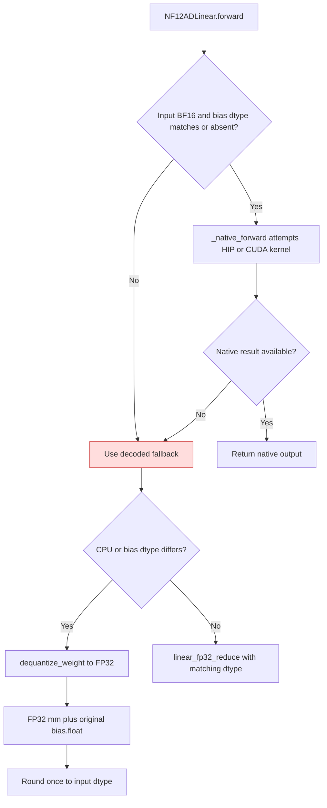

<!-- SPDX-FileCopyrightText: 2026 ModelCloud.ai
SPDX-License-Identifier: Apache-2.0 -->

# NF12 bias epilogue

`NF12ADLinear.forward` preserves the stored bias dtype until after the
temporary decoded weight and activation have been multiplied. A native BF16
kernel receives bias only when its dtype matches the BF16 activation; other
cases use the wide fallback. Introduced in PR #3730 and corrected for
mixed-dtype bias in this follow-up.

| Mechanism | Before | After |
| --- | --- | --- |
| Bias cast | `gptqmodel/nn_modules/qlinear/nf12_ad.py:377` converted bias to input dtype before dispatch | The stored bias retains its dtype through the fallback epilogue |
| Native eligibility | `_native_forward` received the narrowed bias | It declines a mismatched bias dtype, then uses fallback |
| Fallback precision | FP32 product could add a bias already narrowed to FP16 | FP32 product adds `bias.float()` before output rounding |

The regression `test_linear_fallback_adds_mixed_dtype_bias_before_rounding`
compares the packed forward result to an independent FP32 Torch reference.
No dense weight is retained after forward.
