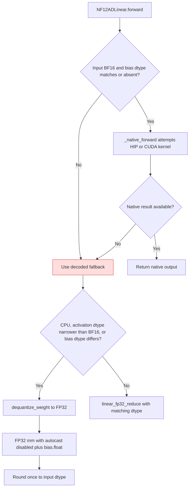

<!-- SPDX-FileCopyrightText: 2026 ModelCloud.ai
SPDX-License-Identifier: Apache-2.0 -->

# NF12 fallback epilogue

`NF12ADLinear.forward` keeps the stored bias dtype and the full BF16 weight
range until after the temporary decoded weight and activation have been
multiplied. A native BF16 kernel receives bias only when its dtype matches the
BF16 activation; other cases use the wide fallback. Introduced in PR #3730,
corrected for mixed-dtype bias in PR #3735, and corrected for FP16 activation
range loss in the follow-up that added `test_linear_fallback_preserves_bf16_weight_range`.

NF12-AD checkpoints are lossless BF16. The format range is therefore the BF16
range, not the activation range: `65536` is a representable weight, and
`65536 * 2**-16` is exactly `1` even though `65536` is outside the FP16 range.
A decoded weight narrowed to FP16 becomes `inf` before the product, so a finite
final result is lost.

| Mechanism | Before | After |
| --- | --- | --- |
| Bias cast | `gptqmodel/nn_modules/qlinear/nf12_ad.py:377` converted bias to input dtype before dispatch | The stored bias retains its dtype through the fallback epilogue |
| Native eligibility | `_native_forward` received the narrowed bias | It declines a mismatched bias dtype, then uses fallback |
| Fallback precision | FP32 product could add a bias already narrowed to FP16 | FP32 product adds `bias.float()` before output rounding |
| Decoded weight dtype | `nf12_ad.py:392` decoded to `x.dtype` on any non-CPU device, so FP16 activation narrowed BF16 weights to `inf` or zero | `_weight_dtype_is_lossless()` sends FP16 activations to the FP32 decode and product |
| Wide GEMM under autocast | Not applicable: the wide branch did not exist on accelerators | The FP32 product runs under `torch.autocast(..., enabled=False)` so autocast cannot narrow it back to FP16 |

The autocast guard is keyed on `autocast_active()`, not on the device type:
CPU autocast narrows an FP32 `mm` to the autocast dtype just like the CUDA
path, so a CUDA-only guard would leave the CPU fallback vulnerable.

Measured on the decoded fallback with a BF16 weight `65536` and an FP16
activation `2**-16`: CPU returned `1` before and after; the accelerator fallback
returned `inf` before and `1` after. The test matrix also covers negative weight
range, a BF16 weight below the FP16 subnormal range, a weight that needs FP32
accumulation, and a BF16 activation whose bias cancels an out-of-FP16 sum.

The regressions `test_linear_fallback_preserves_bf16_weight_range`,
`test_linear_fallback_rounds_only_the_final_bf16_output`, and
`test_linear_fallback_preserves_bf16_range_under_autocast` compare the packed
forward result to an independent FP64 Torch reference on CPU and on the
available accelerator. No dense weight is retained after forward.

## Metadata-only inputs

A meta module answers `forward` from its metadata alone. Lazy-load and offload
shells construct quant-linear layers on the meta device, so the packed buffers
hold no values; decoding them or reading `exp_base` would raise
`Tensor.item() cannot be called on meta tensors`. `forward` returns the
shape/dtype-correct empty output from `empty_linear_output()` before the decode
path, matching the zero-row contract and the other quant-linear layers.

