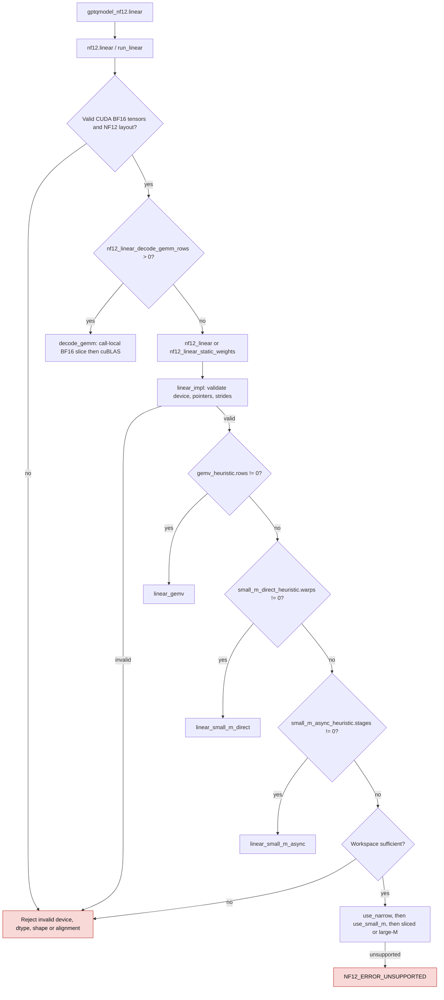

<!-- SPDX-FileCopyrightText: 2026 ModelCloud.ai -->
<!-- SPDX-License-Identifier: Apache-2.0 -->

# NF12 CUDA dispatch and weight readiness

GPT-QModel's BF16 NF12 linear selects a shape- and architecture-specific kernel
without changing packed storage. The CUDA implementation incorporates the
[upstream CUDA update](https://github.com/dphnAI/nf12/commit/606f8823e182f65d6f2ead368aa9e5ba965c057c).
The new GEMV, direct small-M, and asynchronous small-M heuristics select only
SM103. Other SM80+ devices retain the existing narrow, small-M, large-M, and
call-local decode/GEMM paths. The separate HIP runtime is unchanged.

## Native linear selection

The specialized families use no workspace; workspace sizing tests the same
heuristics as dispatch. The asynchronous launcher additionally checks the
device's shared-memory capacity. Direct small-M uses clusters only for selected
shapes. A shape outside a heuristic's band continues to the existing
families; a selected kernel launch failure is returned, not silently retried.
SM103 short-K prefill (`K <= 128`, `512 <= N <= 8192`, `M >= 64`) can use
external decode/GEMM. Row-major decode uses two warps on SM103 and preserves
the SM80 512-by-5120 special case.

| Before (base revision) | After |
| --- | --- |
| `gptqmodel_ext/nf12/csrc/linear/dispatch.cu:203` sizes narrow/small-M/large-M scratch | `linear_workspace_bytes` first checks GEMV/direct/async, returning zero for those paths |
| `gptqmodel_ext/nf12/csrc/linear/dispatch.cu:236` enters narrow or small-M before large-M | `linear_impl` first tries the three SM103-specific families |
| `gptqmodel_nf12/api.py:131` exposes ordinary linear only | `linear(..., static_weights=False)` defaults to the same readiness contract and adds an explicit opt-in |
| `gptqmodel_ext/nf12/csrc/linear/dispatch.cu:210` prepares staged-B1 small-M scratch | `linear_staged_b1_workspace_bytes` also recognizes zero-scratch single-row GEMV |

## Staged-B1 arithmetic

`linear_staged_b1` requires 1–8 rows. It does not select the new multirow
direct/async kernels: those need not have the same reduction order as ordinary
single-row linear. When `gemv_heuristic(1, N, K, dev)` selects GEMV, staged B1
launches it once per row with adjusted input/output pointers. Otherwise it
retains the fused small-M traversal with the single-row configuration. An
unsupported single-row family or slice returns `NF12_ERROR_UNSUPPORTED`.

## Programmatic dependent launch

`linear(..., static_weights=True)` maps to `nf12_linear_static_weights` and
sets `LinearArgs.weights_ready`. It permits packed-weight and escape reads
before the preceding kernel's programmatic dependency wait. **Both buffers
must be ready before that kernel releases dependents and must remain unchanged
until the linear operation finishes.** Activation/bias reads and output writes
still wait. The caller owns this promise; readiness cannot be inferred from
tensor metadata. The default remains `False`, including for module forwards.

Do not enable it when the preceding PDL kernel produces packed weights or
escapes. It is not a substitute for cross-stream events. Dispatch paths that
do not stage early may ignore the option. Decoded BF16T slices explicitly
reset `weights_ready` because they were just produced by decode.

No path installs a dense weight cache. GEMV/direct/async decode register/shared
fragments; decode/GEMM uses a bounded call-local slice. The Python API and
modules retain packed weights, escapes, and metadata only.

## Validation scope

`tests/test_gptqmodel_nf12_api.py` covers specialized shape bands, escape and
signed-zero restoration, BF16T twins, an independent FP64 Torch linear oracle
(`rtol=atol=2e-3`), repeated calls, graph replay with changed inputs, packed-only
module storage, and staged-B1 equality with independent single-row calls.
`tests/test_nf12_runtime_load.py` covers explicit static-weight forwarding and
JIT fingerprints for each new CUDA source family without requiring a GPU.
These tests do not constitute performance or PDL producer/consumer overlap
qualification. Native compilation and runtime validation require a CUDA
toolchain and representative SM80+, especially SM103, hardware.
