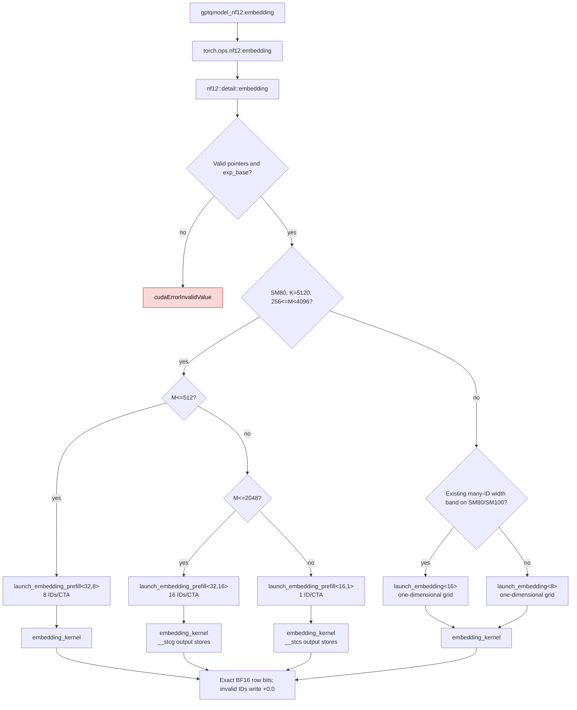

# NF12 embedding prefill dispatch

`gptqmodel_nf12.embedding` reads only the tiled NF12 weight and escape table.
The SM80 K=5120 prefill route uses a two-dimensional grid. For 256–512 IDs,
one CTA covers eight IDs; for 513–2048, it covers sixteen. The 2049–4095
route keeps one ID per CTA. Decode, other widths, and other architectures
retain their existing routes. These changes are in [PR #3761](https://github.com/ModelCloud/GPTQModel/pull/3761).

| Mechanism | Original flat grid | Two-dimensional grid |
| --- | --- | --- |
| SM80 K=5120, M=512/1536/3072 | `launch_embedding<8>` at `1fc52973` | `launch_embedding_prefill<32/16>` initially; packed ID CTAs below M=2049 in the later revision |
| Grid and ID/column mapping | `blockIdx.x / p.kb_chunks` and `quad / p.kb_span` in `embedding_kernel` | `blockIdx.x` is ID, `blockIdx.y` is column chunk in `embedding_kernel` at `gptqmodel_ext/nf12/csrc/codec/embedding.cu:71` |
| Other shapes and architectures | Existing 8/16-quad route | Same route at `gptqmodel_ext/nf12/csrc/codec/embedding.cu:162` |
| Invalid IDs | +0.0 row | Same, at `gptqmodel_ext/nf12/csrc/codec/embedding.cu:81` |

## Released-weight evidence

The [reproducible benchmark](../scripts/bench_nf12_real_embedding.py) used the
released DeepSeek-V4.1-Flash-1017 checkpoint, GPU 7 (NVIDIA PG506-230, SM80),
PyTorch 2.15.0+cu132 with GIL disabled, 16-call CUDA graphs, and four paired
ABBA rounds. `F.embedding` and NF12 received the same IDs and exact restored
BF16 weight. [Raw final timings](nf12-real-embedding-observed-mkn-20261111.json)
and [the block-size-only run](nf12-real-embedding-blocksize-only-20261111.json)
contain all samples. The older [geometry sweep](nf12-embedding-geometry-sweep-20261111.json)
used a temporary dispatch override to compare CTA sizes; that override is
absent from the final code.

| Embedding lookup | Dense BF16 | Initial 2D NF12 | NF12 / dense | Exact output |
| --- | ---: | ---: | ---: | --- |
| Main, M=1 | 2.560 µs | 2.368 µs | 1.081× | yes |
| Main, M=6 | 5.120 µs | 2.432 µs | 2.105× | yes |
| Main, M=512 | 4.736 µs | 6.144 µs | 0.771× | yes |
| Main, M=1536 | 11.104 µs | 23.456 µs | 0.473× | yes |
| Main, M=3072 | 35.328 µs | 44.672 µs | 0.791× | yes |
| Markov, M=1 | 2.368 µs | 2.208 µs | 1.073× | yes |
| Markov, M=5 | 4.416 µs | 2.176 µs | 2.029× | yes |

The NF12 prefill lookup remains below dense BF16 at the observed M values.
This kernel improvement alone does not qualify a whole Lite service profile.
For one main embedding copy, the released weight uses 1,323,827,200 BF16 bytes
or 995,314,416 packed-plus-escape bytes, saving 328,512,784 bytes. One Markov
embedding copy saves 16,418,432 bytes (66,191,360 versus 49,772,928).
No expanded weight is retained after lookup. The module stores only packed
bytes, escapes, and the exponent base; the output is an activation.

Nsight Compute on the same GPU at M=1536 recorded 15,360 one-warp CTAs and
two `MUFU.RCP` SASS instructions in the old grid, versus 7,680 two-warp CTAs
and zero `MUFU.RCP` in the new grid. Achieved occupancy rose from 39.21% to
66.83%. Profiled kernel duration was 22.40 versus 20.58 µs, with GPU clocks
uncontrolled; use the paired CUDA-graph timings above for latency comparisons.
The test `test_native_embedding_observed_lite_prefill_rows_are_exact_and_packed`
covers both ID dtypes, nine prefill M values and dispatch boundaries, invalid IDs, exact BF16
output bits, repeated calls, and packed-only module buffers on actual CUDA.

## Observed short tails and service result

Lite's B1 wave counters also show short prefill tails at M=312/313. The same
released-weight [CUDA graph benchmark](../scripts/bench_nf12_real_embedding.py)
was repeated with those exact row counts on GPU 7. The
[raw tail report](nf12-real-embedding-observed-mkn-tail-20261111.json) retains
the shape medians and exact-output checks. The production BF16
service was idle, but other host activity and GPU clocks were not controlled.

| Main embedding M | Dense BF16 | NF12 | NF12 / dense | Exact BF16 bits |
| ---: | ---: | ---: | ---: | --- |
| 312 | 4.320 µs | 5.408 µs | 0.799× | yes |
| 313 | 4.288 µs | 5.376 µs | 0.798× | yes |
| 1536 | 12.288 µs | 24.256 µs | 0.507× | yes |
| 3072 | 35.776 µs | 45.280 µs | 0.790× | yes |

The accompanying [released projection benchmark](../scripts/bench_nf12_lite_observed_shapes.py)
on GPU 5 covers the same tails for main gates, compressor KV, and indexer
projections. Its [raw result](nf12-lite-observed-mkn-tails-20261111.json)
shows that simply forcing the existing SM80 fused narrow route at M=312/313
would worsen indexer score/key latency by about 2× versus the current
decode-plus-GEMM dispatch. That experiment was reverted. Lite's dependency
pin currently identifies the preceding, one-ID-per-CTA prefill kernel.

In Lite's matched BF16 / selective NF12 / BF16 three-lane B1 trial, packed
main and Markov embeddings saved 1,023,161,856 resident bytes across three
core copies and matched all 36 candidate outputs to both controls. The 8K
prefill endpoint reached only 0.882× the BF16 after-control, so Lite keeps
NF12 opt-in. The service record in
[Lite PR #1302](https://github.com/ModelCloud/Inference-Ultra/pull/1302)
contains the exact controls and runtime fingerprints.

The same embedding benchmark also accepts `--ids-json` to test a real token
distribution. The [code-ID report](nf12-real-embedding-code-ids-20261111.json)
used the first 3,072 IDs from Lite's CUDA source fixture `b10_r0`, with 413
distinct IDs. Those source IDs precede the service-added request header, so
they are representative rather than an exact HTTP input replay. On GPU 7,
NF12 was **0.728×** dense BF16 at M=1536 (14.816 vs 10.784 µs) and
**0.769×** at M=3072 (26.400 vs 20.288 µs), with exact BF16 output bits.
Repeated IDs improved M1536 over the uniform-random 0.507× probe, but the
kernel still missed dense prefill parity. A follow-up main-embedding-only Lite
trial saved 973,906,944 resident bytes across three lanes but had large
8K timing drift in both BF16 controls; it remains unqualified for default use.

## Packed ID CTAs at observed rows

The [temporary CTA sweep](nf12-embedding-cta-pack-sweep-20261111.json)
compared eight and sixteen IDs per 128-thread CTA with the preceding grid in
six paired ABBA rounds on GPU 7. It used the same released BF16 embedding,
16-call CUDA graphs, and either the [first 3,072 CUDA fixture IDs](nf12-lite-cuda-token-ids-20261111.json)
or deterministic uniform random IDs. All candidate outputs matched dense
BF16 bits. The sweep-only environment selector was removed from the shipped
kernel. A selective two-permutation decoder was also tested and discarded
because it did not improve latency consistently.

| M | Real code IDs, selected pack vs old | Random IDs, selected pack vs old | Final CTA pack |
| ---: | ---: | ---: | ---: |
| 312 | 1.072× | 1.048× | 8 |
| 313 | 1.054× | 1.024× | 8 |
| 512 | 1.068× | 1.047× | 8 |
| 1024 | 1.077× | 1.006× | 16 |
| 1536 | 1.086× | 0.996× | 16 |
| 2048 | 1.079× | 1.003× | 16 |
| 3072 | Existing path | Existing path | 1 |

The [final released-weight benchmark](nf12-real-embedding-code-ids-packed-cta-20261111.json)
uses the same source-code IDs before the service header and compares each
lookup directly with dense BF16 in six paired ABBA rounds. Its new native
source key is `f9f7155c973fcc8c1dfae32efa39d243baa4230f50ff93f103f1c8d5f663f8c5`.

| Main embedding M | Dense BF16 | Final NF12 | NF12 / dense |
| ---: | ---: | ---: | ---: |
| 312 | 4.288 µs | 5.184 µs | 0.827× |
| 313 | 4.320 µs | 5.248 µs | 0.823× |
| 512 | 5.376 µs | 6.400 µs | 0.840× |
| 1536 | 10.592 µs | 13.312 µs | 0.796× |
| 3072 | 19.808 µs | 25.760 µs | 0.769× |

The 1536/3072 prefill lookups remain below dense BF16, and the whole-service
8K parity gate remains unmet. The last Lite A/B/A measurements used the
preceding native source key `57f012675277782c45e14b4fc1032effbf7ebf2e84ef471c467825dead8b82a4`.
A final M=3072 sweep assigned one quad per ID in a 32-ID CTA. Eight paired
ABBA rounds gave 0.994× the preceding route on code IDs and 0.931× on random
IDs, with bit-exact output; that variant was reverted.
The [uniform-random ID final run](nf12-real-embedding-random-ids-packed-cta-20261111.json)
reaches only 0.516× dense at M=1536, so the code-ID speedup must not be
generalized to all prompt distributions. Nsight Compute on GPU 7 observed
3,840 CTAs, 128 threads per CTA, 32 registers per thread, 69.16% achieved
occupancy, and 14.53 µs profiled duration for the packed M=1536 kernel;
the paired CUDA graph timings above are the latency comparison because clocks
were not controlled across profiler runs.

## Bypass L1 for 16-ID prefill output stores

The 16-ID specialization writes its two 128-bit output vectors with
`__stcg`, leaving L1 available for packed source lines. In that first change,
the 8-ID specialization at M=312/313, one-ID specialization at M=3072, and
decode used their original stores. This changes no weight layout, adds no
cache, and preserves exact BF16 bits. The
[benchmark harness](../scripts/bench_nf12_embedding_load_policy.py)
compares native libraries with the same released `embed.weight`, the same IDs,
and paired CUDA graphs. [GPU1 run A](nf12-embedding-load-policy-gpu1-balanced-20261111.json),
[fresh GPU1 run B](nf12-embedding-load-policy-gpu1-balanced-reconfirm-20261111.json),
and the [GPU5 cross-check](nf12-embedding-load-policy-gpu5-crosscheck-20261111.json)
retain the raw timing samples and exact-output checks. GPU1 is a PG506-232;
GPU5 is a PG506-230. Both are SM80. Lite passes `torch.long` IDs to embedding.

| M, int64 IDs | Dense BF16 GPU1 | Old NF12 GPU1 | New NF12 GPU1 | New / old | New / dense |
| --- | ---: | ---: | ---: | ---: | ---: |
| 312, code IDs | 3.584 µs | 4.320 µs | 4.368 µs | 0.989× | 0.821× |
| 1536, code IDs | 8.896 µs | 11.568 µs | 11.200 µs | 1.033× | 0.794× |
| 1536, random IDs | 14.304 µs | 24.336 µs | 24.136 µs | 1.008× | 0.593× |
| 3072, code IDs | 18.016 µs | 23.904 µs | 23.920 µs | 0.999× | 0.753× |

The second GPU1 run reproduced the 1536-code-ID gain (11.568 → 11.200 µs).
GPU5 measured 11.584 → 11.296 µs (1.025×) for the same shape. The M=312
offset is within an identical-library self-control's 0.048 µs offset; the
M=312 and M=3072 compiled instructions are unchanged. The embedding remains
below dense BF16 on the observed prefill rows, so this kernel change does not
qualify NF12 as a Lite default. The full released embedding occupies
995,314,416 packed bytes versus 1,323,827,200 dense BF16 bytes per copy.

## Eight-GPU experiment triage

One isolated worktree and one physical GPU were assigned to each experiment.
All reported speedups compare against the same experiment's current NF12
kernel, not against measurements from another GPU. GPU0 and GPU6 used compact
released-weight subsets; GPU4's compact geometry result was checked again on
the full released weight before its rejection.

| GPU | Experiment | Observed result | Decision |
| ---: | --- | --- | --- |
| 0 | Selective decoder | M=312 5.568 → 5.760 µs; M=1536 approximately flat | Revert |
| 1 | L1-bypassing stores for 16-ID CTAs | M=1536 code IDs 11.568 → 11.200 µs, repeated | Keep |
| 2 | Row-major packed layout | Int64 code IDs M=1536 14.144 → 15.808 µs; random IDs 24.000 → 14.592 µs | Experiment only |
| 3 | Per-call ID deduplication | M=1536 parallel gather 15.36 → 23.81 µs | Revert |
| 4 | Wider CTA layout | Full-weight M=312 code IDs +3.8%, random IDs −1.2% | Revert |
| 5 | Escape-group warp voting | M=3072 slowed about 9% | Revert |
| 6 | Grid ordering and swizzles | Reversed axes near flat; grouped swizzles slower on compact table | Revert |
| 7 | Column scheduling and preload | M=3072 code IDs near flat; random IDs slower | Revert |

The row-major layout reads 96 packed bytes per 64 BF16 outputs, compared with
192 bytes for the present tiled lookup. Its full released-weight outputs were
bit exact for int32 and int64 IDs, including escape and invalid-ID checks, but
it lost on Lite's observed repeated IDs at M=1536 and M=3072. The experiment
retains only packed weights; neither layout retained expanded BF16 weights.
The store-policy change does not close the dense BF16 prefill gap, so the Lite
service remains on BF16 by default.

## Evict-first stores for single-copy one-ID prefill

The SM80 K=5120 single-copy (`Repeats=1`) one-ID specialization now uses
`__stcs` for its two 128-bit
output vectors. The 8-ID specialization retains default stores; 16-ID retains
`__stcg`. The four-copy HC4 specialization retains its separately tuned store
policy. A GPU 2 sweep tested `.cg`, `.ca`, and `.cs` on the three packed loads,
and `.cg`, `.wb`, and `.cs` on the two output stores, one policy at a time. The
[GPU 2 report](nf12-embedding-cache-policy-gpu2-20261111.md) and
[raw samples](nf12-embedding-cache-policy-gpu2-20261111.json) use the same full
released `embed.weight` and Lite int64 code IDs. Three independent paired
ABBA runs of the one-ID `.cs` variant yielded 1.044×, 1.044×, and 1.067× at
M=3072. Random IDs stayed within measurement noise. The final source's
full-weight run gave 24.000 → 22.496 µs for code IDs and 44.992 → 44.920 µs
for random IDs. Dense BF16 took 18.000 µs on the same code IDs, so the packed
lookup still does not reach dense latency.

SM80 SASS has `STG.E.EF.128` for the one-ID specialization, replacing
`STG.E.128`; the 8-ID instruction sequence is byte-identical to the baseline.
The full released table restored exact BF16 bits in bounded 128-row chunks.
Int32 and int64 valid and invalid IDs returned exact BF16 and +0.0 bits in
the native paired runs; the production Python API embedding cases passed on
physical GPU 2. Inference retains only the packed and escape tensors, with no
expanded weight cache or extra packed layout. The benchmark process peaked at
3010 MiB of physical GPU 2 memory, below its 3072 MiB limit.
