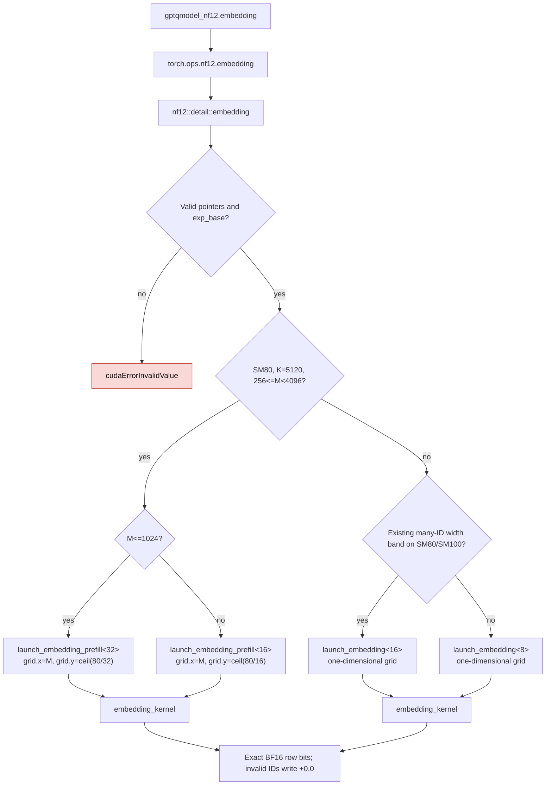

# NF12 embedding prefill dispatch

`gptqmodel_nf12.embedding` reads only the tiled NF12 weight and escape table.
The SM80 K=5120 prefill route groups more column blocks per CTA and uses a
two-dimensional grid, removing the runtime divisions seen in the previous
one-dimensional kernel. Decode, other widths, and other architectures retain
their existing routes. This route was introduced in [PR #3761](https://github.com/ModelCloud/GPTQModel/pull/3761).

| Mechanism | Before | After |
| --- | --- | --- |
| SM80 K=5120, M=512/1536/3072 | `launch_embedding<8>` in `gptqmodel_ext/nf12/csrc/codec/embedding.cu:149` at `1fc52973` | `launch_embedding_prefill<32/16>` in `gptqmodel_ext/nf12/csrc/codec/embedding.cu:151` |
| Grid and ID/column mapping | `blockIdx.x / p.kb_chunks` and `quad / p.kb_span` in `embedding_kernel` | `blockIdx.x` is ID, `blockIdx.y` is column chunk in `embedding_kernel` at `gptqmodel_ext/nf12/csrc/codec/embedding.cu:71` |
| Other shapes and architectures | Existing 8/16-quad route | Same route at `gptqmodel_ext/nf12/csrc/codec/embedding.cu:162` |
| Invalid IDs | +0.0 row | Same, at `gptqmodel_ext/nf12/csrc/codec/embedding.cu:81` |

## Released-weight evidence

The [reproducible benchmark](../scripts/bench_nf12_real_embedding.py) used the
released DeepSeek-V4.1-Flash-1017 checkpoint, GPU 7 (NVIDIA PG506-230, SM80),
PyTorch 2.15.0+cu132 with GIL disabled, 16-call CUDA graphs, and four paired
ABBA rounds. `F.embedding` and NF12 received the same IDs and exact restored
BF16 weight. [Raw final timings](nf12-real-embedding-observed-mkn-20261111.json)
and [the block-size-only run](nf12-real-embedding-blocksize-only-20261111.json)
contain all samples. The older [geometry sweep](nf12-embedding-geometry-sweep-20261111.json)
used a temporary dispatch override to compare CTA sizes; that override is
absent from the final code.

| Embedding lookup | Dense BF16 | Final NF12 | NF12 / dense | Exact output |
| --- | ---: | ---: | ---: | --- |
| Main, M=1 | 2.560 µs | 2.368 µs | 1.081× | yes |
| Main, M=6 | 5.120 µs | 2.432 µs | 2.105× | yes |
| Main, M=512 | 4.736 µs | 6.144 µs | 0.771× | yes |
| Main, M=1536 | 11.104 µs | 23.456 µs | 0.473× | yes |
| Main, M=3072 | 35.328 µs | 44.672 µs | 0.791× | yes |
| Markov, M=1 | 2.368 µs | 2.208 µs | 1.073× | yes |
| Markov, M=5 | 4.416 µs | 2.176 µs | 2.029× | yes |

The NF12 prefill lookup remains below dense BF16 at the observed M values.
This kernel improvement alone does not qualify a whole Lite service profile.
For one main embedding copy, the released weight uses 1,323,827,200 BF16 bytes
or 995,314,416 packed-plus-escape bytes, saving 328,512,784 bytes. One Markov
embedding copy saves 16,418,432 bytes (66,191,360 versus 49,772,928).
No expanded weight is retained after lookup. The module stores only packed
bytes, escapes, and the exponent base; the output is an activation.

Nsight Compute on the same GPU at M=1536 recorded 15,360 one-warp CTAs and
two `MUFU.RCP` SASS instructions in the old grid, versus 7,680 two-warp CTAs
and zero `MUFU.RCP` in the new grid. Achieved occupancy rose from 39.21% to
66.83%. Profiled kernel duration was 22.40 versus 20.58 µs, with GPU clocks
uncontrolled; use the paired CUDA-graph timings above for latency comparisons.
The test `test_native_embedding_observed_lite_prefill_rows_are_exact_and_packed`
covers both ID dtypes, the three prefill M values, invalid IDs, exact BF16
output bits, repeated calls, and packed-only module buffers on actual CUDA.
