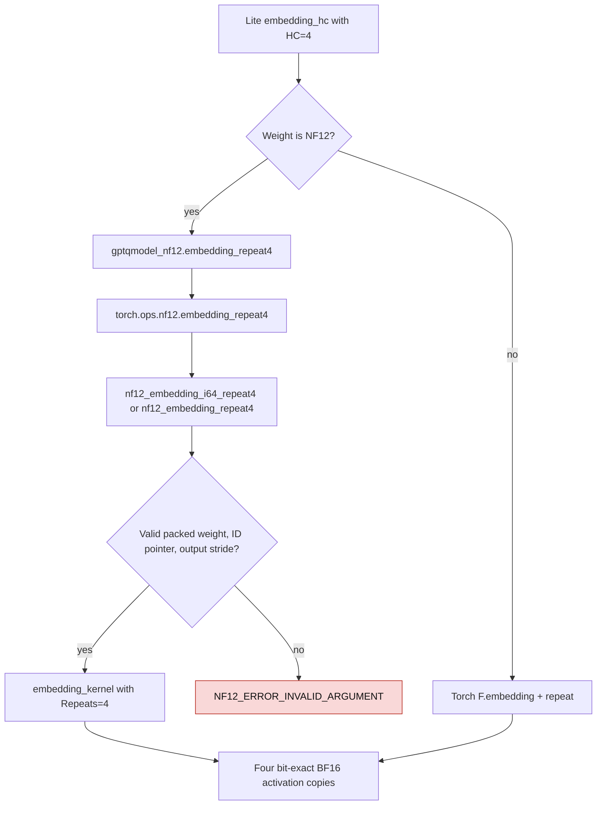

# NF12 embedding with four hyper-connection copies

Lite's released checkpoint has `hc_mult=4`. Its initial activation path
materializes four identical BF16 copies after an embedding lookup. The native
`gptqmodel_nf12.embedding_repeat4` operation looks up each packed row once,
decodes it in registers, and writes all four activation copies in one CUDA
launch. It returns `[*ids.shape, 4, K]` and preserves the bits of
`embedding(ids, weight).unsqueeze(-2).repeat(..., 4, 1)`. Invalid IDs produce
four `+0.0` rows.

| Stage | Earlier path | New NF12 path |
| --- | --- | --- |
| Lite initial activation | `lite/model.py` called `nf12_embedding`, then `unsqueeze(2).repeat(1,1,hc,1)` at each prefill/decode entry | Lite calls `embedding_hc`; for NF12 and HC=4 it calls `embedding_repeat4` |
| Native lookup | `embedding_kernel` wrote one row to `p.out` | `embedding_kernel<..., Repeats=4>` writes four copies from the same decoded registers |
| Other HC values or dense weight | Torch lookup and repeat | Existing Torch lookup and repeat |
| Persistent weight | Packed bytes and escapes | Same packed bytes and escapes; no expanded weight cache |

The new C API uses `ldo` as the BF16 stride between IDs and validates that
each output row can hold `4*K` elements. It bounds output offsets, requires one
valid ID pointer, and returns an error for malformed arguments before launch.
The original single-copy API still selects `Repeats=1`. The Torch binding
registers the output shape for FakeTensor and graph capture.

## Released-weight measurement

The [reproducer](../scripts/bench_nf12_embedding_repeat4.py) used released
DeepSeek-V4.1-Flash-1017 `embed.weight` `[129280,5120]`, the first 3,072 IDs
from Lite's CUDA fixture, int64 serving IDs, and physical GPU7 (PG506-230,
SM80). These source IDs omit the service-added request header. Each candidate
returned exact BF16 bits against independent `F.embedding` followed by
`repeat`. Sixteen-call CUDA graphs ran in eight alternating paired ABBA rounds.
The [initial raw report](nf12-embedding-repeat4-gpu7-20261111.json) includes every
sample, deterministic random-ID cases, source hash, and storage counts.

| M | Dense BF16 + repeat | NF12 + repeat | Initial fused NF12 repeat4 | Fused / dense |
| ---: | ---: | ---: | ---: | ---: |
| 1 | 5.824 µs | 5.952 µs | 2.816 µs | 2.068× |
| 6 | 8.832 µs | 6.528 µs | 2.944 µs | 3.000× |
| 312 | 26.816 µs | 27.968 µs | 9.536 µs | 2.812× |
| 313 | 26.944 µs | 28.000 µs | 9.472 µs | 2.845× |
| 1536 | 128.384 µs | 131.008 µs | 44.608 µs | 2.878× |
| 3072 | 229.856 µs | 234.432 µs | 79.520 µs | 2.891× |

The M=1536 output holds 62,914,560 BF16 bytes and M=3072 holds
125,829,120 bytes. The fused kernel writes those activation bytes once and
does not read an intermediate single-copy activation. The packed embedding is
995,314,416 bytes versus 1,323,827,200 dense BF16 bytes, saving 328,512,784
resident bytes per copy. Benchmark peak PyTorch reserved memory was
3,256,877,056 bytes including the independent dense oracle and CUDA graphs;
the inference module retains no expanded BF16 weight.

The unreplicated NF12 lookup remains slower than dense BF16 at prefill M.
This result qualifies the lookup-plus-repeat stage as implemented in Lite;
it does not by itself establish whole-service prefill or decode parity.
CUDA embedding tests cover int32/int64 IDs, signed zero, invalid IDs, shape
boundaries, repeated calls, and packed-only state.

A second full-weight run on physical GPU1 (PG506-232, also SM80) independently
confirmed the result with the same code IDs and benchmark method. Its
[raw samples](nf12-embedding-repeat4-gpu1-20261111.json) show dense versus
fused at M=312: 26.688 versus 9.312 µs; M=1536: 128.320 versus 44.576 µs;
and M=3072: 258.720 versus 79.904 µs. The M=3072 dense timing varied
between GPUs, while fused timing stayed near 80 µs. All candidate outputs
matched independent Torch BF16 bits on both GPUs.

## SM80 observed-wave tuning

The final dispatch uses a 32-quad, one-ID CTA with `__stcs` output stores for
int64 IDs at M=1536..2048, K=5120, `Repeats=4` on SM80. The preceding
16-ID CTA wrote the same four BF16 copies with `__stcg`. The new route keeps
the packed table and output layout unchanged and never applies to the
single-copy embedding operator.

With both native libraries reading the same full released packed table and
IDs, 32 paired ABBA rounds of 16-call CUDA graphs on GPU7 gave these medians:

| IDs | M | Initial fused | Tuned fused | Initial / tuned |
| --- | ---: | ---: | ---: | ---: |
| Lite code | 1536 | 43.520 µs | 38.048 µs | 1.144× |
| Lite code | 2048 | 57.088 µs | 51.808 µs | 1.102× |
| Random | 1536 | 53.632 µs | 50.240 µs | 1.068× |
| Random | 2048 | 71.584 µs | 65.920 µs | 1.086× |

The [paired native report](nf12-embedding-repeat4-tuning-gpu7-20261111.json)
records every sample and exact BF16 checks. The same one-ID/streaming option
at M=3072 slowed random IDs by about 1.5%, so that shape keeps the prior
route. A 64-quad short-tail route helped single-copy lookup but slowed fused
HC4 at M=312/313 by about 6%, so those shapes also keep the prior route.

The [final public-op GPU7 run](nf12-embedding-repeat4-tuned-gpu7-20261111.json)
measured Lite code M=1536 at **128.320 µs dense+repeat versus 38.848 µs
tuned NF12** (3.303×). An independent [physical GPU3
run](nf12-embedding-repeat4-tuned-gpu3-20261111.json) measured **128.096
versus 39.360 µs** (3.254×) with the same full table and exact BF16 bits.
All five targeted CUDA tests passed on GPU3 after the final source change.
These are activation-stage results; a concurrent three-lane service gate is
still needed before Lite can make NF12 its default.
