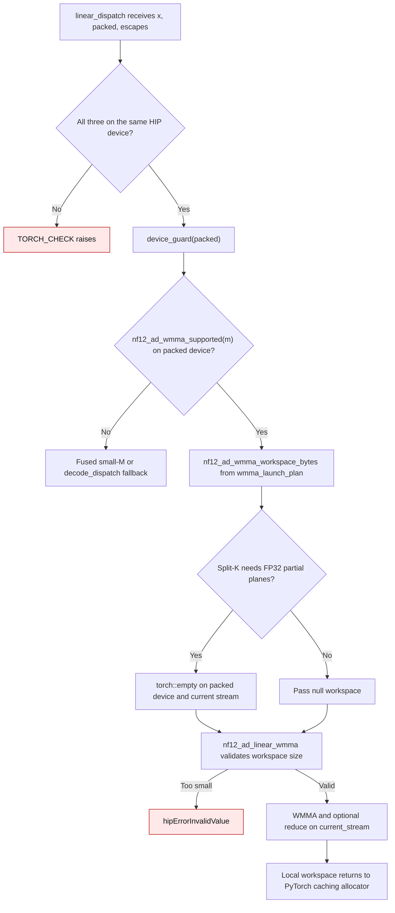
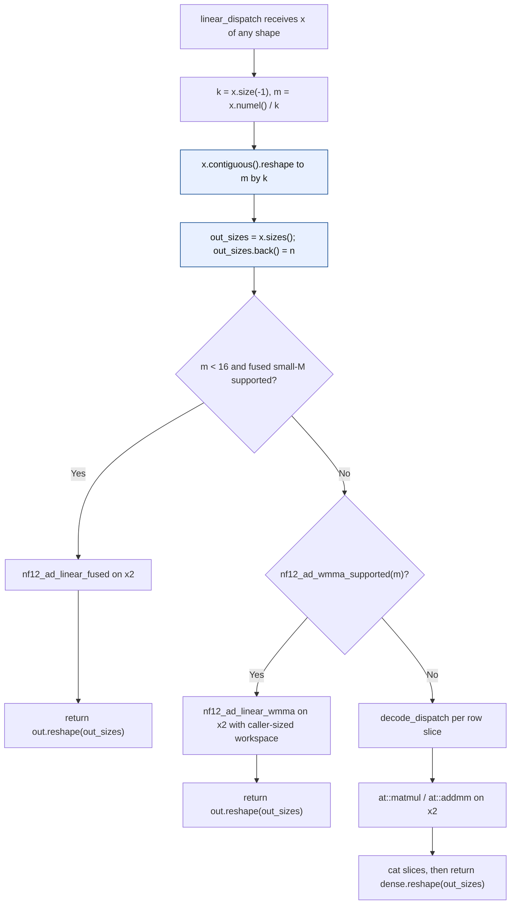
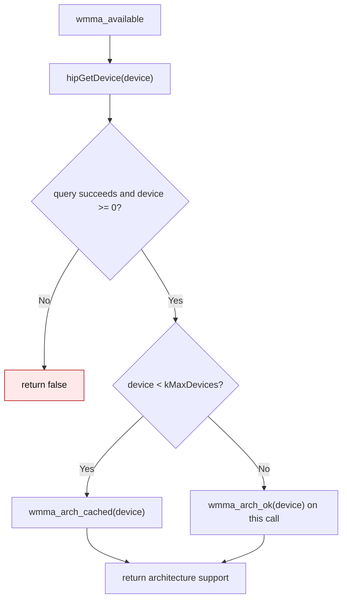
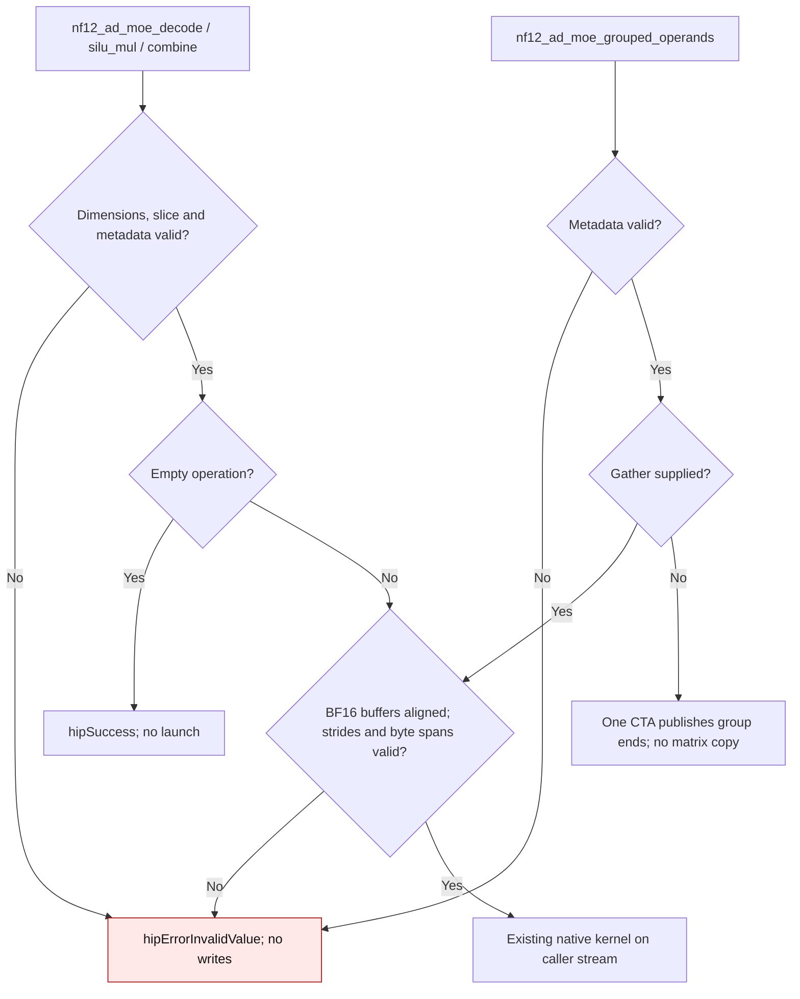
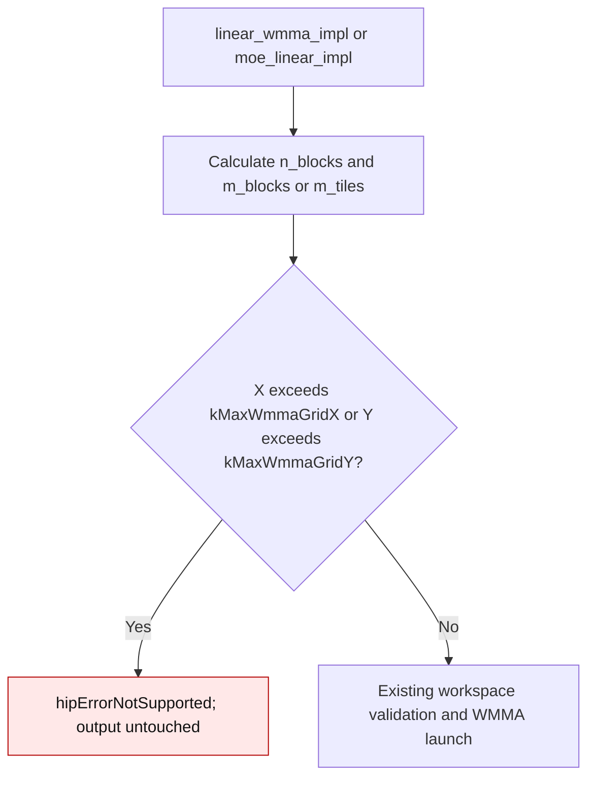
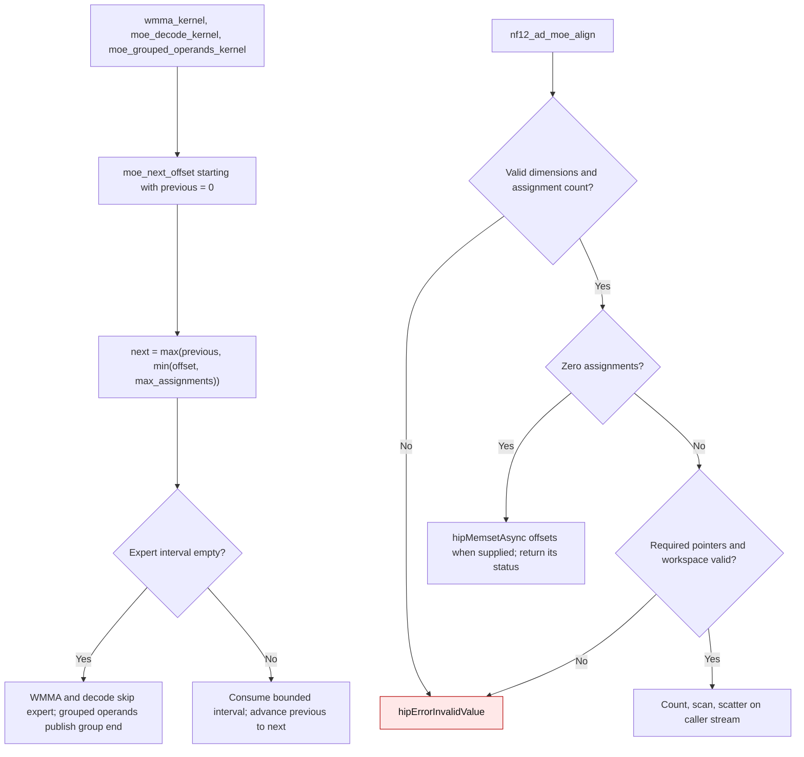
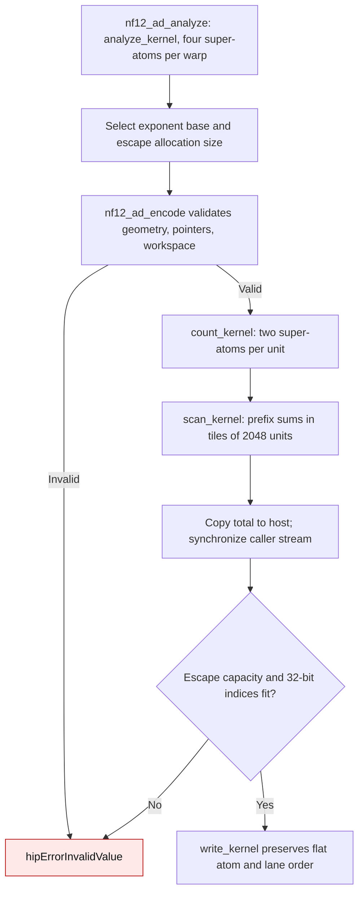
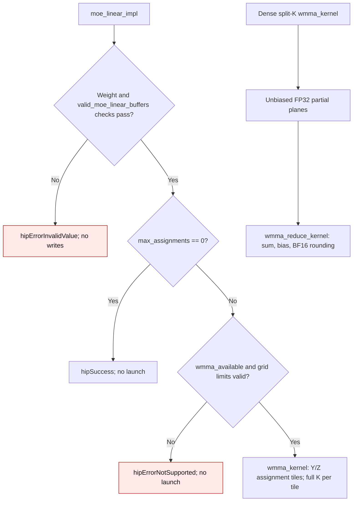
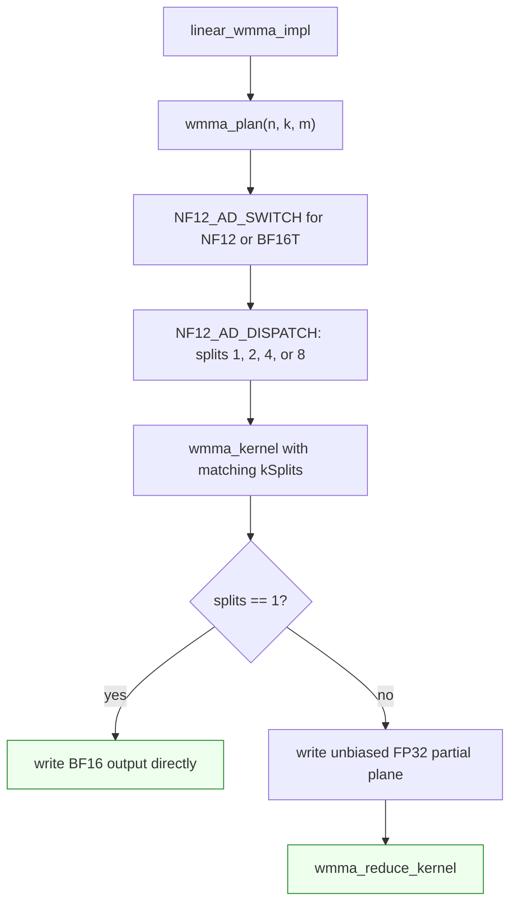

# NF12 HIP device and split-K workspace flow

`nf12_ad_hip.linear_dispatch` selects the NF12 matrix-core route for 16 to 256
tokens on gfx1200/gfx1201. Selection queries the **current HIP device**, so the
binding first checks that `x`, `packed`, and `escapes` share a device, then holds
`device_guard(packed)` through selection, allocation, and launch. The guard
restores the caller's current device when the call returns.



`wmma_launch_plan` supplies both the workspace size and the launch's tile,
M-block, and split counts. Split-K uses one FP32 partial plane per split. The
workspace is a local PyTorch tensor, so separate calls on different streams or
devices receive separate live storage. The allocator can reuse the storage
after the call's queued work finishes on its stream. No decoded weight is kept.

| Mechanism | Before | Current |
| --- | --- | --- |
| WMMA device selection | `nf12_ad_wmma_supported` read the ambient device before a guard (`58b00cc:gptqmodel_ext/nf12_hip/nf12_ad_torch.cpp:265`; `58b00cc:gptqmodel_ext/nf12_hip/nf12_ad_wmma.hip:346-350`) | `linear_dispatch` validates tensor devices and guards `packed` before routing (`gptqmodel_ext/nf12_hip/nf12_ad_torch.cpp:197-203`) |
| Split-K scratch | One process-wide `g_partial` pointer was reused by all calls and streams (`58b00cc:gptqmodel_ext/nf12_hip/nf12_ad_wmma.hip:353-376`) | `linear_dispatch` owns a local allocator tensor, sized by the shared launch plan (`gptqmodel_ext/nf12_hip/nf12_ad_torch.cpp:285-298`; `gptqmodel_ext/nf12_hip/nf12_ad_wmma.hip:412-449`) |
| Invalid inputs | WMMA could launch with tensors on different devices, or reuse scratch from another device | A tensor-device mismatch raises before dispatch; an undersized workspace returns `hipErrorInvalidValue` |

The independent Torch FP32 oracle in `tests/test_nf12_ad_codec.py` checks the
multi-device and concurrent-stream results on suitable RDNA4 hosts. The
`m <= 15` fused route and the `m > 256` decode-then-GEMM route retain their
existing math and packed-weight storage.

Introduced in #3635.

## Activation layout and output shape

Every HIP route indexes rows of a contiguous `[m, k]` matrix: the fused
small-M kernel, the matrix-core kernel, and the decode-then-GEMM slices all
take a row pointer plus `k`. A sliced activation (`storage[:m, :k]` of a wider
allocation) or a 3-D activation therefore cannot be forwarded as-is. The
op layer normalizes once at entry and restores the caller's leading
dimensions on every return.



| Mechanism | Before | Current |
| --- | --- | --- |
| Fused small-M eligibility | Required `x.dim() == 2 && x.is_contiguous()`, so a 3-D or sliced input silently took a slower route (`08cf3857b:gptqmodel_ext/nf12_hip/nf12_ad_torch.cpp:214`) | Route decision uses only `m`, after `x2 = x.contiguous().reshape({m, k})` (`gptqmodel_ext/nf12_hip/nf12_ad_torch.cpp:218-221`) |
| Kernel input pointer | Passed `x.data_ptr()` to the fused and WMMA kernels (`08cf3857b:...:240`, `:290`) | Passes `x2.data_ptr()`, which is contiguous by construction (`...:246`, `:296`) |
| GEMM operand | `at::matmul(x, ...)` / `at::addmm(bs, x, ...)` (`08cf3857b:...:338`) | `at::matmul(x2, ...)` / `at::addmm(bs, x2, ...)` (`...:339-341`) |
| Output shape | Returned `[m, n]`, flattening `[2, 8, 256]` to `[16, 256]` (`08cf3857b:...:245`, `:296`, `:338`) | Returns `out.reshape(out_sizes)` / `dense.reshape(out_sizes)` (`...:251`, `:302`, `:345`) |

Failure path: a shape the kernels cannot honour (`n % 16 != 0`, `k % 64 != 0`,
`packed` not contiguous) still raises `TORCH_CHECK` before any launch, so the
normalization never converts a rejection into a wrong answer. The raw HIP dense
entry points consume contiguous rows and expose no leading-dimension parameter.

`tests/test_nf12_ad_codec.py` asserts the 3-D shape round-trip, the padded
row-slice result against `F.linear`, and the `NF12ADLinear` module shape on a
RDNA4 host.

## Bounded WMMA capability cache

`wmma_available()` keeps 64 atomic slots for frequently queried HIP device
ordinals. A host exposing a larger ordinal still needs the same architecture
answer: it probes `wmma_arch_ok(device)` for that call instead of treating the
device as unsupported. A failed `hipGetDevice` or negative ordinal remains
unsupported. This preserves the WMMA route for a capable device beyond the
cache's capacity without changing the cached fast path.



| Mechanism | Before (`eeab711:gptqmodel_ext/nf12_hip/nf12_ad_wmma.hip:463-467`) | Current |
| --- | --- | --- |
| Ordinal below 64 | Cached architecture answer | Same cached answer |
| Ordinal 64 or above | Returned false before probing, despite the cache comment promising a fresh probe | Calls `wmma_arch_ok(device)` without indexing the bounded cache |
| Invalid device query | Returned false | Returns false |

## Native MoE input validation

Native MoE callers are checked before a launch: decode slices stay inside the
specified weight, BF16 row strides satisfy vector alignment, and byte spans fit
signed 64-bit indexing. `nf12_ad_validation.cuh` is staged with the JIT sources
and included in source distributions. The helpers mirror NF12's common C-ABI
validation; no device allocation, synchronization, or retained weight cache is
introduced.



| Before at `b19447f37` | Current behavior |
| --- | --- |
| Decode accepted slices past N (`nf12_ad_moe.hip:482`) | Reject `rows > n - row0` without overflow or output writes |
| SiLU and combine accepted undersized/misaligned strides (`nf12_ad_moe.hip:469`, `:454`) | Check pointers, vector row strides, and input/output byte spans |
| Grouped gather accepted invalid buffers and assignment bounds (`nf12_ad_moe.hip:503`) | Check metadata and optional gather buffers; no-gather mode computes only group ends |

The native regression suite adds 24 rejection cases: 8 decode slice/stride
cases, 12 SiLU/combine buffer cases, and 4 grouped-gather cases. All return
`hipErrorInvalidValue` (1) and leave output guards unchanged. Existing tests
continue to cover valid padded buffers, empty calls, and calls without gather.
On two R9700s with GIL disabled, ROCm 10.1.0 / HIP 7.16.26385, the NF12 and
backend contract suites pass **683 tests in 19.32 seconds**. Ruff and diff checks
pass. CUDA kernels and persistent storage are unchanged.

## Routing bounds and empty alignment

### WMMA launch dimensions

The dense and routed WMMA launchers admit the supported gfx1200/gfx1201 grid
dimensions: X up to 2147483647, Y up to 65535. Indices widen to `int64_t`
before multiplying by tile sizes. A larger grid returns
`hipErrorNotSupported` before launching or writing output; no extra device
query or allocation is added to the launch path.



| Mechanism | Before at `1e676331e` | Current |
| --- | --- | --- |
| Dense WMMA grid check | X/Y above 32767 rejected as invalid (`gptqmodel_ext/nf12_hip/nf12_ad_wmma.hip:631`) | X up to 2147483647 and Y up to 65535; larger grids are unsupported |
| Routed WMMA grid check | Same restriction (`gptqmodel_ext/nf12_hip/nf12_ad_wmma.hip:767`) | Same corrected limits |

R9700 boundary tests use one 16-by-64 expert, BF16 ones, and guarded output.
The expected output is exactly 64, independently of the encoder. No expanded
weight cache or scratch allocation was added.

| Assignments | Reserved Y blocks | Result | Wrong output elements / changed guard elements |
| ---: | ---: | --- | --- |
| 524256 | 32767 | Success | 0 / 0 |
| 524272 | 32768 | Success | 0 / 0 |
| 1048544 | 65535 | Success | 0 / 0 |
| 1048560 | 65536 total tiles across Y/Z | Success | 0 / 0 |

Validated with `PYTHON_GIL=0`, two visible R9700 GPUs, ROCm 10.1.0 / HIP
7.16.26385: **659 passed in 18.46 seconds** across the NF12 codec, native
review contracts, runtime loading, validator, backend naming, quantization-bit,
ROCm LLC, and kernel contract suites. This launch-boundary change does not
retune kernels; no new performance claim is made.

### Offset normalization

Routing and encoder contract updates introduced in #3685.

The vendored HIP MoE consumers follow CUDA's clamped running-maximum offset
schedule. Starting at zero, `moe_next_offset` bounds each endpoint by the
assignment count and the previous endpoint. Negative, decreasing, and oversized
offsets therefore cannot select guard rows or resurrect an empty expert.



`nf12_ad_moe_decode` also admits grid-X counts up to `INT32_MAX`; grid Y retains
the 65535-expert limit. A 524288-by-64 expert needs 32768 X blocks and a 64 MiB
BF16 output, so the former 32767-block limit rejected a small valid decode.

| Mechanism | Before at `9b0ff2a52` | Current source |
| --- | --- | --- |
| Routed expert intervals | Upper-only clamps allowed a negative row and decreasing intervals (`gptqmodel_ext/nf12_hip/nf12_ad_wmma.hip:159`; `gptqmodel_ext/nf12_hip/nf12_ad_moe.hip:268`) | Shared running maximum (`gptqmodel_ext/nf12_hip/nf12_ad_format_hip.cuh:61`), consumed by WMMA, decode, and grouped operands |
| Grouped operands | Started at zero regardless of the first offset (`gptqmodel_ext/nf12_hip/nf12_ad_moe.hip:324`) | Starts from normalized offset zero (`gptqmodel_ext/nf12_hip/nf12_ad_moe.hip:326`) |
| Empty routing | Workspace rejection preceded empty handling (`gptqmodel_ext/nf12_hip/nf12_ad_moe.hip:407`) | Zero assignments publish zero offsets before scratch checks (`gptqmodel_ext/nf12_hip/nf12_ad_moe.hip:405`) |
| Decode launch | Rejected more than 32767 X blocks (`gptqmodel_ext/nf12_hip/nf12_ad_moe.hip:495`) | Uses the signed 32-bit X limit (`gptqmodel_ext/nf12_hip/nf12_ad_moe.hip:494`) |

## Exact-byte encoder scheduling

Analysis assigns four super-atoms to each warp, and count/write use contiguous
two-super-atom units. Smaller units expose more parallel work while preserving
the format's flat atom/lane escape order. The CPU Torch codec remains an
independent byte oracle, including every BF16 bit pattern.



The former schedule used 16 super-atoms per analysis warp and eight per
count/write unit (`9b0ff2a52:gptqmodel_ext/nf12_hip/nf12_ad_encode.hip:55`).
The current constants are at `gptqmodel_ext/nf12_hip/nf12_ad_encode.hip:59`;
capacity validation still precedes writing at line 348. Additional persistent
weight/cache storage is **zero bytes**. The encoder's transient prefix workspace
for a 4096-by-4096 weight grows from 16400 to 65552 bytes; the histogram minimum
is unchanged. No dense inference weight cache is introduced, and existing
module tests check packed-only state after repeated forwards and invalidation
after mutation/loading. Decode output in the regression is caller-owned export
storage, not retained inference scratch.

### Validation evidence

Validation uses Radeon AI PRO R9700 (gfx1201), physical HIP2 only, ROCm SDK 10.1,
HIP 7.16.26385, Torch `2.16.0.dev20261025+rocm10.1`, and Python with the GIL
disabled. The regression waits on the captured producer stream, with both
default and nondefault producers, before launching on a separate consumer.

Four isolated baseline probes fail at `9b0ff2a52`: `[-1, 1]` overwrites a guard
row; empty routing returns invalid value; `[3, 1, 2, 4]` activates an empty
expert in decode; and 32768 decode blocks return invalid value. The updated
tests require exact BF16 equality for analytic integral routing results and
the all-ones large decode. Packed bytes, escape payloads, exponent base, and
decoded bits match the independent Torch codec exactly for all 65536 BF16 bit
patterns and random bit matrices with 3, 4095, and 4097 super-atoms. These sizes
cover partial units and the 2048-unit scan boundary. No FP64 oracle or relaxed
tolerance substitutes for these exact checks.

Run the native regressions and broader codec, module, loader, and validation
units from the repository root:

```bash
env -u ROCR_VISIBLE_DEVICES HIP_VISIBLE_DEVICES=2 PYTHON_GIL=0 \
  OMP_NUM_THREADS=1 MKL_NUM_THREADS=1 MAX_JOBS=2 \
  GPTQMODEL_NF12_AD_HIP_BUILD_ROOT=/tmp/gptqmodel-review-round2-native \
  /opt/venvs/rocm101t/bin/python -m pytest \
  tests/test_nf12_hip_review_contracts.py tests/test_nf12_ad_codec.py \
  tests/test_nf12_ad_runtime_load.py tests/test_validate_nf12_ad.py -q -rs
```

Result: **51 passed, 1 skipped in 25.84 seconds**.

The multi-device test requires two visible AMD devices and was skipped under
that isolation. A second run with `HIP_VISIBLE_DEVICES=0,2` passed that case
plus backend naming, bit validation, ROCm LLC, and kernel contract suites:
**604 passed in 6.09 seconds**, with no skips. Together the runs cover 655
passing cases. CUDA, other AMD architectures, and full-model inference were
not revalidated by this sync.

An isolated encode sample uses device-resident random BF16 weights, three
warmups, and the median of 15 host wall-time measurements, synchronized before
and after each call. It includes Python dispatch and allocation, excludes JIT,
and compares the baseline with these kernels on HIP2:

| Weight shape | Before, microseconds | After, microseconds |
| --- | ---: | ---: |
| 256 by 256 | 147.23 | 130.34 |
| 4096 by 4096 | 311.44 | 231.16 |

These two samples support the scheduling change on this device; they do not
establish performance across models or architectures.

## Bias reduction and routed launch contracts

Split-K writes unbiased FP32 partials. `wmma_reduce_kernel` sums all splits,
adds bias, then rounds once to BF16. Adding bias to split zero could lose it
before cancellation or overflow even when the final answer is finite.

Native routed linear now uses `valid_moe_linear_buffers` for the same scalar,
alignment and stride checks as upstream's shared CUDA/HIP ABI. Empty work
validates weights/scalars but needs no X/Y/offset buffers. Assignment tiles
span grid.y/z, while routed K always starts at zero. Dense split-K still uses
Z for K slices. Neither path allocates or retains device buffers internally.



| Before at `21e9961a4` | Current |
| --- | --- |
| Bias added to partial zero (`nf12_ad_wmma.hip:402`) | Add after reduction (`nf12_ad_wmma.hip:423`) |
| Routed grids with more than 65535 Y tiles rejected (`nf12_ad_wmma.hip:772`) | Use bounded Y/Z dimensions (`nf12_ad_wmma.hip:781`) |
| Native routed validation omitted buffer checks and rejected empty work (`nf12_ad_wmma.hip:766`) | Share `valid_moe_linear_buffers`, allow validated empty work (`nf12_ad_wmma.hip:768`) |
| Decode E > 65535 returned unsupported (`nf12_ad_moe.hip:516`) | Return invalid-value, matching the CUDA codec contract |

## Shared BF16T split-K dispatch

`linear_wmma_impl<WeightSource>` computes one `WmmaPlan` for both NF12 and
BF16T weights. `NF12_AD_SWITCH` dispatches the selected tile and K-split counts
for either source, so the BF16T reference fills the same partial planes and
uses the same reducer as NF12.



| BF16T launcher | Before | After |
| --- | --- | --- |
| Tile count | always `kMaxTiles` | plan-selected tile count |
| K splits | hardcoded `kSplits=1` | plan-selected split 1/2/4/8 |
| Split-K output | wrote directly to `out` while host launched `grid.z=splits` | writes `partial`, then runs the shared reducer |
| Coverage | no split-plan test | `test_bf16t_wmma_matches_nf12_split_k_plans` covers split 2/4/8 |

Validation on two visible R9700s, ROCm 10.1 / HIP 7.16.26385, GIL=0:
**717 tests passed in 19.58 s**, with no skips. Tests cover exact cancelling
products with biases 1, 2^-25 and 2^127; all return the exact finite bias.
The routed tests check all output elements and guards through 2097120 assignments.
Malformed native inputs are rejected without writes, and empty work succeeds.
There are **zero bytes** of additional persistent weight storage; partial planes
remain transient caller-owned scratch. Existing module/state tests also pass.

The same fixes are in dphnAI/nf12 PR #3. Its independent before/after timing
probe measures up to 3.16% higher GPU time for one biased split-K case; it is
not a performance measurement of this vendored extension. No universal
performance claim is made for these correctness fixes.
