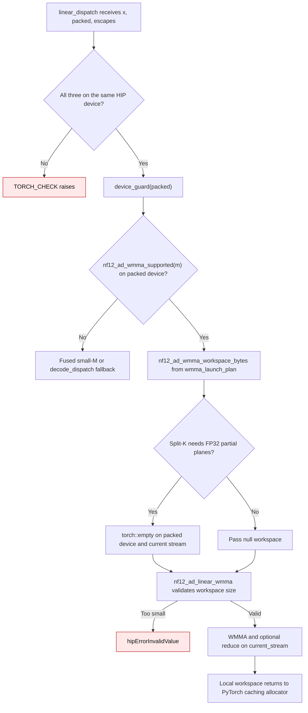

# NF12 HIP device and split-K workspace flow

`nf12_ad_hip.linear_dispatch` selects the NF12 matrix-core route for 16 to 256
tokens on gfx1200/gfx1201. Selection queries the **current HIP device**, so the
binding first checks that `x`, `packed`, and `escapes` share a device, then holds
`device_guard(packed)` through selection, allocation, and launch. The guard
restores the caller's current device when the call returns.

`wmma_launch_plan` supplies both the workspace size and the launch's tile,
M-block, and split counts. Split-K uses one FP32 partial plane per split. The
workspace is a local PyTorch tensor, so separate calls on different streams or
devices receive separate live storage. The allocator can reuse the storage
after the call's queued work finishes on its stream. No decoded weight is kept.

| Mechanism | Before | Current |
| --- | --- | --- |
| WMMA device selection | `nf12_ad_wmma_supported` read the ambient device before a guard (`58b00cc:gptqmodel_ext/nf12_hip/nf12_ad_torch.cpp:265`; `58b00cc:gptqmodel_ext/nf12_hip/nf12_ad_wmma.hip:346-350`) | `linear_dispatch` validates tensor devices and guards `packed` before routing (`gptqmodel_ext/nf12_hip/nf12_ad_torch.cpp:197-203`) |
| Split-K scratch | One process-wide `g_partial` pointer was reused by all calls and streams (`58b00cc:gptqmodel_ext/nf12_hip/nf12_ad_wmma.hip:353-376`) | `linear_dispatch` owns a local allocator tensor, sized by the shared launch plan (`gptqmodel_ext/nf12_hip/nf12_ad_torch.cpp:285-298`; `gptqmodel_ext/nf12_hip/nf12_ad_wmma.hip:412-449`) |
| Invalid inputs | WMMA could launch with tensors on different devices, or reuse scratch from another device | A tensor-device mismatch raises before dispatch; an undersized workspace returns `hipErrorInvalidValue` |

The independent Torch FP32 oracle in `tests/test_nf12_ad_codec.py` checks the
multi-device and concurrent-stream results on suitable RDNA4 hosts. The
`m <= 15` fused route and the `m > 256` decode-then-GEMM route retain their
existing math and packed-weight storage.

Introduced in #3635.
