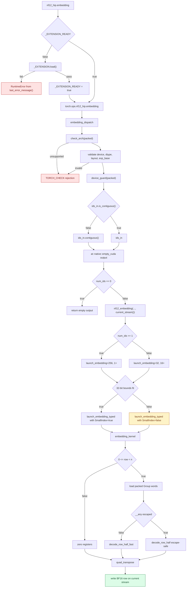

<!-- SPDX-FileCopyrightText: 2026 ModelCloud.ai -->
<!-- SPDX-License-Identifier: Apache-2.0 -->

# NF12 HIP embedding dispatch

The HIP embedding operator gathers exact BF16 rows directly from the packed
NF12 table. It keeps the weight in its quantized representation, decodes only
the selected row halves, and returns a dense gather result to the caller.
Dispatch changes with the number of requested IDs because a one-row lookup is
latency and launch limited, while a larger gather can amortize each CTA across
16 IDs.

This page describes the canonical paired-row compatibility operator. Production
`AUTO_NF12` embedding modules use the row-major representation documented in
[NF12 row-major embedding storage](nf12-row-major-embedding.md). The canonical
operator remains available for existing packed inputs and direct comparisons.

## New flow

The binding is in `gptqmodel_ext/nf12_hip/nf12_torch.cpp:160-204`; the kernel
and launch selection are in `gptqmodel_ext/nf12_hip/nf12_embedding.hip:47-180`.
The Python extension-ready check and cached dispatcher handle are in
`gptqmodel/utils/nf12_hip.py:187-194,266-278`.

For a one-ID call, `<256, 1>` creates a 1,024-thread CTA. For a 5120-column
table, the K grid has one block, so one CTA covers the complete row. For two
or more IDs, `<32, 16>` creates a 128-thread CTA containing 16 IDs with two
quads per ID. The same table uses 40 K-grid blocks, and `blockIdx.x` packs
successive groups of 16 IDs.

## Before and after

The pre-change evidence below is from the embedding source in Git index blob
`993712a`. Its line numbers are retained here because those lines were removed.

| Mechanism | Before | Evidence | After | Evidence |
| --- | --- | --- | --- | --- |
| CTA geometry | Fixed `kEmbeddingQuads = 32`; one ID per `blockIdx.x` and up to 32 quads per row | `nf12_embedding.hip:17-18,49-50,101-106` (blob `993712a`) | `<Quads, IdsPerCTA>` templates; `<256, 1>` for one ID and `<32, 16>` for multiple IDs | `nf12_embedding.hip:47-64,168-184` |
| Row decode | `decode_bulk` decoded all four row halves, then selected two words | `nf12_embedding.hip:23-36` (blob `993712a`) | `decode_row_half_fast` computes only the selected half; an escape-safe variant is used only when the wave detects an escape | `nf12_embedding.hip:21-44,79-95` |
| Index width | Every row, table bound, K bound, and grid position used `int64_t` | `nf12_embedding.hip:39-46,56-60` (blob `993712a`) | `SmallIndex` selects 32-bit arithmetic when `num_ids`, `n`, `k`, and table super-atoms fit; larger cases use the 64-bit specialization | `nf12_embedding.hip:47-58,146-155` |

## Contracts and failure paths

| Situation | Shipped behavior | Evidence |
| --- | --- | --- |
| ID is negative or at least `n` | The original ID is validated before narrowing, so an out-of-range int64 value cannot wrap into a valid uint32 row; zero `uint4` values then pass through `quad_transpose` and produce an all-`+0` BF16 row | `nf12_embedding.hip:66-71,104-111` |
| Escape metadata is zero and the escape index is out of range | `decode_row_half` returns zero words instead of reading the escape table | `nf12_embedding.hip:37-42` |
| IDs tensor is strided | The binding makes one contiguous ID tensor while preserving every leading dimension, then appends `K` to the output shape | `nf12_torch.cpp:186-190` |
| IDs tensor is empty | The binding allocates `[*ids.shape, K]` and returns without launching a kernel | `nf12_torch.cpp:187-192` |
| Table or launch position exceeds the 32-bit fast path | `launch_embedding` selects the 64-bit kernel specialization | `nf12_embedding.hip:146-155` |
| ID or K grid exceeds the HIP grid limit | `launch_embedding_typed` returns `hipErrorInvalidValue`; the binding turns the status into `TORCH_CHECK` failure | `nf12_embedding.hip:119-132`; `nf12_torch.cpp:194-203` |
| Device, ID dtype, packed layout, escape layout, exponent, or table shape is invalid | `embedding_dispatch` rejects the call before launch with a targeted `TORCH_CHECK` message | `nf12_torch.cpp:164-183` |
| Extension build or load fails | The Python wrapper raises `RuntimeError` with `_EXTENSION.last_error_message()` | `nf12_hip.py:263-268` |

The device guard is created from `packed`, and `current_stream()` is queried
after that guard. A call therefore follows the packed table's device and the
calling thread's current stream even when another device is current. The
output allocation uses `at::native::empty_cuda`; the only returned dense tensor
is the gather result. No dense table, decoded row cache, or expanded packed
weight is retained between calls.

## Validation

Measured on AMD Radeon AI PRO R9700 (`gfx1201`), ROCm 10.1.0, PyTorch
2.16.0.dev20261025+rocm10.1, with `PYTHON_GIL=0`. The benchmark used a
`[512, 5120]` BF16 table, five warmed trials of 100 Python calls, a device
synchronization after each trial, and the median trial:

| IDs | dense `F.embedding` | native NF12 embedding | native / dense |
| ---: | ---: | ---: | ---: |
| 1 | 4.41544 µs | 5.49262 µs | 0.8039x |
| 256 | 5.84545 µs | 6.18655 µs | 0.9449x |

These values are the medians of 25 trial timings from five independent process
runs, where each run used the five-trial protocol above. The dispatch reduced native latency
substantially from the earlier roughly 9.4/9.3 µs medians. Caching the
registered operator removes the repeated `torch.ops.nf12_hip.embedding` lookup
from the Python wrapper. The one-ID schedule also replaces 20 tiny CTAs with
one 1,024-thread CTA. These changes improve one-ID latency, but the operator
remains slower than dense BF16 and does not meet the 1.2x-dense target.

The target is above the bandwidth ceiling for this operation. Dense BF16 reads
two bytes and writes two bytes per output element, while NF12 reads 1.5 bytes
and must still write two bytes of BF16 output. If all traffic ran at the same
rate and decode were free, the maximum speedup would be
`(2 + 2) / (1.5 + 2) = 1.143x`. At 256 IDs the output store dominates, and the
measured native path is close to the dense copy time. At one ID, launch and
dispatch latency dominate both paths.

### Llama 3.2 1B embedding shape

The model's embedding table is `[128256, 2048]`. A realistic table used
525,336,576 bytes in BF16; packed NF12 data and escapes used 394,323,488 bytes,
a 24.9% reduction. Three independent process runs, each taking the median of
nine trials of 200 calls, produced:

| IDs | dense `F.embedding` | native NF12 embedding | native / dense |
| ---: | ---: | ---: | ---: |
| 1 | 4.21629 µs | 5.33979 µs | 0.7896x |
| 256 | 14.34657 µs | 6.81298 µs | 2.1057x |

The 256-ID case exceeds the 1.2x target on R9700 and matches the dense output
exactly, including all BF16 bits. One-ID lookup remains launch limited and
does not meet the target. The 2.10x result also shows why the same-rate ceiling
is not a universal upper bound: this ROCm build's dense gather is substantially
slower for the 4 KiB row stride than the copy-rate model predicts.

The exact-bit and lifecycle coverage is in
`tests/test_nf12_hip_embedding.py`. It checks int32/int64 and strided IDs,
arbitrary leading dimensions, scalar and empty inputs, invalid-ID `+0` rows,
signed zero, subnormals, infinities, NaN payloads, packed-device selection,
mutation visibility, and live allocator bytes across repeated calls.
