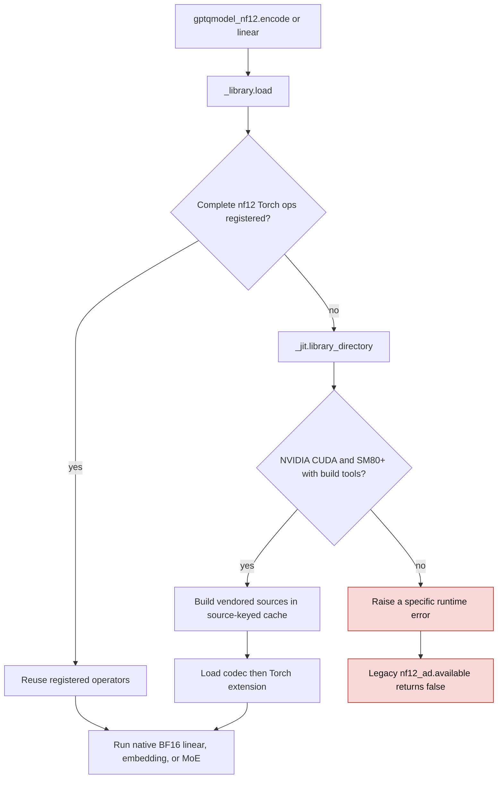
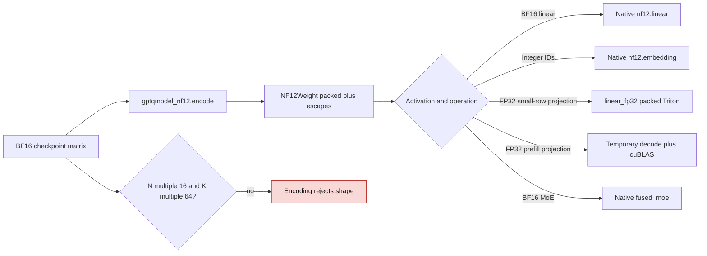

<!-- SPDX-FileCopyrightText: 2026 ModelCloud.ai -->
<!-- SPDX-License-Identifier: Apache-2.0 -->

# NF12 vendored runtime

GPT-QModel ships the lightweight `gptqmodel_nf12` Python API and the vendored
CUDA sources in one wheel. Inference callers can encode a BF16 matrix once and
keep only packed NF12 storage. The legacy `gptqmodel.utils.nf12_ad` entry points
delegate to the same package; callers no longer need an installed `nf12` wheel.

`gptqmodel_nf12.linear_fp32` selects a separate Triton kernel for FP32
activations. It decodes bounded weight fragments in registers. Selected output
rows use a short-K tiled kernel; small full projections use the general packed
projection. Large input batches use a call-local decode and cuBLAS projection;
the temporary dense weight is released after that call. No path retains a
dense weight between calls. `NF12Weight.narrow_rows`
views a 16-row-aligned packed range and shares the original escape table.

| Previous mechanism | Current mechanism |
| --- | --- |
| `gptqmodel/utils/nf12_ad.py:173` tried `_load_installed` before `_build_and_load` at `:187` | `gptqmodel/utils/nf12_ad.py:25` delegates to `gptqmodel_nf12.load` |
| An external `nf12` wheel could own the operator registration | `gptqmodel_nf12/_library.py:39` loads GPT-QModel's vendored CUDA source build, or reuses a complete registered operator set |
| Legacy CUDA runtime exposed BF16 `linear` at `gptqmodel/utils/nf12_ad.py:318` | `gptqmodel_nf12/api.py:131` provides BF16 linear and `:142` adds `linear_fp32` for FP32 routing and score projections |

The native CUDA API supports NVIDIA SM80 or newer. GPT-QModel's separate HIP
runtime and CPU codec remain the fallbacks for the existing quantizer and
quantized linear layer. The lightweight Python API rejects ROCm explicitly so
the HIP runtime is not mistaken for NVIDIA CUDA.

The exact BF16 format requires a two-dimensional matrix with `N % 16 == 0` and
`K % 64 == 0`. Norm vectors, biases, and unaligned matrices remain BF16 in
applications that use this API. The source wheel includes the native CUDA
sources, but a first use without prebuilt binaries requires nvcc, CMake, Ninja,
and a C++ compiler; a missing toolchain fails before inference starts.

Synthetic SM80 tests use independent dense Torch oracles for BF16 linear,
embedding, FP32 projection, selected rows, and MoE. FP32 scores may differ in
the last bits from cuBLAS because reduction order changes. Serving applications
must qualify routing and token decisions at model level before enabling the new
dispatch.
