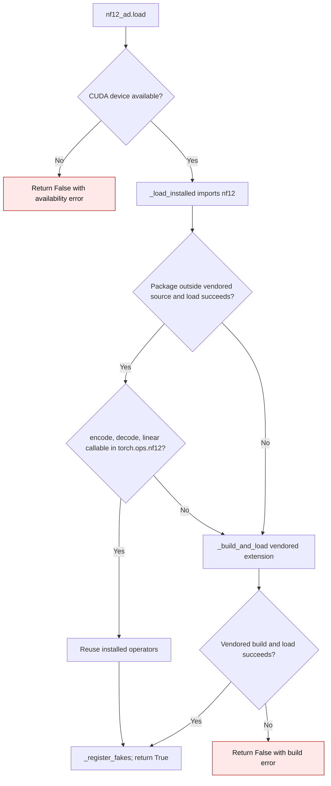

# NF12 installed extension selection

`gptqmodel.utils.nf12_ad.load` can reuse an installed upstream `nf12` package
or build the vendored extension. PyTorch creates a `torch.ops.nf12` namespace
when it is accessed, even if no operators are registered. The installed path
therefore checks that the three runtime operators used by GPT-QModel—`encode`,
`decode`, and `linear`—are callable before accepting that package.

| Mechanism | Before | Current |
| --- | --- | --- |
| Installed package acceptance | `hasattr(torch.ops, "nf12")` accepted an empty namespace (`e0991f5:gptqmodel/utils/nf12_ad.py:180`) | `_load_installed` checks the callable `encode`, `decode`, and `linear` operators (`gptqmodel/utils/nf12_ad.py:180-184`) |
| Partial or no-op installed package | `_LOADED` could become `True`; the first operator call then failed | The installed path returns `False` and `load` tries the vendored extension; if that build fails, `load` reports the error and callers can use the Torch codec |

The fake installed-package cases in `tests/test_nf12_ad_runtime_load.py`
exercise empty, partial, and complete operator sets. No quantization math,
checkpoint representation, or inference storage changes in this flow.
