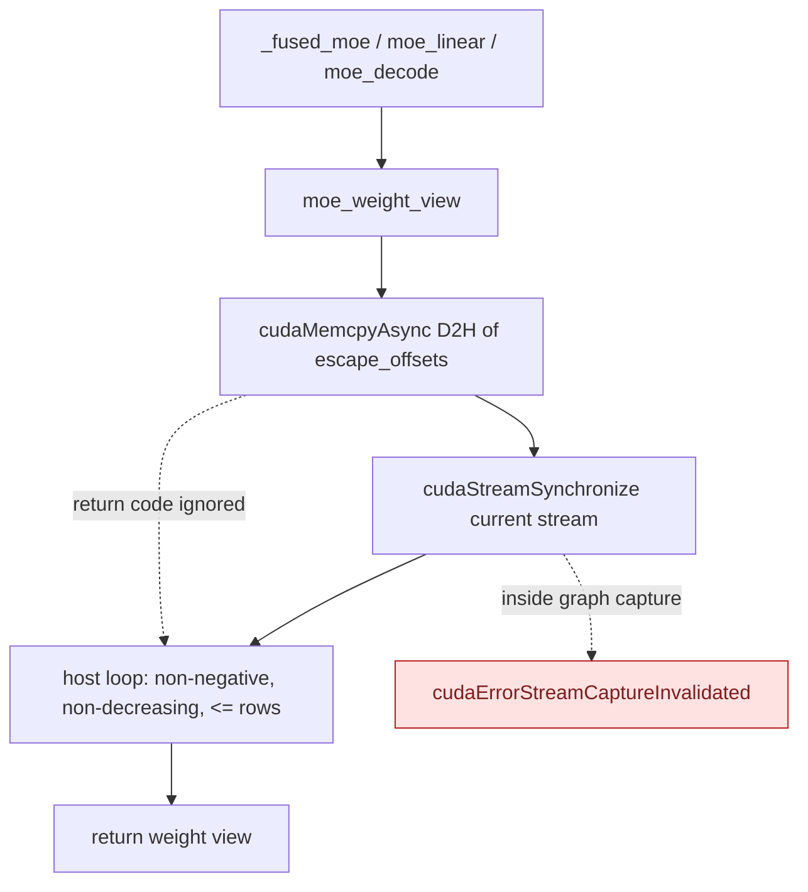
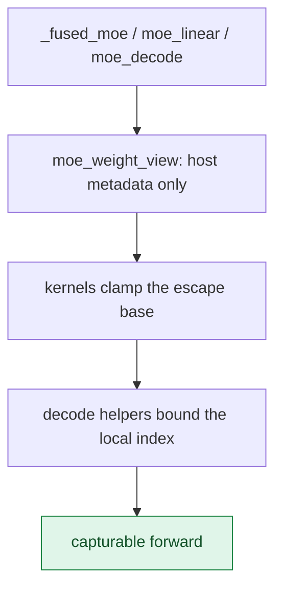

<!-- SPDX-FileCopyrightText: 2026 ModelCloud.ai -->
<!-- SPDX-License-Identifier: Apache-2.0 -->

# NF12 MoE capture and escape bounds

The NF12 MoE operators (`_fused_moe`, `moe_linear`, `moe_decode`) are documented
to "support graph capture without host synchronization" (`include/nf12/nf12.h`).
That contract is what lets a serving engine capture a decode graph.

Two rules keep it true:

1. The forward path never reads device memory on the host.
2. Device memory that the kernels index is bounded on the device.

This page describes both, introduced for issues #4547 and #4552.

## 1. `moe_weight_view` is host-only

`moe_weight_view` (`gptqmodel_ext/nf12/csrc/torch/ops.cpp`) builds the C view for
every MoE call. It validates shapes, dtypes, alignment and contiguity — all host
metadata — and nothing else. `NF12MoEWeight.__post_init__` validates the offset
table once at load time (non-negative, non-decreasing, inside the table).

### Old flow

The sync waited for all queued GPU work twice per layer, and its return codes
were unchecked, so a failed copy skipped the very validation it existed for.

### New flow

## 2. Escape bounds live in the kernels

`moe_escape_slice` (`csrc/moe/common.cuh`) computes one expert's slice from the
absolute offset pair:

| Offset pair | Before | After |
| --- | --- | --- |
| valid `[lo, hi]` | `escapes + lo`, `hi - lo` rows | same |
| negative `lo` | host `ValueError` (or OOB read when the copy failed) | base clamped to 0 |
| decreasing `hi < lo` | host `ValueError` | empty slice, no load |
| `hi` past the table | host `ValueError` | trusted (load-time check owns it) |

The local escape index is bounded by the shared decode helpers
(`decode_group`, `decode_group_any_lane`): `meta == 0 && lo0 < num_escapes`.
The SM103 staged path (`small_m_async_kernel`, `StageEscapes`) had its own
producer and consumer that skipped that test; both now apply it before copying a
row into shared memory and before overwriting the fragment.

## 3. Failure contract

| Situation | Before | After |
| --- | --- | --- |
| MoE forward inside `torch.cuda.graph` | capture invalidated by the sync | captures and replays |
| Valid checkpoint | correct | correct |
| Negative offset (direct op caller) | `ValueError` | clamped, no read before the table |
| Decreasing offset (direct op caller) | `ValueError` | empty slice |
| Offset past the table (direct op caller) | `ValueError` | trusted; load-time check rejects it |
| SM103 staged escape with index >= `num_escapes` | OOB global read | bulk-decode fallback |

## Scope

Direct `torch.ops.nf12` callers are trusted for an in-range upper offset, the
same way the HIP MoE kernels trust `escapes + escape_offsets[e]`. The public
`NF12MoEWeight` API rejects it at load time. The SM103 path was compile-checked
for `sm_103` but not executed on B300 hardware here.
