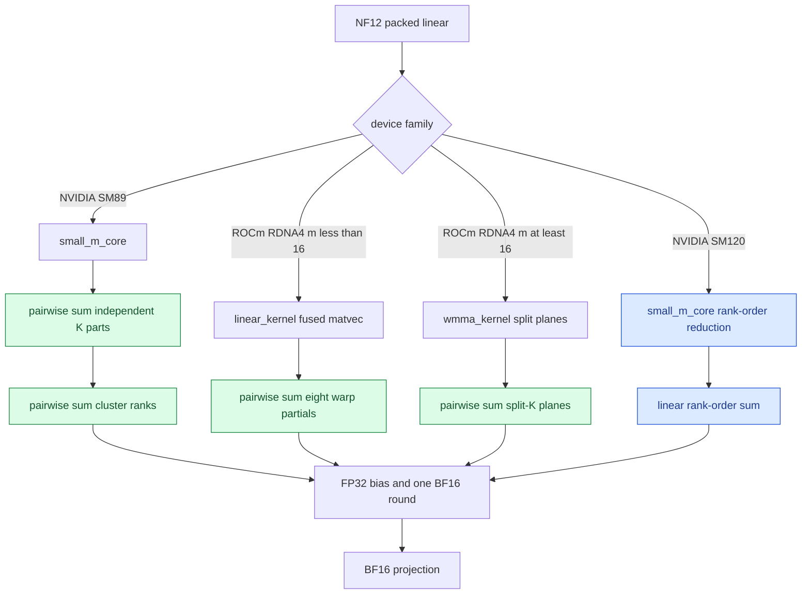

<!-- SPDX-FileCopyrightText: 2026 ModelCloud.ai -->
<!-- SPDX-License-Identifier: Apache-2.0 -->

# NF12 linear reduction association

NF12 weight decoding is bit exact. A BF16 embedding lookup performs no
arithmetic reduction, so its gathered rows are bit-identical to the dense
table. The visible logits difference in a full model comes from FP32
accumulation association inside NF12 linear kernels and from the BF16
rounding after each projection.

Dense BF16 GEMM and NF12 use different K traversal and reduction shapes. Even
with identical BF16 weights and FP32 accumulators, the final bits can differ
when a result lies near a BF16 rounding boundary. GPT-QModel uses pairwise
association only on the accelerator families where measurements show a
lower maximum and mean error. It does not change the packed weight, source
restoration, or quantization math.

## Flow

The SM89 path is in
`gptqmodel_ext/nf12/csrc/linear/small_m_core.cuh`. The SM89 split-plane
reducer in `gptqmodel_ext/nf12/csrc/linear/small_m.cu` also uses pairwise
association; other SM8x images retain rank order. The RDNA4 fused matvec is in
`gptqmodel_ext/nf12_hip/nf12_decode.hip`; its matrix-core split reducer is in
`gptqmodel_ext/nf12_hip/nf12_wmma.hip`.

## Why the policy differs

| Device path | Shipped association | Reason |
| --- | --- | --- |
| NVIDIA SM89, RTX 4090 | Pairwise | Lowered both maximum and mean drift for the measured Llama 3.2 1B input |
| NVIDIA SM120, RTX 5090 | Rank order | Pairwise association increased maximum and mean drift on the measured input |
| ROCm RDNA4 fused matvec | Pairwise | Eight warp partials contain long cancellation-heavy K slices |
| ROCm RDNA4 WMMA | Pairwise | Split planes are independent FP32 chains with the same reduction risk |

The selection is compiled from the concrete CUDA architecture and from the
separate HIP source family. It is not inferred from a generic Torch `cuda`
device string and does not use an environment variable.

## Measured Llama 3.2 1B result

The dense and NF12 models used the same BF16 weights, prompt, tokenizer, and
next-token path. The comparison packed all 113 eligible linear modules.

| Device | Policy | Max absolute logits drift | Mean absolute logits drift | Token IDs |
| --- | --- | ---: | ---: | --- |
| RTX 4090 | Rank order | 0.234375 | 0.0261802 | Exact |
| RTX 4090 | Pairwise | 0.218750 | 0.0234022 | Exact |
| RTX 5090 | Rank order | 0.2734375 | 0.0255472 | Exact |
| RTX 5090 | Pairwise experiment | 0.30078125 | 0.0266446 | Exact |
| R9700 | Rank order | 0.28125 | 0.0278205 | Exact |
| R9700 | Pairwise | 0.187500 | 0.0176995 | Exact |

On RTX 4090, pairwise association reduced maximum drift by 6.7% and mean
drift by 10.6%. On R9700 it reduced maximum drift by 33.3% and mean drift by
36.4%. RTX 5090 therefore retains the original order instead of accepting a
worse numerical result.

The calibration handoff remains independent of the inference reduction tree.
After the association changes, `AUTO_NF12` and `OFF` GPTQ runs still produced
482 of 482 state tensors with identical bytes and zero mismatches.

The RDNA4 fused matvec remains faster than dense BF16 at one token:

| Projection | Dense BF16 | NF12 | Speedup |
| --- | ---: | ---: | ---: |
| 2048x2048 | 13.33 us | 9.65 us | 1.38x |
| 8192x2048 | 23.03 us | 18.25 us | 1.26x |
| 2048x8192 | 34.56 us | 17.27 us | 2.00x |
| 11008x4096 | 145.90 us | 39.92 us | 3.65x |
| 4096x4096 | 22.12 us | 18.73 us | 1.18x |

These timings are warmed medians of seven trials with 300 calls per trial,
one synchronization after each trial, and `PYTHON_GIL=0`.

The M=1, M=4, M=8, and M=16 launch sweep, including the remaining slower
shapes, is recorded in [NF12 short-M dispatch](nf12-short-m-dispatch.md).

## Failure and precision contract

- Packed weights and escapes are unchanged and decode bit-exactly.
- Bias joins the final FP32 reduction before the single BF16 output round.
- Invalid shapes and unsupported device families continue to fail closed in
  the existing native bindings.
- A model whose token IDs change is a regression; token identity is asserted
  in the model comparison rather than hidden by a logits tolerance.
- The reduction tree changes only arithmetic association. It does not retain
  dense or dequantized weights between calls.
