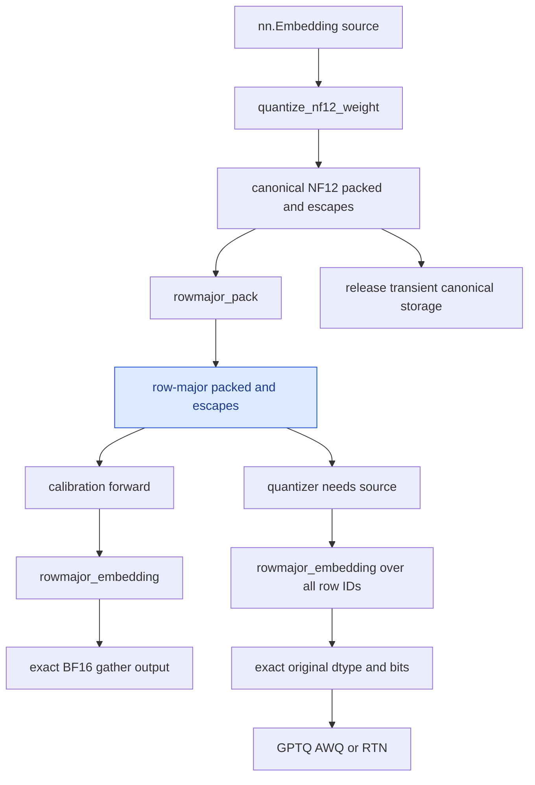
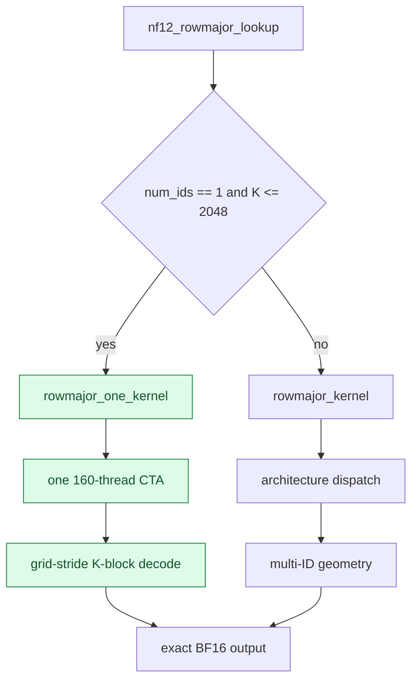

<!-- SPDX-FileCopyrightText: 2026 ModelCloud.ai -->
<!-- SPDX-License-Identifier: Apache-2.0 -->

# NF12 row-major embedding storage

NF12 matrices use the canonical interleaved super-atom layout so linear
kernels can decode paired rows together. Embedding lookup has the opposite
access pattern: one requested row should be read without fetching its paired
row. GPT-QModel therefore derives an embedding-only row-major representation
from canonical NF12. Matrix weights and checkpoints remain canonical.

## Packed layout

Each 64-column row block occupies 96 bytes:

- 32 metadata bytes.
- 64 low-mantissa bytes.
- Escape records remain packed metadata, never decoded table rows.

The transformation selects one half of every canonical group. If that half
would look like the zero sentinel, the transform creates an escape record for
the selected half. This preserves every BF16 bit, including signed zero,
subnormals, infinities, and NaN payloads.

The row-major tensor still has `N * K * 3 / 2` bytes, so the base NF12 saving
is unchanged. Lookup locality improves because one row block no longer reads
its paired row.

## Flow

`AutoNF12Embedding` retains only the row-major packed tensor, its escape
table, and the exponent. A dense table is materialized only when the
quantizer requests the source and is released after the quantizer finishes.
No dense lookup cache is retained.

## Backend contract

NVIDIA CUDA uses `torch.ops.nf12.rowmajor_pack` and
`torch.ops.nf12.rowmajor_embedding`. RDNA4 uses the corresponding
`nf12_hip.rowmajor_pack` and `nf12_hip.rowmajor_embedding` operators. Both
accept int32 or int64 IDs of any shape, support non-contiguous IDs, write
`[*ids.shape, K]`, and return all-`+0.0` rows for IDs outside `[0, N)`.
Each backend reads and writes on the packed tensor's device and current
stream.

The transform is implemented by native kernels on both backends. The HIP
transform performs the same selected-half extraction and collision escape
materialization as CUDA; both paths are checked against the independent CPU
transform and dense Torch gather for the shared collision fixture.

## Measured CUDA result

The table is `[512, 5120]` BF16. Row-major packed plus escapes occupied
3,935,120 bytes on RTX 4090 and 3,935,136 bytes on RTX 5090, versus 5,242,880
dense bytes. Measurements are nine warmed trials of 300 calls, with a device
synchronization after each trial. The reported value is the median trial.

| GPU | IDs | Dense `F.embedding` | Row-major NF12 | Speedup |
| --- | ---: | ---: | ---: | ---: |
| RTX 4090, SM89 | 1 | 5.14478 us | 5.75709 us | 0.894x |
| RTX 4090, SM89 | 64 | 6.31762 us | 5.74136 us | 1.100x |
| RTX 4090, SM89 | 256 | 6.26928 us | 5.77862 us | 1.085x |
| RTX 4090, SM89 | 512 | 6.31395 us | 6.06792 us | 1.041x |
| RTX 5090, SM120 | 1 | 5.19466 us | 5.81147 us | 0.894x |
| RTX 5090, SM120 | 64 | 6.33561 us | 5.84041 us | 1.085x |
| RTX 5090, SM120 | 256 | 6.33558 us | 5.85246 us | 1.083x |
| RTX 5090, SM120 | 512 | 6.38101 us | 5.88164 us | 1.085x |

The original geometry remains selected for calls with two or more IDs and for
wider one-ID tables. A one-ID lookup with at most 2048 columns launches one
160-thread CTA and walks the 64-column blocks with a grid-stride loop. This
removes the second grid dimension and keeps the cache-global output stores used
by the decode path. The kernel is selected from `num_ids == 1` and `K <= 2048`,
not from an environment variable.

Direct C ABI paired measurements used repeated GPU-event samples of 1,500 to
2,000 launches.
The baseline was the prior architecture-specific one-ID launch; the candidate
was the 160-thread persistent CTA. Both paths were checked against the dense
BF16 gather before timing.

| GPU | Table | Prior one-ID launch | Persistent one-ID CTA | Speedup |
| --- | --- | ---: | ---: | ---: |
| RTX 4090, SM89 | `[128256, 2048]` | 6.118 us | 6.021 us | 1.016x |
| RTX 5090, SM120 | `[128256, 2048]` | 5.836 us | 5.753 us | 1.014x |

The public operator remains launch-limited, and its end-to-end timing is
noisier than the kernel-only paired measurements. Multi-token lookup continues
to meet the 1.0x-dense acceptance gate.

On one Radeon AI PRO R9700 (`gfx1201`), ROCm 10.1.0, the row-major HIP path
produced exact BF16 bits for every measured row. Three independent processes
each used seven warmed trials of 200 calls and synchronized after every trial;
the table reports the median of those process medians:

| Table | IDs | Dense `F.embedding` | Row-major NF12 | Speedup |
| --- | ---: | ---: | ---: | ---: |
| `[512, 5120]` | 1 | 4.68553 us | 5.53393 us | 0.847x |
| `[512, 5120]` | 64 | 5.80548 us | 5.49112 us | 1.057x |
| `[512, 5120]` | 256 | 5.84294 us | 5.42302 us | 1.077x |
| `[128256, 2048]` | 1 | 4.64912 us | 5.45021 us | 0.853x |
| `[128256, 2048]` | 64 | 5.66658 us | 5.41130 us | 1.047x |
| `[128256, 2048]` | 256 | 14.25602 us | 5.42758 us | 2.627x |

The `[128256, 2048]` table is the Llama 3.2 1B embedding shape. Its row-major
packed data and escapes occupied 394,325,856 bytes versus 525,336,576 dense
bytes. The large 2.627x result reflects ROCm dense gather behavior at the
4 KiB row stride, not a universal bandwidth ratio.

### `AutoNF12Embedding` module path

The production wrapper caches the exponent as a Python integer and calls the
native row-major operator directly. It does not read `nf12_exp_base.item()` on
every forward, which previously synchronized the device before every token.
The following measurements compare `nn.Embedding.__call__` with
`AutoNF12Embedding.__call__` for the same `[128256, 2048]` table:

| GPU | IDs | Dense module | AUTO_NF12 module | Speedup |
| --- | ---: | ---: | ---: | ---: |
| RTX 4090, SM89 | 1 | 7.406 us | 8.120 us | 0.912x |
| RTX 4090, SM89 | 64 | 8.444 us | 8.103 us | 1.042x |
| RTX 4090, SM89 | 256 | 8.369 us | 8.197 us | 1.021x |
| R9700, gfx1201 | 1 | 6.678 us | 7.589 us | 0.880x |
| R9700, gfx1201 | 64 | 7.858 us | 7.524 us | 1.044x |
| R9700, gfx1201 | 256 | 14.475 us | 7.555 us | 1.916x |

Multi-token lookup meets the 1.0x module-level gate on both CUDA and ROCm.
The one-token result remains launch limited. These values are the median of
nine warmed trials with 300 calls per trial, one synchronization after each
trial, and `PYTHON_GIL=0`.

The useful embedding traffic limit is independent of the GPU:

| Layout | Packed read | BF16 write | Total per 64 columns |
| --- | ---: | ---: | ---: |
| Dense BF16 | 128 B | 128 B | 256 B |
| Row-major NF12 | 96 B | 128 B | 224 B |
| Canonical NF12 lookup | about 192 B | 128 B | about 320 B |

Row-major therefore has an ideal end-to-end ceiling of `256 / 224 = 1.143x`
before launch overhead. One-token lookup is dominated by launch latency.

## Failure contract

The native binding rejects an unsupported device family, mismatched devices,
non-int32/int64 IDs, malformed packed or escape shapes, an invalid exponent,
or an escape index that exceeds uint32. Shape validation follows canonical
NF12: `N` is a multiple of 16 and `K` is a multiple of 64. Empty ID tensors
return an empty `[*ids.shape, K]` result without launching a kernel.
