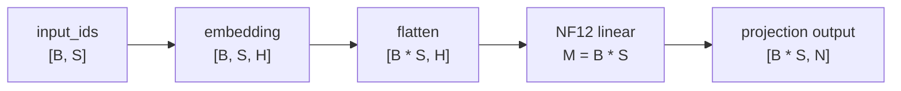
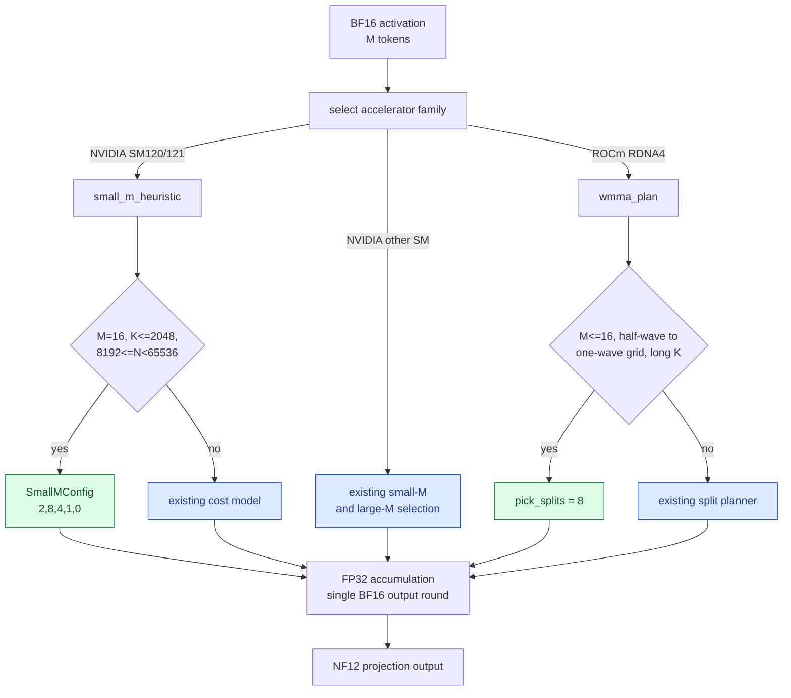

<!-- SPDX-FileCopyrightText: 2026 ModelCloud.ai -->
<!-- SPDX-License-Identifier: Apache-2.0 -->

# NF12 short-M dispatch

NF12 decode requests often arrive as a small number of tokens: one generated
token, four independently batched requests, or an eight-token decode chunk.
GPT-QModel therefore has separate launch plans for M=1, M=4, M=8, and M=16.
The plan is selected from the actual flattened token count and the concrete
accelerator family; it is not selected from the request count or an
environment variable.

## What M means at an embedding

An embedding receives IDs, not the later linear input. For the common
`input_ids` shape `[B, S]`, `F.embedding` returns `[B, S, H]`. The decoder
projects that tensor as `[B * S, H]`, so the projection's M is the number of
processed tokens:

Consequently:

| Workload | Embedding IDs | Projection M |
| --- | ---: | ---: |
| Four one-token requests, batch tensor `[4, 1]` | 4 | 4 |
| Four prefill requests of length `L`, batch tensor `[4, L]` | `4L` | `4L` |
| Ragged requests flattened without padding | sum of request lengths | sum of request lengths |
| One generated token after a one-token prompt | 1 | 1 |

The embedding kernel's `num_ids` is therefore the embedding-side analogue of
the linear M. Padding tokens count as processed rows unless the caller removes
them before the projection.

## Dispatch flow

The CUDA path uses `small_m_heuristic` for short M. The ROCm RDNA4 path uses
`wmma_plan` and `pick_splits`; both retain the packed NF12 weight and keep
dequantized values call-local.

The CUDA specialization is in
`gptqmodel_ext/nf12/csrc/linear/small_m.cu:610`; the generic selection remains
at `small_m.cu:602`. It is deliberately limited to SM120/121, M=16, short K,
and wide output tiles. Other M values continue through the measured generic
cost model. The ROCm split rule is at
`gptqmodel_ext/nf12_hip/nf12_wmma.hip:518`, and its planner is
`wmma_plan` at `nf12_wmma.hip:570`.

## Measured M sweep

The paired benchmark is
`scripts/benchmark_nf12_short_m.py`. Each entry compares the same resident
BF16 input with `F.linear` and the NF12 operator. Values are medians of seven
warmed trials of 200 calls with a synchronization after each trial. The
reported ratio is dense time divided by NF12 time, so values below 1.0 are
slower than dense BF16.

### RTX 4090, SM89

| Shape `(N, K)` | M=1 | M=4 | M=8 | M=16 |
| --- | ---: | ---: | ---: | ---: |
| `2048x2048` | 0.693x | 0.989x | 1.003x | 1.061x |
| `512x2048` | 0.601x | 0.805x | 0.692x | 0.676x |
| `8192x2048` | 2.426x | 1.064x | 1.273x | 1.171x |
| `2048x8192` | 2.880x | 2.499x | 2.234x | 2.474x |
| `4096x4096` | 2.880x | 1.527x | 1.489x | 1.256x |
| `128256x2048` | 1.300x | 1.327x | 1.261x | 1.291x |

### RTX 5090, SM120

| Shape `(N, K)` | M=1 | M=4 | M=8 | M=16 |
| --- | ---: | ---: | ---: | ---: |
| `2048x2048` | 0.880x | 1.189x | 1.130x | 1.171x |
| `512x2048` | 0.870x | 1.207x | 1.194x | 1.215x |
| `8192x2048` | 2.808x | 1.277x | 1.180x | **1.001x** |
| `2048x8192` | 1.306x | 3.534x | 3.127x | 2.926x |
| `4096x4096` | 2.859x | 1.971x | 1.937x | 1.658x |
| `128256x2048` | 1.372x | 1.350x | 1.362x | 1.374x |

The `8192x2048` M=16 result improved from roughly 0.795x to parity. The new
SM120 plan uses `SmallMConfig{2, 8, 4, 1, 0}`. A separate M=384 experiment
was run outside this repository and is not part of this change.

### R9700, gfx1201 ROCm

| Shape `(N, K)` | M=1 | M=4 | M=8 | M=16 |
| --- | ---: | ---: | ---: | ---: |
| `2048x2048` | 2.114x | 1.501x | 1.183x | 1.051x |
| `512x2048` | 2.097x | 1.710x | 1.686x | 1.197x |
| `8192x2048` | 1.354x | 0.831x | 1.005x | 0.957x |
| `2048x8192` | 2.196x | 1.718x | 1.365x | 1.380x |
| `4096x4096` | 1.190x | 0.780x | 0.948x | 0.998x |
| `128256x2048` | 1.334x | 1.326x | 1.314x | 1.145x |

The eight-way split reduced `2048x8192` at M=16 from about `45.29 us` to
`23.17 us` during tuning. The retained table above is the final paired run;
run-to-run variation on R9700 is visible in the small M values.

### Apple M5 Ultra, MLX Metal

The Metal kernels use the same shape set and the same M values, measured with
`scripts/benchmark_mlx_nf12_short_m.py`. Dense BF16 `x @ W.T` on the same
resident input is the baseline; the ratio is dense divided by NF12, so values
below 1.0 are slower than dense.

| Shape `(N, K)` | M=1 | M=4 | M=8 | M=16 |
| --- | ---: | ---: | ---: | ---: |
| `2048x2048` | 0.49x | 0.29x | 0.40x | 0.33x |
| `512x2048` | 0.67x | 0.51x | 0.51x | 0.46x |
| `8192x2048` | 0.50x | 0.40x | 0.40x | 0.29x |
| `2048x8192` | 0.57x | 0.34x | 0.45x | 0.27x |
| `4096x4096` | 0.60x | 0.34x | 0.42x | 0.27x |
| `128256x2048` | 1.09x | 1.10x | 1.74x | 0.49x |

The Metal measurement cannot synchronize per call: one `mx.eval` costs about
240 us on this host regardless of the work it waits for, which is an order of
magnitude above these kernels. Each trial therefore enqueues a bounded number
of calls and evaluates them once, and both sides of every ratio use the same
harness. Absolute values are steady-state throughput, not single-shot latency.

The Metal dispatch differs from the CUDA and ROCm plans because the bottleneck
does:

- **M=1** runs a GEMV with 16 output columns per threadgroup. A super-atom is
  1536 contiguous bytes covering 16 rows by 64 K values, so the threadgroup
  reads it with coalesced `uint32` loads and each thread decodes one
  `(lane, j)` group: three shared reads expand to eight BF16 values. The two
  row sums a thread owns are reduced once at the end, so the K loop carries no
  per-step reduction.
- **M=2..16** runs a fused tile: one super-atom per K step is decoded into
  `[k][out]` threadgroup memory and multiplied on the simdgroup matrix units,
  so no dense BF16 weight is ever written. A split-K pass fills the grid when
  the 16-column tile count would leave the GPU idle, and a reduce pass folds
  the partials and applies the bias.
- **M>16** decodes once and multiplies, because the padded 16-row MMA tile
  would re-read the packed stream once per token block.

Both packed paths read the checkpoint bytes exactly once per output block. The
earlier Metal kernels decoded each value from scattered 1-byte loads, which
cost a memory transaction per byte; staging the super-atom and unrolling the
eight slots of a group is what closed most of the gap. On this host the change
measured 24.8 us vs 31.5 us at `2048x2048` M=1 and 66.7 us vs 124.0 us at
`8192x2048` M=4.

NF12 still loses to dense BF16 at these shapes on this GPU, and the reason is
measurable rather than incidental: a 6.3 MB packed read with no decode at all
already costs 13.7 us (459 GB/s) in this grid shape, while an elementwise pass
over the same bytes reaches 745 GB/s and dense BF16 `4096x4096` reaches about
1.1 TB/s at large sizes. The tiled NF12 layout is built for `m16n8k16` MMA, so
every value needs a decode step that dense BF16 does not, and at small M the
decode costs as much as the weight traffic it saves. The win at
`128256x2048` is not a decode advantage either: it appears where the dense
baseline is itself launch-bound and slow, so the NF12 kernel's steadier
throughput wins by default. Closing the small-M gap needs the kind of
hand-scheduled decode the CUDA and HIP kernels use, not a launch-plan change.

## Remaining gaps

The sweep is not uniformly faster:

- RTX 4090 still loses on the narrow `512x2048` shapes, especially M=1.
- RTX 5090 is launch limited at M=1 for the two narrow `2048`-column shapes.
- R9700 still loses at `8192x2048` M4 and `4096x4096` M4/M8, and is near parity
  at several other M values.
- Embedding one-ID lookup is launch and binding limited; multi-token lookup
  is the useful speedup. Embedding rows are exact because lookup has no
  arithmetic reduction.

The dispatch changes do not alter the persistent storage contract: only NF12
packed data, escapes, and indexing metadata remain between calls. FP32
partials and any temporary decoded values are scoped to the current launch.
