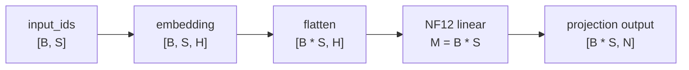
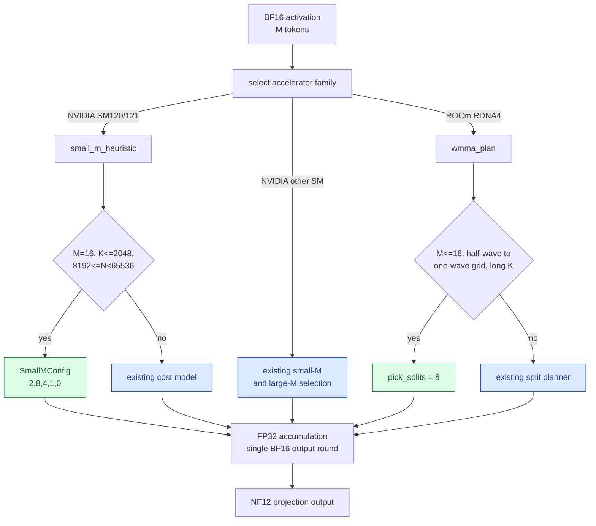

<!-- SPDX-FileCopyrightText: 2026 ModelCloud.ai -->
<!-- SPDX-License-Identifier: Apache-2.0 -->

# NF12 short-M dispatch

NF12 decode requests often arrive as a small number of tokens: one generated
token, four independently batched requests, or an eight-token decode chunk.
GPT-QModel therefore has separate launch plans for M=1, M=4, M=8, and M=16.
The plan is selected from the actual flattened token count and the concrete
accelerator family; it is not selected from the request count or an
environment variable.

## What M means at an embedding

An embedding receives IDs, not the later linear input. For the common
`input_ids` shape `[B, S]`, `F.embedding` returns `[B, S, H]`. The decoder
projects that tensor as `[B * S, H]`, so the projection's M is the number of
processed tokens:

Consequently:

| Workload | Embedding IDs | Projection M |
| --- | ---: | ---: |
| Four one-token requests, batch tensor `[4, 1]` | 4 | 4 |
| Four prefill requests of length `L`, batch tensor `[4, L]` | `4L` | `4L` |
| Ragged requests flattened without padding | sum of request lengths | sum of request lengths |
| One generated token after a one-token prompt | 1 | 1 |

The embedding kernel's `num_ids` is therefore the embedding-side analogue of
the linear M. Padding tokens count as processed rows unless the caller removes
them before the projection.

## Dispatch flow

The CUDA path uses `small_m_heuristic` for short M. The ROCm RDNA4 path uses
`wmma_plan` and `pick_splits`; both retain the packed NF12 weight and keep
dequantized values call-local.

The CUDA specialization is in
`gptqmodel_ext/nf12/csrc/linear/small_m.cu:610`; the generic selection remains
at `small_m.cu:602`. It is deliberately limited to SM120/121, M=16, short K,
and wide output tiles. Other M values continue through the measured generic
cost model. The ROCm split rule is at
`gptqmodel_ext/nf12_hip/nf12_wmma.hip:518`, and its planner is
`wmma_plan` at `nf12_wmma.hip:570`.

## Measured M sweep

The paired benchmark is
`scripts/benchmark_nf12_short_m.py`. Each entry compares the same resident
BF16 input with `F.linear` and the NF12 operator. Values are medians of seven
warmed trials of 200 calls with a synchronization after each trial. The
reported ratio is dense time divided by NF12 time, so values below 1.0 are
slower than dense BF16.

### RTX 4090, SM89

| Shape `(N, K)` | M=1 | M=4 | M=8 | M=16 |
| --- | ---: | ---: | ---: | ---: |
| `2048x2048` | 0.693x | 0.989x | 1.003x | 1.061x |
| `512x2048` | 0.601x | 0.805x | 0.692x | 0.676x |
| `8192x2048` | 2.426x | 1.064x | 1.273x | 1.171x |
| `2048x8192` | 2.880x | 2.499x | 2.234x | 2.474x |
| `4096x4096` | 2.880x | 1.527x | 1.489x | 1.256x |
| `128256x2048` | 1.300x | 1.327x | 1.261x | 1.291x |

### RTX 5090, SM120

| Shape `(N, K)` | M=1 | M=4 | M=8 | M=16 |
| --- | ---: | ---: | ---: | ---: |
| `2048x2048` | 0.880x | 1.189x | 1.130x | 1.171x |
| `512x2048` | 0.870x | 1.207x | 1.194x | 1.215x |
| `8192x2048` | 2.808x | 1.277x | 1.180x | **1.001x** |
| `2048x8192` | 1.306x | 3.534x | 3.127x | 2.926x |
| `4096x4096` | 2.859x | 1.971x | 1.937x | 1.658x |
| `128256x2048` | 1.372x | 1.350x | 1.362x | 1.374x |

The `8192x2048` M=16 result improved from roughly 0.795x to parity. The new
SM120 plan uses `SmallMConfig{2, 8, 4, 1, 0}`. A separate M=384 experiment
was run outside this repository and is not part of this change.

### R9700, gfx1201 ROCm

| Shape `(N, K)` | M=1 | M=4 | M=8 | M=16 |
| --- | ---: | ---: | ---: | ---: |
| `2048x2048` | 2.114x | 1.501x | 1.183x | 1.051x |
| `512x2048` | 2.097x | 1.710x | 1.686x | 1.197x |
| `8192x2048` | 1.354x | 0.831x | 1.005x | 0.957x |
| `2048x8192` | 2.196x | 1.718x | 1.365x | 1.380x |
| `4096x4096` | 1.190x | 0.780x | 0.948x | 0.998x |
| `128256x2048` | 1.334x | 1.326x | 1.314x | 1.145x |

The eight-way split reduced `2048x8192` at M=16 from about `45.29 us` to
`23.17 us` during tuning. The retained table above is the final paired run;
run-to-run variation on R9700 is visible in the small M values.

### Apple M5 Ultra, MLX Metal

The Metal kernels use the same shape set and the same M values, measured with
`scripts/benchmark_mlx_nf12_short_m.py`. Dense BF16 `x @ W.T` on the same
resident input is the baseline; the ratio is dense divided by NF12, so values
below 1.0 are slower than dense.

| Shape `(N, K)` | M=1 | M=4 | M=8 | M=16 |
| --- | ---: | ---: | ---: | ---: |
| `2048x2048` | 2.56x | 2.61x | 3.14x | 0.70x |
| `512x2048` | 1.29x | 2.01x | 1.99x | 0.90x |
| `8192x2048` | 2.19x | 2.08x | 2.62x | 0.70x |
| `2048x8192` | 2.08x | 3.76x | 4.09x | 0.40x |
| `4096x4096` | 2.53x | 3.00x | 3.38x | 0.51x |
| `128256x2048` | 1.38x | 2.99x | 4.29x | 0.48x |

The measurement cannot synchronize per call: one `mx.eval` costs about 240 us
on this host regardless of the work it waits for. Each trial therefore builds
its calls first and times only the eval, with enough calls that the fixed
round-trip is amortized; the same harness measures both sides of every ratio.
Every row includes roughly 1.2 us of dispatch, measured with a null kernel at
the same batch size. Absolute values are steady-state throughput, not
single-shot latency.

The Metal dispatch differs from the CUDA and ROCm plans because the bottleneck
does:

- **M=1..15** runs one decode-plus-dot kernel. A super-atom is 1536 contiguous
  bytes covering 16 rows by 64 K values, so the threadgroup reads it with
  coalesced `uint32` loads and each thread decodes one `(lane, j)` group: three
  loads expand to eight BF16 values. The next super-atom is prefetched while
  the current one decodes, and the two row sums a thread owns are folded with a
  16-lane butterfly (`simd_shuffle_xor`) instead of a shared-memory tree, so the
  K loop carries neither a barrier nor a serial tail. The BF16 word is assembled
  with the exponent byte shifted straight to the top of the word and the low
  byte masked into place, which is the cheapest form of the decode that fits.

  A threadgroup also owns several adjacent 16-column blocks — four for 1..4
  tokens, two for 5..12 — because `x` does not depend on the output column.
  Decoding four blocks from one set of activation loads is what makes the wide
  token counts fast: at eight rows the per-step activation loads outnumber the
  packed loads, and sharing them removes most of that traffic without touching
  the weight stream. The block count shrinks with the output width (one block
  below `N=512`) so the grid still covers the GPU, and with the token count
  because each block costs `rows` accumulator pairs per thread.
- **M=16 on a wide output** runs the fused tile: one super-atom per K step is
  decoded into `[k][out]` threadgroup memory and multiplied on the simdgroup
  matrix units, so no dense BF16 weight is ever written. A split-K pass fills
  the grid when the 16-column tile count would leave the GPU idle, and a reduce
  pass folds the partials and applies the bias. At 1..15 rows the tile's
  per-super-atom barriers cost more than the matrix units save, which is why
  the dot product owns that range.
- **M>16** decodes once and multiplies, because the padded 16-row MMA tile
  would re-read the packed stream once per token block.

Both packed paths read the checkpoint bytes exactly once per output block. The
earlier Metal kernels decoded each value from scattered 1-byte loads, which
cost a memory transaction per byte; reading the super-atom with coalesced
`uint32` loads and unrolling the eight slots of a group is what closed most of
the gap. That change measured 24.8 us vs 31.5 us at `2048x2048` M=1 and
66.7 us vs 124.0 us at `8192x2048` M=4 under the earlier harness.

Against the previous Metal kernels, the shared-block decode is 1.04-1.70x at
M=1, 1.02-1.49x at M=4 and 0.96-1.34x at M=8 on this host, with the narrow
`512x2048` shape flat because its output is too short for more than one block.
The earlier single-block decode-plus-dot rework added 1.3x at M=1, 2.2x at M=4
and 1.8x at M=8 on top of the staged kernels; the M=16 column changes only
where the tile replaced the dot product, and it is neutral at wide outputs.
The remaining limit at M=1..8 is not weight traffic. At `2048x2048` M=1 the
kernel reads 6.3 MB in about 4.6 us, roughly 1.35 TB/s, which is the read-only
floor for the same access pattern; the decode costs the rest, because about
8.5 integer operations per weight saturate the ALU at 128 lanes per core. A
lookup-table decode was measured and rejected: the extra gather per weight
costs more than the shifts it removes on this GPU.

At M=16 NF12 still loses to dense BF16. The dot product pays 16 FMAs per
weight, which makes it ALU-bound, while the dense baseline runs the same MACs
on the matrix units and stays memory-bound. The fused tile is the right shape
for that regime but is barrier-bound here, so it only wins at
`128256x2048`, where the 16-column grid has enough work to amortize the
barriers. Closing the M=16 gap needs a tile that stages fewer super-atoms per
barrier, not a dispatch change.

## Remaining gaps

The sweep is not uniformly faster:

- RTX 4090 still loses on the narrow `512x2048` shapes, especially M=1.
- RTX 5090 is launch limited at M=1 for the two narrow `2048`-column shapes.
- R9700 still loses at `8192x2048` M4 and `4096x4096` M4/M8, and is near parity
  at several other M values.
- M5 Ultra loses at M=16 on every shape in the sweep, where the decode cost
  dominates and the dense baseline is memory-bound on the matrix units.
- Embedding one-ID lookup is launch and binding limited; multi-token lookup
  is the useful speedup. Embedding rows are exact because lookup has no
  arithmetic reduction.

The dispatch changes do not alter the persistent storage contract: only NF12
packed data, escapes, and indexing metadata remain between calls. FP32
partials and any temporary decoded values are scoped to the current launch.
