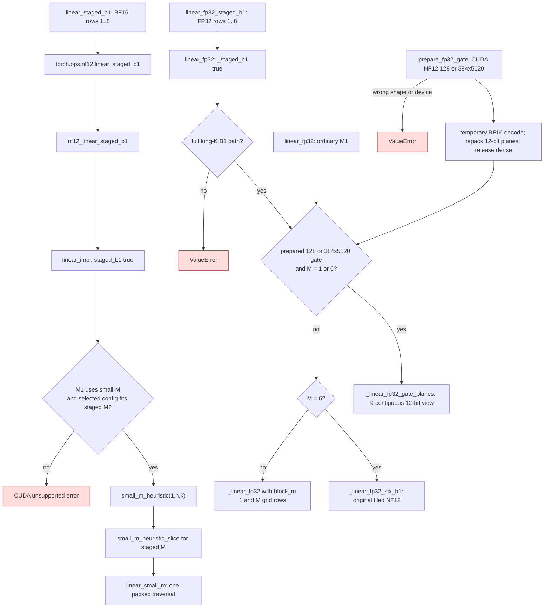
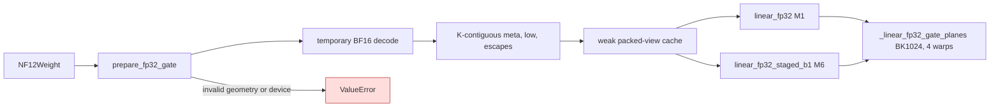

# NF12 staged B1 projections

Speculative verification can present six physical rows for one logical B1
request. Its numerical reference is six ordinary one-row projections. The
small-M BF16 kernel already computes an eight-row MMA tile for M=1, so a
single launch can consume the six inputs while retaining the M=1 kernel
configuration and reduction order. The packed weight remains the only
persistent weight representation.

## Dispatch

| Before | After |
| --- | --- |
| Each physical row called `nf12.linear` and selected `small_m_heuristic(1,n,k)` separately (`gptqmodel_nf12/api.py`, `linear/dispatch.cu`). | `linear_staged_b1` selects the same one-row configuration once and passes all staged rows to `linear_small_m` (`gptqmodel_nf12/api.py`, `linear/dispatch.cu`). |
| Each FP32 row launched `_linear_fp32` separately (`gptqmodel_nf12/_fp32.py`). | Six rows use `_linear_fp32_six_b1`, decoding a packed tile once while retaining six independent one-row reduction trees. Other staged row counts use one grid with `block_m=1` (`gptqmodel_nf12/_fp32.py`). |
| FP32 B1 reads the original tiled NF12 layout for every 128/384x5120 router (`gptqmodel_nf12/_fp32.py:_linear_fp32_six_b1`). | `prepare_fp32_gate` keeps a second compressed K-contiguous 12-bit view. `linear_fp32` uses `_linear_fp32_gate_planes` for ordinary M1 and staged M6 when prepared, retaining the tiled path otherwise (`gptqmodel_nf12/_fp32.py`). |

The BF16 API rejects more than eight rows and returns an unsupported CUDA
status when the one-row route or staged configuration is unavailable. The FP32
API rejects indexed or short-K full-head paths that use a different B1 kernel.
Callers requiring those shapes keep their existing per-row path.

## Prepared FP32 router view

`prepare_fp32_gate` accepts only a CUDA NF12 128x5120 or 384x5120 weight. At load time it
temporarily decodes BF16, repacks each row into a 32-bit metadata word and
eight low bytes per eight values, compacts exceptional groups, and releases
the dense tensor. A weak map keyed by `NF12Weight` owns this view, so it dies
with the model weight. The original tiled NF12 tensor remains available for
other shapes and kernels. Both views are 12-bit compressed; no BF16 weight
matrix remains resident. The view uses 2,949,120 bytes for 384 rows or 983,040
bytes for 128 rows, plus its exceptional table, in addition to the original
packed view.

On NVIDIA PG506-230, PyTorch 2.15 CUDA 13.2 with GIL disabled, a CUDA graph
rotating the 40 actual checkpoint gate matrices measured 13.158 microseconds
per gate for Lite's BF16 pair kernel and 11.878 microseconds for the prepared
NF12 kernel (1.108x). Six verifier rows used the same FP32 activations. The
top-eight route IDs agreed on all 240 rows; the largest score difference was
2.384e-7. These are projection measurements, not full serving throughput.
Ordinary M1 and staged M6 share the same BK1024 reduction. The actual-device
test checks bitwise agreement between them, FP64 Torch arithmetic, escaped
groups, changed inputs, and packed-only persistent storage. The free-threaded
probe exercised eight threads across two GPUs in three processes.
On the three released 128x5120 MTP gates with six FP32 verifier rows, an
isolated CUDA graph measured 17.186 microseconds per gate for the original
tiled NF12 path and 10.837 microseconds for the prepared path. Their top-eight
route IDs matched dense Torch for the sampled inputs, with maximum score
difference 4.173e-7. This is a projection measurement, not an endpoint claim.

## SM80 measurements

NVIDIA PG506-230, CUDA 13.2, stable PyTorch 2.15, GIL disabled, GPU-resident
random BF16 weights and inputs. Median CUDA graph replay time, 24 calls per
replay, five measured replays. The unfused control is six independent NF12 B1
calls, and the dense control is one `torch.nn.functional.linear` BF16 call.

| N x K, M=6 | Six NF12 B1 calls | Fused staged NF12 | Dense BF16 |
| --- | ---: | ---: | ---: |
| 384 x 5120 | 46.5 us | 8.9 us | 8.7 us |
| 512 x 5120 | 47.4 us | 9.0 us | 8.8 us |
| 5120 x 5120 | 152.2 us | 29.6 us | 30.5 us |
| 129280 x 5120 | 2826.5 us | 498.4 us | 673.4 us |

Nsight Compute 2026.2.1 profiled the actual `small_m_kernel<NF12, MT1,
WARPS16, kStages0, KP1>` image for the 129280 x 5120 head. One B1 launch
and one staged M6 launch each executed about 2.43 million `LDG`, 15.51
million `PRMT`, and 2.59 million `HMMA` warp instructions. The staged call
adds stores for six outputs, but the packed decode and MMA work do not repeat
six times. The selected M1 image used 64 registers per thread and about 2.07
TB/s memory throughput, with 74.3% of scheduler cycles lacking an eligible
warp. The M6 image used the same 64 registers and about 2.11 TB/s. Local
memory spilling remains in this image and is a separate tuning opportunity.

The six-row FP32 gate kernel measured 17.2 us for 384 x 5120 versus 50.0 us
for the prior staged `block_m=1` grid; the 512 x 5120 score projection measured
18.4 us versus 64.0 us. Both results were bitwise identical to six independent
B1 calls. Nsight Compute showed 48 registers per thread, no local spills, and
61,440 `PRMT` instructions for the six-row gate launch, the same packed decode
count as one prior single-row invocation. The six accumulators performed
368,640 `FFMA` instructions, as expected for six independent rows.

The actual-device tests compare all BF16 staged rows bitwise with independent
one-row NF12 calls at M=1,2,6,8 and N=384,512,5120,129280 (K=5120), including
an escaped weight. A separate Torch BF16 weight projection checks arithmetic
error. FP32 staged rows at M=2,6,8 and N=128,384,512,5120 match one-row calls
bitwise and a dense FP32 Torch oracle within the inference tolerance, including
escaped weights and bias. Tests inspect the packed weight object
after inference; neither path retains a dense weight cache.
