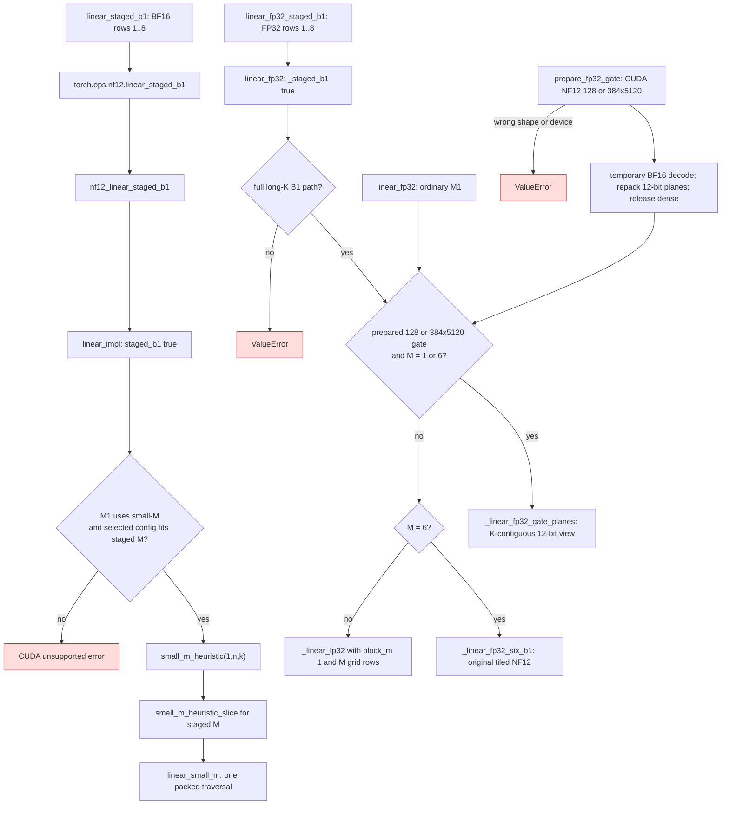
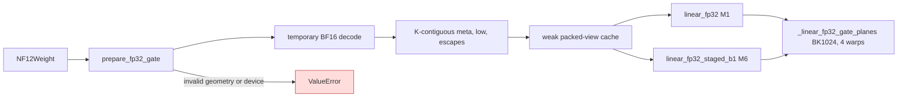
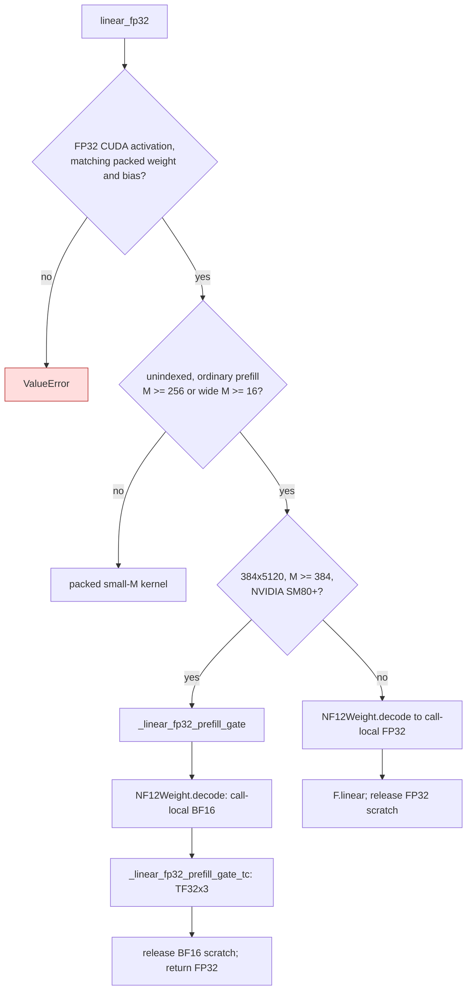

# NF12 staged B1 and prefill projections

Speculative verification can present six physical rows for one logical B1
request. Its numerical reference is six ordinary one-row projections. The
small-M BF16 kernel already computes an eight-row MMA tile for M=1, so a
single launch can consume the six inputs while retaining the M=1 kernel
configuration and reduction order. The packed weight remains the only
persistent weight representation.

For the 384x5120 FP32 main router, a separate Ampere prefill path decodes the
NF12 weight to BF16 for the current call and uses TF32x3 Tensor Cores. The
activation and result remain FP32. The decoded weight is released after the
launch, while the original NF12 weight remains the persistent representation.

## Dispatch

| Before | After |
| --- | --- |
| Each physical row called `nf12.linear` and selected `small_m_heuristic(1,n,k)` separately (`gptqmodel_nf12/api.py`, `linear/dispatch.cu`). | `linear_staged_b1` selects the same one-row configuration once and passes all staged rows to `linear_small_m` (`gptqmodel_nf12/api.py`, `linear/dispatch.cu`). |
| Each FP32 row launched `_linear_fp32` separately (`gptqmodel_nf12/_fp32.py`). | Six rows use `_linear_fp32_six_b1`, decoding a packed tile once while retaining six independent one-row reduction trees. Other staged row counts use one grid with `block_m=1` (`gptqmodel_nf12/_fp32.py`). |
| FP32 B1 reads the original tiled NF12 layout for every 128/384x5120 router (`gptqmodel_nf12/_fp32.py:_linear_fp32_six_b1`). | `prepare_fp32_gate` keeps a second compressed K-contiguous 12-bit view. `linear_fp32` uses `_linear_fp32_gate_planes` for ordinary M1 and staged M6 when prepared, retaining the tiled path otherwise (`gptqmodel_nf12/_fp32.py`). |

The BF16 API rejects more than eight rows and returns an unsupported CUDA
status when the one-row route or staged configuration is unavailable. The FP32
API rejects indexed or short-K full-head paths that use a different B1 kernel.
Callers requiring those shapes keep their existing per-row path.

## Prepared FP32 router view

`prepare_fp32_gate` accepts only a CUDA NF12 128x5120 or 384x5120 weight. At load time it
temporarily decodes BF16, repacks each row into a 32-bit metadata word and
eight low bytes per eight values, compacts exceptional groups, and releases
the dense tensor. A weak map keyed by `NF12Weight` owns this view, so it dies
with the model weight. The original tiled NF12 tensor remains available for
other shapes and kernels. Both views are 12-bit compressed; no BF16 weight
matrix remains resident. The view uses 2,949,120 bytes for 384 rows or 983,040
bytes for 128 rows, plus its exceptional table, in addition to the original
packed view.

On NVIDIA PG506-230, PyTorch 2.15 CUDA 13.2 with GIL disabled, a CUDA graph
rotating the 40 actual checkpoint gate matrices measured 13.158 microseconds
per gate for Lite's BF16 pair kernel and 11.878 microseconds for the prepared
NF12 kernel (1.108x). Six verifier rows used the same FP32 activations. The
top-eight route IDs agreed on all 240 rows; the largest score difference was
2.384e-7. These are projection measurements, not full serving throughput.
Ordinary M1 and staged M6 share the same BK1024 reduction. The actual-device
test checks bitwise agreement between them, FP64 Torch arithmetic, escaped
groups, changed inputs, and packed-only persistent storage. The free-threaded
probe exercised eight threads across two GPUs in three processes.
On the three released 128x5120 MTP gates with six FP32 verifier rows, an
isolated CUDA graph measured 17.186 microseconds per gate for the original
tiled NF12 path and 10.837 microseconds for the prepared path. Their top-eight
route IDs matched dense Torch for the sampled inputs, with maximum score
difference 4.173e-7. This is a projection measurement, not an endpoint claim.

A follow-up CUDA graph sweep rotated all 40 released main gates with the same
resident six-row FP32 input and interleaved BF16-pair controls. The control
stayed near 13.16 microseconds per gate. The prepared kernel measured:

| K tile | Warps | Microseconds per gate | NF12/BF16 speed |
| ---: | ---: | ---: | ---: |
| 512 | 4 | 13.49 | 0.977x |
| 512 | 8 | 12.44 | 1.058x |
| 1024 | 2 | 17.57 | 0.750x |
| 1024 | 4 | 11.93 | 1.105x |
| 1024 | 8 | 14.75 | 0.892x |
| 2048 | 4 | 28.65 | 0.459x |
| 2048 | 8 | 22.58 | 0.583x |

All tested shapes matched the sampled gate's top-eight route IDs. BK1024 with
four warps remains the measured choice; the sweep did not produce a candidate
with enough additional gain to justify another production restart.

A separate [real-weight FP64 oracle](nf12-real-gate-fp64-20261111.json)
compared one released main gate and one MTP gate with six fixed FP32 input
rows, IEEE FP32 Torch, and TF32 disabled. The candidate used the same packed
BK1024 arithmetic for ordinary and staged B1. The 384-row legacy comparator
was Lite's BF16-pair gate; the 128-row comparator was dense FP32 Torch.

| Weight | NF12 mean / max absolute FP64 error | Legacy mean / max | NF12 closer / legacy closer / ties | Top-eight IDs |
| --- | ---: | ---: | ---: | --- |
| Main 384x5120 | 1.08e-8 / 6.69e-8 | 2.64e-8 / 1.62e-7 | 1603 / 430 / 271 | Equal |
| MTP 128x5120 | 2.73e-8 / 1.48e-7 | 5.02e-8 / 3.36e-7 | 478 / 209 / 81 | Equal |

The detailed record includes RMSE and normalized maximum error. These small
FP32 reduction differences are accepted as arithmetic variation when routes
and serving state pass their independent checks; full output hashes alone do
not determine numerical accuracy.

### Lite service check for the 128-row view

Lite loaded the released checkpoint with every eligible BF16 matrix online
NF12, including prepared 128-row MTP gates, at clean Lite revision `eaf77abe`
and pinned GPT-QModel revision `c3811f24`. Two matched 8K trials used three
concurrent B1 Zig/CUDA/PyTorch lanes, 512 output tokens, two repeats, MTP,
GIL disabled, an exclusive lease, and fresh BF16 main controls before and
after the candidate process. All 18 prompt/lane pairs matched within each
trial, with zero cached tokens and
allocator retries. The loaded-model MTP target and commit oracles passed.

| Prompt namespace | HTTP decode vs BF16 before / after | Synchronized decode vs before / after | Prefill vs before / after |
| --- | ---: | ---: | ---: |
| `ab-equal-20261110-8k` | 0.761x / 0.842x | 0.813x / 0.814x | 0.652x / 0.796x |
| `ab-equal-20261111-gate-8k` | 0.937x / 0.926x | 0.996x / 1.017x | 0.732x / 0.685x |

The first trial included a 6.1-second prefill stall on one lane and 29.5/29.7
ms verifier steps on the other two lanes during that group. Subsequent groups
returned to roughly 15–16 ms steps. BF16 itself varied from 394 to 356 HTTP
decode tokens/s in the first namespace across the before and after controls.
The isolated 128-row projection gain did not establish a whole-service gain;
the cause of the stall is unproven. Lite
therefore uses the tiled MTP gate path in its proposed serving profile while
retaining this explicit `prepare_fp32_gate` API for controlled experiments.
The [Lite trial record](https://github.com/ModelCloud/Inference-Ultra/blob/deploy/nf12-online-merged-20261110/lite/results/nf12_gate_128_matched_8k_20261111.json)
contains exact commands, runtime identities, affinity, and group timings.

## FP32 main-router prefill

| Before | After |
| --- | --- |
| Every unindexed FP32 prefill decoded BF16, cast the entire matrix to FP32, and called `F.linear` (`gptqmodel_nf12/_fp32.py:linear_fp32`). | On NVIDIA SM80+ with a 384x5120 gate and at least 384 input rows, `linear_fp32` calls `_linear_fp32_prefill_gate`, which decodes only BF16 scratch and runs `_linear_fp32_prefill_gate_tc`. Other shapes and devices keep the existing fallback. |
| The prefill call briefly owned both BF16 and FP32 decoded matrices. | The new branch owns one 3,932,160-byte BF16 scratch matrix until its Tensor Core launch. Neither branch retains a decoded matrix across calls. |

The kernel loads BF16 weight tiles, converts those exact weight values to FP32,
and uses Triton's `tf32x3` multiplication for the FP32 activations. It adds
optional FP32 bias in the output tile. The launch uses 32x64x64 tiles, four
warps and three stages. NVIDIA SM80 is checked on the activation's actual
device; HIP does not enter this path.

The [real-checkpoint sweep](nf12-real-gate-prefill-20261111.json) rotated all
40 released 384x5120 gate matrices on a PG506-230 SM80 GPU with PyTorch 2.15,
CUDA 13.2, GIL disabled, resident Gaussian FP32 activations and CUDA graph
timing. Each graph replay made 40 calls; medians use eight alternating-order
replays. Dense control is `F.linear(x, checkpoint_bf16.float())` with cuBLAS
TF32 disabled. The old NF12 control decodes BF16, casts FP32, then calls
`F.linear`. These are projection timings, not Lite service throughput.

| Input rows | Selected NF12 path, us/gate | Old NF12, us/gate | Dense control, us/gate | NF12 / dense |
| ---: | ---: | ---: | ---: | ---: |
| 256 | 93.82 (old fallback) | 93.82 | 86.31 | 0.920x |
| 384 | 123.17 | 128.54 | 121.02 | 0.983x |
| 512 | 106.64 | 147.40 | 139.44 | 1.308x |
| 3072 | 449.61 | 743.14 | 740.45 | 1.647x |

The dispatched path restored every checkpoint BF16 bit from NF12. Sampled
FP64 mean absolute error at 3,072 rows was 2.50e-8 for the candidate and
6.73e-8 for dense Torch. At 384 and 3,072 rows, one and four rows respectively
had a different top-eight ordering across all 40 gates; independent FP64
agreed with NF12 in all five. One difference changed the eighth member.
The largest score difference from dense Torch was 1.51e-6. These random
activation probes do not establish exact serving route or output identity.
The 40 benchmark weights held 118,176,704 packed bytes versus 157,286,400
checkpoint BF16 bytes, with no retained decoded matrix. Lite also retains its
separate compressed B1 router view; that additional storage is documented
above. Repeated forwards and CUDA graph replay passed the packed-only storage
and independent Torch tests for 256, 384, 512, and 3,072 rows. The free-threaded
prefill probe passed three processes of eight workers on two GPUs.

## SM80 measurements

NVIDIA PG506-230, CUDA 13.2, stable PyTorch 2.15, GIL disabled, GPU-resident
random BF16 weights and inputs. Median CUDA graph replay time, 24 calls per
replay, five measured replays. The unfused control is six independent NF12 B1
calls, and the dense control is one `torch.nn.functional.linear` BF16 call.

| N x K, M=6 | Six NF12 B1 calls | Fused staged NF12 | Dense BF16 |
| --- | ---: | ---: | ---: |
| 384 x 5120 | 46.5 us | 8.9 us | 8.7 us |
| 512 x 5120 | 47.4 us | 9.0 us | 8.8 us |
| 5120 x 5120 | 152.2 us | 29.6 us | 30.5 us |
| 129280 x 5120 | 2826.5 us | 498.4 us | 673.4 us |

Nsight Compute 2026.2.1 profiled the actual `small_m_kernel<NF12, MT1,
WARPS16, kStages0, KP1>` image for the 129280 x 5120 head. One B1 launch
and one staged M6 launch each executed about 2.43 million `LDG`, 15.51
million `PRMT`, and 2.59 million `HMMA` warp instructions. The staged call
adds stores for six outputs, but the packed decode and MMA work do not repeat
six times. The selected M1 image used 64 registers per thread and about 2.07
TB/s memory throughput, with 74.3% of scheduler cycles lacking an eligible
warp. The M6 image used the same 64 registers and about 2.11 TB/s. Local
memory spilling remains in this image and is a separate tuning opportunity.

The six-row FP32 gate kernel measured 17.2 us for 384 x 5120 versus 50.0 us
for the prior staged `block_m=1` grid; the 512 x 5120 score projection measured
18.4 us versus 64.0 us. Both results were bitwise identical to six independent
B1 calls. Nsight Compute showed 48 registers per thread, no local spills, and
61,440 `PRMT` instructions for the six-row gate launch, the same packed decode
count as one prior single-row invocation. The six accumulators performed
368,640 `FFMA` instructions, as expected for six independent rows.

The actual-device tests compare all BF16 staged rows bitwise with independent
one-row NF12 calls at M=1,2,6,8 and N=384,512,5120,129280 (K=5120), including
an escaped weight. A separate Torch BF16 weight projection checks arithmetic
error. FP32 staged rows at M=2,6,8 and N=128,384,512,5120 match one-row calls
bitwise and a dense FP32 Torch oracle within the inference tolerance, including
escaped weights and bias. Tests inspect the packed weight object
after inference; neither path retains a dense weight cache.
