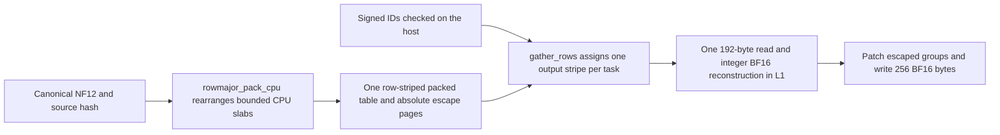

# Blackhole row-oriented NF12 embedding experiment

Canonical checkpoint NF12 stores 16 rows together. Its Blackhole gather
reads three 64-byte fragments per 64 columns of a requested row. The
shared CUDA/HIP row-major layout keeps one derived copy in DRAM and reads
two adjacent 96-byte blocks as an aligned 192-byte stripe. A 2,304-wide row
needs 3,456 packed bytes before escape reads. The canonical gather needs
6,912 bytes before escapes.



Each 96-byte block contains 32 bytes of meta and 64 bytes of low BF16 bits.
A zero 16-bit meta marks an escape and its low word holds its absolute
four-BF16 escape index. The host transcode emits the same records and bytes
as the CUDA/HIP packer. Blackhole alignment adds a transport block to an odd
number of 64-column blocks. The reader reuses L1 decodes for adjacent tasks
with the same ID and stripe. The serialized checkpoint remains canonical.

## Public Inkling 2 Mini token table

Physical P300c chip 1, firmware 19.17.1, source-main TT-Metal and TTNN
`2a1236fa6e78c`, and PyTorch `2.16.0a0+git65e101a`. Thirty resident calls after
warmup per row, with synchronization and preallocated output on both paths.
The 926,318,592-byte BF16 table was uploaded with `TILE_LAYOUT` and converted
once to resident `ROW_MAJOR_LAYOUT` before timing actual `ttnn.embedding`.

### Initial Blackhole-specific direct-pair experiment

The following measurements use the earlier Blackhole-specific three-plane
encoding. Its initial reader used 896 bytes of worker scratch and one
192-byte stripe per task.

| IDs | Unique IDs | Row NF12 median / p95 | TTNN BF16 median / p95 | Median speedup |
| --- | ---: | ---: | ---: | ---: |
| One | 1 | 16.556 / 20.138 µs | 18.751 / 59.493 µs | 1.13× |
| 32 repeated | 1 | 32.046 / 39.825 µs | 24.707 / 107.564 µs | 0.77× |
| 32 contiguous | 32 | 40.818 / 44.364 µs | 21.977 / 23.325 µs | 0.54× |
| 32 scattered | 31 | 40.788 / 42.180 µs | 22.042 / 25.748 µs | 0.54× |

The row layout occupies 695,461,248 bytes including 45,144 escaped groups.
Every one of the released 201,024 rows matched its original BF16 bits. The
synthetic check covers signed invalid IDs, rank, duplicate order, padding,
tile and escape-page boundaries, and raw special BF16 bit patterns.

A follow-up 50-sample comparison coalesced adjacent stripes into a single
read and write per task. The one-ID advantage above did not reproduce in
this run. The stronger BF16 medians are the comparison below.

| IDs | Best adjacent stripes per task | Row NF12 median | TTNN BF16 median | Speedup |
| --- | ---: | ---: | ---: | ---: |
| One | 2 | 15.274 µs | 14.768 µs | 0.97× |
| 32 repeated | 9 | 29.837 µs | 19.142 µs | 0.64× |
| 32 contiguous | 9 | 28.434 µs | 17.168 µs | 0.60× |
| 32 scattered | 9 | 28.490 µs | 17.118 µs | 0.60× |

Nine coalesced stripes use 7,040 L1 scratch bytes per worker. The transcode
and DRAM footprint are identical for every coalescing factor.

### Shared CUDA/HIP byte format on native TTNN

This comparison used 50 samples, the same BF16 control, and bit-for-bit
verification of all released rows. The shared format occupied 695,461,184
bytes including 90,280 four-BF16 records. Two stripes per task use 5,568 L1
scratch bytes per worker. Nine stripes use 24,832 bytes.

| IDs | Unique IDs | Stripes per task | NF12 median / p95 | BF16 median / p95 | Speedup |
| --- | ---: | ---: | ---: | ---: | ---: |
| One | 1 | 2 | 16.081 / 20.579 µs | 14.824 / 16.291 µs | 0.92× |
| 32 repeated | 1 | 9 | 41.645 / 50.245 µs | 19.803 / 22.392 µs | 0.48× |
| 32 contiguous | 32 | 9 | 37.737 / 46.649 µs | 17.524 / 19.166 µs | 0.46× |
| 32 scattered | 31 | 9 | 37.412 / 41.078 µs | 17.579 / 18.615 µs | 0.47× |

A compile-time 1,024-byte lookup table stores the BF16 sign and high
exponent bits for each metadata byte. This reduces batch decode work and
retains the same packed bytes, escape table, and per-call scratch buffers.
All released rows matched BF16 again.

| IDs | Unique IDs | Stripes per task | Lookup NF12 median / p95 | BF16 median / p95 |
| --- | ---: | ---: | ---: | ---: |
| One | 1 | 2 | 16.522 / 23.155 µs | 14.007 / 16.561 µs |
| 32 repeated | 1 | 1 | 33.634 / 42.471 µs | 18.586 / 19.878 µs |
| 32 contiguous | 32 | 6 | 33.294 / 49.855 µs | 16.477 / 17.323 µs |
| 32 scattered | 31 | 9 | 31.585 / 32.883 µs | 16.572 / 18.997 µs |

Grouping consecutive output IDs lets a worker reuse its last decoded stripe
for repeated tokens. For 32 copies of a single ID, running one worker per
stripe and writing all copies cuts scheduled base packed traffic to 3,456
bytes for the entire request. The tuned native path used 20.309 / 23.766 µs
median / p95, compared with 18.887 / 21.932 µs for BF16 in a 30-sample run.
The default 2,304-column dispatcher uses two stripes per worker task for
one ID and nine for 32 general IDs. The Torch adapter recognizes 32 equal
CPU IDs and uses the one-stripe repeat schedule. Other shapes keep the
one-stripe schedule.

The selected defaults were rerun for 30 samples with a fresh BF16 control.
Every released row matched its original BF16 bits. Both timed paths had
preallocated outputs, and the samples exclude host ID preparation.

| IDs | Unique IDs | Scheduled packed bytes, before escapes | NF12 median / p95 | BF16 median / p95 |
| --- | ---: | ---: | ---: | ---: |
| One | 1 | 3,456 | 16.517 / 18.045 µs | 14.829 / 20.750 µs |
| 32 repeated | 1 | 3,456 | 19.403 / 22.223 µs | 19.182 / 22.253 µs |
| 32 contiguous | 32 | 110,592 | 32.307 / 36.009 µs | 17.294 / 21.051 µs |
| 32 scattered | 31 | 110,592 | 32.127 / 34.085 µs | 17.068 / 20.369 µs |

```bash
PYTHONPATH=. python scripts/bench_nf12_ttnn_rows.py \
  --checkpoint /path/to/Inkling-2-Mini --repeats 50 --stripe-chunks 1 2 3 4 6 9 18 --exhaustive
PYTHONPATH=. python scripts/bench_nf12_ttnn_rows.py \
  --checkpoint /path/to/Inkling-2-Mini --repeats 30 --stripe-chunks 1 2 3 6 9 --id-chunks 1 4 8 16 32
python -m pytest -q tests/test_nf12_rowmajor_cpu.py tests/test_nf12_ttnn_rows.py tests/test_nf12_tenstorrent.py
```
