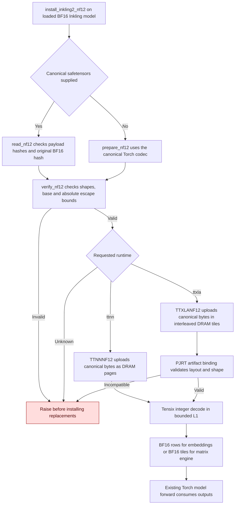

# NF12 weights on Tenstorrent Blackhole

GPT-QModel can install single-chip NF12 embedding and linear inference layers
in Inkling 2 Mini. The standard model loader first resolves checkpoint names
and loads the source tensors. Call `install_inkling2_nf12` after loading and
placing the model for inference. The implementation is introduced in
[PR #5977](https://github.com/ModelCloud/GPTQModel/pull/5977).

```python
from gptqmodel.models.ports.inkling2_loop import install_inkling2_nf12
from gptqmodel.utils.ttnn_runtime import close_mesh, open_mesh

mesh = open_mesh(device_id=0, owner="inkling-nf12")
descriptors = install_inkling2_nf12(model.eval(), backend="ttnn", device=mesh.device)
# Run model forwards, then release the model before closing its device.
del model
close_mesh(owner="inkling-nf12")
```

For TT-XLA, start a separate process with `PJRT_DEVICE=TT`, use
`torch_xla.device(0)`, and pass `backend="ttxla"`. The model adapters accept
host activations in both backends. Native operations also expose
`TTNNNF12.gather_device` and `TTNNNF12.linear_device` for TTNN tensors. The
TT-XLA linear accepts XLA tensors, and its gather accepts CPU signed IDs or
device int32 IDs. The model's remaining operators run where the model is placed.

| Site | Dense forward at `0071b1aa0` | With the opt-in installer |
| --- | --- | --- |
| Token embedding and RMS gain | `Inkling2LoopNormedEmbedding.forward` | `_NF12Embedding` runs gather and calls the existing `embed_norm` |
| LM head, valid vocabulary crop, softcap | `Inkling2LoopForConditionalGeneration.forward` | `_NF12Linear` supplies BF16 logits to the existing crop and FP32 softcap |
| Patch projection and position taps | `Inkling2LoopVisionEmbeddings.forward` | The same vision forward calls the fitted linear and gather modules |
| Vision blocks and four-patch merger | `Inkling2LoopVisionLayer.forward` and `Inkling2LoopVisionMerger.forward` | Each target projection calls the same tiled linear with its checkpoint bias |



A descriptor binds the checkpoint tensor name, logical and padded shapes,
canonical layout version, BF16 source hash, hashes of the three ABI tensors,
and the escape count. The installer can take a mapping from runtime weight
names to `(NF12Descriptor, safetensors_path)`. The file stores the existing
`.nf12_packed`, `.nf12_escapes`, and `.nf12_exp_base` suffixes. Native TTNN
maps a canonical super-atom to a 1,536-byte DRAM page. TT-XLA maps the same byte
stream into face-ordered 4,096-byte INT32 pages. Escape indexes retain their
canonical absolute meaning.

The raw gather checks signed IDs before index narrowing. Invalid IDs and an
explicitly configured zero-padding ID yield positive-zero BF16 rows. The model
adapter reads the stored checkpoint padding row, as PyTorch embedding does.
The patch projection exposes logical K=1,200 and pads its last 16 columns
to K=1,216. Position interpolation, image boundaries and merge order use the
existing vision forward.

Linear cores own disjoint output vocabulary tiles. The reader maps decoded
`[N, K]` bits into `[K, N]` TT face order. The matrix engine advances K in
ascending tile order with HiFi4, FP32 destination accumulation and approximate
math disabled. Up to four activation tiles reuse each decoded weight tile.
Bias is added to the FP32 result before BF16 conversion. The layers retain
one packed copy and escape table. Native TTNN specializes on the exponent
base. TT-XLA reads the exponent base and row geometry from a 64-byte header in
the escape stream so a cached executable can safely serve different weights.

TT-XLA uses the version-2 tt-lang resolver artifact ABI to lower the shared
Metal kernels into a PJRT executable. Its resolver delegates other operations
to TT-XLA and rejects a mismatched artifact ABI or unsupported layout at
compile time. Each backend takes explicit ownership of one chip per process.
The native runtime used 110 worker cores for the LM head and TT-XLA used up
to 64. The formats and dataflow are described in [NF12 SPEC](../gptqmodel_ext/nf12/docs/SPEC.md)
and [Tensix compute engines](https://docs.tenstorrent.com/tt-metal/latest/tt-metalium/tt_metal/advanced_topics/compute_engines_and_dataflow_within_tensix.html).

## Reproduction

From the repository checkout, in a Python environment with the requested
Tenstorrent runtime and Torch version supported by GPT-QModel:

```bash
PYTHONPATH=. python scripts/bench_nf12_tenstorrent.py --backend ttnn --chip 0
PJRT_DEVICE=TT PYTHONPATH=. python scripts/bench_nf12_tenstorrent.py --backend ttxla --chip 0
PYTHONPATH=. python scripts/bench_nf12_tenstorrent.py \
  --backend ttnn --chip 0 --checkpoint /path/to/Inkling-2-Mini --repeats 8 --exhaustive
PJRT_DEVICE=TT PYTHONPATH=. python scripts/bench_nf12_tenstorrent.py \
  --backend ttxla --chip 0 --checkpoint /path/to/Inkling-2-Mini --repeats 8 --exhaustive
PYTHONPATH=. python scripts/validate_inkling2_nf12_tenstorrent.py \
  --backend ttnn --chip 0 --checkpoint /path/to/Inkling-2-Mini --verify-weights
PJRT_DEVICE=TT PYTHONPATH=. python scripts/validate_inkling2_nf12_tenstorrent.py \
  --backend ttxla --chip 0 --checkpoint /path/to/Inkling-2-Mini --verify-weights
python -m pytest -q tests/test_nf12_tenstorrent.py tests/test_nf12_codec.py
```

The benchmark compares raw BF16 bits before arithmetic, checks every sampled
linear against the matching device reduction, and reports maximum error,
scaled RMSE and top-k overlap against FP32 Torch arithmetic rounded to BF16.
The paired model harness reports logits, KLD, and PPL and can write per-matrix
provenance to a user-specified local file. Use `--verify-weights` to compare
every selected matrix's logical rows against its original BF16 bits and each
forward against the matching device BF16 reduction. Use `--vision-only` to
run the vision cases without the CPU language model.

## Device and runtime manifest

| Property | Hardware run |
| --- | --- |
| Board and ASIC | P300c Blackhole, four local PCIe chips, chip 0 for checkpoint profiling |
| Chip 0 compute grid | 11 × 10 |
| P300c firmware | `19.17.1.0`, [Tenstorrent v19.17.1](https://github.com/tenstorrent/tt-system-firmware/releases/tag/v19.17.1) |
| P300c firmware SHA-256 | `c13b74c007d2e48482154f6c212e4e0ef61ffe7316f6cdd689b3e86c10f0c4ce` |
| Driver and SMI | TT-KMD 2.12.0, tt-smi 6.8.1 |
| TT-Metalium / bundled TTNN | `d5f9bc4a43b1287523458f1af6a470c6b2adc180` |
| TT-XLA / TT-MLIR | `873c53c4ff84bd91112a1f43e788cfed75aaa914` / `e2b21a721955b2b68540d9e6879a215ce3dcfae5` |
| Python stack | CPython 3.12.16, PyTorch 2.11.0+cpu, Torch/XLA 2.9.0+gited8a445, PJRT 1.5.0.dev20260831000501 |
| Transformers source | `2f1bc5e321b9a736200a590d6e7743ccdeb60772` |
| Canonical codec | GPT-QModel Torch reference and vendored NF12 ABI |

### Local P300c topology

UMD discovered two cards with PCIe-visible ASICs `{0, 1}` and `{2, 3}`.
The active chip-to-chip Ethernet links form a path with two reported channels
per edge. PCIe carries host traffic. The Ethernet path carries inter-chip
fabric traffic. All measurements in this document use one ASIC's local DRAM.

```text
chip 0 -- 2 channels -- chip 3 -- 2 channels -- chip 2 -- 2 channels -- chip 1
card A                   card B                 card B                 card A
```

Each local device exposes an 11×10 logical worker grid and eight DRAM banks.
Blackhole's physical SoC grid is 17×12. The TT-Metal SoC descriptor maps the
worker, Ethernet and DRAM endpoints onto the two independent NoC planes. In
its physical coordinate convention, DRAM channel endpoints are grouped in
columns 0 and 9, and Ethernet cores occupy row 1. ASIC and runtime grid
dimensions differ because of harvesting and dispatch reservations.
[Blackhole SoC descriptor](https://github.com/tenstorrent/tt-metal/blob/2a1236fa6e78c49d61986e403d1fe09dd1b981cb/tt_metal/soc_descriptors/blackhole_140_arch.yaml)

A Tensix worker has about 1.5 MB of L1 and five control RISC-V processors.
BRISC and NCRISC issue data movement on the NoCs. TRISC0/1/2 drive unpack,
math and pack. The matrix engine consumes BF16 tiles from L1, while the SFPU
can execute 32-wide integer operations. The original NF12 reader reconstructs
each BF16 value on a data-movement RISC-V while the matrix engine waits.
The p300c rating is 32 GB and 512 GB/s of GDDR6 per ASIC.
[P300c specifications](https://docs.tenstorrent.com/systems/quietbox/quietbox-bh-2/specifications.html) ·
[Tensix dataflow](https://docs.tenstorrent.com/tt-metal/latest/tt-metalium/tt_metal/advanced_topics/compute_engines_and_dataflow_within_tensix.html) ·
[Blackhole bring-up guide](https://github.com/tenstorrent/tt-metal/blob/2a1236fa6e78c49d61986e403d1fe09dd1b981cb/tech_reports/Blackhole/BlackholeBringUpProgrammingGuide.md)

For independent tests, current source TTNN accepts `TT_VISIBLE_DEVICES=N`
with the stock 1×1 `p150_mesh_graph_descriptor.textproto` as
`TT_MESH_GRAPH_DESC_PATH`. The masked ASIC appears as logical device 0. Four
simultaneous TTNN tile tests verified `/proc/self/fd` contained only the
assigned `/dev/tenstorrent/N` for each process.

The checkpoint kernel timings used the original runtime above with GPT-QModel's
documented Torch-version override. A separate source-main native environment
ran the synthetic bit-pattern, rounding, bias and matched BF16 suites on all four chips
using the following source revisions and SFPI 7.96.0.

| Source development component | Revision or status |
| --- | --- |
| PyTorch main | `65e101a3cc8242711ae1cb467ed6cde097135821`, installed as 2.16.0a0 |
| TT-Metal / TTNN main | `2a1236fa6e78c49d61986e403d1fe09dd1b981cb`, editable TTNN installed and tested |
| TT-XLA main | `fdc3b7773674081b8f8c0698de3400d8d899dc8f`, uses its own TT-MLIR and TT-Metal source pins |
| Tenstorrent PyTorch/XLA default branch | `a3fb00817690c82bef596c74243a213986c358a4`, TorchGen fails against PyTorch main because the fork registers removed operators such as `qr` |

Checkpoint data came from the public
[Inkling-2-Mini revision](https://huggingface.co/thinkingmachines/Inkling-2-Mini/tree/b85c3cfa615fc413cc9af3379f491b963f3b586a).
Its checkpoint index SHA-256 is
`c1631065b7b00787993522dddc66a68b3abee869192977fb3dcb796e63bc5838`.
The checkpoint contains BF16 embeddings, head and vision weights, and original
NVFP4/MXFP8 text experts. Native TTNN measured 695,461,184 resident embedding
bytes and 695,392,000 resident LM-head bytes, against 926,318,592 BF16 bytes
each. The resident figures include page padding and exclude allocator pool
reservations. TT-XLA rounds each packed stream to a 4,096-byte page.

The model installer packed all 144 target matrices. The 142 vision matrices
occupy 477,749,758 canonical bytes, from 635,797,504 logical BF16 bytes, with
54,807 escape groups. The 144 target matrices together use 1,868,602,944
canonical bytes. Rank-one vision parameters and normalization gains are BF16.

### Resident weights and operator scratch

| Device DRAM for weights | Matched BF16 bytes | TTNN NF12 bytes | TT-XLA NF12 bytes |
| --- | ---: | ---: | ---: |
| Token embedding | 926,318,592 | 695,461,184 | 695,463,936 |
| LM head | 926,318,592 | 695,392,000 | 695,394,304 |
| Vision matrices (142) | 635,830,272 | 477,752,896 | 477,933,568 |
| Total (144 matrices) | 2,488,467,456 | 1,868,606,080 | 1,868,791,808 |
| Weight reduction | | 24.91% | 24.90% |

These tensor allocations include page alignment and K padding for the patch
projection. They exclude rank-one parameters, activations, and runtime allocator
reservations. The scratch figures below are program allocations, exclusive of
runtime and allocator overhead.

| Operator scratch | TTNN NF12 | TT-XLA NF12 | Matched BF16 |
| --- | ---: | ---: | ---: |
| Gather circular buffer per worker | 2,752 B | 4,224 B | — |
| LM head circular buffers per worker at M=1 | 17,920 B | 17,920 B | 17,920 B |
| LM head circular buffers per worker at M=128 or 256 | 30,208 B | 30,208 B | 30,208 B |
| LM head temporary DRAM beyond activations and results | 0 B | 0 B | 0 B |
| Q projection temporary FP32 DRAM at M=65 | 393,216 B | 393,216 B | 393,216 B |
| MLP expansion temporary FP32 DRAM at M=65 | 1,572,864 B | 1,572,864 B | 1,572,864 B |

## Initial checkpoint kernel measurements

Latency is synchronized wall time, median and p95 of eight samples after one
warmup. Timed native calls take resident activations and weights. TT-XLA pays
the PJRT launch, shape operations, and a host output read that forces
completion. With eight samples, p95 is the slowest sample. `GB/s` for linear
uses one logical weight stream per call. It measures effective bandwidth, including the compute cost
and any additional reads. Gather and decode bandwidth use logical output bytes.

### Native TTNN LM head

| M | NF12 ms median / p95 | BF16 ms median / p95 | NF12 GB/s | Scaled RMSE |
| ---: | ---: | ---: | ---: | ---: |
| 1 | 208.04 / 208.11 | 5.64 / 5.68 | 3.34 | 0.001072 |
| 4 | 208.06 / 208.49 | 5.64 / 5.69 | 3.34 | 0.001073 |
| 8 | 208.05 / 209.80 | 5.63 / 5.98 | 3.34 | 0.001067 |
| 16 | 208.06 / 208.17 | 5.55 / 5.69 | 3.34 | 0.001058 |
| 32 | 208.06 / 208.22 | 5.68 / 5.79 | 3.34 | 0.001063 |
| 128 | 208.63 / 208.79 | 14.45 / 15.58 | 3.33 | 0.001067 |
| 256 | 407.05 / 449.66 | 27.95 / 29.71 | 1.71 | 0.001068 |

### Native TTNN token embedding

| IDs | NF12 µs median / p95 | BF16 µs median / p95 | Full-atom NF12 µs median |
| --- | ---: | ---: | ---: |
| one | 232 / 603 | 47 / 209 | 193 |
| repeat | 362 / 408 | 64 / 235 | 387 |
| contiguous | 391 / 658 | 54 / 174 | 360 |
| scattered | 380 / 556 | 83 / 215 | 388 |

The native token reader fetched 6,912 canonical bytes for one uncached
2,304-element row, plus its escape reads. Full super-atoms would use 55,296
bytes. The same resident payload serves both readers. A 2,048-row head decode
checked raw weight bits in about 5.1 ms median on native TTNN. Linear circular
buffers reserve 17,920 bytes per worker at M=1 and 30,208 bytes at M≥128 for
bias-free outputs. The bias path adds 4,096 bytes of circular buffering and a
transient FP32 output matrix. The bias-free path uses L1 for decoded tiles
throughout the contraction.

### TT-XLA LM head

| M | NF12 ms median / p95 | BF16 ms median / p95 | NF12 / BF16 effective GB/s |
| ---: | ---: | ---: | ---: |
| 1 | 363.18 / 364.32 | 10.94 / 368.58 | 1.91 / 84.69 |
| 4 | 365.29 / 365.84 | 12.88 / 370.77 | 1.90 / 71.94 |
| 8 | 367.93 / 368.60 | 15.49 / 372.93 | 1.89 / 59.82 |
| 16 | 373.39 / 375.28 | 22.30 / 379.06 | 1.86 / 41.53 |
| 32 | 364.19 / 366.85 | 12.32 / 369.79 | 1.91 / 75.16 |
| 128 | 393.79 / 395.63 | 66.33 / 408.32 | 1.77 / 13.97 |
| 256 | 799.95 / 2,182.73 | 134.26 / 831.92 | 0.87 / 6.90 |

### TT-XLA token embedding

| IDs | NF12 µs median / p95 | BF16 µs median / p95 |
| --- | ---: | ---: |
| one | 418 / 854 | 195 / 470 |
| repeat | 395 / 601 | 137 / 233 |
| contiguous | 663 / 802 | 195 / 278 |
| scattered | 494 / 612 | 291 / 567 |

### Representative vision linears

Values are median / p95.

| Checkpoint projection | M | TTNN NF12 ms | TTNN BF16 ms | TT-XLA NF12 ms | TT-XLA BF16 ms |
| --- | ---: | ---: | ---: | ---: | ---: |
| Patch projection | 64 | 2.54 / 5.78 | 0.24 / 0.42 | 2.30 / 2.46 | 0.37 / 2.12 |
| Q projection with bias | 65 | 2.09 / 2.86 | 0.27 / 0.48 | 2.11 / 2.48 | 0.75 / 1.77 |
| MLP expansion with bias | 65 | 5.00 / 5.01 | 1.45 / 4.21 | 4.41 / 4.91 | 1.54 / 4.14 |
| MLP contraction with bias | 65 | 6.95 / 7.45 | 0.45 / 3.26 | 6.97 / 8.39 | 0.84 / 6.65 |
| Merger input | 16 | 14.74 / 15.66 | 1.36 / 2.06 | 13.09 / 13.29 | 0.83 / 12.95 |
| Merger output | 16 | 7.08 / 7.78 | 0.53 / 0.65 | 13.12 / 13.83 | 0.69 / 12.96 |

Both runtimes verified every logical row of the token table and LM head,
and every row of the seven representative vision matrices. All 21 linear
cases per runtime were bit-identical to their matching device BF16 schedule.
The bias-free head had maximum absolute error at most 0.00098 and scaled
RMSE at most 0.00108 against FP32 Torch arithmetic rounded to BF16.
Across the head samples, top-1, top-5 and top-10 overlap were at least
99.2%, 99.9% and 98.8%, respectively. The M=256 runs retained the same
K-reduction order. Native reuse of up to four activation tiles reduced
weight decoding at that shape and kept scratch bounded.

| LM-head decode-only workload | Native TTNN median / p95 | TT-XLA median / p95 |
| --- | ---: | ---: |
| 2,048 rows × 2,304 BF16 values | 5.05 / 5.34 ms | 6.22 / 6.78 ms |
| Effective output bandwidth | 1.87 GB/s | 1.52 GB/s |

At M=256 the one-activation-tile schedule took 1,657.75 ms on TTNN and
2,883.01 ms on TT-XLA. Reusing each decoded tile for up to four activation
tiles reduced the medians to 407.05 ms and 799.95 ms, respectively.

### LM-head performance target

The initial reader fetches two 1,536-byte super-atoms per K=32 tile. Each
super-atom covers K=64, so that schedule requests about 1.39 GB of packed
weight data for one LM-head contraction before escapes and activation reads.
The resident packed weight is about 695 MB. Reusing each atom across both
K tiles realizes the resident-byte reduction in the weight read path.

At the 5.64 ms native matched BF16 median, the 695 MB packed weight alone
requires 123 GB/s of effective bandwidth to break even. At 1.1× and 1.3×
speedup the end-to-end targets are 5.13 ms and 4.34 ms, equivalent to
136 GB/s and 160 GB/s of packed weight per second. Activation, escape,
decode, output and dispatch costs fit inside those same time budgets.

On source-main TTNN, the grouped canonical reader builds paired BF16 stores
and defers only escape groups. A 1 KiB per-worker L1 table caches exponent
expansions and an unrolled loop writes four row pairs. Timed source-main runs
kept the canonical packed data in DRAM and matched BF16 bit-for-bit.

| Chip 0 LM-head variant | M=1 median | M=128 median |
| --- | ---: | ---: |
| Initial canonical reader | 203.29 ms | 204.03 ms |
| Grouped 32-bit stores | 41.28 ms | 41.66 ms |
| Grouped stores, exponent lookup and unrolled writes | 37.33 ms | 37.53 ms |
| Matched BF16, same run as the unrolled variant | 5.44 ms | 14.22 ms |

The L1 reservations for the new reader are 18,944 bytes per worker at M=1 and
31,232 bytes per worker at M=128 or 256. The exponent table does not change
resident DRAM. Each variant was compared to its same-process control across
eight synchronized samples per configuration. The two comparison sessions used
the same chip. They were initialized independently.

The same optimized decoder passed the exhaustive TT-XLA checkpoint kernel
run. The bundled PJRT benchmark used chip 0 and a synchronized host output
read. Each entry is median / p95 in milliseconds.

| TT-XLA LM-head M | Optimized NF12 ms | Matched BF16 ms |
| ---: | ---: | ---: |
| 1 | 124.86 / 137.12 | 13.63 / 129.34 |
| 4 | 127.45 / 132.05 | 14.20 / 133.04 |
| 8 | 128.59 / 133.17 | 18.28 / 137.45 |
| 16 | 141.90 / 144.05 | 25.62 / 145.99 |
| 32 | 123.92 / 125.41 | 14.43 / 130.45 |
| 128 | 184.82 / 190.53 | 75.41 / 191.73 |
| 256 | 247.95 / 527.07 | 159.98 / 277.20 |

### SFPU full-head prototype on source-main TTNN

The prototype groups four consecutive `[K, N]` BF16 tiles into three tiled
16-bit planes and streams additional absolute bit patches for escaped entries.
The SFPU rebuilds one K slab in L1 using its 32-wide integer lanes. The matrix
engine then accumulates the decoded slab in ascending K order with FP32
destination registers. The same worker performs both steps. The prototype
uses one packed resident weight and bounds the decoded slab to one worker's
output tile. The matched BF16 benchmark uses the same activation placement,
output geometry and matrix schedule.

| Full released LM head, M=1, chip 2 | NF12 SFPU | Matched BF16 |
| --- | ---: | ---: |
| Resident weights and sparse metadata | 695,807,872 B | 926,318,592 B |
| Median / p95, 40 synchronized interleaved launches | 2.087 / 2.131 ms | 2.491 / 2.532 ms |
| Effective weight bandwidth | 333.4 GB/s | 371.9 GB/s |
| Temporary DRAM for reconstructed weights | 0 B | 0 B |

The packed path ran 1.193× faster at the median and matched the BF16 results
bit-for-bit. The SFPU path used 311,424 B of L1 circular buffers per worker,
including 144 KiB each for decoded weights and activations. Reconstructing
special BF16 values, including signed zeros, subnormals, infinities and NaN
payloads, was also tested before arithmetic. This result is for the source-main
TTNN prototype at M=1.

An independent 40-sample run on chip 0 measured 2.082 / 2.093 ms packed and
2.375 / 2.403 ms matched BF16. The outputs matched bit-for-bit on both chips.

The following chip 2 runs use one 32-row block at a time for both operands.
For M above 32, they reuse the same resident weight across successive row
blocks. This comparison uses the same row blocking for BF16 and NF12.

| M | SFPU NF12 median / p95 | Matched BF16 median / p95 |
| ---: | ---: | ---: |
| 1 | 2.088 / 2.100 ms | 2.491 / 2.551 ms |
| 4 | 2.090 / 2.184 ms | 2.504 / 2.545 ms |
| 8 | 2.114 / 2.242 ms | 2.503 / 2.567 ms |
| 16 | 2.117 / 2.195 ms | 2.497 / 2.616 ms |
| 32 | 2.093 / 2.125 ms | 2.492 / 2.520 ms |
| 33 | 4.120 / 4.198 ms | 4.919 / 4.993 ms |
| 128 | 8.248 / 8.312 ms | 9.871 / 9.888 ms |

```bash
TT_VISIBLE_DEVICES=2 TT_MESH_GRAPH_DESC_PATH=/path/to/p150_mesh_graph_descriptor.textproto \
  PYTHONPATH=. python scripts/bench_nf12_sfpu_decode.py --chip 0 --size 201024 \
  --linear --checkpoint /path/to/Inkling-2-Mini --repeats 40
```

## Mixed-runtime model validation

Using Transformers 5.23.0, the NF12 matrices ran on P300c chip 0. The existing
Torch model ran normalization, rotary embeddings, attention, routing, and
expert operations on CPU. Each paired run kept the released NVFP4/MXFP8
expert payloads fixed. The handoff variant with BF4_B/BF8_B experts needs
its corresponding checkpoint to establish equivalent model-level results.

| Vision input, both backends | Patch blocks | Patch scaled RMSE | Block 0 scaled RMSE | 23-block scaled RMSE | Merged 2,304-wide token scaled RMSE |
| --- | ---: | ---: | ---: | ---: | ---: |
| square | 4 | 0.001068 | 0.002049 | 0.008138 | 0.009500 |
| rectangle | 6 | 0.001079 | 0.001746 | 0.008450 | 0.008290 |
| processor pair | 10 | 0.0002383 | 0.003008 | 0.01596 | 0.03507 |

Position sums matched bitwise for all three inputs. The processor case sent
two differently sized images through one vision forward. On each backend,
all 142 vision matrices decoded bit-for-bit and all 431 checked vision calls
matched the same-device BF16 path. Those comparisons used the same activations,
HiFi4 arithmetic, K-reduction order, bias and output conversion for both paths.
Against CPU BF16, the processor-pair difference starts in the patch projection
and grows through the tower.

Initial image tests also exposed a GPT-QModel checkpoint-loading bug. The
vision tower loaded an empty non-persistent axial rotary buffer from its meta
placeholder, with no initializer to restore the frequency values. The code now
rebuilds the buffer from the vision config in `_init_weights`. A checkpoint
save-and-load regression checks the expected column and row phases. The table
above was measured after that fix. The earlier image logit measurements varied
with the uninitialized buffer and have been withdrawn.

| Native TTNN logits after the loader fix | Max abs | Scaled RMSE | Top-1 / 5 / 10 overlap | KLD | BF16 / NF12 PPL |
| --- | ---: | ---: | ---: | ---: | ---: |
| text | 0.09505 | 0.0007206 | 100.00% / 100.00% / 100.00% | 1.9454e-05 | 182.2207 / 182.2977 |
| image | 16.67358 | 0.2488112 | 93.33% / 93.33% / 89.33% | 0.2059546 | 39270.61 / 36971.74 |
| image with CPU BF16 vision tokens | 0.09505 | 0.0008239 | 100.00% / 100.00% / 100.00% | 2.2561e-06 | 39270.61 / 39273.31 |

The native run verified all 144 logical matrices and 580 matched device BF16
calls. Swapping only the merged vision tokens reduced scaled image logit RMSE
from 24.88% to 0.0824% on the frozen pair. The device BF16 control reproduces
the NF12 vision arithmetic bit-for-bit on the same activations.
