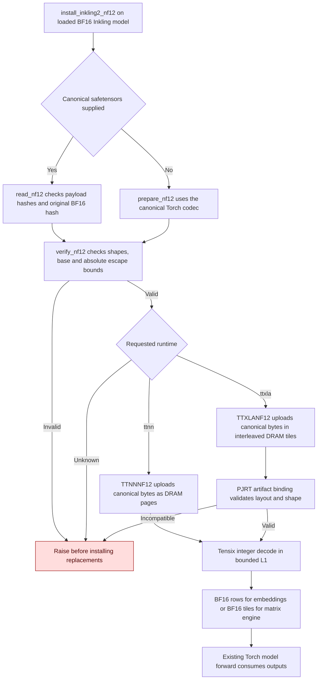

# NF12 weights on Tenstorrent Blackhole

GPT-QModel can install single-chip NF12 embedding and linear inference layers
in Inkling 2 Mini. The standard model loader first resolves checkpoint names
and loads the source tensors. Call `install_inkling2_nf12` after loading and
placing the model for inference.

```python
from gptqmodel.models.inkling2_loop import install_inkling2_nf12
from gptqmodel.utils.ttnn_runtime import close_mesh, open_mesh

mesh = open_mesh(device_id=0, owner="inkling-nf12")
descriptors = install_inkling2_nf12(model.eval(), backend="ttnn", device=mesh.device)
# Run model forwards, then release the model before closing its device.
del model
close_mesh(owner="inkling-nf12")
```

For TT-XLA, start a separate process with `PJRT_DEVICE=TT`, use
`torch_xla.device(0)`, and pass `backend="ttxla"`. The model adapters accept
host activations in both backends. Native operations also expose
`TTNNNF12.gather_device` and `TTNNNF12.linear_device` for TTNN tensors. The
TT-XLA linear accepts XLA tensors, and its gather accepts CPU signed IDs or
device int32 IDs. The model's remaining operators run where the model is placed.

| Site | Dense forward at `465290e6f` | With the opt-in installer |
| --- | --- | --- |
| Token embedding and RMS gain | `gptqmodel/models/inkling2_loop/modeling.py:876` | `_NF12Embedding` runs gather and calls the existing `embed_norm` |
| LM head, valid vocabulary crop, softcap | `gptqmodel/models/inkling2_loop/modeling.py:1315` | `_NF12Linear` supplies BF16 logits to the existing crop and FP32 softcap |
| Patch projection and position taps | `gptqmodel/models/inkling2_loop/vision.py:224`, `:228`, `:310` | The same vision forward calls the fitted linear and gather modules |
| Vision blocks and four-patch merger | `gptqmodel/models/inkling2_loop/vision.py:80`, `:115`, `:259`, `:340` | Each target projection calls the same tiled linear with its checkpoint bias |



A descriptor binds the checkpoint tensor name, logical and padded shapes,
canonical layout version, BF16 source hash, hashes of the three ABI tensors,
and the escape count. The installer can take a mapping from runtime weight
names to `(NF12Descriptor, safetensors_path)`. The file stores the existing
`.nf12_packed`, `.nf12_escapes`, and `.nf12_exp_base` suffixes. Native TTNN
maps a canonical super-atom to a 1,536-byte DRAM page. TT-XLA maps the same byte
stream into face-ordered 4,096-byte INT32 pages. Escape indexes retain their
canonical absolute meaning.

The raw gather checks signed IDs before index narrowing. Invalid IDs and an
explicitly configured zero-padding ID yield positive-zero BF16 rows. The model
adapter reads the stored checkpoint padding row, as PyTorch embedding does.
The patch projection exposes logical K=1,200 and pads its last 16 columns
to K=1,216. Position interpolation, image boundaries and merge order use the
existing vision forward.

Linear cores own disjoint output vocabulary tiles. The reader maps decoded
`[N, K]` bits into `[K, N]` TT face order. The matrix engine advances K in
ascending tile order with HiFi4, FP32 destination accumulation and approximate
math disabled. Up to four activation tiles reuse each decoded weight tile.
Bias is added to the FP32 result before BF16 conversion. The layers retain
one packed copy and escape table. The exponent base is a kernel constant.

TT-XLA uses the version-2 tt-lang resolver artifact ABI to lower the shared
Metal kernels into a PJRT executable. Its resolver delegates other operations
to TT-XLA and rejects a mismatched artifact ABI or unsupported layout at
compile time. Each backend takes explicit ownership of one chip per process.
The native runtime used 110 worker cores for the LM head and TT-XLA used up
to 64. The formats and dataflow are described in [NF12 SPEC](../gptqmodel_ext/nf12/docs/SPEC.md)
and [Tensix compute engines](https://docs.tenstorrent.com/tt-metal/latest/tt-metalium/tt_metal/advanced_topics/compute_engines_and_dataflow_within_tensix.html).

## Reproduction

From the repository checkout, in a Python environment with the requested
Tenstorrent runtime and Torch version supported by GPT-QModel:

```bash
PYTHONPATH=. python scripts/bench_nf12_tenstorrent.py --backend ttnn --chip 0
PJRT_DEVICE=TT PYTHONPATH=. python scripts/bench_nf12_tenstorrent.py --backend ttxla --chip 0
PYTHONPATH=. python scripts/bench_nf12_tenstorrent.py \
  --backend ttnn --chip 0 --checkpoint /path/to/Inkling-2-Mini --repeats 8 --exhaustive
PJRT_DEVICE=TT PYTHONPATH=. python scripts/bench_nf12_tenstorrent.py \
  --backend ttxla --chip 0 --checkpoint /path/to/Inkling-2-Mini --repeats 8 --exhaustive
PYTHONPATH=. python scripts/validate_inkling2_nf12_tenstorrent.py \
  --backend ttnn --chip 0 --checkpoint /path/to/Inkling-2-Mini
python -m pytest -q tests/test_nf12_tenstorrent.py tests/test_nf12_codec.py
```

The benchmark compares raw BF16 bits before arithmetic, checks every sampled
linear against the matching device reduction, and reports maximum error,
scaled RMSE and top-k overlap against FP32 Torch arithmetic rounded to BF16.
The paired model harness reports logits, KLD, and PPL and can write per-matrix
provenance to a user-specified local file.

## Device and runtime manifest

| Property | Hardware run |
| --- | --- |
| Board and ASIC | P300c Blackhole, four local PCIe chips, chip 0 for checkpoint profiling |
| Chip 0 compute grid | 11 × 10 |
| P300c firmware | `19.17.1.0`, [Tenstorrent v19.17.1](https://github.com/tenstorrent/tt-system-firmware/releases/tag/v19.17.1) |
| P300c firmware SHA-256 | `c13b74c007d2e48482154f6c212e4e0ef61ffe7316f6cdd689b3e86c10f0c4ce` |
| Driver and SMI | TT-KMD 2.12.0, tt-smi 6.8.1 |
| TT-Metalium / bundled TTNN | `d5f9bc4a43b1287523458f1af6a470c6b2adc180` |
| TT-XLA / TT-MLIR | `873c53c4ff84bd91112a1f43e788cfed75aaa914` / `e2b21a721955b2b68540d9e6879a215ce3dcfae5` |
| Python stack | CPython 3.12.16, PyTorch 2.11.0+cpu, Torch/XLA 2.9.0+gited8a445, PJRT 1.5.0.dev20260831000501 |
| Transformers source | `2f1bc5e321b9a736200a590d6e7743ccdeb60772` |
| Canonical codec | GPT-QModel Torch reference and vendored NF12 ABI |

The initial hardware stack used GPT-QModel's documented Torch-version override
for local validation. A separate source development environment uses the
default branches of PyTorch, Tenstorrent's PyTorch/XLA fork, TT-XLA, and
TT-Metal. Hardware measurements below identify the runtime used for each run.

Checkpoint data came from the public
[Inkling-2-Mini revision](https://huggingface.co/thinkingmachines/Inkling-2-Mini/tree/b85c3cfa615fc413cc9af3379f491b963f3b586a).
Its checkpoint index SHA-256 is
`c1631065b7b00787993522dddc66a68b3abee869192977fb3dcb796e63bc5838`.
The checkpoint contains BF16 embeddings, head and vision weights, and original
NVFP4/MXFP8 text experts. Native TTNN measured 695,461,184 resident embedding
bytes and 695,392,000 resident LM-head bytes, against 926,318,592 BF16 bytes
each. The resident figures include page padding and exclude allocator pool
reservations. TT-XLA rounds each packed stream to a 4,096-byte page.

## Checkpoint kernel measurements

Latency is synchronized wall time, median and p95 of eight samples after one
warmup. Timed native calls take resident activations and weights. TT-XLA pays
the PJRT launch and shape operations. `GB/s` for linear uses one logical weight
stream per call. It measures effective bandwidth, including the compute cost
and any additional reads. Gather and decode bandwidth use logical output bytes.

### Native TTNN LM head

| M | NF12 ms median / p95 | BF16 ms median / p95 | NF12 GB/s | Scaled RMSE |
| ---: | ---: | ---: | ---: | ---: |
| 1 | 208.04 / 208.11 | 5.64 / 5.68 | 3.34 | 0.001072 |
| 4 | 208.06 / 208.49 | 5.64 / 5.69 | 3.34 | 0.001073 |
| 8 | 208.05 / 209.80 | 5.63 / 5.98 | 3.34 | 0.001067 |
| 16 | 208.06 / 208.17 | 5.55 / 5.69 | 3.34 | 0.001058 |
| 32 | 208.06 / 208.22 | 5.68 / 5.79 | 3.34 | 0.001063 |
| 128 | 208.63 / 208.79 | 14.45 / 15.58 | 3.33 | 0.001067 |
| 256 | 407.05 / 449.66 | 27.95 / 29.71 | 1.71 | 0.001068 |

### Native TTNN token embedding

| IDs | NF12 µs median / p95 | BF16 µs median / p95 | Full-atom NF12 µs median |
| --- | ---: | ---: | ---: |
| one | 232 / 603 | 47 / 209 | 193 |
| repeat | 362 / 408 | 64 / 235 | 387 |
| contiguous | 391 / 658 | 54 / 174 | 360 |
| scattered | 380 / 556 | 83 / 215 | 388 |

The native token reader fetched 6,912 canonical bytes for one uncached
2,304-element row, plus its escape reads. Full super-atoms would use 55,296
bytes. The same resident payload serves both readers. A 2,048-row head decode
checked raw weight bits in about 5.1 ms median on native TTNN. Linear circular
buffers reserve 17,920 bytes per worker at M=1 and 30,208 bytes at M≥128 for
bias-free outputs. The bias path adds 4,096 bytes of circular buffering and a
transient FP32 output matrix. The bias-free path uses L1 for decoded tiles
throughout the contraction.
