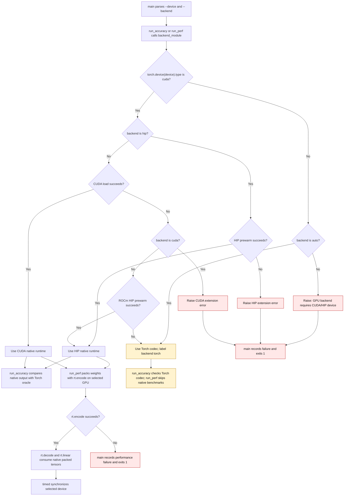

# NF12 validation backend and performance flow

`scripts/validate_nf12_ad.py` compares native NF12 encode, decode, and linear
results against independent Torch references. The requested `--device` governs
which backend may be selected and which GPU the performance timers wait for.
Explicit CUDA/HIP requests require a compatible GPU and a loadable native
extension. Automatic mode can use the Torch codec when no native backend is
available; the report labels that path `torch` and skips native benchmarks.

This flow was introduced in #3636 and refined in #3639, #3640, and #3642.

`run_perf` resolves the backend before querying GPU properties or measuring
bandwidth. With a native runtime, its decode and linear inputs come from that
runtime's encoder. The encode throughput row measures the same encoder. Its
timing, bandwidth, and cache helpers synchronize the selected `--device`, even
when another GPU is the process's current device. A native encode failure
propagates to `main`, which records the performance failure and exits 1.

| Mechanism | Before | Current |
| --- | --- | --- |
| Explicit CUDA request when extension load failed | Fell through to the Torch result (`b98ae70:scripts/validate_nf12_ad.py:167`) | `backend_module` raises with `nf12_ad.last_error()` (`scripts/validate_nf12_ad.py:176`) |
| CPU target with automatic selection | Probed native CUDA first (`2f22621:scripts/validate_nf12_ad.py:167`) | Returns the Torch codec before probing an extension (`scripts/validate_nf12_ad.py:160`) |
| CPU target with explicit GPU backend | Tried the requested extension (`2f22621:scripts/validate_nf12_ad.py:160`, `2f22621:scripts/validate_nf12_ad.py:167`) | Raises a device/backend error (`scripts/validate_nf12_ad.py:161`) |
| Performance-only exception | Recorded the exception but left `ok=True` (`b98ae70:scripts/validate_nf12_ad.py:598`) | Sets `ok=False` and exits 1 (`scripts/validate_nf12_ad.py:608`) |
| No native backend during performance validation | Queried GPU properties before checking availability (`b98ae70:scripts/validate_nf12_ad.py:383`) | Resolves the backend first and skips native benchmarks (`scripts/validate_nf12_ad.py:393`) |
| Timing on a non-current GPU | `torch.cuda.synchronize()` waited on the current GPU (`61b2ae5:scripts/validate_nf12_ad.py:321`) | All helpers synchronize `device` (`scripts/validate_nf12_ad.py:321`) |
| HIP performance encoding | Moved the weight to CPU, encoded with `nf12_codec`, and copied bytes back (`2b468d4:scripts/validate_nf12_ad.py:417`) | `run_perf` uses `rt.encode(w)` for CUDA and HIP (`scripts/validate_nf12_ad.py:420`) |

`tests/test_validate_nf12_ad.py` checks backend errors, CPU fallback, selected
GPU synchronization, and native HIP performance routing without requiring an
AMD GPU. Kernel throughput and numerical validation still require the target
hardware.
