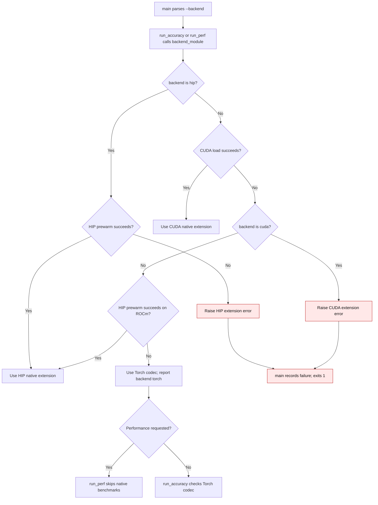

# NF12 validation backend selection

`scripts/validate_nf12_ad.py` compares native NF12 encode, decode, and linear
results against independent Torch references. An explicit `--backend cuda` or
`--backend hip` must load that native extension. `--backend auto` may use the
Torch codec when neither extension is available; the report labels it `torch`.
Performance measurements require a native backend and are skipped in that case.

`run_perf` resolves the backend before querying GPU properties or measuring
bandwidth. A performance exception sets `ok=False` in `main`, including with
`--perf-only`, so the command exits with status 1. A successful performance-only
report records the actual selected backend.

| Mechanism | Before | Current |
| --- | --- | --- |
| Explicit CUDA request when extension load failed | Fell through to the `torch` result (`b98ae70:scripts/validate_nf12_ad.py:167-174`) | `backend_module` raises with `nf12_ad.last_error()` (`scripts/validate_nf12_ad.py:167-171`) |
| Performance-only error | `main` recorded the exception but left `ok=True` (`b98ae70:scripts/validate_nf12_ad.py:593-606`) | `main` sets `ok=False` and exits 1 (`scripts/validate_nf12_ad.py:597-608`) |
| Performance probe with no native backend | Queried GPU properties and measured bandwidth before discovering the missing extension (`b98ae70:scripts/validate_nf12_ad.py:382-406`) | `run_perf` resolves the backend first and skips measurements when `auto` selects Torch (`scripts/validate_nf12_ad.py:385-391`) |

`tests/test_validate_nf12_ad.py` covers the explicit CUDA error and the
performance-only exit status without requiring a CUDA compiler or HIP device.
