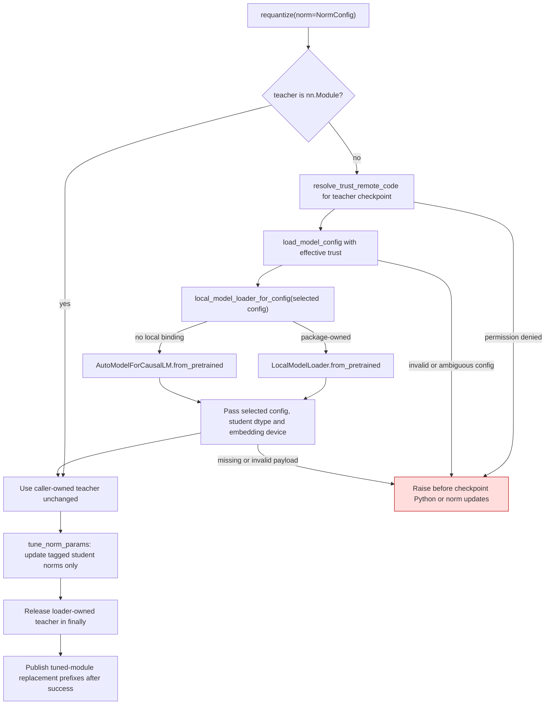
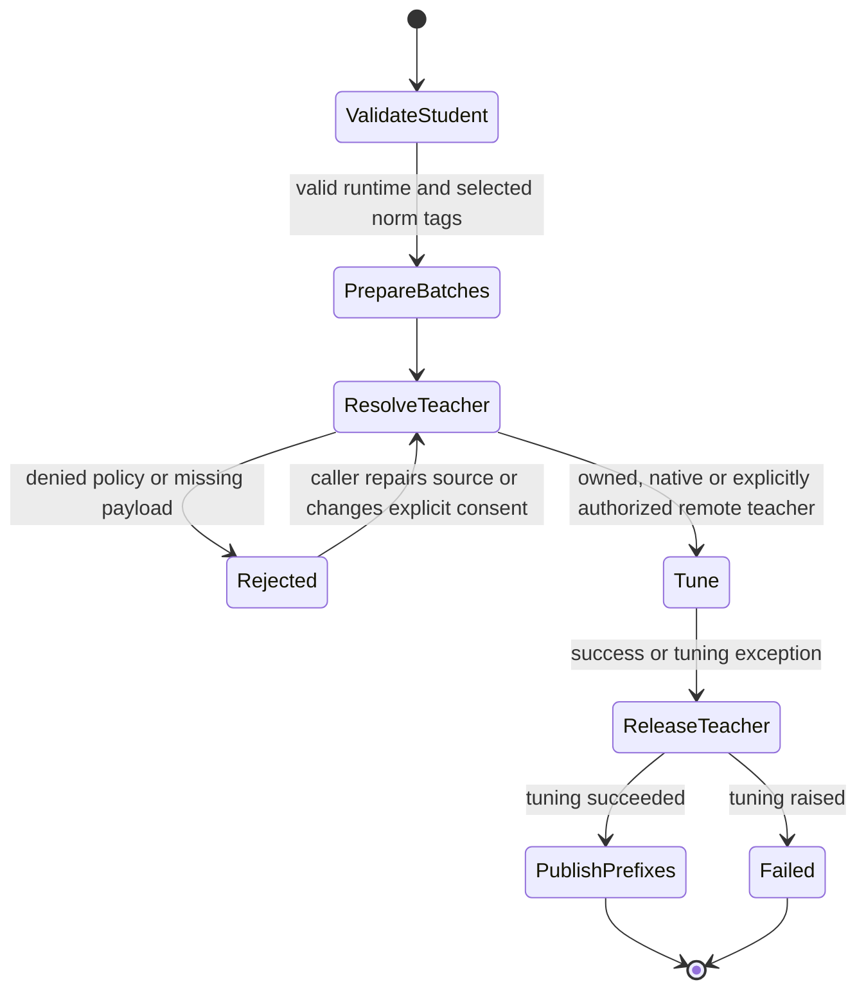

<!-- SPDX-FileCopyrightText: 2026 ModelCloud.ai
SPDX-License-Identifier: Apache-2.0 -->

# Norm-tuning teacher loading

`requantize(norm=NormConfig(teacher=...))` distills a quantized student's next-token
distribution from a dense teacher. A teacher path is a separate checkpoint:
its configuration, model family and code policy must be resolved independently
of the student's definition. Supplying an already loaded `nn.Module` bypasses
checkpoint discovery and retains caller ownership.

Introduced in [PR #4620](https://github.com/ModelCloud/GPTQModel/pull/4620).

## Selection and security

The former string path in `BaseQModel._requantize_norm` called
`AutoModelForCausalLM.from_pretrained` directly with the student's stored trust
flag. This both missed package-owned teacher implementations and allowed Hugging
Face to execute a teacher's `auto_map` without GPT-QModel's additional consent
gate. Even native teacher families could be replaced when trust was true.

| Mechanism | Before | Now |
| --- | --- | --- |
| Teacher configuration | Implicit HF discovery | `load_model_config` selects package-owned/native config |
| Teacher implementation | Always `AutoModelForCausalLM` | Teacher's `LocalModelLoader`, otherwise HF auto class |
| Native/package-owned trust | Raw student flag | `resolve_trust_remote_code` overrides to false |
| Unsupported checkpoint Python | HF trust flag alone | Explicit stored trust **and** existing safety bypass |
| Model load config | Read again implicitly | Selected config supplied explicitly |
| Placement | Student input-embedding device | Unchanged |
| Serving dtype | Student model dtype | Unchanged |
| Supplied module | Caller-owned teacher | Unchanged; no checkpoint lookup |



For package-owned and exact native teachers, checkpoint Python never overrides
the selected implementation, including when both consent flags are present.
For unsupported remote teachers, `GPTQ_BYPASS_SAFETY_CHECKS=1` is necessary but
not sufficient: the existing explicit `trust_remote_code` policy must also be
true. Neither permission is inherited from the teacher's `auto_map`. There is
no new environment switch or implicit student-family fallback.

## Retry and ownership



Teacher-loading failure does not update student norms or publish new replacement
prefixes. A later attempt reads the current permission gate again, including
after an authorized remote module was cached by Hugging Face. Supplied modules
are not reloaded, moved, cast or deleted; the tuner restores their original
training mode and does not modify teacher weights or gradient flags. This does
not add a general rollback guarantee after an optimizer step has succeeded.

## Executable evidence

`tests/test_norm_teacher_loading.py` creates a real tiny Qwen3 student, quantizes
all seven decoder projections through the Torch GPTQ-v2 backend, and reloads its
safetensors checkpoint before using public `requantize(norm=...)` calls.

| Regression | Contract |
| --- | --- |
| `test_public_norm_teacher_uses_own_config_and_matches_supplied_dense_teacher` | Actual InternLM/package and GPT-2/native teachers, hostile maps, all six trust/bypass combinations; exact student state matches directly supplied dense teacher |
| `test_teacher_requested_bfloat16_device_and_supplied_module_control` | BF16 loading on CPU; supplied FP32 teacher remains caller-owned and unchanged |
| `test_teacher_missing_payload_failure_leaves_student_unchanged_and_retries` | Missing owned-teacher payload is transactional; repaired source really tunes |
| `test_unknown_teacher_remote_code_requires_both_consents` | Unknown-family teacher executes only with both consents, using inspected test-only remote code |
| `test_teacher_permission_is_rechecked_after_failed_and_successful_attempts` | Permission revocation rejects even cached remote teacher code |

Before the fix: **14 failed, 8 passed in 27.96 seconds**. Failures included actual
test checkpoint Python execution without the bypass, hostile native model-code
selection, and inability to load the package-owned teacher with trust disabled.
After the fix: **22 passed, no skips in 23.52 seconds**.

The combined norm/config/guards/requantization/review, local-loader, InternLM
and trust-isolation suite passed **269 tests**, with **105 CUDA-unavailable
skips** and **6 explicitly deselected baseline failures**, in **22.77 seconds**.
Those six `test_norm_lifecycle.py` fresh-quantization cases fail their assertion
that a model contains meta/inference tensors **before teacher loading**. A clean
unchanged `0fdfd2396646a129f165822e66fc7c5ecec90cc0` worktree independently
reproduced all six in 5.89 seconds. They remain unresolved outside this bounded
teacher-loading change; the complete run was not green.

```sh
PYTHON_GIL=0 python -m pytest -q tests/test_norm_teacher_loading.py \
  --disable-warnings --tb=short

PYTHON_GIL=0 python -m pytest -q -ra \
  tests/test_norm_teacher_loading.py tests/test_norm_config.py \
  tests/test_norm_guards.py tests/test_norm_requant.py \
  tests/test_norm_lifecycle.py tests/test_norm_review_regressions.py \
  tests/test_local_model_loading.py tests/test_internlm_local_port.py \
  tests/test_trust_remote_code_isolation.py \
  -k 'not test_fresh_quantization_and_embedding_requantization_tuning_lifecycle' \
  --disable-warnings --tb=short
```

Measured on Python 3.14.6 free-threaded, Transformers 5.23.0, Torch 2.15.0 CPU,
and released Tokenicer 0.0.17. Torch eager autograd and packed storage are tested;
compilation is disabled in the test harness. No GPU, multi-device placement,
threaded PyTorch, large trained-checkpoint or model-quality qualification is
claimed. Existing norm lifecycle tests separately cover persistence. No shared
quantization algorithm, norm optimizer or model registry fixture is changed.
