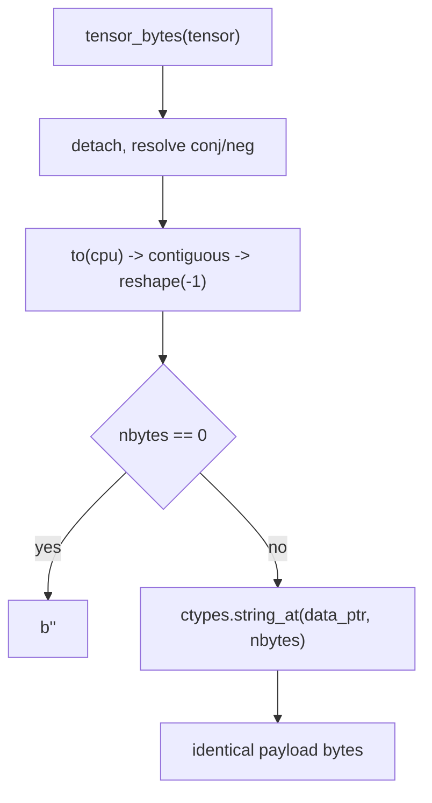
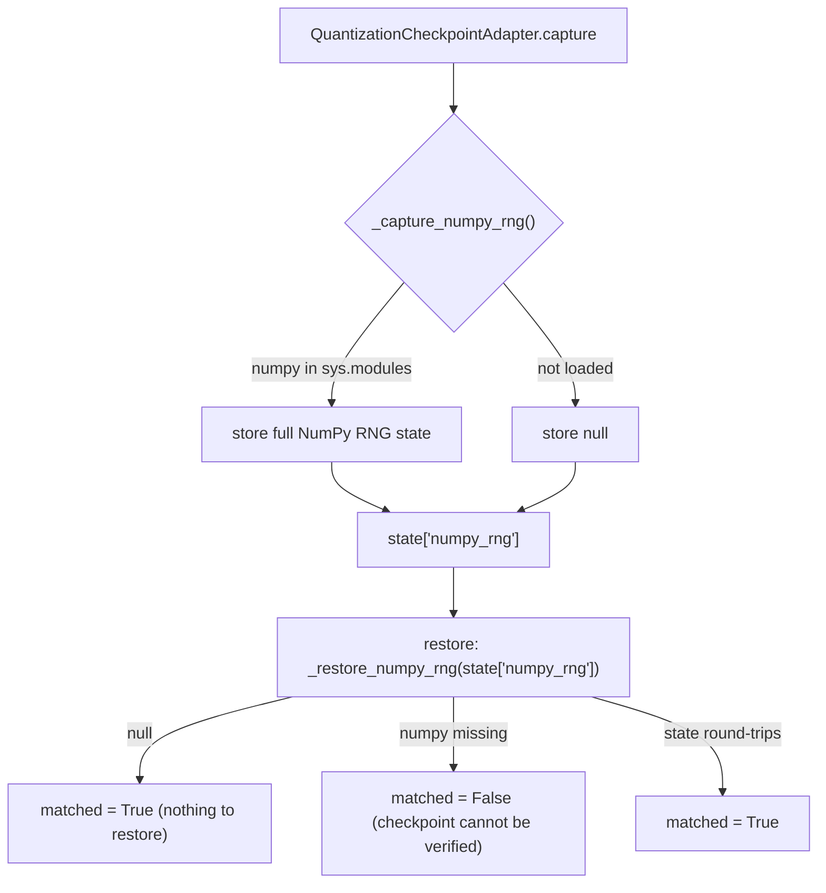

<!-- SPDX-FileCopyrightText: 2026 ModelCloud.ai
SPDX-License-Identifier: Apache-2.0 -->

# NumPy-free core: optional dependency, not a hard one

GPT-QModel is removing hard dependencies on packages outside the ModelCloud
organization. NumPy is the first target because the engine stack
(`torch`, `transformers`) installs it anyway, so a direct pin buys nothing while
forcing every downstream consumer to keep it.

NumPy is no longer a base dependency: it was removed from `requirements.txt`
and is declared only by the `gguf`, `bitblas`, and `mlx` extras. The core
quantization path never imports it, and the GGUF modules are loaded lazily so
`gptqmodel.models.loader` / `gptqmodel.utils.hf` do not pull them in.

This does not yet make `import gptqmodel` succeed in a NumPy-free environment.
`transformers` hard-imports NumPy at module scope (`transformers/utils/generic.py`)
and `gptqmodel.models` imports `transformers` eagerly, so NumPy still arrives
transitively. Removing that edge is the larger transformers-decoupling effort,
not part of this change; what this change guarantees is that GPT-QModel's own
code contributes no NumPy import and no NumPy-accelerated fallback.

The byte-extraction and packing paths are fully NumPy-free. The one remaining
optional integration is the checkpoint RNG snapshot, which can only exist when
the process already loaded NumPy. No module imports NumPy to provide a fast
path, and every substitution below is verified bit-for-bit against the
implementation it replaced.

## Byte extraction (`gptqmodel.utils.tensor.tensor_bytes`)

`tensor_bytes` replaced ten ad-hoc `tensor.numpy().tobytes()` /
`memoryview(tensor.numpy())` call sites. It copies the contiguous CPU buffer
by wrapping the tensor's data pointer in a `ctypes` array and materializing a
single `bytes` object (a C memcpy), so it needs no NumPy and no Python-level
element loop. `tensor_buffer` exposes the same storage as a zero-copy
`memoryview` for callers that only hash or stream. Shape and dtype stay in the
caller's identity record instead of the byte stream.

`ctypes.string_at` measures within ~2% of `Tensor.numpy().tobytes()` on a
256 MiB tensor (1.02x) and about 280x faster than `bytes(tolist())`.

## Checkpoint RNG capture (`gptqmodel.looper.gptq_checkpoint`)

The continuation checkpoint records the Python, Torch, CUDA and NumPy global RNG
states. NumPy's state is read from `sys.modules` only when the process already
loaded NumPy (`_loaded_numpy`, `gptqmodel/looper/gptq_checkpoint.py`); the
checkpoint code never imports it. A checkpoint captured with NumPy present still
stores the exact
`(algorithm, key_array.tolist(), pos, has_gauss, cached_gaussian)` payload, so
existing checkpoints restore unchanged.

`matched = False` is deliberate: a checkpoint written with a NumPy RNG cannot be
proven to resume bit-identically on a host without NumPy, and silently claiming
a match would hide a real divergence.

## Before / after

| Old mechanism | Location (before) | Replacement |
| --- | --- | --- |
| `np.prod(shape)` for parameter counts | `utils/tensor.py` | `math.prod` |
| `np.array(weights, copy=True, order="C")` | `utils/hf.py` | NumPy path kept, function-local and guarded; Torch fallback |
| `isinstance(path, np.ndarray)` | `utils/audio.py` | duck-typed `ndim` check |
| `np.array` + reshape/ravel permutations | `qlinear/qqq.py`, `qlinear/marlin.py` | list comprehension into `torch.tensor` |
| `numpy.uint32` pack/unpack, `np.argsort` | `utils/marlin.py` | int64 Torch words, final int32 narrow, `sorted` |
| `pack_np_dtype` / `pack_np_math_dtype` packing | `qlinear/__init__.py` | Torch int32 packing (signed wrap matches `uint32`) |
| NumPy DP table | `quantization/rco.py` | compiled C++ DP (Torch fallback) |
| module-scope `import numpy`, `np.random.get_state()` | `looper/gptq_checkpoint.py` | guarded lazy probe + `tensor_bytes` |
| `tensor.numpy().tobytes()` hashing | `utils/model.py`, `utils/offload.py`, `utils/exl3_projection_checkpoint.py`, `looper/gsq_training_model.py` | `tensor_bytes` |
| `tensor.cpu().numpy().tolist()` | `utils/calibration.py` | `tensor.cpu().tolist()` |

## Verification

Measured against `origin/main` (`afde8d7d`) in a second worktree. Both sides
run the Python packer, which is the only packer:

| Check | Result |
| --- | --- |
| `pack_block` / `pack_original` qweight+qzeros, bits 2/3/4/8 | 16 tensors, identical |
| planar qweight+qzeros, bits 3/5/6/7 | 16 tensors, identical |
| `pack_original` qweight+qzeros, int8/int16 storage, bits 2/4/8 | 12 tensors, identical |
| Marlin pack/unpack/zero-points, 4 and 8-bit | 8 tensors, identical |
| Marlin + QQQ permutation tables, RCO assignment, `tensor_parameters` | 17 values, identical |
| safetensors payload digests (f32/f16/bf16/int8/fp8/empty/scalar) | 7/7 identical |
| RCO DP, 400 randomized configurations (ties, saturation, infeasible) | 400/400 identical |
| compiled DP vs Torch fallback vs pure-Python oracle, 200 randomized cases | identical |

Surface after this change: module-scope NumPy importers in `gptqmodel/` went
from 22 to 12, and `.numpy()` occurrences from 80 to 61.

## Performance

Removing NumPy must not slow the CPU hot paths. Every substitution below was
measured against `origin/main` in a second worktree, alternating base/new runs
and taking the minimum of 3-9 samples on a 4096x4096 layer with
`workers=1`.

| Hot path | Before | After | Ratio |
| --- | --- | --- | --- |
| `pack_block` qweight+qzeros, 2/4/8-bit | 184-241 ms | 163-181 ms | 0.73-0.98x |
| `pack_block` qweight+qzeros, 3-bit | 300 ms | 242 ms | 0.81x |
| `pack_block` qweight+qzeros, planar 5/6/7-bit | 291-417 ms | 243-310 ms | 0.71-1.05x |
| `pack_original` qweight+qzeros, 2/3/4/8-bit | 492-595 ms | 469-496 ms | 0.83-0.98x |
| `pack_original`, planar 5/6/7-bit | 837-1032 ms | 837-974 ms | 0.94-1.00x |
| `pack_original`, int8/int16 storage | 476-501 ms | 448-492 ms | 0.91-0.98x |
| `marlin.pack_cols` (4-bit) | 5.0 ms | 0.4 ms | 0.07x |
| `marlin.unpack_cols` (4-bit) | 5.1 ms | 0.3-3.4 ms | 0.06-0.67x |
| `budget_constrained_argmax` DP (28 layers, budget 1751) | 2.82 ms | 0.26 ms | 0.09x |
| `tensor_bytes` on 256 MiB | 14.5 ms | 14.6 ms | 1.01x |

The native `pack_block` extension is intentionally removed: the Python packer
is the only packer and `workers=` is the only thread control. On the reference
CPU the JIT-built extension measured 244-248 ms for the same 4096x4096 4-bit
layer, so the optimized Python path is at parity here (235-245 ms). The affine
stage now divides/rounds/clamps in place instead of materializing three full
temporaries (0.71-0.85x of the previous affine cost).

The native-vs-Python packing comparison is host-dependent and should be read as
such. The reference host is AVX2-only (no AVX-512) and the JIT build uses `-O3`
without `-march=native`; `gptqmodel_ext/pack_block_cpu.cpp` contains no AVX-512
intrinsics, so a build on a wider-ISA host or with `-march=native` can be
materially faster than the numbers above. Any claim that the Python packer
matches the native extension applies to this reference configuration only.

Three findings drove the implementation:

1. **Pack in int32, not int64.** A signed int32 left shift and an int32 sum both
   wrap exactly like NumPy's `uint32` arithmetic, and the packed fields are
   disjoint, so summing the shifted views equals OR-ing them. This removed the
   int64 copies that a first port introduced and made the narrow int8/int16
   storage paths as fast as the 32-bit one.
2. **Vectorize the loops, do not just translate them.** The original packers
   touched one row or column per Python iteration (4096 Torch dispatches for a
   4096x4096 layer). `_pack_codes_to_words`, `_pack_block_rows_2_4_8`,
   `_pack_block_rows_3`, `_pack_code_cols_2_4_8` and `_pack_code_cols_3`
   process whole chunks per step, which is both exact and faster than the NumPy
   loop for `marlin.pack_cols` and `marlin.unpack_cols`. The `pack_factor == 1`
   case is the identity and skips packing entirely.
3. **The RCO DP is compiled, not a NumPy fast path.** The inner step is a few
   hundred tiny float64 reductions where Torch's CPU dispatch and thread-pool
   overhead dominate (a 128-thread default made `max(dim=0)` up to 150x slower
   than NumPy). `gptqmodel_ext/rco/rco_dp.cpp` is compiled on first use as a
   stable-ABI `torch.ops` extension (`gptqmodel.utils.rco_cpp`), so the
   artifact is not tied to a torch or Python version; it runs the whole table
   in one call, is 6-30x faster than the NumPy loop, and falls back to
   `_budget_dp_torch` under `threadpool_limits(1)` when no C++ toolchain is
   available. A test asserts both paths match an independent pure-Python DP on
   200 randomized cases (including ties and saturation).

## Not in scope / follow-up

The remaining NumPy surface is concentrated and intentional for now:

| Surface | Why it still needs NumPy |
| --- | --- |
| `utils/internal_gguf.py`, `qlinear/gguf.py`, `qlinear/gguf_cpp.py` | GGUF/ggml reader (`np.memmap`, dtype views) and codecs; provided by the `gguf` extra |
| `qlinear/mlx*.py`, `quantization/mlx_*.py`, `utils/mlx*.py`, `quantization/rco_mlx.py` | NumPy is the `mx.array` ↔ `torch.Tensor` bridge; provided by the `mlx` extra |
| `qlinear/bitblas.py` | `general_compress` takes a NumPy array; provided by the `bitblas` extra |
