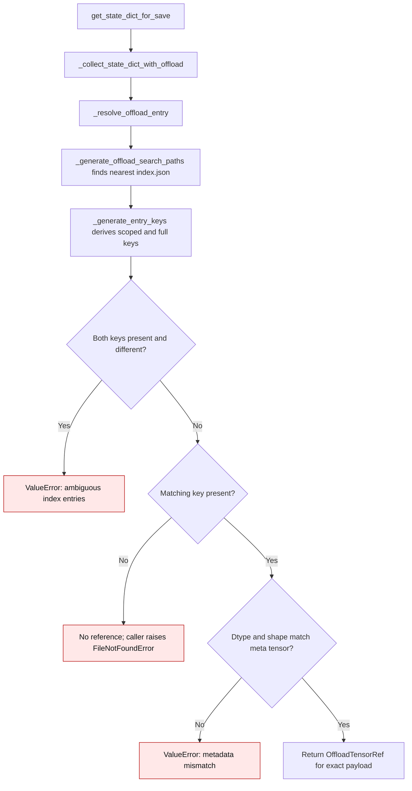

# Offload index resolution

`get_state_dict_for_save()` resolves meta tensors through the nearest
`index.json` beneath the configured offload root. Reference offload and the
regular disk bundle both store tensor names relative to the directory that owns
the index. The selected directory therefore determines the key used for each
tensor. An index may also use the full model path as a key.

For example, `offload_root/block/index.json` may hold both `weight` and
`child.weight`. The tensor `block.child.weight` resolves to `child.weight` in
that index. Looking up the short key `weight` first would select the parent's
payload, then treat the child as a duplicate and omit it from export.

| Mechanism | Earlier behavior | Current behavior |
| --- | --- | --- |
| Keys tried within an index | `_generate_entry_keys()` in `gptqmodel/utils/model.py:2159` tried `weight` before `child.weight`, even when the selected index was `block/index.json` | It derives `child.weight` from the selected directory, then accepts `block.child.weight` as a full-path alias |
| Missing child key | A parent `weight` entry could silently stand in for a missing `child.weight` entry if shape and dtype agreed | The child lookup returns no reference and `get_state_dict_for_save()` raises `FileNotFoundError` |
| Scoped and full keys disagree | The first short key silently won | `_resolve_offload_entry()` raises `ValueError` before export |

The key rule applies to both safetensors reference indexes and ordinary disk
offload bundles. It keeps sibling or parent tensors with equal shapes distinct;
the payload digest remains a separate content check during export.

This scoped lookup was introduced in
[PR #3621](https://github.com/ModelCloud/GPTQModel/pull/3621).
